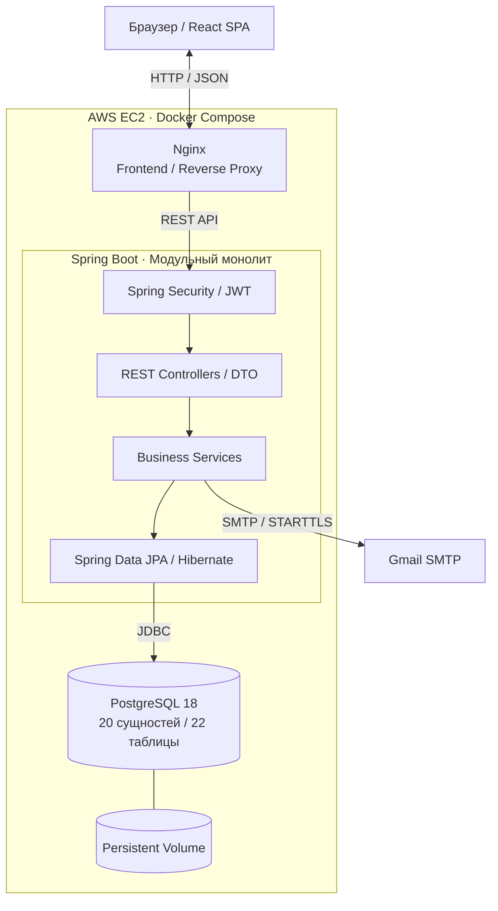

# CourseFlow — учебная платформа (LMS)

**Итоговый проект (сессионное задание). ORM-фреймворки для Java**

[](https://github.com/vkuryndin/CourseFlow/blob/master/VERSION)
[](https://github.com/vkuryndin/CourseFlow/actions/workflows/ci.yml)
[](https://github.com/vkuryndin/CourseFlow/actions/workflows/codeql.yml)
[](https://github.com/vkuryndin/CourseFlow/actions/workflows/performance.yml)
[](docs/TESTING.md)
[](docs/TESTING.md)
[](https://openjdk.org/projects/jdk/17/)
[](https://www.postgresql.org/)
[](https://react.dev/)

## О проекте

CourseFlow — веб-приложение для организации учебного процесса: от создания курса и записи студентов до выполнения заданий, проверки знаний и анализа успеваемости. В основе платформы — реляционная модель из 20 JPA-сущностей и 22 таблиц PostgreSQL. Доступ к данным обеспечивают 20 репозиториев Spring Data JPA и два репозитория специализированных запросов для электронного журнала и прогресса.

## Функциональные возможности

| Пользователь | Возможности |
|---|---|
| Гость | Просмотр каталога и преподавателей, поиск курсов, регистрация и вход |
| Студент | Запись на курсы, изучение материалов, сдача работ, прохождение тестов, расписание, оценки, прогресс и отзывы |
| Преподаватель | Управление курсами и учебными материалами, планирование занятий, создание заданий и тестов, оценивание работ, электронный журнал |
| Администратор | Управление пользователями, преподавателями, ролями, курсами, категориями и тегами, каталог внутри кабинета, статистика и мониторинг |

Один пользователь может совмещать несколько ролей. Восстановление пароля осуществляется по электронной почте.

## Технологический стек

| Область | Технологии |
|---|---|
| Серверная часть | Java 17, Spring Boot 4.1.2, Spring MVC, Spring Security, JWT, BCrypt |
| Доступ к данным | Spring Data JPA, Hibernate, PostgreSQL 18 |
| API | REST, JSON, Swagger UI, OpenAPI |
| Клиентская часть | React, TypeScript, Material UI, TanStack Query, Axios, TipTap, FullCalendar, Recharts |
| Сборка | Gradle Wrapper, Vite, npm |
| Тестирование | JUnit, Mockito, Testcontainers, ArchUnit, Vitest, Playwright |
| Качество кода | Spotless, SpotBugs, Checkstyle, JaCoCo, ESLint, CodeQL |
| Инфраструктура | Docker, Docker Compose, Nginx, GitHub Actions, GHCR, AWS EC2 |

## Архитектура



Серверная часть построена как модульный монолит со слоистой внутренней структурой: безопасность, REST-контроллеры, бизнес-сервисы и слой доступа к данным. Модули соответствуют предметным областям платформы. Клиентская часть представляет собой SPA на React с отдельными рабочими областями для каждой роли. Nginx отдаёт статические файлы приложения и проксирует запросы REST API. Данные хранятся в PostgreSQL, письма для восстановления пароля отправляются через Gmail SMTP.

Модель данных, связи между сущностями, структура модулей и дополнительные диаграммы приведены в [ARCHITECTURE.md](docs/ARCHITECTURE.md).

## Реализация учебного задания

В проекте реализован полный учебный цикл: управление пользователями и курсами, формирование структуры курса из модулей и уроков, запись студентов, выдача и проверка домашних работ, проведение тестов с сохранением результатов. Поддерживаются категории, теги и отзывы о курсах.

ORM-модель включает связи «один к одному», «один ко многим» и «многие ко многим». Настроены ленивая загрузка, каскадное сохранение, ограничения целостности и транзакции. Репозитории обеспечивают основные CRUD-операции; схема PostgreSQL формируется при запуске приложения. Конфигурация разделена по профилям.

Для работы с платформой разработаны REST API с валидацией и централизованной обработкой ошибок, документация OpenAPI и Swagger UI. Реализованы автоматическое наполнение базы, модульные и интеграционные тесты, контейнеризация и CI/CD.

## Дополнительные возможности и инженерные достижения

- **Архитектура:** межмодульные контракты, изоляция репозиториев, контроль зависимостей и слоёв, архитектурные тесты серверной и клиентской частей.
- **ORM и надёжность:** контроль количества запросов, оптимистические и пессимистические блокировки, проверки изоляции транзакций, конкурентных операций и восстановления после отказов БД.
- **Безопасность:** несколько ролей, контроль доступа к объектам, отзыв JWT, ограничение частоты запросов, асинхронное восстановление пароля, сохранение истории обучения при управлении аккаунтами.
- **Учебные процессы:** электронный журнал, аналитика, расписание, прогресс, хранение выбранных ответов и история попыток тестирования.
- **Клиентская часть:** полноценный React-интерфейс, визуальный редактор материалов, отложенная загрузка модулей, разделение сборки на части, серверная пагинация и кеширование запросов.
- **Инженерная инфраструктура:** расширенная автоматизированная регрессия, PostgreSQL Testcontainers, нагрузочные и браузерные тесты, анализ качества и безопасности кода, прикладные метрики и мониторинг.
- **Доставка:** публикация образов в GHCR, управляемое развёртывание на AWS, согласованная версионность компонентов.

Подробности и примеры реализации — в [ENGINEERING.md](docs/ENGINEERING.md).

## Тестирование и качество кода

Набор серверных проверок охватывает модульное, интеграционное, архитектурное и нагрузочное тестирование. Для интеграционных тестов Testcontainers автоматически запускает PostgreSQL 18 — тот же тип СУБД, который используется приложением. Проверяются CRUD, ограничения и связи ORM, ленивая загрузка, блокировки, параллельные операции, права доступа и REST API.

| Показатель | Количество сценариев |
|---|---:|
| Модульные тесты backend | 614 |
| Архитектурные тесты backend | 17 |
| Интеграционные тесты backend | 679 |
| Нагрузочные тесты | 14 |
| **Всего backend (по исходникам)** | **1324** |
| Модульные тесты frontend | 41 |
| Архитектурные тесты frontend | 7 |
| Браузерные тесты Playwright | 43 |
| Тесты анализатора сборки | 3 |
| **Всего frontend** | **94** |

В таблице приведён состав тестов по исходному коду, включая динамические и унаследованные сценарии. Playwright использует один набор из 43 сценариев для dev- и production-сборок. JaCoCo рассчитывает покрытие серверного кода задачей `test`; показатели последнего успешного CI отображаются в начале README.

Нагрузочные испытания охватывают до 500 виртуальных пользователей. В контрольном прогоне 25 ноября 2026 года обработано 204 337 HTTP-запросов, включая 40 ожидаемых ответов HTTP 429. Неожиданных ошибок не зарегистрировано. В течение 15 минут при 100 пользователях выполнено 88 746 запросов без ошибок. Подробные результаты приведены в [TESTING.md](docs/TESTING.md).

Spotless, SpotBugs, Checkstyle, ESLint и CodeQL используются для автоматизированного контроля качества и безопасности кода. Полный каталог тестов, команды и отчёты — в [TESTING.md](docs/TESTING.md).

## Установка и запуск

Для локальной разработки используются Java 17, Node.js 22, PostgreSQL 18 и Git. Настройки подключения к БД, JWT, SMTP и администратора приведены в [SETUP.md](docs/SETUP.md).

Backend запускается из IntelliJ IDEA конфигурацией `CourseFlowApplication`. Альтернативный запуск из корня проекта (PowerShell, после настройки переменных окружения):

```powershell
.\gradlew.bat bootRun
```

Запуск frontend в отдельном терминале:

```powershell
cd frontend
npm ci
npm run dev
```

| Компонент | Адрес |
|---|---|
| Frontend | http://localhost:5173 |
| Backend | http://localhost:8080 |
| Swagger UI (профиль `dev`) | http://localhost:8080/swagger-ui/index.html |

Для контейнерного запуска заполните `.env` по шаблону `.env.example` и выполните:

```bash
docker compose pull
docker compose up -d
```

По умолчанию приложение доступно на http://localhost:8081. Полный перечень операций API приведён в [API.md](docs/API.md).

## Демонстрационные данные

При первом запуске приложения в обычном профиле база автоматически наполняется учебными данными.

| Объект | Количество |
|---|---:|
| Демонстрационные аккаунты | 60 |
| Курсы / модули / уроки | 16 / 48 / 144 |
| Занятия | 96 |
| Задания / тесты | 48 / 48 |
| Записи студентов на курсы | 200 |

Дополнительно формируются работы студентов, результаты тестирования, оценки и отзывы. Системный администратор создаётся отдельно.

Email и пароль системного администратора по умолчанию задаются в конфигурации запуска через `COURSEFLOW_ADMIN_EMAIL` и `COURSEFLOW_ADMIN_PASSWORD`.

Данные остальных демонстрационных аккаунтов сохраняются в каталоге `~/.courseflow/`.

## Демонстрационная версия на AWS

**[Открыть CourseFlow](http://3.79.152.70:8081)**

Приложение развёрнуто на AWS EC2 (t3.micro, Ubuntu 24.04) в трёх контейнерах: React/Nginx, Spring Boot и PostgreSQL. База данных хранится в постоянном томе Docker. Демонстрационная среда предназначена для учебных данных. Ограничение текущего развёртывания — HTTP без TLS; поддержка HTTPS относится к дальнейшему развитию.

## CI/CD и развёртывание

| Процесс | Режим запуска |
|---|---|
| [CourseFlow CI](https://github.com/vkuryndin/CourseFlow/actions/workflows/ci.yml) | Автоматический и ручной |
| [CourseFlow CodeQL](https://github.com/vkuryndin/CourseFlow/actions/workflows/codeql.yml) | Автоматический и ручной |
| [CourseFlow Performance Tests](https://github.com/vkuryndin/CourseFlow/actions/workflows/performance.yml) | Ручной |
| [CourseFlow Deploy to AWS](https://github.com/vkuryndin/CourseFlow/actions/workflows/deploy.yml) | Ручной |

CI выполняет серверные проверки, все семь архитектурных тестов frontend, Vitest, тесты анализатора сборки, статическую проверку API-контракта, production-сборку, анализ чанков и Playwright на собранном приложении. После успешной проверки ветки `master` образы backend и frontend публикуются в GitHub Container Registry (GHCR). Ручной процесс доставки обновляет приложение на AWS через SSH и проверяет состояние контейнеров.

## Управление версиями

Номер версии задаётся в корневом файле `VERSION`. Команда `node frontend/scripts/sync-version.mjs` синхронизирует метаданные frontend. Gradle и OpenAPI используют номер версии приложения; CI присваивает Docker-образам теги версии, Git SHA и `latest`. Данные сборки отображаются в системной информации.

## Дальнейшее развитие

- Продление пользовательской сессии без повторного входа каждый час: обновление access-токена с сохранением возможности отзыва сессии.
- Загрузка, хранение и отображение фотографий пользователей в профилях и списках участников курсов.
- Почтовые уведомления о новых заданиях, оценках, занятиях и приближении сроков сдачи; настройки подписки, повторные попытки отправки и журнал доставки.
- Сертификаты об окончании курса, расширение аналитики и электронного журнала.
- Версионируемые миграции схемы БД, резервное копирование и автоматический откат при неудачном развёртывании.
- Поддержка HTTPS при дальнейшем развитии инфраструктуры.

## Документация

- [ARCHITECTURE.md](docs/ARCHITECTURE.md) — архитектура, модули, модель данных и ORM.
- [API.md](docs/API.md) — REST API, правила доступа и примеры запросов.
- [TESTING.md](docs/TESTING.md) — тестирование, качество кода, команды и каталог сценариев.
- [ENGINEERING.md](docs/ENGINEERING.md) — дополнительные инженерные решения.
- [SETUP.md](docs/SETUP.md) — настройка среды, запуск и развёртывание.
