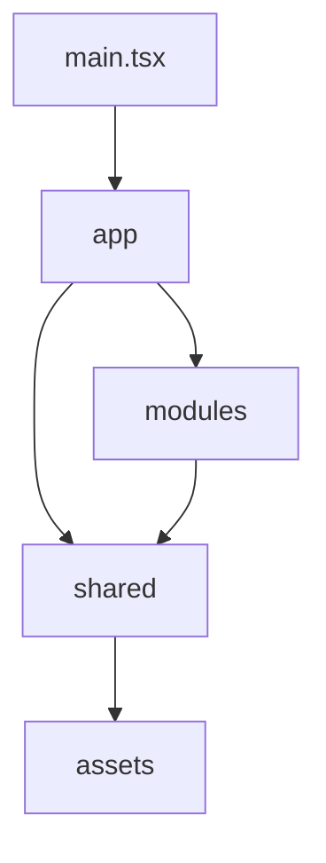
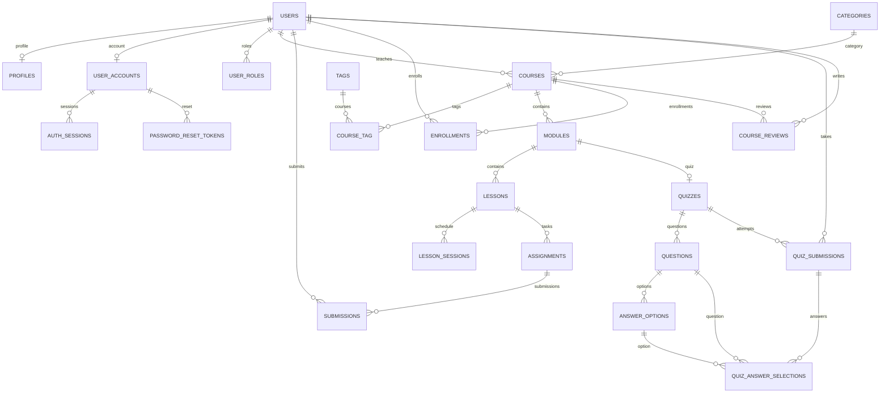
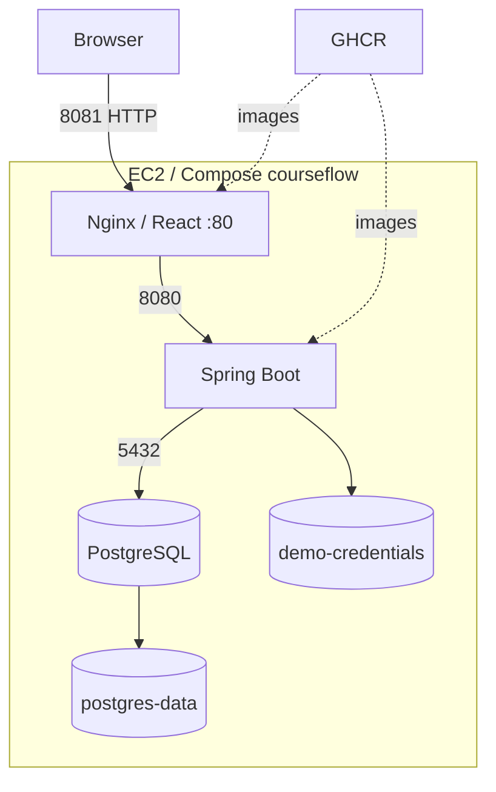

# CourseFlow — архитектура

[README](../README.md) · [API](API.md) · [Инженерные решения](ENGINEERING.md) · [Настройка](SETUP.md)

## 1. Архитектурные принципы

Модульный монолит: один Spring Boot процесс и одна PostgreSQL. Функциональные границы проходят внутри Java-приложения, а не по сети. REST-контроллеры работают с DTO; сервисы реализуют бизнес-правила и транзакции; репозитории инкапсулируют запросы. Межмодульные операции используют публичные Java-контракты в пакетах `api`. Внутренние сервисы и репозитории доступны только своему модулю. JPA-сущности могут ссылаться на сущности других модулей; модель данных остаётся общей.

## 2. Backend

Корневой пакет: `org.courseflow`.

| Модуль | Ответственность |
|---|---|
| identity | Пользователь, профиль, роли и состояние |
| auth | Учётная запись, вход, выход, пароль, сессии, сброс пароля |
| catalog | Курсы, категории, теги |
| content | Модули, уроки, занятия |
| learning | Записи, задания, работы, прогресс, электронный журнал |
| assessment | Тесты, вопросы, варианты ответа, попытки |
| review | Отзывы и рейтинг |
| dashboard | Агрегированные показатели по ролям |
| security | JWT, авторизация, CORS |
| common | Валидация, ошибки, REST-утилиты, диагностика, метрики |
| demo | Демонстрационное наполнение |

Типовые подкаталоги: `controller`, `dto`, `service`, `repository`, `entity`, `api`. `ArchitectureTest` проверяет правила зависимостей, слои и границы модулей. Подробности проверок — в [TESTING.md](TESTING.md).

### Публичные контракты модулей

| Модуль | Контракты |
|---|---|
| identity | `UserDirectory`, `StudentAccess` |
| auth | `SessionAccess`, `AccountCreator`, `CredentialLifecycle`, `AccessTokenIssuer` |
| catalog | `CourseGuard`, `CourseAccessPolicy`, `CourseParticipation` |
| content | `ContentStructure`, `ContentAccessService`, `LessonScheduleChecks` |
| learning | `AssignmentAccess`, `EnrollmentAccess`, `ProgressQuery` |
| assessment | `QuizAccess` |
| review | `ReviewAccess` |

`ProgressQuery` предоставляет дашборду сводные данные о прогрессе; интерфейс реализован в `ProgressService`. Межмодульные операции выполняются в транзакциях и используют общую ORM-модель.

Предметные модули имеют взаимные зависимости, связанные с проверками бизнес-правил и общей ORM-моделью. Например, при удалении курса проверяется наличие учебных материалов, записей и отзывов, а при записи студента — состояние курса. Полная ацикличность предметных модулей не обеспечивается. `ArchitectureTest` выводит диагностику межмодульных циклов отдельно для полного графа и графа без связей пакетов `entity`. Эта диагностика не влияет на результат тестов. Обязательные архитектурные проверки контролируют границы слоёв, доступ к внутренним сервисам и репозиториям, независимость инфраструктуры и отсутствие циклов конструкторных зависимостей Spring-компонентов. Двунаправленные JPA-связи не являются циклами внедрения зависимостей Spring.

`common` не зависит от других модулей CourseFlow. Общая политика публичных маршрутов (`common.api.PublicEndpoints`) используется OpenAPI и настройкой авторизации; `common.security.CurrentUser` предоставляет вспомогательные операции работы с текущим пользователем. Модуль `auth` выпускает токены через `auth.api.AccessTokenIssuer`, реализованный `security.JwtService`. Предметные модули не зависят от реализации `security`; это ограничение проверяется ArchUnit.

Для электронного журнала, прогресса, истории обучения и дашбордов допустимы межмодульные JPQL-запросы на чтение поверх общей базы. Они не дают права обращаться к чужим репозиториям или выполнять произвольные изменения данных другого модуля. Демо-инициализация работает с общей ORM-моделью. ArchUnit проверяет зависимости Java-классов, а не содержимое строк JPQL.

## 3. Frontend

Клиентская часть — SPA на React и TypeScript. Слои организованы по направлению зависимостей:

| Слой | Ответственность |
|---|---|
| `main.tsx` | Точка входа и подключение приложения |
| `app` | Маршруты, рабочие области, общая оболочка, ленивые точки входа |
| `modules` | Функциональные страницы и их внутренние компоненты |
| `shared` | API-клиент, состояние авторизации, контракты, формы, общие компоненты и утилиты |
| `assets` | Изображения и статические ресурсы |

Функциональные точки входа: `catalog`, `identity`, `dashboard`, `teaching`, `editor`, `learning`, `schedule`, `monitoring`, `system-info`, `teacher-search`. Межмодульные импорты разрешены только через точки входа и для явно согласованных направлений: `dashboard → teaching`, `monitoring → system-info`, `schedule → learning`, `catalog → teacher-search`. Эти зависимости не образуют циклов. `shared` не зависит от функциональных модулей или оболочки. HTTP-транспорт сосредоточен в `shared/api.ts`; TanStack Query отвечает за кеш и обновление данных.

Семь проверок в `scripts/architecture.test.mjs` и `scripts/structure.test.cjs` контролируют разрешение импортов, границы слоёв, точки входа, отсутствие циклов (включая реэкспорты и литеральные динамические импорты), централизацию HTTP и имена файлов. Все семь запускаются через `npm run test:architecture` и в CI. Статическая проверка API-контракта использует `shared/contract.json`.

Каталог гостя, студента и администратора использует общие компоненты; внутренние маршруты `/student/catalog` и `/admin/catalog` сохраняют оболочку соответствующего кабинета, в том числе на страницах курса и преподавателя. Авторизация хранит токен в `sessionStorage`; он передаётся в заголовке Authorization. Восстановление пароля вызывает два существующих REST API последовательно; адрес электронной почты временно сохраняется в `localStorage`, пароль и токен восстановления там не сохраняются. Подробности — в [API.md](API.md).

Маршруты загружаются через `React.lazy` и `Suspense`. TipTap и административный дашборд загружаются отдельно. Vite формирует чанки и манифест, по которому `scripts/bundle-report.cjs` проверяет отсутствие тяжёлых функций в начальной загрузке гостя и оценивает размеры JS и gzip. Nginx отдаёт SPA и проксирует API; HTML учебных материалов очищается DOMPurify.

## 4. ORM и модель данных

20 сущностей, 20 репозиториев; 22 бизнес-таблицы с учётом `user_roles` и `course_tag`. Для однократной загрузки демонстрационных данных используется отдельная последовательность PostgreSQL.

| Модуль | Сущность | Таблица / назначение |
|---|---|---|
| identity | User | users — пользователь и роли |
| identity | Profile | profiles — профиль |
| auth | UserAccount | user_accounts — пароль и состояние учётной записи |
| auth | AuthSession | auth_sessions — состояние токена/сессии |
| auth | PasswordResetToken | password_reset_tokens — восстановление пароля |
| catalog | Category | categories — классификация |
| catalog | Tag | tags — метки |
| catalog | Course | courses — курс, преподаватель, категория |
| content | Module | modules — раздел курса |
| content | Lesson | lessons — урок |
| content | LessonSession | lesson_sessions — занятие |
| learning | Enrollment | enrollments — запись на курс |
| learning | Assignment | assignments — домашнее задание |
| learning | Submission | submissions — работа студента |
| assessment | Quiz | quizzes — тест модуля |
| assessment | Question | questions — вопрос |
| assessment | AnswerOption | answer_options — вариант ответа |
| assessment | QuizSubmission | quiz_submissions — попытка тестирования |
| assessment | QuizAnswerSelection | quiz_answer_selections — выбор варианта |
| review | CourseReview | course_reviews — отзыв и оценка |

### ER-диаграмма

Диаграмма отражает связи таблиц, включая необязательные связи 1:1 и две таблицы связей.

## 5. ORM-механизмы

| Механизм | Пример |
|---|---|
| `@OneToOne` | Profile–User, UserAccount–User, Quiz–Module |
| `@OneToMany` / `@ManyToOne` | Course–Module, Module–Lesson, Quiz–Question |
| `@ManyToMany` | Course–Tag, таблица course_tag |
| `@ElementCollection` | User.roles, таблица user_roles |
| Каскадное сохранение | `CascadeType.PERSIST` в Course, Quiz, Question и др.; удаление зависимостей контролируется сервисами |
| Lazy | Коллекции и связи с одиночными объектами; `open-in-view=false` |
| Загрузка данных | `@EntityGraph` в EnrollmentRepository; batch fetch size 32; JPQL, проекции, выборки по страницам |
| Оптимистическая блокировка | `@Version` в User, Course, Assignment, Question, Quiz и других редактируемых сущностях |
| Пессимистическая блокировка | CourseRepository, UserRepository, QuizSubmissionRepository, SubmissionRepository |

`LazyInitializationIT` воспроизводит LazyInitializationException и проверяет способы обхода. `OrmPersistenceIT`, `QueryEfficiencyIT`, `PostgresLockingIT`, `TransactionIsolationIT`, `AdvancedIntegrityIT` проверяют ORM и PostgreSQL.

## 6. Транзакции и целостность

Сервисы задают транзакционные границы; чтение использует транзакции с `readOnly=true` для соответствующих операций. PostgreSQL обеспечивает FK, UNIQUE, CHECK и блокировки. `DatabaseInvariantInitializer` добавляет индексы, ограничения позиций и оценок, уникальность системного администратора, регистронезависимые ограничения категорий/тегов; сериализация инициализации через advisory lock. Ограничения проверяются совместно с сервисной валидацией. `dev` и `aws` используют `ddl-auto=update`, `test` — `create`. 

## 7. Безопасность

JWT HS256, проверка срока действия/issuer/сессии; Spring Security работает без HTTP-сессии, но состояние авторизации хранится в БД (`AuthSession`). BCrypt; роли STUDENT/TEACHER/ADMIN, проверка владения и доступа к данным. Отзыв сессий при изменении учётных данных и деактивации; защита системного и последнего администратора. Восстановление пароля через Gmail SMTP и асинхронную обработку, rate limiting. CORS с явными origin, без credentials; CSRF отключён для bearer-only API, не использующего cookie для аутентификации. Nginx заменяет входящие proxy-заголовки, добавляет CSP и защитные заголовки.

## 8. Развёртывание

Три контейнера работают в отдельной bridge-сети; данные сохраняются в постоянных томах. Внешний доступ осуществляется через Nginx по HTTP на порту 8081. Backend и PostgreSQL доступны внутри сети Docker. Настроены health checks, graceful shutdown backend, политика перезапуска `unless-stopped`, ограничения памяти и ротация логов. TLS в учебной среде не настроен. Детали — [SETUP.md](SETUP.md).
