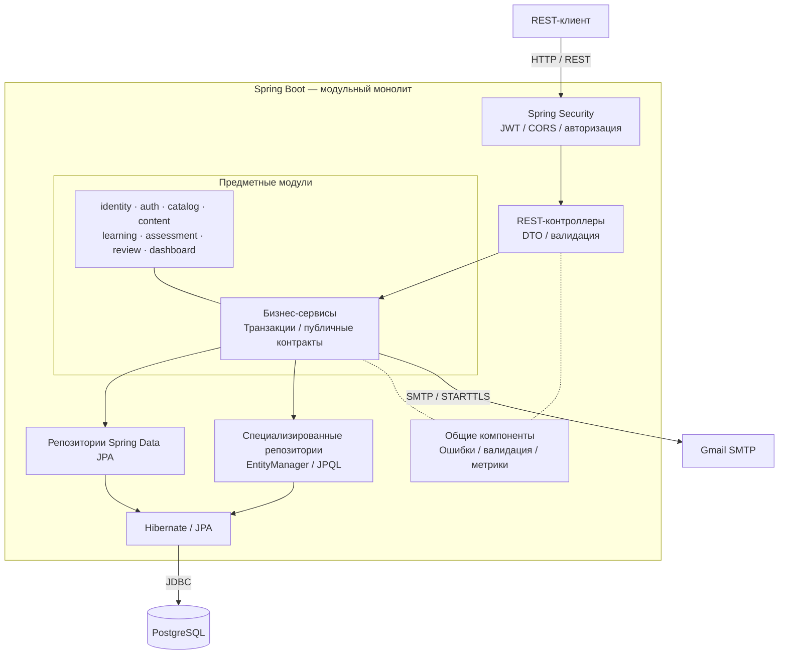
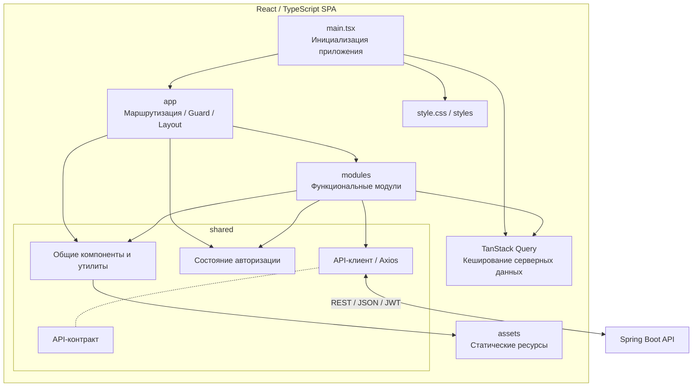
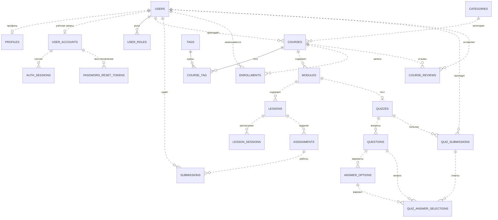
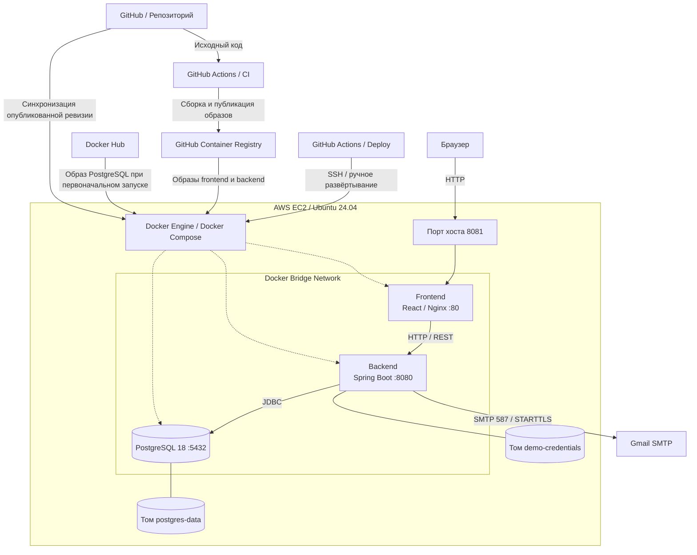

# CourseFlow — архитектура

[README](../README.md) · [API](API.md) · [Инженерные решения](ENGINEERING.md) · [Настройка](SETUP.md)

## 1. Архитектурные принципы

Модульный монолит: один Spring Boot процесс и одна PostgreSQL. Функциональные границы определены внутри Java-приложения. REST-контроллеры работают с DTO; сервисы реализуют бизнес-правила и транзакции; репозитории инкапсулируют запросы. Межмодульные операции используют публичные Java-контракты в пакетах `api`. Внутренние сервисы и репозитории доступны только своему модулю. JPA-сущности могут ссылаться на сущности других модулей; модель данных остаётся общей.

## 2. Backend

Корневой пакет: `org.courseflow`.

| Модуль | Ответственность |
|---|---|
| identity | Пользователь, профиль, роли и состояние |
| auth | Учётная запись, вход, выход, пароль, сессии, сброс пароля |
| catalog | Курсы, категории, теги |
| content | Модули, уроки, занятия |
| learning | Записи, задания, работы, прогресс, электронный журнал |
| assessment | Тесты, вопросы, варианты ответа, попытки |
| review | Отзывы и рейтинг |
| dashboard | Агрегированные показатели по ролям |
| security | JWT, авторизация, CORS |
| common | Валидация, ошибки, REST-утилиты, диагностика, метрики |
| demo | Демонстрационное наполнение |

Типовые подкаталоги: `controller`, `dto`, `service`, `repository`, `entity`, `api`. `ArchitectureTest` проверяет правила зависимостей, слои и границы модулей. Подробности проверок — в [TESTING.md](TESTING.md).

### Логическая архитектура backend

Spring Security обрабатывает запросы до контроллеров. Публичные операции доступны без JWT; для защищённых операций проверяются токен, состояние сессии и права доступа. Сервисы дополнительно проверяют бизнес-правила и доступ к конкретным объектам. Специализированные репозитории электронного журнала и прогресса выполняют запросы через `EntityManager`. Схема отражает логические компоненты и потоки вызовов. Модуль `demo` используется для инициализации данных.

### Публичные контракты модулей

| Модуль | Контракты |
|---|---|
| identity | `UserDirectory`, `StudentAccess` |
| auth | `SessionAccess`, `AccountCreator`, `CredentialLifecycle`, `AccessTokenIssuer` |
| catalog | `CourseGuard`, `CourseAccessPolicy`, `CourseParticipation` |
| content | `ContentStructure`, `ContentAccessService`, `LessonScheduleChecks` |
| learning | `AssignmentAccess`, `EnrollmentAccess`, `ProgressQuery` |
| assessment | `QuizAccess` |
| review | `ReviewAccess` |

`ProgressQuery` предоставляет дашборду сводные данные о прогрессе; интерфейс реализован в `ProgressService`. Межмодульные операции выполняются в транзакциях и используют общую ORM-модель.

Предметные модули имеют взаимные зависимости, связанные с проверками бизнес-правил и общей ORM-моделью. Например, при удалении курса проверяется наличие учебных материалов, записей и отзывов, а при записи студента — состояние курса. Полная ацикличность предметных модулей не обеспечивается. `ArchitectureTest` выводит диагностику межмодульных циклов отдельно для полного графа и графа без связей пакетов `entity`. Эта диагностика не влияет на результат тестов. Обязательные архитектурные проверки контролируют границы слоёв, доступ к внутренним сервисам и репозиториям, независимость инфраструктуры и отсутствие циклов конструкторных зависимостей Spring-компонентов. Двунаправленные JPA-связи не являются циклами внедрения зависимостей Spring.

`common` не зависит от других модулей CourseFlow. Общая политика публичных маршрутов (`common.api.PublicEndpoints`) используется OpenAPI и настройкой авторизации; `common.security.CurrentUser` предоставляет вспомогательные операции работы с текущим пользователем. Модуль `auth` выпускает токены через `auth.api.AccessTokenIssuer`, реализованный `security.JwtService`. Предметные модули не зависят от реализации `security`; это ограничение проверяется ArchUnit.

Для электронного журнала, прогресса, истории обучения и дашбордов допустимы межмодульные JPQL-запросы на чтение поверх общей базы. Они не дают права обращаться к чужим репозиториям или выполнять произвольные изменения данных другого модуля. Демо-инициализация работает с общей ORM-моделью. ArchUnit анализирует зависимости Java-классов.

## 3. Frontend

Клиентская часть — SPA на React и TypeScript.

Схема показывает логические компоненты и их взаимодействие. `contract.json` применяется для статической проверки API, поэтому связь с API-клиентом показана пунктиром.

| Слой | Ответственность |
|---|---|
| `main.tsx` | Точка входа, подключение темы, маршрутизатора и провайдеров |
| `app` | Маршруты, рабочие области, общая оболочка, ленивые точки входа |
| `modules` | Функциональные страницы и их внутренние компоненты |
| `shared` | API-клиент, состояние авторизации, контракты, формы, общие компоненты и утилиты |
| `assets` | Изображения и статические ресурсы |
| `styles`, `style.css` | Стили приложения |

Функциональные точки входа: `catalog`, `identity`, `dashboard`, `teaching`, `editor`, `learning`, `schedule`, `monitoring`, `system-info`, `teacher-search`. Межмодульные импорты разрешены только через точки входа и для явно согласованных направлений: `dashboard → teaching`, `monitoring → system-info`, `schedule → learning`, `catalog → teacher-search`. Эти зависимости не образуют циклов. `shared` не зависит от функциональных модулей или оболочки. HTTP-транспорт сосредоточен в `shared/api.ts`; TanStack Query отвечает за кеш и обновление данных.

Семь проверок в `scripts/architecture.test.mjs` и `scripts/structure.test.cjs` контролируют разрешение импортов, границы слоёв, точки входа, отсутствие циклов (включая реэкспорты и литеральные динамические импорты), централизацию HTTP и имена файлов. Все семь запускаются через `npm run test:architecture` и в CI. Статическая проверка API-контракта использует `shared/contract.json`.

Каталог гостя, студента и администратора использует общие компоненты; внутренние маршруты `/student/catalog` и `/admin/catalog` сохраняют оболочку соответствующего кабинета, в том числе на страницах курса и преподавателя. Авторизация хранит токен в `sessionStorage`; он передаётся в заголовке Authorization. Восстановление пароля вызывает два существующих REST API последовательно; адрес электронной почты временно сохраняется в `localStorage`, пароль и токен восстановления там не сохраняются. Подробности — в [API.md](API.md).

Nginx отдаёт SPA и проксирует API. Оптимизация загрузки клиентской сборки описана в [ENGINEERING.md](ENGINEERING.md#6-клиентская-часть).

## 4. ORM и модель данных

20 JPA-сущностей, 22 таблицы с учётом `user_roles` и `course_tag`, 20 репозиториев Spring Data JPA и два репозитория специализированных запросов для электронного журнала и прогресса. Для однократной загрузки демонстрационных данных используется отдельная последовательность PostgreSQL.

| Модуль | Сущность | Таблица / назначение | Основные поля | Ограничения |
|---|---|---|---|---|
| identity | User | users — пользователь и роли | displayName, email, status, systemAdmin, roles, createdAt, deletedAt | Уникальный email; не более одного системного администратора; уникальная пара user_id и role |
| identity | Profile | profiles — профиль | user, bio, avatarUrl | Уникальный user_id (1:1) |
| auth | UserAccount | user_accounts — пароль и состояние учётной записи | user, passwordHash, passwordChangeRequired, createdAt | Уникальный user_id; пароль хранится как хеш |
| auth | AuthSession | auth_sessions — состояние токена/сессии | id (UUID), userAccount, createdAt, expiresAt, revoked | Обязательная ссылка на учётную запись |
| auth | PasswordResetToken | password_reset_tokens — восстановление пароля | userAccount, tokenHash, expiresAt, usedAt | Уникальный token_hash; одноразовое использование |
| catalog | Category | categories — классификация | name, description | Уникальное название, в том числе без учёта регистра |
| catalog | Tag | tags — метки | name | Уникальное название, в том числе без учёта регистра |
| catalog | Course | courses — курс, преподаватель, категория | title, description, category, teacher, duration, startDate, status | Обязательные category_id и teacher_id; duration > 0, в днях |
| content | Module | modules — раздел курса | course, title, description, position | Уникальная позиция внутри курса; position > 0 |
| content | Lesson | lessons — урок | module, title, content, videoUrl, position | Уникальная позиция внутри модуля; position > 0 |
| content | LessonSession | lesson_sessions — занятие | lesson, startsAt, endsAt, format, meetingUrl | endsAt > startsAt; пересечения расписания преподавателя контролируются сервисом |
| learning | Enrollment | enrollments — запись на курс | student, course, enrolledAt, endedAt, status | UNIQUE(student_id, course_id) |
| learning | Assignment | assignments — домашнее задание | lesson, title, description, dueAt, maxScore | maxScore > 0 |
| learning | Submission | submissions — работа студента | assignment, student, content, submittedAt, status, score, feedback | UNIQUE(assignment_id, student_id); score ≥ 0 или NULL; верхняя граница проверяется сервисом |
| assessment | Quiz | quizzes — тест модуля | module, title, timeLimit, maxAttempts | Уникальный module_id; время 1–240 минут, число попыток 1–10 (по умолчанию 2) |
| assessment | Question | questions — вопрос | quiz, text, type, position | Уникальная позиция внутри теста; position > 0 |
| assessment | AnswerOption | answer_options — вариант ответа | question, text, correct | Обязательный question_id; составной внешний ключ при сохранении выбора проверяет принадлежность варианта вопросу |
| assessment | QuizSubmission | quiz_submissions — попытка тестирования | quiz, student, attemptNumber, score, takenAt, expiresAt, finishedAt, status | UNIQUE(quiz_id, student_id, attempt_number); номер > 0, результат 0–100 или NULL; expiresAt > takenAt |
| assessment | QuizAnswerSelection | quiz_answer_selections — выбор варианта | quizSubmission, question, answerOption | Уникальная тройка FK; составной FK обеспечивает принадлежность варианта вопросу |
| review | CourseReview | course_reviews — отзыв и оценка | course, student, rating, comment, createdAt | UNIQUE(course_id, student_id); rating 1–5 |

У всех сущностей есть собственный первичный ключ `id`. В таблице перечислены основные атрибуты без служебных полей версионности. Ограничения обеспечиваются JPA, дополнительными индексами и `CHECK` в `DatabaseInvariantInitializer`, а также сервисными проверками там, где правило зависит от нескольких объектов.

### Диаграмма сущностей и связей (ER-диаграмма)

ER (Entity–Relationship) — модель сущностей и связей. Диаграмма представляет 22 таблицы PostgreSQL и 27 связей в нотации Crow’s Foot («воронья лапка»). Обозначения `||` — ровно один, `o|` — ноль или один, `o{` — ноль или несколько. Пунктирные линии обозначают неидентифицирующие связи; сплошные линии обозначают идентифицирующие связи таблиц `user_roles` и `course_tag`. Кратность определяется ORM-моделью и ограничениями базы данных.

Дополнительный составной внешний ключ `fk_cf_selection_option_question` связывает `(answer_option_id, question_id)` таблицы `quiz_answer_selections` с `(id, question_id)` таблицы `answer_options`. Он гарантирует принадлежность выбранного варианта указанному вопросу. На диаграмме этот ключ представлен вместе со связями выбранного ответа с вопросом и вариантом.

## 5. ORM-механизмы

| Механизм | Пример |
|---|---|
| `@OneToOne` | Profile–User, UserAccount–User, Quiz–Module |
| `@OneToMany` / `@ManyToOne` | Course–Module, Module–Lesson, Quiz–Question |
| `@ManyToMany` | Course–Tag, таблица course_tag |
| `@ElementCollection` | User.roles, таблица user_roles |
| Каскадное сохранение | `CascadeType.PERSIST` в Course, Quiz, Question и др.; удаление зависимостей контролируется сервисами |
| Lazy | Коллекции и связи с одиночными объектами; `open-in-view=false` |
| Загрузка данных | `@EntityGraph` в EnrollmentRepository; batch fetch size 32; JPQL, проекции, выборки по страницам |
| Оптимистическая блокировка | `@Version` в User, Course, Assignment, Question, Quiz и других редактируемых сущностях |
| Пессимистическая блокировка | CourseRepository, UserRepository, QuizSubmissionRepository, SubmissionRepository |

`LazyInitializationIT` воспроизводит LazyInitializationException и проверяет способы обхода. `OrmPersistenceIT`, `QueryEfficiencyIT`, `PostgresLockingIT`, `TransactionIsolationIT`, `AdvancedIntegrityIT` проверяют ORM и PostgreSQL.

### Основные бизнес-правила

| Область | Правило |
|---|---|
| Пользователи | Деактивация блокирует вход и отзывает сессии, но сохраняет учебные связи. При окончательном удалении учётная запись удаляется, а пользователь обезличивается; учитываются действующие записи и назначенные курсы. Системный и последний администратор защищены. |
| Курсы | Преподаватель управляет собственными курсами; только администратор может сменить преподавателя через `PUT /api/courses/{courseId}/teacher`. Новый преподаватель должен быть активным, иметь роль TEACHER и не иметь активной записи на курс в качестве студента; для активного курса проверяется совместимость расписания. Проверяется версия курса. Архивирование невозможно при незавершённых занятиях. Курс с зависимыми учебными объектами не удаляется физически. |
| Запись на курс | Один объект Enrollment на студента и курс. Повторная запись возвращает существующую активную запись или восстанавливает ранее прекращённую. Отписка сохраняет историю. |
| Учебные материалы | ADMIN, преподаватель курса и студент с активной записью могут читать закрытые материалы. Модули и каталог доступны без JWT. |
| Расписание | Начало занятия предшествует окончанию; пересечения занятий одного преподавателя запрещены. |
| Домашние задания | Одна сдача на студента и задание; требуются активная запись и соблюдение срока сдачи. Оценка не превышает maxScore. |
| Тестирование | На модуль приходится не более одного теста. Число попыток и время ограничены; правильные варианты не выдаются студенту во время активной попытки. Выбранные ответы сохраняются. |
| Отзывы | Один отзыв на студента и курс, рейтинг от 1 до 5. Для изменения отзыва требуется активная запись на активный курс; преподаватель не оценивает собственный курс. |

Электронный журнал объединяет результаты заданий и тестов с фильтрацией и пагинацией. Прогресс рассчитывается по сохранённым данным учебного процесса. Календарь объединяет занятия и сроки сдачи работ.

## 6. Транзакции и целостность

Сервисы задают транзакционные границы; чтение использует транзакции с `readOnly=true` для соответствующих операций. PostgreSQL обеспечивает FK, UNIQUE, CHECK и блокировки. `DatabaseInvariantInitializer` добавляет индексы, ограничения позиций и оценок, уникальность системного администратора, регистронезависимые ограничения категорий/тегов; сериализация инициализации через advisory lock. Ограничения проверяются совместно с сервисной валидацией. `dev` и `aws` используют `ddl-auto=update`, `test` — `create`. 

## 7. Безопасность

Spring Security защищает REST API с помощью JWT HS256, срок действия токена — один час. Авторизация учитывает роли STUDENT, TEACHER и ADMIN, владение ресурсами и активные записи на курсы. HTTP-сессии не используются; состояние выданных токенов хранится в `AuthSession`. CORS использует явно разрешённые источники запросов без credentials; для bearer-only API отключена CSRF-защита. Механизмы отзыва токенов, защиты паролей и ограничения запросов описаны в [ENGINEERING.md](ENGINEERING.md#5-безопасность).

## 8. Развёртывание

Три контейнера работают в отдельной bridge-сети. Постоянные тома PostgreSQL и демонстрационных учётных данных принадлежат Docker Engine. Docker Compose публикует порт хоста 8081 на адресе `COURSEFLOW_BIND_ADDRESS` (по умолчанию `127.0.0.1`) с перенаправлением на порт 80 контейнера Nginx. Backend и PostgreSQL доступны внутри сети Docker. При ручном развёртывании загружаются опубликованные образы frontend и backend, проверяется совпадение их ревизий, синхронизируется исходный код и обновляются только эти два контейнера. Контейнер PostgreSQL при этом не пересоздаётся. Текущее развёртывание использует HTTP. Параметры запуска — в [SETUP.md](SETUP.md); эксплуатационные решения — в [ENGINEERING.md](ENGINEERING.md#9-доставка-и-эксплуатация).
