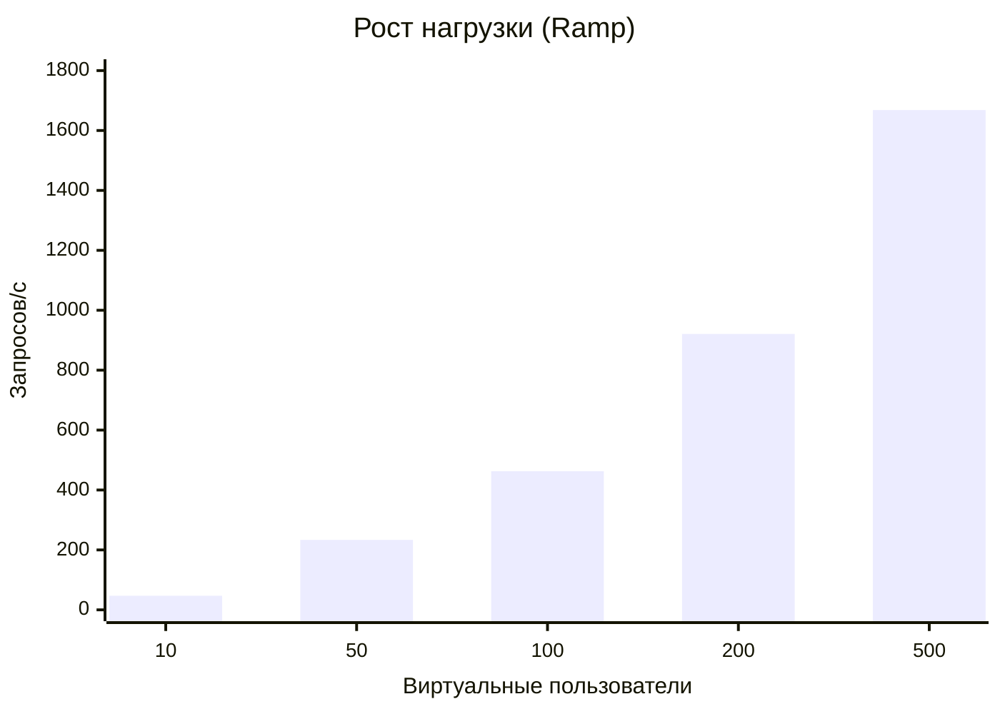

# CourseFlow — тестирование и качество кода

[README](../README.md) · [Архитектура](ARCHITECTURE.md) · [Настройка среды](SETUP.md)

## 1. Стратегия тестирования

Тесты разделены по уровню и назначению. Модульные проверки изолируют бизнес-логику, интеграционные запускают контекст Spring и реальный PostgreSQL, архитектурные контролируют зависимости, нагрузочные моделируют одновременную работу пользователей. Клиентские тесты проверяют преобразование данных, интерфейс и навигацию.

| Уровень | Инструменты | Область проверки |
|---|---|---|
| Модульный | JUnit, Mockito | Сервисы, доменная модель, контроллеры, DTO, валидация, безопасность |
| Интеграционный | Spring Boot, PostgreSQL Testcontainers | REST API, CRUD, бизнес-операции, ограничения БД |
| ORM | JPA, Hibernate, PostgreSQL | Связи, каскады, ленивая загрузка, число запросов |
| Конкурентный | JUnit, PostgreSQL | Блокировки, изоляция, параллельные операции, откат |
| Архитектурный | ArchUnit, Node.js Test Runner | Границы модулей, зависимости слоёв, циклы конструкторных зависимостей backend и циклы импортов frontend, HTTP-транспорт |
| Нагрузочный | JUnit, параллельные HTTP-клиенты | Задержки, пропускная способность, устойчивость |
| Клиентский | Vitest | Формы, календарь, пагинация, контракты, электронный журнал |
| Браузерный функциональный | Playwright | Пользовательские сценарии с имитацией ответов backend |
| Проверка API | IntelliJ HTTP Client, Swagger UI | Ручные запросы и последовательная REST-регрессия |

Testcontainers запускает PostgreSQL 18 в Docker и передаёт параметры JDBC в тестовый контекст. Профиль `test` создаёт схему заново. Поддерживаются локальный Docker, удалённый Docker через SSH и GitHub Actions. Порядок настройки описан в [SETUP.md](SETUP.md).

## 2. Основные серверные проверки

- CRUD и сохранение графов сущностей, каскады, FK, UNIQUE, CHECK, удаление зависимостей.
- Ленивые коллекции: воспроизведение `LazyInitializationException`, загрузка внутри транзакции, `JOIN FETCH`.
- Эффективность SQL-запросов при росте числа объектов, оптимизация выборок и электронного журнала.
- Оптимистические и пессимистические блокировки, взаимные блокировки и таймауты PostgreSQL, уровни изоляции READ COMMITTED, REPEATABLE READ и SERIALIZABLE.
- Аутентификация, права доступа к объектам, отзыв сессий, ограничение частоты запросов и защита от подмены proxy-заголовков.
- Валидация границ длины полей, числовых значений и времени; HTTP-статусы и контракты API.
- Конкурентная регистрация, запись студентов, сдача заданий, прохождение тестов, оценивание, очистка просроченных попыток.
- Восстановление после исчерпания пула соединений, недоступности БД и прерывания транзакции; сохранение данных при повторном запуске.

## 3. Нагрузочное тестирование

`PerformanceIT` содержит девять основных сценариев: чтение каталога и уроков, параллельную запись на курсы, сдачу заданий, прохождение тестов, электронный журнал и смешанные нагрузки. В них моделируются до 100 пользователей одновременно.

`AdvancedPerformanceIT` добавляет пять сценариев: ступенчатое увеличение нагрузки, насыщение без пауз между запросами, резкий всплеск и восстановление, продолжительную нагрузку и интенсивную аутентификацию с действующим ограничителем запросов.

Набор проверяет HTTP-статусы и содержимое ответов, задержки, пропускную способность, конкурентность, сохранность данных и восстановление после нагрузки. Расширенные сценарии контролируют также ошибки телеметрии, взаимные блокировки PostgreSQL и состояние пула соединений. Телеметрия записывается в CSV примерно каждые 2 секунды, прогресс длительных сценариев выводится примерно каждые 30 секунд. При запуске нагрузочных тестов создаются CSV-отчёты в `build/reports/performance/` относительно рабочего каталога тестов. Нагрузочные испытания проводятся в тестовой среде с PostgreSQL Testcontainers, а не на AWS.

### Результаты контрольного прогона 25.11.2026

| Показатель | Результат |
|---|---:|
| Базовые / расширенные сценарии | 9 / 5 |
| HTTP-запросы | 204 337 |
| Успешные ответы | 204 297 |
| Ожидаемые HTTP 429 | 40 |
| Неожиданные ошибки | 0 |
| Максимум виртуальных пользователей | 500 |
| Soak, 100 пользователей, 900 секунд | 88 746 запросов |
| Soak: среднее / P95 / P99 | 6,77 / 12,38 / 18,88 мс |
| Ramp, 500 пользователей: RPS / P95 | 1 668,24 / 175,16 мс |
| Spike, 500 пользователей: RPS / P95 | 1 442,18 / 445,59 мс |

По данным CSV, базовый набор обработал 34 346 запросов, расширенный — 169 991. В расширенном наборе не зарегистрированы ошибки сбора телеметрии и прирост счётчика взаимных блокировок; все пять проверок восстановления завершились без неожиданных ошибок. В этом прогоне метрики потоков Tomcat недоступны (`NA`). Длительная нагрузка на 500 пользователей не проверялась; 15-минутный тест выполнялся при 100 пользователях.

### Подробные результаты контрольного прогона

RPS — запросы в секунду; P95 и P99 — задержки, которые не превышают соответственно 95% и 99% измерений. Таблицы используют агрегированные строки `ALL` из CSV; отдельные строки операций повторно не суммируются.

**Базовый набор — девять сценариев**

| Сценарий | Пользователи | Время, с | Запросы | RPS | Среднее, мс | P95, мс | P99, мс | Ошибки |
|---|---:|---:|---:|---:|---:|---:|---:|---:|
| Прохождение тестов | 50 | 1,02 | 100 | 98,17 | 398,51 | 742,26 | 796,59 | 0 |
| Смешанная запись | 100 | 0,29 | 100 | 346,93 | 194,62 | 268,14 | 275,12 | 0 |
| Длительная нагрузка (Soak) | 50 | 300,00 | 14 800 | 49,33 | 7,72 | 14,90 | 26,13 | 0 |
| Смешанная нагрузка | 100 | 20,01 | 9 126 | 456,16 | 13,43 | 33,03 | 82,19 | 0 |
| Сдача заданий | 50 | 0,10 | 50 | 494,83 | 76,34 | 97,70 | 100,69 | 0 |
| Чтение уроков | 100 | 10,00 | 4 548 | 454,69 | 15,64 | 40,35 | 80,38 | 0 |
| Каталог | 100 | 10,00 | 4 634 | 463,24 | 10,63 | 23,03 | 46,30 | 0 |
| Запись на курс | 50 | 0,06 | 50 | 850,91 | 40,15 | 57,20 | 58,10 | 0 |
| Электронный журнал | 20 | 10,01 | 938 | 93,72 | 10,77 | 19,02 | 25,65 | 0 |

**Расширенный набор — пять сценариев, включая отдельные ступени и проверки восстановления**

| Сценарий | Пользователи | Время, с | Запросы | RPS | Среднее, мс | P95, мс | P99, мс | HTTP 429 | Неожиданные ошибки |
|---|---:|---:|---:|---:|---:|---:|---:|---:|---:|
| Soak, 15 минут | 100 | 900,00 | 88 746 | 98,61 | 6,77 | 12,38 | 18,88 | 0 | 0 |
| Восстановление после Soak | 10 | 10,00 | 470 | 46,99 | 7,48 | 11,12 | 20,26 | 0 | 0 |
| Насыщение | 100 | 10,05 | 15 461 | 1 538,26 | 64,86 | 88,35 | 103,84 | 0 | 0 |
| Насыщение | 200 | 10,10 | 14 474 | 1 433,51 | 138,90 | 183,06 | 215,88 | 0 | 0 |
| Восстановление после насыщения | 10 | 10,00 | 470 | 46,99 | 6,53 | 9,59 | 18,97 | 0 | 0 |
| До всплеска | 10 | 10,00 | 470 | 46,99 | 8,41 | 11,53 | 47,39 | 0 | 0 |
| Пик нагрузки | 500 | 10,36 | 14 943 | 1 442,18 | 339,60 | 445,59 | 505,35 | 0 | 0 |
| Восстановление после всплеска | 10 | 10,00 | 470 | 46,99 | 7,51 | 10,01 | 18,28 | 0 | 0 |
| Рост нагрузки (Ramp) | 10 | 10,00 | 470 | 46,99 | 7,47 | 11,72 | 21,09 | 0 | 0 |
| Рост нагрузки (Ramp) | 50 | 10,01 | 2 334 | 233,27 | 9,72 | 24,74 | 36,64 | 0 | 0 |
| Рост нагрузки (Ramp) | 100 | 10,00 | 4 629 | 462,79 | 11,32 | 29,07 | 72,20 | 0 | 0 |
| Рост нагрузки (Ramp) | 200 | 10,00 | 9 213 | 921,01 | 13,49 | 44,39 | 86,17 | 0 | 0 |
| Рост нагрузки (Ramp) | 500 | 10,07 | 16 801 | 1 668,24 | 95,01 | 175,16 | 218,25 | 0 | 0 |
| Восстановление после Ramp | 10 | 10,00 | 470 | 46,99 | 8,52 | 17,71 | 42,96 | 0 | 0 |
| Интенсивная авторизация | 100 | 0,42 | 100 | 240,62 | 308,70 | 364,74 | 392,01 | 40 | 0 |
| Восстановление после авторизации | 10 | 10,00 | 470 | 46,99 | 6,64 | 9,54 | 11,39 | 0 | 0 |

**Пропускная способность при ступенчатой нагрузке**



При ступенчатом росте нагрузки пропускная способность увеличивается практически линейно до 200 пользователей; при 500 пользователях рост замедляется, а задержка увеличивается. В испытании на насыщение без пауз увеличение нагрузки со 100 до 200 пользователей не увеличило пропускную способность. Ожидаемые HTTP 429 относятся к защите авторизации, а не к ошибкам сервера.

### Телеметрия PostgreSQL и JVM

| Показатель | Значение |
|---|---:|
| Размер пула HikariCP | 20 |
| Максимум активных соединений | 20 |
| Максимум ожидающих соединения потоков | 180 |
| Максимум зарегистрированных ожиданий блокировок PostgreSQL | 0 |
| Замеры телеметрии расширенного набора | 528 |
| Максимум активных соединений при Soak | 14 |
| Ошибки сбора телеметрии | 0 |
| Прирост счётчика взаимных блокировок (по CSV сценариев) | 0 |

| Показатель Soak (100 пользователей, 15 минут) | Первый замер | Последний замер |
|---|---:|---:|
| Heap, МБ | 384,3 | 312,5 |
| Heap после GC, МБ | 103,0 | 88,6 |
| Non-heap, МБ | 245,4 | 248,2 |
| Активные соединения | 0 | 0 |
| Свободные соединения | 20 | 20 |
| Открытые транзакции | 0 | 0 |

Показатели памяти переведены из байтов делением на 1024². За время Soak-теста не наблюдалось роста остаточного heap после сборки мусора, но такой прогон не исключает утечек при многосуточной работе. В пиковых сценариях пул соединений исчерпывался; после нагрузки проверки восстановления завершились успешно. Метрики потоков Tomcat в этом прогоне недоступны. Результаты характеризуют тестовую среду, а не производительность экземпляра AWS.

## 4. Контроль архитектуры и качества кода

| Инструмент | Назначение |
|---|---|
| ArchUnit 1.4.1 | Анализ зависимостей Java-классов и архитектурных ограничений |
| Spotless 8.10.4 | Форматирование Java по Google Java Format 1.28.0 |
| SpotBugs 6.5.13 | Статический анализ Java; исключения описаны в `config/spotbugs/exclude.xml` |
| Checkstyle 12.3.1 | Проверка соглашений и стиля, правила в `config/checkstyle/checkstyle.xml` |
| JaCoCo | Отчёты покрытия модульными и архитектурными тестами задачи `test` |
| ESLint 9.22.0 | Статический анализ TypeScript/React |
| CodeQL | Анализ Java/Kotlin и JavaScript/TypeScript на потенциальные уязвимости |

`ArchitectureTest` содержит 17 обязательных проверок. Диагностика межмодульных циклов выводится после выполнения тестов, но не является обязательной проверкой ацикличности модулей.

Checkstyle формирует отчёт о предупреждениях; текущая настройка Gradle допускает предупреждения (`maxWarnings = Int.MAX_VALUE`). SpotBugs проверяет основной код в CI. JaCoCo формирует HTML и XML без заданного минимального порога покрытия.

## 5. Запуск проверок

### Backend

При локальной разработке серверные тесты запускаются из IntelliJ IDEA. Настройка подключения Testcontainers описана в [SETUP.md](SETUP.md).

| Набор | Запуск |
|---|---|
| Модульные и архитектурные | JUnit; отдельные классы или задача Gradle `test` |
| Интеграционные | Конфигурация `CourseFlow Integration Tests`, пакет `org.courseflow.integration` |
| Нагрузочные | Конфигурация `CourseFlow Performance Tests`, пакет `org.courseflow.performance`, VM option `-Dcourseflow.performance=true` |

Результаты запуска через JUnit отображаются в окне Run IntelliJ IDEA. Запуск пакета в IDEA включает и находящиеся в нём модульные тесты вспомогательных классов; распределение по наборам в разделе 6 основано на тегах Gradle. При работе с удалённым Docker интеграционные и нагрузочные наборы запускаются последовательно.

Проверка модульных и архитектурных тестов через Gradle (PowerShell, из корня проекта):

```powershell
.\gradlew.bat test
```

Проверка качества Java-кода:

```powershell
.\gradlew.bat spotlessCheck checkstyleMain checkstyleTest spotbugsMain spotbugsTest --continue
```

В Gradle также зарегистрированы задачи `integrationTest` и `performanceTest`. Они используются в GitHub Actions и доступны для альтернативного запуска из терминала при настроенном Docker. Задача `test` исключает теги `integration` и `performance`; задача `performanceTest` включает нагрузочный режим автоматически. Для Linux/macOS вместо `gradlew.bat` используется `./gradlew`.

### Frontend

```bash
cd frontend
npm ci
node scripts/sync-version.mjs --check
npm run lint
npm test
npm run test:bundle
npm run check:contract
npx playwright install chromium
npm run test:e2e:production
npm run report:bundle
```

`npm test` запускает все семь архитектурных проверок и 41 тест Vitest. `npm run test:bundle` запускает три теста анализатора сборки, `npm run check:contract` — статическую проверку локального API-контракта. `npm run test:e2e:production` сначала компилирует и собирает frontend, затем запускает 43 сценария Playwright на порту 4173. При ошибке сборки браузерный набор не запускается. `npm run report:bundle` проверяет манифест свежей сборки.

Для проверки в режиме разработки используется `npm run test:e2e` (Vite, порт 5173). Это те же 43 сценария с управляемыми ответами API, не отдельные тесты реального backend. В CI используются Chromium с системными зависимостями (`npx playwright install --with-deps chromium`), свежая production-сборка и отдельная проверка манифеста перед Playwright. Прямая команда `npx playwright test --config=playwright.production.config.ts` сама не собирает приложение; локально предпочтителен npm-скрипт с предварительной сборкой.

Дополнительная проверка проксирования (Linux с установленным nginx):

```bash
python3 scripts/check-proxy.py
```

Для ручной проверки доступны `requests.http`, `requests_auto.http` и Swagger UI в профиле `dev`. HTTP Client использует последовательность запросов с тестовыми данными.

## 6. Сводка тестов и покрытия

| Набор | Число сценариев |
|---|---:|
| Модульные тесты backend | 614 |
| Архитектурные тесты backend | 17 |
| Интеграционные тесты (включая динамические и унаследованный сценарий) | 679 |
| Нагрузочные тесты | 14 |
| **Всего backend (по исходникам)** | **1324** |
| Модульные тесты frontend | 41 |
| Архитектурные тесты frontend | 7 |
| Браузерные тесты Playwright | 43 |
| Тесты анализатора сборки | 3 |
| **Всего frontend** | **94** |
| Отдельные проверки реального Nginx | 6 |

Состав серверного набора: 870 методов `@Test` (614 модульных, 17 архитектурных, 225 интеграционных, 14 нагрузочных), 394 динамических сценария REST-регрессии, 59 динамических проверок rate limiting и один унаследованный интеграционный сценарий. Playwright содержит 39 объявлений тестов, два из которых разворачиваются в четыре и два сценария. Dev и production используют одинаковый набор. Проверки реального Nginx и статический анализ контракта/манифеста не входят в 94 теста frontend.

Количество сценариев в таблице определено по исходному коду. Фактическое число выполненных, неуспешных и пропущенных тестов определяется по результату конкретного запуска.

Покрытие серверного кода модульными и архитектурными тестами (задача `test`, ранее выполненный контрольный прогон; дата и ревизия этого замера не зафиксированы):

| Метрика | Покрыто | Всего | Покрытие |
|---|---:|---:|---:|
| Строки | 4817 | 5346 | 90,10% |
| Ветви | 1078 | 1507 | 71,53% |
| Инструкции | 23574 | 26561 | 88,75% |
| Методы | 1110 | 1218 | 91,13% |
| Классы | 275 | 293 | 93,86% |

Динамические бейджи в README показывают результаты последнего успешного CI и могут отличаться от приведённого контрольного замера.

## 7. Отчёты и автоматизация

При локальном запуске через JUnit результаты серверных тестов доступны в окне Run IntelliJ IDEA. Нагрузочные тесты самостоятельно записывают результаты и телеметрию в CSV. Отчёты Gradle формируются при выполнении соответствующих задач Gradle.

| Отчёт | Расположение / способ получения |
|---|---|
| Модульные, архитектурные и интеграционные тесты в IDEA | Окно Run |
| Нагрузочные тесты | Окно Run; CSV в `build/reports/performance/` |
| Модульные и архитектурные тесты через `test` | `build/reports/tests/test/index.html` |
| JaCoCo (задача `test`) | `build/reports/jacoco/test/` |
| Checkstyle и SpotBugs | Вывод соответствующих задач Gradle и отчёты в `build/reports/` |

JaCoCo показывает покрытие серверного кода модульными и архитектурными тестами задачи `test`, а не совокупное покрытие всех наборов. CSV содержат результаты отдельных нагрузочных сценариев и телеметрию расширенного набора. Каталог `build` и находящиеся в нём отчёты удаляются при выполнении `clean`.

### GitHub Actions

| Workflow | Проверки | Артефакты |
|---|---|---|
| [CI](https://github.com/vkuryndin/CourseFlow/actions/workflows/ci.yml) | Серверные модульные, архитектурные и интеграционные тесты, анализ качества; клиентские тесты, контракт, production-сборка и Playwright | `backend-reports`, `backend-test-results`, `frontend-e2e-reports` |
| [Performance Tests](https://github.com/vkuryndin/CourseFlow/actions/workflows/performance.yml) | Нагрузочные испытания (ручной запуск) | `performance-reports` |
| [CodeQL](https://github.com/vkuryndin/CourseFlow/actions/workflows/codeql.yml) | Анализ Java/Kotlin и JavaScript/TypeScript | Результаты анализа CodeQL |

GitHub Actions использует кеширование Gradle через `gradle/actions/setup-gradle@v6` и кеш npm. CI сохраняет отчёты Gradle и JUnit XML, а для Playwright явно включает HTML-отчёт. Проверки реального Nginx и dev-режим Playwright запускаются отдельно.

## 8. Каталог тестов

Ниже перечислены тесты по классам и функциональным областям. Ссылки ведут к исходному коду; имена методов и оригинальные названия динамических сценариев сохранены для поиска в IDE и отчётах. В таблицах приведены назначение проверок и ключевые ожидаемые результаты. Выражения Java, HTTP-коды и вызовы Mockito оставлены там, где они уточняют проверяемый контракт.

- [8.1. Аутентификация и учётные записи (78)](#tests-1)
- [8.2. Пользователи, профили и роли (69)](#tests-2)
- [8.3. Каталог курсов (79)](#tests-3)
- [8.4. Учебные материалы и занятия (72)](#tests-4)
- [8.5. Запись на курс, задания, оценки и прогресс (110)](#tests-5)
- [8.6. Тестирование знаний (78)](#tests-6)
- [8.7. Отзывы и рейтинг (18)](#tests-7)
- [8.8. Показатели и дашборды (8)](#tests-8)
- [8.9. Общая инфраструктура, валидация, обработка ошибок и тестовые утилиты (79)](#tests-9)
- [8.10. Конфигурация безопасности (23)](#tests-10)
- [8.11. Архитектурные ограничения (17)](#tests-11)
- [8.12. Интеграционные тесты (679)](#tests-12)
- [8.13. Нагрузочные тесты (14)](#tests-13)
- [8.14. Frontend: модульные, архитектурные и браузерные тесты](#tests-14)
- [8.15. HTTP Client](#tests-15)

<a id="tests-1"></a>

### 8.1. Аутентификация и учётные записи (78)

#### [SessionAccessTest](../src/test/java/org/courseflow/auth/api/SessionAccessTest.java)

| Метод | Сценарий и проверяемый результат |
|---|---|
| [rolesAreSortedAndStartupClearsSessions](../src/test/java/org/courseflow/auth/api/SessionAccessTest.java#L20) | Сортировка ролей и удаление ранее созданных сессий при запуске приложения. `service.activeRoles(id, 10L, NOW, true) = List.of("STUDENT", "TEACHER")`; Вызов `repo.deleteAllInBatch()` |

#### [PasswordResetExecutorConfigTest](../src/test/java/org/courseflow/auth/config/PasswordResetExecutorConfigTest.java)

Конфигурация компонентов.

| Метод | Сценарий и проверяемый результат |
|---|---|
| [executorHasBoundedQueueAndFixedWorkers](../src/test/java/org/courseflow/auth/config/PasswordResetExecutorConfigTest.java#L13) | Фиксированное число рабочих потоков и ограниченная очередь восстановления пароля. `executor.getCorePoolSize() = 2`; `executor.getMaxPoolSize() = 2`; `executor.getThreadPoolExecutor().getQueue().remainingCapacity() = 64` |

#### [AdminPasswordResetControllerTest](../src/test/java/org/courseflow/auth/controller/AdminPasswordResetControllerTest.java)

| Метод | Сценарий и проверяемый результат |
|---|---|
| [resetPasswordDelegatesAndReturnsContract](../src/test/java/org/courseflow/auth/controller/AdminPasswordResetControllerTest.java#L21) | Вызов сервиса и проверка ответа контроллера: `resetPassword`. `actual.getStatusCode().value() = 202`; `actual.getBody()` — null; Вызов `passwordResetService.sendResetLink()` |

#### [AuthControllerTest](../src/test/java/org/courseflow/auth/controller/AuthControllerTest.java)

| Метод | Сценарий и проверяемый результат |
|---|---|
| [registerDelegatesAndReturnsContract](../src/test/java/org/courseflow/auth/controller/AuthControllerTest.java#L25) | Вызов сервиса и проверка ответа контроллера: `register`. `actual.getStatusCode().value() = 201`; `actual.getBody() = expected`; Вызов `operations.register()` |
| [loginDelegatesAndReturnsContract](../src/test/java/org/courseflow/auth/controller/AuthControllerTest.java#L38) | Вызов сервиса и проверка ответа контроллера: `login`. `actual = expected`; Вызов `operations.login()` |
| [logoutDelegatesAndReturnsContract](../src/test/java/org/courseflow/auth/controller/AuthControllerTest.java#L50) | Вызов сервиса и проверка ответа контроллера: `logout`. `actual.getStatusCode().value() = 204`; `actual.getBody()` — null; Вызов `logoutService.logout()` |

#### [AuthHttpOperationsTest](../src/test/java/org/courseflow/auth/controller/AuthHttpOperationsTest.java)

| Метод | Сценарий и проверяемый результат |
|---|---|
| [successfulLoginReleasesReservation](../src/test/java/org/courseflow/auth/controller/AuthHttpOperationsTest.java#L60) | Освобождение зарезервированного лимита email после успешного входа. `operations.login(login) = response`; Вызов `limiter.checkLogin()`; Вызов `auth.login()` |
| [wrongPasswordConsumesReservationAndUnexpectedFailureDoesNot](../src/test/java/org/courseflow/auth/controller/AuthHttpOperationsTest.java#L73) | Неверный пароль расходует лимит email; внутренняя ошибка не расходует его. Исключение `BadCredentialsException`; Исключение `IllegalStateException`; Вызов `limiter.completeLogin()` |
| [rateLimitedLoginNeverCallsAuthenticationService](../src/test/java/org/courseflow/auth/controller/AuthHttpOperationsTest.java#L85) | После превышения лимита сервис аутентификации не вызывается. Исключение `RateLimitExceededException`; Вызов `metrics.rateLimited()`; Отсутствие вызовов `auth` |
| [registrationAndPasswordChangesApplyLimitsBeforeBusinessOperations](../src/test/java/org/courseflow/auth/controller/AuthHttpOperationsTest.java#L93) | Лимиты регистрации и смены пароля проверяются до бизнес-операций. `operations.register(request) = response`; Вызов `limiter.checkRegistration()`; Вызов `auth.register()` |
| [forgotPasswordEnqueuesOnlyAcceptedRequests](../src/test/java/org/courseflow/auth/controller/AuthHttpOperationsTest.java#L112) | В очередь восстановления попадают только принятые запросы. Вызов `dispatcher.enqueue()`; Вызов `metrics.resetRequested()`; Вызов `limiter.checkForgotPassword()` |
| [rejectedForgotPasswordIsCountedWithoutDispatching](../src/test/java/org/courseflow/auth/controller/AuthHttpOperationsTest.java#L122) | Отклонённый запрос восстановления учитывается в метриках, но не передаётся в очередь. Исключение `RateLimitExceededException`; Вызов `metrics.resetRequested()`; Вызов `metrics.rateLimited()` |

#### [PasswordControllerTest](../src/test/java/org/courseflow/auth/controller/PasswordControllerTest.java)

| Метод | Сценарий и проверяемый результат |
|---|---|
| [changePasswordDelegatesAndReturnsContract](../src/test/java/org/courseflow/auth/controller/PasswordControllerTest.java#L19) | Вызов сервиса и проверка ответа контроллера: `changePassword`. `actual.getStatusCode().value() = 204`; `actual.getBody()` — null; Вызов `operations.changePassword()` |

#### [PasswordResetControllerTest](../src/test/java/org/courseflow/auth/controller/PasswordResetControllerTest.java)

| Метод | Сценарий и проверяемый результат |
|---|---|
| [forgotPasswordDelegatesAndReturnsContract](../src/test/java/org/courseflow/auth/controller/PasswordResetControllerTest.java#L18) | Вызов сервиса и проверка ответа контроллера: `forgotPassword`. `actual.getStatusCode().value() = 202`; `actual.getBody()` — null; Вызов `operations.forgotPassword()` |
| [resetPasswordDelegatesAndReturnsContract](../src/test/java/org/courseflow/auth/controller/PasswordResetControllerTest.java#L29) | Вызов сервиса и проверка ответа контроллера: `resetPassword`. `actual.getStatusCode().value() = 204`; `actual.getBody()` — null; Вызов `operations.resetPassword()` |

#### [AuthDomainTest](../src/test/java/org/courseflow/auth/entity/AuthDomainTest.java)


| Метод | Сценарий и проверяемый результат |
|---|---|
| [passwordChangeFlagClearedOnReplacement](../src/test/java/org/courseflow/auth/entity/AuthDomainTest.java#L17) | При замене пароля сбрасывается требование обязательной смены. `account.getUser() = user`; `account.getCreatedAt() = NOW`; `account.getPasswordHash() = "new-hash"` |
| [invalidHashDoesNotClearFlag](../src/test/java/org/courseflow/auth/entity/AuthDomainTest.java#L32) | Некорректный хеш не сбрасывает требование смены пароля. Исключение `IllegalArgumentException`; `account.getPasswordHash() = "hash"`; `account.isPasswordChangeRequired()` — истина |
| [sessionExpiryAndRevocation](../src/test/java/org/courseflow/auth/entity/AuthDomainTest.java#L43) | Истечение срока действия и отзыв сессии. `session.getUserAccount() = account`; `session.getCreatedAt() = NOW`; `session.getExpiresAt() = end` |
| [resetTokenIsSingleUseAndExpiresAtBoundary](../src/test/java/org/courseflow/auth/entity/AuthDomainTest.java#L60) | Одноразовое использование токена восстановления и проверка границы срока действия. `token.getUserAccount() = account`; `token.getTokenHash() = "…"`; `token.getExpiresAt() = end` |

#### [AccountCreatorTest](../src/test/java/org/courseflow/auth/service/AccountCreatorTest.java)

| Метод | Сценарий и проверяемый результат |
|---|---|
| [rejectsExistingEmailBeforeHashing](../src/test/java/org/courseflow/auth/service/AccountCreatorTest.java#L44) | Существующий email отклоняется до хеширования пароля. Исключение `BusinessConflictException`; Отсутствие вызовов `encoder` |
| [checksEmailAgainInsideTransaction](../src/test/java/org/courseflow/auth/service/AccountCreatorTest.java#L61) | Повторная проверка email внутри транзакции. Исключение `BusinessConflictException`; Отсутствие вызовов `accounts` |
| [createsUserAndAccountWithRequiredPasswordFlag](../src/test/java/org/courseflow/auth/service/AccountCreatorTest.java#L79) | Создание пользователя и учётной записи с обязательной сменой пароля. `actual = 10L`; `captor.getValue().getUser() = user`; `captor.getValue().getPasswordHash() = "hash"` |

#### [AdminPasswordResetServiceTest](../src/test/java/org/courseflow/auth/service/AdminPasswordResetServiceTest.java)

| Метод | Сценарий и проверяемый результат |
|---|---|
| [activeUserReceivesResetLink](../src/test/java/org/courseflow/auth/service/AdminPasswordResetServiceTest.java#L20) | Отправка ссылки восстановления активному пользователю. Вызов `resets.requestReset()` |
| [inactiveOrEmailLessUserRejected](../src/test/java/org/courseflow/auth/service/AdminPasswordResetServiceTest.java#L28) | Неактивный пользователь или пользователь без email отклоняется. Исключение `BusinessConflictException`; Отсутствие вызовов `resets` |

#### [AuthRateLimiterTest](../src/test/java/org/courseflow/auth/service/AuthRateLimiterTest.java)

| Метод | Сценарий и проверяемый результат |
|---|---|
| [failedCredentialsAreRetainedAcrossIpAndCase](../src/test/java/org/courseflow/auth/service/AuthRateLimiterTest.java#L23) | Неуспешные попытки входа учитываются независимо от IP и регистра email. Исключение `RateLimitExceededException`; `ex.getRetryAfterSeconds() = 60`; `assertDoesNotThrow(() -> limiter.checkLogin("other", "user@example.test"))` |
| [successfulLoginRefundsOnlyOwnReservation](../src/test/java/org/courseflow/auth/service/AuthRateLimiterTest.java#L45) | Успешный вход освобождает только собственную резервацию. Исключение `RateLimitExceededException` |
| [duplicateCompletionCannotRefundAnotherReservation](../src/test/java/org/courseflow/auth/service/AuthRateLimiterTest.java#L57) | Повторное завершение запроса не освобождает чужую резервацию. Исключение `RateLimitExceededException` |
| [expiredReservationCannotRefundNewWindow](../src/test/java/org/courseflow/auth/service/AuthRateLimiterTest.java#L70) | Просроченная резервация не меняет счётчик нового окна. Исключение `RateLimitExceededException` |
| [rejectsForeignReservation](../src/test/java/org/courseflow/auth/service/AuthRateLimiterTest.java#L83) | Резервация другого ограничителя отклоняется. Исключение `IllegalArgumentException` |
| [loginIpBudgetCountsSuccessfulLoginsToo](../src/test/java/org/courseflow/auth/service/AuthRateLimiterTest.java#L92) | Лимит на IP учитывает и успешные входы. Исключение `RateLimitExceededException` |
| [independentRegistrationAndRecoveryBudgets](../src/test/java/org/courseflow/auth/service/AuthRateLimiterTest.java#L101) | Независимость лимитов регистрации и восстановления. Исключение `RateLimitExceededException` |
| [changePasswordLimitsUserAcrossIps](../src/test/java/org/courseflow/auth/service/AuthRateLimiterTest.java#L115) | Лимит смены пароля на пользователя независимо от IP. Исключение `RateLimitExceededException`; `assertDoesNotThrow(() -> limiter.checkChangePassword("…", 2L))` |
| [changePasswordLimitsIpAcrossUsers](../src/test/java/org/courseflow/auth/service/AuthRateLimiterTest.java#L124) | Лимит смены пароля на IP независимо от пользователя. Исключение `RateLimitExceededException` |
| [emailBudgetCannotBeEvictedByRotatingKeys](../src/test/java/org/courseflow/auth/service/AuthRateLimiterTest.java#L132) | Перебор адресов не вытесняет действующие счётчики email. Исключение `RateLimitExceededException`; `assertDoesNotThrow(() -> limiter.checkLogin("new-ip", "new@example.test"))` |
| [simultaneousReservationsNeverExceedTwelve](../src/test/java/org/courseflow/auth/service/AuthRateLimiterTest.java#L143) | Параллельные резервации не превышают лимит в 12 попыток. `admitted = 12` |

#### [AuthServiceTest](../src/test/java/org/courseflow/auth/service/AuthServiceTest.java)

| Метод | Сценарий и проверяемый результат |
|---|---|
| [unknownEmailStillRunsPasswordCheck](../src/test/java/org/courseflow/auth/service/AuthServiceTest.java#L59) | Проверка пароля выполняется и для неизвестного email. Исключение `BadCredentialsException`; Вызов `encoder.matches()`; Отсутствие вызовов `sessions` |
| [wrongPasswordDoesNotCreateSession](../src/test/java/org/courseflow/auth/service/AuthServiceTest.java#L70) | Неверный пароль не создаёт сессию. Исключение `BadCredentialsException`; Отсутствие вызовов `sessions` |
| [loginChecksHashAgainAfterAcquiringLock](../src/test/java/org/courseflow/auth/service/AuthServiceTest.java#L82) | Повторная проверка хеша после получения блокировки. Исключение `BadCredentialsException`; Отсутствие вызовов `sessions` |
| [inactiveUserCannotLogin](../src/test/java/org/courseflow/auth/service/AuthServiceTest.java#L94) | Запрет входа неактивному пользователю. Исключение `BadCredentialsException`; Отсутствие вызовов `sessions` |
| [loginCreatesOneHourSessionAndReturnsFlag](../src/test/java/org/courseflow/auth/service/AuthServiceTest.java#L106) | Создание часовой сессии и возврат признака обязательной смены пароля. `result.accessToken() = "jwt"`; `result.tokenType() = "Bearer"`; `result.userId() = 10L` |
| [longPasswordRejectedBeforeAccountLookup](../src/test/java/org/courseflow/auth/service/AuthServiceTest.java#L126) | Слишком длинный пароль отклоняется до поиска учётной записи. Исключение `BadRequestException`; Отсутствие вызовов `accounts` |

#### [CredentialLifecycleTest](../src/test/java/org/courseflow/auth/service/CredentialLifecycleTest.java)

| Метод | Сценарий и проверяемый результат |
|---|---|
| [revokesSessionsByUserId](../src/test/java/org/courseflow/auth/service/CredentialLifecycleTest.java#L31) | Отзыв сессий по идентификатору пользователя. Вызов `sessions.revokeActiveSessionsByUserId()` |
| [invalidatesTokensOnlyIfAccountExists](../src/test/java/org/courseflow/auth/service/CredentialLifecycleTest.java#L38) | Инвалидация токенов только при наличии учётной записи. Отсутствие вызовов `tokens`; Вызов `tokens.invalidateUnusedTokensForAccount()` |
| [locksAccountAndDeletesCredentialsInOrder](../src/test/java/org/courseflow/auth/service/CredentialLifecycleTest.java#L49) | Блокировка учётной записи и последовательное удаление связанных данных авторизации. Вызов `accounts.findByUserIdForUpdate()`; Вызов `sessions.deleteAllByAccountId()`; Вызов `tokens.deleteAllByAccountId()` |
| [missingAccountCannotBeDeleted](../src/test/java/org/courseflow/auth/service/CredentialLifecycleTest.java#L62) | Удаление отсутствующей учётной записи отклоняется. Исключение `BusinessConflictException`; Отсутствие вызовов `sessions` |

#### [ExpiredCredentialsCleanupTest](../src/test/java/org/courseflow/auth/service/ExpiredCredentialsCleanupTest.java)

| Метод | Сценарий и проверяемый результат |
|---|---|
| [cleanupUsesOneDayRetention](../src/test/java/org/courseflow/auth/service/ExpiredCredentialsCleanupTest.java#L17) | Очистка устаревших записей с суточным периодом хранения. Вызов `sessions.deleteExpiredBefore()`; Вызов `tokens.deleteExpiredBefore()` |

#### [LogoutServiceTest](../src/test/java/org/courseflow/auth/service/LogoutServiceTest.java)

| Метод | Сценарий и проверяемый результат |
|---|---|
| [revokesExistingSession](../src/test/java/org/courseflow/auth/service/LogoutServiceTest.java#L25) | Отзыв существующей сессии. `a.isRevoked()` — истина |
| [rejectsMissingSession](../src/test/java/org/courseflow/auth/service/LogoutServiceTest.java#L36) | Отсутствующая сессия отклоняется. Исключение `InvalidSessionException` |

#### [PasswordResetDispatcherTest](../src/test/java/org/courseflow/auth/service/PasswordResetDispatcherTest.java)

| Метод | Сценарий и проверяемый результат |
|---|---|
| [dispatchesWithoutSynchronousAccountLookupAndRestoresMdc](../src/test/java/org/courseflow/auth/service/PasswordResetDispatcherTest.java#L30) | Передача восстановления в очередь без синхронного поиска аккаунта и восстановление MDC. `MDC.get("requestId") = "request"`; `MDC.get("requestId") = "worker"`; Отсутствие вызовов `resets` |
| [queueRejectionReturnsRetryAfterAndDoesNotInvokeService](../src/test/java/org/courseflow/auth/service/PasswordResetDispatcherTest.java#L55) | При переполнении очереди возвращается Retry-After, сервис не вызывается. Исключение `RateLimitExceededException`; `assertThrows( RateLimitExceededException.class, () -> dispatcher.enqueue("student@example.test")) .getRetryAfterSeconds() = 60`; Вызов `metrics.resetRejected()` |
| [workerFailureRecordedWithoutEscapingRunnable](../src/test/java/org/courseflow/auth/service/PasswordResetDispatcherTest.java#L68) | Ошибка фонового обработчика регистрируется и не выходит из Runnable. Вызов `executor.execute()`; `assertDoesNotThrow(task.getValue()::run)`; Вызов `metrics.resetProcessingFailed()` |

#### [PasswordResetServiceCoverageTest](../src/test/java/org/courseflow/auth/service/PasswordResetServiceCoverageTest.java)

| Метод | Сценарий и проверяемый результат |
|---|---|
| [smtpFailureDoesNotExposeAccountExistence](../src/test/java/org/courseflow/auth/service/PasswordResetServiceCoverageTest.java#L86) | Ошибка SMTP не раскрывает наличие аккаунта. Вызов `metrics.resetMailFailed()`; Вызов `metrics.resetMailSent()` (`never()`) |
| [deactivatedAccountDoesNotReceiveToken](../src/test/java/org/courseflow/auth/service/PasswordResetServiceCoverageTest.java#L95) | Деактивированному аккаунту токен не выдаётся. Отсутствие вызовов `tokens` |
| [changedEmailDoesNotReceiveToken](../src/test/java/org/courseflow/auth/service/PasswordResetServiceCoverageTest.java#L103) | При изменившемся email токен не выдаётся. Отсутствие вызовов `tokens` |
| [developmentMailIncludesTestToken](../src/test/java/org/courseflow/auth/service/PasswordResetServiceCoverageTest.java#L111) | В режиме разработки письмо содержит тестовый токен. `message.getValue().getText().contains("For testing through requests.http")` — истина; Вызов `mail.send()` |
| [productionSuppressesDebugTokenEvenWithDevProfile](../src/test/java/org/courseflow/auth/service/PasswordResetServiceCoverageTest.java#L120) | В production отладочный токен не выводится даже при dev-профиле. `message.getValue().getText().contains("For testing through requests.http")` — ложь; Вызов `mail.send()` |
| [samePasswordRejectedBeforeLock](../src/test/java/org/courseflow/auth/service/PasswordResetServiceCoverageTest.java#L129) | Совпадающий пароль отклоняется до получения блокировки. Исключение `BadRequestException`; Отсутствие вызовов `lifecycle`; Вызов `accounts.findByIdForUpdate()` (`never()`) |
| [expiredTokenRejectedAfterLock](../src/test/java/org/courseflow/auth/service/PasswordResetServiceCoverageTest.java#L140) | Просроченный токен отклоняется после получения блокировки. Исключение `BadRequestException`; `account.getPasswordHash() = "old-hash"`; Отсутствие вызовов `lifecycle` |
| [changedPasswordHashRejectsStaleReset](../src/test/java/org/courseflow/auth/service/PasswordResetServiceCoverageTest.java#L152) | Изменившийся хеш пароля делает ранее начатый сброс недействительным. Исключение `BadRequestException`; `account.getPasswordHash() = "changed-hash"`; `token.getUsedAt()` — null |

#### [PasswordResetServiceTest](../src/test/java/org/courseflow/auth/service/PasswordResetServiceTest.java)

| Метод | Сценарий и проверяемый результат |
|---|---|
| [unknownEmailDoesNotSendMail](../src/test/java/org/courseflow/auth/service/PasswordResetServiceTest.java#L76) | Для неизвестного email письмо не отправляется. Вызов `accounts.findAccountIdByUserEmail()`; Отсутствие вызовов `tokens` |
| [cooldownPreventsSendingAnotherToken](../src/test/java/org/courseflow/auth/service/PasswordResetServiceTest.java#L85) | Повторная отправка токена в пределах интервала ожидания запрещена. Вызов `tokens.saveAndFlush()` (`never()`); Отсутствие вызовов `mail` |
| [storesHashedTokenAndSendsResetLink](../src/test/java/org/courseflow/auth/service/PasswordResetServiceTest.java#L96) | Сохранение хеша токена и отправка ссылки восстановления. `token.getValue().getTokenHash().length() = 64`; `token.getValue().getExpiresAt() = NOW.plusSeconds(1800)`; `message.getValue().getTo()[0] = "student@example.test"` |
| [invalidTokenDoesNotHashNewPassword](../src/test/java/org/courseflow/auth/service/PasswordResetServiceTest.java#L113) | Для недействительного токена новый пароль не хешируется. Исключение `BadRequestException`; Отсутствие вызовов `encoder` |
| [resetChangesPasswordAndRevokesSessions](../src/test/java/org/courseflow/auth/service/PasswordResetServiceTest.java#L121) | Восстановление меняет пароль и отзывает сессии. `account.getPasswordHash() = "new-hash"`; `token.getUsedAt() = NOW`; Вызов `tokens.invalidateUnusedTokensForAccount()` |

#### [PasswordServiceTest](../src/test/java/org/courseflow/auth/service/PasswordServiceTest.java)

| Метод | Сценарий и проверяемый результат |
|---|---|
| [passwordChangeUpdatesHashAndRevokesCredentials](../src/test/java/org/courseflow/auth/service/PasswordServiceTest.java#L53) | Смена пароля обновляет хеш и отзывает данные авторизации. `account.getPasswordHash() = "new-hash"`; `account.isPasswordChangeRequired()` — ложь; Вызов `tokens.invalidateUnusedTokensForAccount()` |
| [rejectsWrongOrSamePassword](../src/test/java/org/courseflow/auth/service/PasswordServiceTest.java#L65) | Неверный текущий или совпадающий новый пароль отклоняется. Исключение `BadRequestException`; Отсутствие вызовов `tx` |
| [stalePasswordHashCannotOverwriteConcurrentReset](../src/test/java/org/courseflow/auth/service/PasswordServiceTest.java#L79) | Устаревший хеш не позволяет перезаписать пароль после параллельного восстановления. Исключение `BadRequestException`; `account.getPasswordHash() = "other"`; Отсутствие вызовов `tokens` |
| [inactiveAccountRejected](../src/test/java/org/courseflow/auth/service/PasswordServiceTest.java#L92) | Неактивная учётная запись отклоняется. Исключение `AccessDeniedException`; Отсутствие вызовов `tokens` |
| [missingAccountRejected](../src/test/java/org/courseflow/auth/service/PasswordServiceTest.java#L104) | Отказ при отсутствии учётной записи. Исключение `ResourceNotFoundException` |

#### [RegistrationServiceTest](../src/test/java/org/courseflow/auth/service/RegistrationServiceTest.java)

| Метод | Сценарий и проверяемый результат |
|---|---|
| [registrationAlwaysCreatesStudentWithoutTemporaryPassword](../src/test/java/org/courseflow/auth/service/RegistrationServiceTest.java#L40) | Самостоятельная регистрация создаёт студента без обязательной смены пароля. `response.id() = 10L`; `response.roles() = Set.of(UserRole.STUDENT)`; `response.email() = "student@example.test"` |

#### [SystemAdminBootstrapServiceTest](../src/test/java/org/courseflow/auth/service/SystemAdminBootstrapServiceTest.java)

| Метод | Сценарий и проверяемый результат |
|---|---|
| [existingAdminSkipsCreation](../src/test/java/org/courseflow/auth/service/SystemAdminBootstrapServiceTest.java#L42) | При наличии системного администратора повторное создание не выполняется. Вызов `jdbc.execute()`; Отсутствие вызовов `accounts` |
| [blankEmailRejected](../src/test/java/org/courseflow/auth/service/SystemAdminBootstrapServiceTest.java#L50) | Пустой email отклоняется. Исключение `IllegalStateException`; Отсутствие вызовов `accounts` |
| [blankPasswordRejected](../src/test/java/org/courseflow/auth/service/SystemAdminBootstrapServiceTest.java#L57) | Пустой пароль отклоняется. Исключение `IllegalStateException` |
| [shortPasswordRejected](../src/test/java/org/courseflow/auth/service/SystemAdminBootstrapServiceTest.java#L63) | Слишком короткий пароль отклоняется. Исключение `IllegalStateException` |
| [longUtf8PasswordRejected](../src/test/java/org/courseflow/auth/service/SystemAdminBootstrapServiceTest.java#L69) | Пароль сверх допустимого размера UTF-8 отклоняется. Исключение `IllegalStateException` |
| [duplicateEmailRejected](../src/test/java/org/courseflow/auth/service/SystemAdminBootstrapServiceTest.java#L75) | Повторное использование email отклоняется. Исключение `IllegalStateException`; Отсутствие вызовов `accounts` |
| [createsAdminWithEncodedPassword](../src/test/java/org/courseflow/auth/service/SystemAdminBootstrapServiceTest.java#L83) | Создание администратора с хешированным паролем. `captor.getValue().getUser() = admin`; `captor.getValue().getPasswordHash() = "…"`; `captor.getValue().isPasswordChangeRequired()` — ложь |
| [runnerDelegatesInitialization](../src/test/java/org/courseflow/auth/service/SystemAdminBootstrapServiceTest.java#L99) | Компонент запуска передаёт инициализацию сервису. Вызов `initializer.initialize()` |

<a id="tests-2"></a>

### 8.2. Пользователи, профили и роли (69)

#### [UserDirectoryCoverageTest](../src/test/java/org/courseflow/identity/api/UserDirectoryCoverageTest.java)

| Метод | Сценарий и проверяемый результат |
|---|---|
| [requireUserReturnsRepositoryEntity](../src/test/java/org/courseflow/identity/api/UserDirectoryCoverageTest.java#L20) | Получение пользователя из репозитория. `directory.requireUser(10L) = user` |
| [requireStudentReturnsEntity](../src/test/java/org/courseflow/identity/api/UserDirectoryCoverageTest.java#L27) | Получение сущности студента. `directory.requireStudentReference(10L) = user` |
| [teacherReferenceUsesWriteLock](../src/test/java/org/courseflow/identity/api/UserDirectoryCoverageTest.java#L34) | Получение ссылки на преподавателя с блокировкой записи. `directory.lockTeacherReference(20L) = user` |
| [emailExistenceDelegates](../src/test/java/org/courseflow/identity/api/UserDirectoryCoverageTest.java#L41) | Проверка существования email через репозиторий. `directory.emailInUse("…")` — истина; `directory.emailInUse("…")` — ложь |
| [systemAdminExistenceDelegates](../src/test/java/org/courseflow/identity/api/UserDirectoryCoverageTest.java#L48) | Проверка существования системного администратора через репозиторий. `directory.systemAdminExists()` — истина; `directory.systemAdminExists()` — ложь |

#### [UserDirectoryTest](../src/test/java/org/courseflow/identity/api/UserDirectoryTest.java)

| Метод | Сценарий и проверяемый результат |
|---|---|
| [missingUserAndTeacherRejected](../src/test/java/org/courseflow/identity/api/UserDirectoryTest.java#L25) | Отсутствующий пользователь или преподаватель не найден. Исключение `ResourceNotFoundException` |
| [systemAdminCreationSetsRoleAndFlag](../src/test/java/org/courseflow/identity/api/UserDirectoryTest.java#L32) | При создании системного администратора устанавливаются роль и признак системной записи. `admin.getRoles() = Set.of(UserRole.ADMIN)`; `admin.getCreatedAt() = NOW`; `admin.isSystemAdmin()` — истина |
| [normalUserCreationRetainsRequestedRoles](../src/test/java/org/courseflow/identity/api/UserDirectoryTest.java#L42) | При создании обычного пользователя сохраняется заданный набор ролей. `user.getRoles() = Set.of(UserRole.STUDENT)`; `user.isSystemAdmin()` — ложь |

#### [ProfileControllerTest](../src/test/java/org/courseflow/identity/controller/ProfileControllerTest.java)

| Метод | Сценарий и проверяемый результат |
|---|---|
| [getDelegatesAndReturnsContract](../src/test/java/org/courseflow/identity/controller/ProfileControllerTest.java#L20) | Вызов сервиса и проверка ответа контроллера: `get`. `actual = expected`; Вызов `profileService.getMyProfile()` |
| [updateDelegatesAndReturnsContract](../src/test/java/org/courseflow/identity/controller/ProfileControllerTest.java#L33) | Вызов сервиса и проверка ответа контроллера: `update`. `actual = expected`; Вызов `profileService.updateMyProfile()` |

#### [PublicTeacherControllerTest](../src/test/java/org/courseflow/identity/controller/PublicTeacherControllerTest.java)

| Метод | Сценарий и проверяемый результат |
|---|---|
| [findAllDelegatesAndReturnsPage](../src/test/java/org/courseflow/identity/controller/PublicTeacherControllerTest.java#L20) | Получение страницы через соответствующий сервис или репозиторий. `controller.findAll(0, 20, "Tea") = expected`; Вызов `userService.findPublicTeachers()` |
| [getDelegatesAndReturnsContract](../src/test/java/org/courseflow/identity/controller/PublicTeacherControllerTest.java#L30) | Вызов сервиса и проверка ответа контроллера: `get`. `actual = expected`; Вызов `userService.getPublicTeacher()` |

#### [UserControllerTest](../src/test/java/org/courseflow/identity/controller/UserControllerTest.java)

| Метод | Сценарий и проверяемый результат |
|---|---|
| [getMeDelegatesAndReturnsContract](../src/test/java/org/courseflow/identity/controller/UserControllerTest.java#L30) | Вызов сервиса и проверка ответа контроллера: `getMe`. `actual = expected`; Вызов `userService.getById()` |
| [getByIdDelegatesAndReturnsContract](../src/test/java/org/courseflow/identity/controller/UserControllerTest.java#L43) | Вызов сервиса и проверка ответа контроллера: `getById`. `actual = expected`; Вызов `userService.getById()` |
| [findAllDelegatesAndReturnsContract](../src/test/java/org/courseflow/identity/controller/UserControllerTest.java#L55) | Вызов сервиса и проверка ответа контроллера: `findAll`. `actual = expected`; Вызов `userService.findAll()` |
| [createDelegatesAndReturnsContract](../src/test/java/org/courseflow/identity/controller/UserControllerTest.java#L73) | Вызов сервиса и проверка ответа контроллера: `create`. `actual.getStatusCode().value() = 201`; `actual.getBody() = expected`; `actual.getHeaders().getLocation().toString() = "/api/users/999"` |
| [updateRolesDelegatesAndReturnsContract](../src/test/java/org/courseflow/identity/controller/UserControllerTest.java#L90) | Вызов сервиса и проверка ответа контроллера: `updateRoles`. `actual = expected`; Вызов `adminUserService.updateRoles()` |
| [updateDetailsDelegatesAndReturnsContract](../src/test/java/org/courseflow/identity/controller/UserControllerTest.java#L105) | Вызов сервиса и проверка ответа контроллера: `updateDetails`. `actual = expected`; Вызов `adminUserService.updateDetails()` |
| [deactivateDelegatesAndReturnsContract](../src/test/java/org/courseflow/identity/controller/UserControllerTest.java#L120) | Вызов сервиса и проверка ответа контроллера: `deactivate`. `actual = expected`; Вызов `adminUserService.deactivate()` |
| [activateDelegatesAndReturnsContract](../src/test/java/org/courseflow/identity/controller/UserControllerTest.java#L134) | Вызов сервиса и проверка ответа контроллера: `activate`. `actual = expected`; Вызов `adminUserService.activate()` |
| [deleteDelegatesAndReturnsContract](../src/test/java/org/courseflow/identity/controller/UserControllerTest.java#L148) | Вызов сервиса и проверка ответа контроллера: `delete`. `actual.getStatusCode().value() = 204`; `actual.getBody()` — null; Вызов `adminUserService.deleteUser()` |

#### [IdentityDomainTest](../src/test/java/org/courseflow/identity/entity/IdentityDomainTest.java)


| Метод | Сценарий и проверяемый результат |
|---|---|
| [newUserIsActiveAndRolesAreDefensiveCopy](../src/test/java/org/courseflow/identity/entity/IdentityDomainTest.java#L18) | Новый пользователь активен; набор ролей защищён от внешнего изменения. Исключение `UnsupportedOperationException`; `user.getStatus() = UserStatus.ACTIVE`; `user.getRoles() = Set.of(UserRole.STUDENT)` |
| [deactivateAndReactivate](../src/test/java/org/courseflow/identity/entity/IdentityDomainTest.java#L30) | Деактивация и повторная активация. `user.getStatus() = UserStatus.INACTIVE`; `user.getStatus() = UserStatus.ACTIVE` |
| [activeUserCannotBeDeleted](../src/test/java/org/courseflow/identity/entity/IdentityDomainTest.java#L40) | Активного пользователя нельзя удалить. Исключение `IllegalStateException`; `user.getStatus() = UserStatus.ACTIVE` |
| [deletionAnonymizesAndPreventsFurtherChanges](../src/test/java/org/courseflow/identity/entity/IdentityDomainTest.java#L48) | Удаление обезличивает пользователя и запрещает дальнейшее изменение. Исключение `IllegalStateException`; `user.getStatus() = UserStatus.DELETED`; `user.getDeletedAt() = NOW` |
| [systemAdminMustHaveAdminRole](../src/test/java/org/courseflow/identity/entity/IdentityDomainTest.java#L65) | Системный администратор должен иметь роль ADMIN. Исключение `IllegalStateException`; `user.isSystemAdmin()` — истина |
| [rolesMustNotBeEmptyOrNull](../src/test/java/org/courseflow/identity/entity/IdentityDomainTest.java#L78) | Набор ролей не может быть пустым или null. Исключение `IllegalArgumentException` |
| [updateDetailsAndMultipleRoles](../src/test/java/org/courseflow/identity/entity/IdentityDomainTest.java#L89) | Изменение данных пользователя и нескольких ролей. `user.getDisplayName() = "New"`; `user.getEmail() = "new@example.test"`; `user.getRoles() = Set.of(UserRole.STUDENT, UserRole.TEACHER)` |
| [profileUpdateAndAnonymize](../src/test/java/org/courseflow/identity/entity/IdentityDomainTest.java#L100) | Обновление и обезличивание профиля. `profile.getUser() = user`; `profile.getBio() = "Bio"`; `profile.getAvatarUrl() = "https://example.test/avatar"` |

#### [AdminUserServiceCoverageTest](../src/test/java/org/courseflow/identity/service/AdminUserServiceCoverageTest.java)

| Метод | Сценарий и проверяемый результат |
|---|---|
| [systemAdminCannotLoseAdminRole](../src/test/java/org/courseflow/identity/service/AdminUserServiceCoverageTest.java#L56) | Системный администратор не может потерять роль ADMIN. Исключение `BusinessConflictException` |
| [systemAdminCannotDeactivate](../src/test/java/org/courseflow/identity/service/AdminUserServiceCoverageTest.java#L64) | Системный администратор не подлежит деактивации. Исключение `BusinessConflictException` |
| [systemAdminCannotDelete](../src/test/java/org/courseflow/identity/service/AdminUserServiceCoverageTest.java#L70) | Системный администратор не подлежит удалению. Исключение `BusinessConflictException` |
| [deletedUserCannotBeModifiedOrActivated](../src/test/java/org/courseflow/identity/service/AdminUserServiceCoverageTest.java#L76) | Удалённого пользователя нельзя изменить или активировать. Исключение `BusinessConflictException` |
| [missingBootstrapAdminPreventsMutation](../src/test/java/org/courseflow/identity/service/AdminUserServiceCoverageTest.java#L91) | Отсутствие системного администратора блокирует изменение пользователей. Исключение `IllegalStateException`; Отсутствие вызовов `credentials` |
| [missingTargetUserRejected](../src/test/java/org/courseflow/identity/service/AdminUserServiceCoverageTest.java#L97) | Отсутствующий целевой пользователь не найден. Исключение `ResourceNotFoundException` |
| [nameOnlyUpdateDoesNotRevokeSessions](../src/test/java/org/courseflow/identity/service/AdminUserServiceCoverageTest.java#L103) | Изменение только имени не отзывает сессии. `user.getDisplayName() = "New Name"`; Вызов `credentials.revokeSessions()` (`never()`); Вызов `credentials.invalidateResetTokens()` (`never()`) |
| [adminCanLoseRoleWhenAnotherActiveAdminExists](../src/test/java/org/courseflow/identity/service/AdminUserServiceCoverageTest.java#L112) | Роль ADMIN можно снять при наличии другого активного администратора. `user.getRoles() = Set.of(UserRole.STUDENT)`; Вызов `credentials.revokeSessions()` |
| [createDefaultsToPasswordChange](../src/test/java/org/courseflow/identity/service/AdminUserServiceCoverageTest.java#L122) | При создании аккаунта по умолчанию требуется смена пароля. Вызов `creator.create()` |
| [createAllowsExplicitPasswordChangeOptOut](../src/test/java/org/courseflow/identity/service/AdminUserServiceCoverageTest.java#L138) | При создании аккаунта можно явно отключить обязательную смену пароля. Вызов `creator.create()` |

#### [AdminUserServiceTest](../src/test/java/org/courseflow/identity/service/AdminUserServiceTest.java)

| Метод | Сценарий и проверяемый результат |
|---|---|
| [cannotRemoveStudentRoleWithActiveEnrollment](../src/test/java/org/courseflow/identity/service/AdminUserServiceTest.java#L53) | Роль STUDENT нельзя снять при действующей записи на курс. Исключение `BusinessConflictException`; `user.getRoles() = Set.of(UserRole.STUDENT)`; Вызов `credentials.revokeSessions()` (`never()`) |
| [cannotRemoveTeacherRoleWithAssignedCourse](../src/test/java/org/courseflow/identity/service/AdminUserServiceTest.java#L65) | Роль TEACHER нельзя снять при наличии назначенного курса. Исключение `BusinessConflictException` |
| [roleChangeRevokesSessionsButNoOpDoesNot](../src/test/java/org/courseflow/identity/service/AdminUserServiceTest.java#L76) | Изменение ролей отзывает сессии; повторная установка тех же ролей — нет. `user.getRoles().contains(UserRole.TEACHER)` — истина; Вызов `credentials.revokeSessions()` (`never()`); Вызов `credentials.revokeSessions()` |
| [emailChangeInvalidatesTokensAndSessions](../src/test/java/org/courseflow/identity/service/AdminUserServiceTest.java#L88) | Изменение email отзывает сессии и токены восстановления. `user.getDisplayName() = "New"`; `user.getEmail() = "new@example.test"`; Вызов `credentials.invalidateResetTokens()` |
| [duplicateEmailDoesNotModifyUser](../src/test/java/org/courseflow/identity/service/AdminUserServiceTest.java#L99) | Дублирующий email не изменяет данные пользователя. Исключение `BusinessConflictException`; `user.getEmail() = "student@example.test"` |
| [activeCoursePreventsTeacherDeactivation](../src/test/java/org/courseflow/identity/service/AdminUserServiceTest.java#L110) | Активный курс препятствует деактивации преподавателя. Исключение `BusinessConflictException`; `user.getStatus() = UserStatus.ACTIVE` |
| [deactivateAndActivate](../src/test/java/org/courseflow/identity/service/AdminUserServiceTest.java#L119) | Деактивация и активация пользователя. `user.getStatus() = UserStatus.INACTIVE`; `user.getStatus() = UserStatus.ACTIVE`; Вызов `credentials.revokeSessions()` |
| [cannotDisableLastAdmin](../src/test/java/org/courseflow/identity/service/AdminUserServiceTest.java#L130) | Запрет отключения последнего администратора. Исключение `BusinessConflictException` |
| [deleteRequiresInactiveUserAndNoEducationalAssignments](../src/test/java/org/courseflow/identity/service/AdminUserServiceTest.java#L142) | Удаление требует неактивного пользователя без препятствующих учебных связей. Исключение `BusinessConflictException`; Вызов `credentials.deleteCredentials()` (`never()`) |
| [deletionAnonymizesHistoryAndIsIdempotent](../src/test/java/org/courseflow/identity/service/AdminUserServiceTest.java#L155) | Удаление обезличивает историю и допускает повторный запрос. `user.getStatus() = UserStatus.DELETED`; `user.getId() = 10L`; `p.getBio()` — null |

#### [ProfileServiceTest](../src/test/java/org/courseflow/identity/service/ProfileServiceTest.java)

| Метод | Сценарий и проверяемый результат |
|---|---|
| [missingUserRejected](../src/test/java/org/courseflow/identity/service/ProfileServiceTest.java#L29) | Отказ при отсутствии пользователя. Исключение `ResourceNotFoundException` |
| [missingProfileReturnsEmptyResponse](../src/test/java/org/courseflow/identity/service/ProfileServiceTest.java#L37) | При отсутствии профиля возвращается пустой ответ. `response.bio()` — null; `response.avatarUrl()` — null |
| [existingProfileReturned](../src/test/java/org/courseflow/identity/service/ProfileServiceTest.java#L47) | Возврат существующего профиля. `service.getMyProfile(10L).bio() = "Bio"` |
| [createProfileNormalizesFields](../src/test/java/org/courseflow/identity/service/ProfileServiceTest.java#L58) | Нормализация полей при создании профиля. `r.bio() = "Bio"`; `r.avatarUrl() = "https://example.test"` |
| [updateExistingProfileClearsBlankValues](../src/test/java/org/courseflow/identity/service/ProfileServiceTest.java#L69) | При обновлении профиля пустые значения очищаются. `r.bio()` — null; `r.avatarUrl()` — null; Вызов `profiles.save()` |
| [inactiveUserAndInvalidUrlRejectedBeforeWrite](../src/test/java/org/courseflow/identity/service/ProfileServiceTest.java#L84) | Неактивный пользователь и недопустимый URL отклоняются до записи. Исключение `AccessDeniedException`; Исключение `BadRequestException`; Отсутствие вызовов `profiles` |

#### [StudentAccessTest](../src/test/java/org/courseflow/identity/service/StudentAccessTest.java)

| Метод | Сценарий и проверяемый результат |
|---|---|
| [activeStudentAccepted](../src/test/java/org/courseflow/identity/service/StudentAccessTest.java#L23) | Активный студент проходит проверку. `access.lockActive(10L) = s`; `access.lockForEnrollment(10L) = s` |
| [missingStudentRejected](../src/test/java/org/courseflow/identity/service/StudentAccessTest.java#L32) | Отказ при отсутствии студента. Исключение `ResourceNotFoundException` |
| [inactiveStudentRejected](../src/test/java/org/courseflow/identity/service/StudentAccessTest.java#L37) | Неактивный студент не проходит проверку. Исключение `AccessDeniedException`; Исключение `BusinessConflictException` |
| [teacherWithoutStudentRoleRejected](../src/test/java/org/courseflow/identity/service/StudentAccessTest.java#L47) | Преподаватель без роли STUDENT не проходит проверку. Исключение `AccessDeniedException` |

#### [UserServiceTest](../src/test/java/org/courseflow/identity/service/UserServiceTest.java)

| Метод | Сценарий и проверяемый результат |
|---|---|
| [getUserMapsRoles](../src/test/java/org/courseflow/identity/service/UserServiceTest.java#L55) | Отображение ролей в ответе пользователя. `service.getById(10L).roles() = java.util.Set.of(UserRole.STUDENT)` |
| [missingUserRejected](../src/test/java/org/courseflow/identity/service/UserServiceTest.java#L61) | Отказ при отсутствии пользователя. Исключение `ResourceNotFoundException` |
| [publicTeacherReturnsName](../src/test/java/org/courseflow/identity/service/UserServiceTest.java#L66) | Публичный ответ преподавателя содержит имя. `service.getPublicTeacher(20L).displayName() = "Teacher"` |
| [studentIsNotPublicTeacher](../src/test/java/org/courseflow/identity/service/UserServiceTest.java#L72) | Студент не попадает в публичный справочник преподавателей. Исключение `ResourceNotFoundException` |
| [inactiveTeacherIsNotPublic](../src/test/java/org/courseflow/identity/service/UserServiceTest.java#L78) | Неактивный преподаватель не доступен публично. Исключение `ResourceNotFoundException` |
| [publicDirectoryMapsOnlyPublicFieldsAndUsesStableSort](../src/test/java/org/courseflow/identity/service/UserServiceTest.java#L86) | Справочник возвращает только публичные поля и использует стабильную сортировку. `result.content().get(0).id() = 20L`; `result.content().get(0).displayName() = "Teacher"`; `page.getValue().getSort() = org.springframework.data.domain.Sort.by("displayName", "id")` |
| [publicDirectoryRejectsInvalidParameters](../src/test/java/org/courseflow/identity/service/UserServiceTest.java#L99) | Справочник отклоняет недопустимые параметры. Исключение `org.courseflow.common.exception.BadRequestException`; Отсутствие вызовов `repository` |
| [emptyPageDoesNotFetchRoles](../src/test/java/org/courseflow/identity/service/UserServiceTest.java#L113) | Для пустой страницы роли дополнительно не запрашиваются. `service.findAll(0, 10, null, null, null, "id", "asc").content().isEmpty()` — истина; Вызов `repository.findWithRolesByIds()` (`never()`); Вызов `builder.and()` |
| [filtersAndRoleBatchFetch](../src/test/java/org/courseflow/identity/service/UserServiceTest.java#L125) | Фильтрация пользователей и пакетная загрузка ролей. `result.content().get(0).id() = 10L`; Вызов `repository.findWithRolesByIds()`; Вызов `query.distinct()` |
| [blankSearchDoesNotFilter](../src/test/java/org/courseflow/identity/service/UserServiceTest.java#L163) | Пустая строка поиска не ограничивает выборку. Отсутствие вызовов `root` |

<a id="tests-3"></a>

### 8.3. Каталог курсов (79)

#### [CategoryControllerTest](../src/test/java/org/courseflow/catalog/controller/CategoryControllerTest.java)

| Метод | Сценарий и проверяемый результат |
|---|---|
| [createDelegatesAndReturnsContract](../src/test/java/org/courseflow/catalog/controller/CategoryControllerTest.java#L23) | Вызов сервиса и проверка ответа контроллера: `create`. `actual.getStatusCode().value() = 201`; `actual.getBody() = expected`; `actual.getHeaders().getLocation().toString() = "/api/categories/999"` |
| [updateDelegatesAndReturnsContract](../src/test/java/org/courseflow/catalog/controller/CategoryControllerTest.java#L38) | Вызов сервиса и проверка ответа контроллера: `update`. `actual = expected`; Вызов `categoryService.update()` |
| [deleteDelegatesAndReturnsContract](../src/test/java/org/courseflow/catalog/controller/CategoryControllerTest.java#L51) | Вызов сервиса и проверка ответа контроллера: `delete`. `actual.getStatusCode().value() = 204`; `actual.getBody()` — null; Вызов `categoryService.delete()` |
| [getByIdDelegatesAndReturnsContract](../src/test/java/org/courseflow/catalog/controller/CategoryControllerTest.java#L62) | Вызов сервиса и проверка ответа контроллера: `getById`. `actual = expected`; Вызов `categoryService.getById()` |
| [findAllDelegatesAndReturnsContract](../src/test/java/org/courseflow/catalog/controller/CategoryControllerTest.java#L74) | Вызов сервиса и проверка ответа контроллера: `findAll`. `actual = expected`; Вызов `categoryService.findAll()` |
| [legacySearchAliasIsUsedWhenQIsAbsent](../src/test/java/org/courseflow/catalog/controller/CategoryControllerTest.java#L92) | При отсутствии q используется параметр search. `controller.findAll(0, 20, null, "legacy", "name", "asc") = expected` |

#### [CourseControllerTest](../src/test/java/org/courseflow/catalog/controller/CourseControllerTest.java)

| Метод | Сценарий и проверяемый результат |
|---|---|
| [createDelegatesAndReturnsContract](../src/test/java/org/courseflow/catalog/controller/CourseControllerTest.java#L36) | Вызов сервиса и проверка ответа контроллера: `create`. `actual.getStatusCode().value() = 201`; `actual.getBody() = expected`; `actual.getHeaders().getLocation().toString() = "/api/courses/999"` |
| [updateDelegatesAndReturnsContract](../src/test/java/org/courseflow/catalog/controller/CourseControllerTest.java#L56) | Вызов сервиса и проверка ответа контроллера: `update`. `actual = expected`; Вызов `courseService.update()` |
| [getByIdDelegatesAndReturnsContract](../src/test/java/org/courseflow/catalog/controller/CourseControllerTest.java#L74) | Вызов сервиса и проверка ответа контроллера: `getById`. `actual = expected`; Вызов `courseQueryService.getById()` |
| [findAllDelegatesAndReturnsContract](../src/test/java/org/courseflow/catalog/controller/CourseControllerTest.java#L86) | Вызов сервиса и проверка ответа контроллера: `findAll`. `actual = expected`; Вызов `courseQueryService.findAll()` |
| [archiveDelegatesAndReturnsContract](../src/test/java/org/courseflow/catalog/controller/CourseControllerTest.java#L109) | Вызов сервиса и проверка ответа контроллера: `archive`. `actual = expected`; Вызов `courseService.archive()` |
| [deleteDelegatesAndReturnsContract](../src/test/java/org/courseflow/catalog/controller/CourseControllerTest.java#L126) | Вызов сервиса и проверка ответа контроллера: `delete`. `actual.getStatusCode().value() = 204`; `actual.getBody()` — null; Вызов `courseService.delete()` |
| [addTagDelegatesAndReturnsContract](../src/test/java/org/courseflow/catalog/controller/CourseControllerTest.java#L142) | Вызов сервиса и проверка ответа контроллера: `addTag`. `actual.getStatusCode().value() = 204`; `actual.getBody()` — null; Вызов `courseTagService.addTagToCourse()` |
| [removeTagDelegatesAndReturnsContract](../src/test/java/org/courseflow/catalog/controller/CourseControllerTest.java#L159) | Вызов сервиса и проверка ответа контроллера: `removeTag`. `actual.getStatusCode().value() = 204`; `actual.getBody()` — null; Вызов `courseTagService.removeTagFromCourse()` |
| [getCourseTagsDelegatesAndReturnsContract](../src/test/java/org/courseflow/catalog/controller/CourseControllerTest.java#L176) | Вызов сервиса и проверка ответа контроллера: `getCourseTags`. `actual = expected`; Вызов `courseTagService.findCourseTags()` |
| [reassignTeacherDelegatesAndReturnsContract](../src/test/java/org/courseflow/catalog/controller/CourseControllerTest.java#L190) | Вызов сервиса и проверка ответа контроллера: `reassignTeacher`. `actual = expected`; Вызов `courseService.reassignTeacher()` |

#### [TagControllerTest](../src/test/java/org/courseflow/catalog/controller/TagControllerTest.java)

| Метод | Сценарий и проверяемый результат |
|---|---|
| [findAllDelegatesAndReturnsContract](../src/test/java/org/courseflow/catalog/controller/TagControllerTest.java#L23) | Вызов сервиса и проверка ответа контроллера: `findAll`. `actual = expected`; Вызов `tagService.findAll()` |
| [getByIdDelegatesAndReturnsContract](../src/test/java/org/courseflow/catalog/controller/TagControllerTest.java#L39) | Вызов сервиса и проверка ответа контроллера: `getById`. `actual = expected`; Вызов `tagService.getById()` |
| [createDelegatesAndReturnsContract](../src/test/java/org/courseflow/catalog/controller/TagControllerTest.java#L51) | Вызов сервиса и проверка ответа контроллера: `create`. `actual.getStatusCode().value() = 201`; `actual.getBody() = expected`; `actual.getHeaders().getLocation().toString() = "/api/tags/999"` |
| [updateDelegatesAndReturnsContract](../src/test/java/org/courseflow/catalog/controller/TagControllerTest.java#L66) | Вызов сервиса и проверка ответа контроллера: `update`. `actual = expected`; Вызов `tagService.update()` |
| [deleteDelegatesAndReturnsContract](../src/test/java/org/courseflow/catalog/controller/TagControllerTest.java#L79) | Вызов сервиса и проверка ответа контроллера: `delete`. `actual.getStatusCode().value() = 204`; `actual.getBody()` — null; Вызов `tagService.delete()` |

#### [CatalogDomainTest](../src/test/java/org/courseflow/catalog/entity/CatalogDomainTest.java)


| Метод | Сценарий и проверяемый результат |
|---|---|
| [courseDefaultsAndUpdate](../src/test/java/org/courseflow/catalog/entity/CatalogDomainTest.java#L22) | Начальные значения и обновление курса. `course.getStatus() = CourseStatus.ACTIVE`; `course.getTitle() = "New"`; `course.getDescription() = "Description"` |
| [archiveAndTeacherReassignment](../src/test/java/org/courseflow/catalog/entity/CatalogDomainTest.java#L36) | Архивирование и смена преподавателя. `course.getTeacher() = replacement`; `course.getStatus() = CourseStatus.ARCHIVED` |
| [moduleMaintainsBothSides](../src/test/java/org/courseflow/catalog/entity/CatalogDomainTest.java#L47) | Поддержание обеих сторон связи курса и модуля. Исключение `UnsupportedOperationException`; `module.getCourse() = course`; `course.getModules() = List.of(module)` |
| [tagAssociationAndRemoval](../src/test/java/org/courseflow/catalog/entity/CatalogDomainTest.java#L57) | Добавление и удаление связи с тегом. `course.getTags() = Set.of(tag)`; `course.getTags().isEmpty()` — истина |
| [categoryAndTagRename](../src/test/java/org/courseflow/catalog/entity/CatalogDomainTest.java#L69) | Переименование категории и тега. `category.getName() = "SQL"`; `category.getDescription() = "Database"`; `tag.getName() = "JPA"` |

#### [CategoryServiceCoverageTest](../src/test/java/org/courseflow/catalog/service/CategoryServiceCoverageTest.java)

| Метод | Сценарий и проверяемый результат |
|---|---|
| [getExistingCategory](../src/test/java/org/courseflow/catalog/service/CategoryServiceCoverageTest.java#L24) | Получение существующего объекта: категории. `service.getById(30L).name() = "Java"` |
| [blankSearchListsAll](../src/test/java/org/courseflow/catalog/service/CategoryServiceCoverageTest.java#L30) | Пустой поиск возвращает полный список. `service.findAll(0, 10, " ", "name", "asc").content().get(0).id() = 30L` |
| [searchTrimsInput](../src/test/java/org/courseflow/catalog/service/CategoryServiceCoverageTest.java#L37) | Удаление пробелов по краям поисковой строки. `service.findAll(0, 10, " JaVa ", "id", "asc").totalElements() = 1` |
| [nullSearchListsAll](../src/test/java/org/courseflow/catalog/service/CategoryServiceCoverageTest.java#L45) | Поиск со значением null возвращает полный список. `service.findAll(0, 10, null, "id", "asc").content().isEmpty()` — истина |

#### [CategoryServiceTest](../src/test/java/org/courseflow/catalog/service/CategoryServiceTest.java)

| Метод | Сценарий и проверяемый результат |
|---|---|
| [createTrimsBothFields](../src/test/java/org/courseflow/catalog/service/CategoryServiceTest.java#L29) | При создании оба поля очищаются от краевых пробелов. `r.name() = "Java"`; `r.description() = "Programming"` |
| [duplicateRejected](../src/test/java/org/courseflow/catalog/service/CategoryServiceTest.java#L38) | Отклонение дубликата:. Исключение `BusinessConflictException`; Вызов `categories.saveAndFlush()` (`never()`) |
| [updateRequiresCurrentVersion](../src/test/java/org/courseflow/catalog/service/CategoryServiceTest.java#L48) | Обновление требует актуальной версии объекта. Исключение `OptimisticLockingFailureException`; `c.getName() = "Java"`; `service.update(30L, new CategoryCreateRequest(0L, " SQL ", " DB ")).name() = "SQL"` |
| [updateRejectsDuplicateName](../src/test/java/org/courseflow/catalog/service/CategoryServiceTest.java#L61) | Обновление отклоняется при дублировании названия. Исключение `BusinessConflictException`; `c.getName() = "Java"` |
| [categoryWithCoursesCannotBeDeleted](../src/test/java/org/courseflow/catalog/service/CategoryServiceTest.java#L73) | Категорию с курсами нельзя удалить. Исключение `BusinessConflictException`; Вызов `categories.delete()` (`never()`) |
| [unusedCategoryDeleted](../src/test/java/org/courseflow/catalog/service/CategoryServiceTest.java#L82) | Удаление неиспользуемого объекта: категории. Вызов `categories.delete()`; Вызов `categories.flush()` |
| [missingCategoryRejected](../src/test/java/org/courseflow/catalog/service/CategoryServiceTest.java#L92) | Отказ при отсутствии категории. Исключение `ResourceNotFoundException` |

#### [CourseGuardTest](../src/test/java/org/courseflow/catalog/service/CourseGuardTest.java)

| Метод | Сценарий и проверяемый результат |
|---|---|
| [ownerAndAdminMayEditActiveCourse](../src/test/java/org/courseflow/catalog/service/CourseGuardTest.java#L25) | Владелец и администратор могут редактировать активный курс. `guard.lockEditable(40L, 20L, false, "archived") = c`; `guard.lockEditable(40L, 99L, true, "archived") = c` |
| [nonOwnerDenied](../src/test/java/org/courseflow/catalog/service/CourseGuardTest.java#L34) | Доступ постороннего пользователя отклоняется. Исключение `AccessDeniedException` |
| [archivedCourseCannotBeEditedEvenByAdmin](../src/test/java/org/courseflow/catalog/service/CourseGuardTest.java#L41) | Архивный курс нельзя редактировать даже администратору. Исключение `BusinessConflictException` |
| [missingCourseRejectedByEveryLookup](../src/test/java/org/courseflow/catalog/service/CourseGuardTest.java#L51) | Все способы поиска отклоняют отсутствующий курс. Исключение `ResourceNotFoundException` |
| [correctRepositoryMethodsForReadAndSharedLock](../src/test/java/org/courseflow/catalog/service/CourseGuardTest.java#L59) | Выбор методов репозитория для чтения и разделяемой блокировки. `guard.find(40L) = c`; `guard.lockShared(40L) = c`; Вызов `repo.findByIdForUpdate()` (`never()`) |

#### [CourseParticipationTest](../src/test/java/org/courseflow/catalog/service/CourseParticipationTest.java)

| Метод | Сценарий и проверяемый результат |
|---|---|
| [historicalCoursesCount](../src/test/java/org/courseflow/catalog/service/CourseParticipationTest.java#L18) | Подсчёт курсов с учётом истории. `service.teachesAnyCourse(20L)` — истина; `service.teachesAnyCourse(10L)` — ложь |
| [activeCoursesOnly](../src/test/java/org/courseflow/catalog/service/CourseParticipationTest.java#L25) | Выборка только активных курсов. `service.teachesActiveCourse(20L)` — истина; `service.teachesActiveCourse(10L)` — ложь |

#### [CourseQueryServiceTest](../src/test/java/org/courseflow/catalog/service/CourseQueryServiceTest.java)

| Метод | Сценарий и проверяемый результат |
|---|---|
| [getExistingCourse](../src/test/java/org/courseflow/catalog/service/CourseQueryServiceTest.java#L52) | Получение существующего объекта: курса. `service.getById(40L).id() = 40L` |
| [missingCourseRejected](../src/test/java/org/courseflow/catalog/service/CourseQueryServiceTest.java#L58) | Отказ при отсутствии курса. Исключение `ResourceNotFoundException` |
| [invalidCategoryFilter](../src/test/java/org/courseflow/catalog/service/CourseQueryServiceTest.java#L63) | Недопустимый фильтр по категории. Исключение `BadRequestException`; Отсутствие вызовов `repository` |
| [invalidTeacherFilter](../src/test/java/org/courseflow/catalog/service/CourseQueryServiceTest.java#L70) | Недопустимый фильтр по преподавателю. Исключение `BadRequestException`; Отсутствие вызовов `repository` |
| [overlongSearchRejected](../src/test/java/org/courseflow/catalog/service/CourseQueryServiceTest.java#L78) | Слишком длинная строка поиска отклоняется. Исключение `BadRequestException` |
| [invalidSortRejected](../src/test/java/org/courseflow/catalog/service/CourseQueryServiceTest.java#L85) | Отклонение некорректного значения: сортировки. Исключение `BadRequestException` |
| [unfilteredPageUsesNoPredicates](../src/test/java/org/courseflow/catalog/service/CourseQueryServiceTest.java#L92) | Запрос без фильтров не содержит предикатов. `result.content().get(0).id() = 40L`; Вызов `builder.and()`; Отсутствие вызовов `root` |
| [allFiltersBuildLiteralSearchAndForeignKeys](../src/test/java/org/courseflow/catalog/service/CourseQueryServiceTest.java#L105) | Формирование буквального поиска и условий по внешним ключам при всех фильтрах. Вызов `builder.like()`; Вызов `builder.equal()` |

#### [CourseServiceCoverageTest](../src/test/java/org/courseflow/catalog/service/CourseServiceCoverageTest.java)

| Метод | Сценарий и проверяемый результат |
|---|---|
| [updatesDetailsWithoutChangingTeacher](../src/test/java/org/courseflow/catalog/service/CourseServiceCoverageTest.java#L57) | Изменение данных курса без смены преподавателя. `response.title() = "New"`; `response.description() = "Details"`; `response.duration() = 45` |
| [unknownCategoryCannotBeUsed](../src/test/java/org/courseflow/catalog/service/CourseServiceCoverageTest.java#L71) | Неизвестную категорию нельзя назначить курсу. Исключение `ResourceNotFoundException`; Отсутствие вызовов `courses` |
| [adminCanCreateForTeacher](../src/test/java/org/courseflow/catalog/service/CourseServiceCoverageTest.java#L81) | Администратор может создать курс для преподавателя. `service .create(new CreateCourseRequest("Title", "Text", 30L, 20L, 30, date), 1L, true) .teacherId() = 20L` |
| [deleteTranslatesConstraintViolation](../src/test/java/org/courseflow/catalog/service/CourseServiceCoverageTest.java#L93) | Преобразование нарушения ограничения БД при удалении в бизнес-конфликт. Исключение `BusinessConflictException` |

#### [CourseServiceTest](../src/test/java/org/courseflow/catalog/service/CourseServiceTest.java)

| Метод | Сценарий и проверяемый результат |
|---|---|
| [teacherCreatesOwnCourse](../src/test/java/org/courseflow/catalog/service/CourseServiceTest.java#L63) | Преподаватель создаёт собственный курс. `response.title() = "New"`; `response.id() = 40L` |
| [teacherCannotCreateForOtherTeacher](../src/test/java/org/courseflow/catalog/service/CourseServiceTest.java#L75) | Преподаватель не может создать курс для другого преподавателя. Исключение `AccessDeniedException`; Отсутствие вызовов `courses` |
| [inactiveTeacherOrStudentCannotBeAssigned](../src/test/java/org/courseflow/catalog/service/CourseServiceTest.java#L81) | Неактивного преподавателя или студента нельзя назначить преподавателем курса. Исключение `BusinessConflictException`; Отсутствие вызовов `courses` |
| [regularUpdateCannotChangeTeacher](../src/test/java/org/courseflow/catalog/service/CourseServiceTest.java#L95) | Обычное редактирование не позволяет сменить преподавателя. Исключение `AccessDeniedException`; Исключение `BusinessConflictException` |
| [archiveBlocksUpcomingOrOngoingSessionsAndIsIdempotent](../src/test/java/org/courseflow/catalog/service/CourseServiceTest.java#L104) | Архивирование запрещено при будущих или текущих занятиях; повторный запрос идемпотентен. Исключение `BusinessConflictException`; `c.getStatus() = CourseStatus.ACTIVE`; `c.getStatus() = CourseStatus.ARCHIVED` |
| [deletionBlockedByEducationalHistory](../src/test/java/org/courseflow/catalog/service/CourseServiceTest.java#L117) | Учебная история препятствует удалению курса. Исключение `BusinessConflictException`; Вызов `courses.delete()` (`never()`) |
| [emptyCourseDeleted](../src/test/java/org/courseflow/catalog/service/CourseServiceTest.java#L129) | Удаление курса без зависимостей. Вызов `courses.delete()`; Вызов `courses.flush()` |
| [reassignRequiresAdminAndCompatibleSchedule](../src/test/java/org/courseflow/catalog/service/CourseServiceTest.java#L138) | Смена преподавателя требует прав администратора и совместимого расписания. Исключение `AccessDeniedException`; Исключение `BusinessConflictException`; `c.getTeacher() = replacement` |

#### [CourseTagServiceCoverageTest](../src/test/java/org/courseflow/catalog/service/CourseTagServiceCoverageTest.java)

| Метод | Сценарий и проверяемый результат |
|---|---|
| [courseTagPageMapsTag](../src/test/java/org/courseflow/catalog/service/CourseTagServiceCoverageTest.java#L27) | Преобразование страницы тегов курса в DTO. `service.findCourseTags(40L, 0, 10).content().get(0).name() = "JPA"` |
| [missingTagCannotBeAdded](../src/test/java/org/courseflow/catalog/service/CourseTagServiceCoverageTest.java#L36) | Отсутствующий тег нельзя добавить. Исключение `ResourceNotFoundException` |
| [missingTagCannotBeRemoved](../src/test/java/org/courseflow/catalog/service/CourseTagServiceCoverageTest.java#L42) | Отсутствующий тег нельзя удалить из курса. Исключение `ResourceNotFoundException` |

#### [CourseTagServiceTest](../src/test/java/org/courseflow/catalog/service/CourseTagServiceTest.java)

| Метод | Сценарий и проверяемый результат |
|---|---|
| [tagLinksAreIdempotent](../src/test/java/org/courseflow/catalog/service/CourseTagServiceTest.java#L30) | Повторные операции со связями тегов идемпотентны. `c.getTags() = Set.of(tag)`; `c.getTags().isEmpty()` — истина |
| [unknownTagRejected](../src/test/java/org/courseflow/catalog/service/CourseTagServiceTest.java#L45) | Неизвестный тег отклоняется. Исключение `ResourceNotFoundException` |
| [unknownCourseAndInvalidPageRejected](../src/test/java/org/courseflow/catalog/service/CourseTagServiceTest.java#L53) | Отсутствующий курс и недопустимая страница отклоняются. Исключение `BadRequestException`; Исключение `ResourceNotFoundException` |

#### [TagServiceTest](../src/test/java/org/courseflow/catalog/service/TagServiceTest.java)

| Метод | Сценарий и проверяемый результат |
|---|---|
| [createTrimsName](../src/test/java/org/courseflow/catalog/service/TagServiceTest.java#L32) | Удаление краевых пробелов из названия при создании. `r.name() = "Java"`; `r.id() = 1L` |
| [blankAndDuplicateNamesRejected](../src/test/java/org/courseflow/catalog/service/TagServiceTest.java#L41) | Пустые и дублирующиеся названия отклоняются. Исключение `BadRequestException`; Исключение `BusinessConflictException`; Вызов `repo.saveAndFlush()` (`never()`) |
| [concurrentDuplicateTranslated](../src/test/java/org/courseflow/catalog/service/TagServiceTest.java#L50) | Преобразование ошибки конкурентного создания дубликата в конфликт. Исключение `BusinessConflictException` |
| [updateChecksVersionAndName](../src/test/java/org/courseflow/catalog/service/TagServiceTest.java#L59) | При обновлении проверяются версия и название. Исключение `OptimisticLockingFailureException`; `t.getName() = "Old"`; `service.update(1L, new TagRequest(0L, " New ")).name() = "New"` |
| [deletionBlockedWhenUsed](../src/test/java/org/courseflow/catalog/service/TagServiceTest.java#L72) | Удаление используемого объекта запрещено. Исключение `BusinessConflictException`; Вызов `repo.delete()` (`never()`) |
| [unusedTagDeleted](../src/test/java/org/courseflow/catalog/service/TagServiceTest.java#L82) | Удаление неиспользуемого объекта: тега. Вызов `repo.delete()`; Вызов `repo.flush()` |
| [missingTagRejected](../src/test/java/org/courseflow/catalog/service/TagServiceTest.java#L92) | Отказ при отсутствии тега. Исключение `ResourceNotFoundException` |
| [paginationAndSortValidation](../src/test/java/org/courseflow/catalog/service/TagServiceTest.java#L98) | Проверка пагинации и сортировки. Исключение `BadRequestException` |
| [mapsPageAndPreservesSort](../src/test/java/org/courseflow/catalog/service/TagServiceTest.java#L106) | Преобразование страницы с сохранением сортировки. `result.content().get(0).name() = "Java"`; `result.totalElements() = 1` |

<a id="tests-4"></a>

### 8.4. Учебные материалы и занятия (72)

#### [ContentStructureTest](../src/test/java/org/courseflow/content/api/ContentStructureTest.java)

| Метод | Сценарий и проверяемый результат |
|---|---|
| [findsModuleAndLessonOrThrowsNotFound](../src/test/java/org/courseflow/content/api/ContentStructureTest.java#L24) | Получение модуля и урока либо ошибка отсутствия ресурса. Исключение `ResourceNotFoundException`; `content.requireModule(50L) = m`; `content.requireLesson(60L) = l` |
| [checksParentMembershipAndChildExistence](../src/test/java/org/courseflow/content/api/ContentStructureTest.java#L36) | Проверка принадлежности родительскому объекту и существования дочернего. Исключение `ResourceNotFoundException`; `content.hasModules(40L)` — истина; `content.hasModules(41L)` — ложь |

#### [LessonControllerTest](../src/test/java/org/courseflow/content/controller/LessonControllerTest.java)

| Метод | Сценарий и проверяемый результат |
|---|---|
| [createDelegatesAndReturnsContract](../src/test/java/org/courseflow/content/controller/LessonControllerTest.java#L30) | Вызов сервиса и проверка ответа контроллера: `create`. `actual.getStatusCode().value() = 201`; `actual.getBody() = expected`; `actual.getHeaders().getLocation().toString() = "/api/courses/101/modules/102/lessons/999"` |
| [findByModuleDelegatesAndReturnsContract](../src/test/java/org/courseflow/content/controller/LessonControllerTest.java#L53) | Вызов сервиса и проверка ответа контроллера: `findByModule`. `actual = expected`; Вызов `lessonService.findByModule()` |
| [getByIdDelegatesAndReturnsContract](../src/test/java/org/courseflow/content/controller/LessonControllerTest.java#L75) | Вызов сервиса и проверка ответа контроллера: `getById`. `actual = expected`; Вызов `lessonService.getById()` |
| [updateDelegatesAndReturnsContract](../src/test/java/org/courseflow/content/controller/LessonControllerTest.java#L95) | Вызов сервиса и проверка ответа контроллера: `update`. `actual = expected`; Вызов `lessonService.update()` |
| [changePositionDelegatesAndReturnsContract](../src/test/java/org/courseflow/content/controller/LessonControllerTest.java#L116) | Вызов сервиса и проверка ответа контроллера: `changePosition`. `actual = expected`; Вызов `lessonService.changePosition()` |
| [deleteDelegatesAndReturnsContract](../src/test/java/org/courseflow/content/controller/LessonControllerTest.java#L138) | Вызов сервиса и проверка ответа контроллера: `delete`. `actual.getStatusCode().value() = 204`; `actual.getBody()` — null; Вызов `lessonService.delete()` |

#### [LessonSessionControllerTest](../src/test/java/org/courseflow/content/controller/LessonSessionControllerTest.java)

| Метод | Сценарий и проверяемый результат |
|---|---|
| [createDelegatesAndReturnsContract](../src/test/java/org/courseflow/content/controller/LessonSessionControllerTest.java#L28) | Вызов сервиса и проверка ответа контроллера: `create`. `actual.getStatusCode().value() = 201`; `actual.getBody() = expected`; `actual.getHeaders().getLocation().toString() = "/api/lessons/101/sessions/999"` |
| [findByLessonDelegatesAndReturnsContract](../src/test/java/org/courseflow/content/controller/LessonSessionControllerTest.java#L49) | Вызов сервиса и проверка ответа контроллера: `findByLesson`. `actual = expected`; Вызов `sessionService.findByLesson()` |
| [getByIdDelegatesAndReturnsContract](../src/test/java/org/courseflow/content/controller/LessonSessionControllerTest.java#L70) | Вызов сервиса и проверка ответа контроллера: `getById`. `actual = expected`; Вызов `sessionService.getById()` |
| [updateDelegatesAndReturnsContract](../src/test/java/org/courseflow/content/controller/LessonSessionControllerTest.java#L88) | Вызов сервиса и проверка ответа контроллера: `update`. `actual = expected`; Вызов `sessionService.update()` |
| [rescheduleDelegatesAndReturnsContract](../src/test/java/org/courseflow/content/controller/LessonSessionControllerTest.java#L107) | Вызов сервиса и проверка ответа контроллера: `reschedule`. `actual = expected`; Вызов `sessionService.reschedule()` |
| [deleteDelegatesAndReturnsContract](../src/test/java/org/courseflow/content/controller/LessonSessionControllerTest.java#L126) | Вызов сервиса и проверка ответа контроллера: `delete`. `actual.getStatusCode().value() = 204`; `actual.getBody()` — null; Вызов `sessionService.delete()` |

#### [ModuleControllerTest](../src/test/java/org/courseflow/content/controller/ModuleControllerTest.java)

| Метод | Сценарий и проверяемый результат |
|---|---|
| [createDelegatesAndReturnsContract](../src/test/java/org/courseflow/content/controller/ModuleControllerTest.java#L29) | Вызов сервиса и проверка ответа контроллера: `create`. `actual.getStatusCode().value() = 201`; `actual.getBody() = expected`; `actual.getHeaders().getLocation().toString() = "/api/courses/101/modules/999"` |
| [findByCourseDelegatesAndReturnsContract](../src/test/java/org/courseflow/content/controller/ModuleControllerTest.java#L50) | Вызов сервиса и проверка ответа контроллера: `findByCourse`. `actual = expected`; Вызов `moduleService.findByCourse()` |
| [getByIdDelegatesAndReturnsContract](../src/test/java/org/courseflow/content/controller/ModuleControllerTest.java#L64) | Вызов сервиса и проверка ответа контроллера: `getById`. `actual = expected`; Вызов `moduleService.getById()` |
| [updateDelegatesAndReturnsContract](../src/test/java/org/courseflow/content/controller/ModuleControllerTest.java#L77) | Вызов сервиса и проверка ответа контроллера: `update`. `actual = expected`; Вызов `moduleService.update()` |
| [changePositionDelegatesAndReturnsContract](../src/test/java/org/courseflow/content/controller/ModuleControllerTest.java#L96) | Вызов сервиса и проверка ответа контроллера: `changePosition`. `actual = expected`; Вызов `moduleService.changePosition()` |
| [deleteDelegatesAndReturnsContract](../src/test/java/org/courseflow/content/controller/ModuleControllerTest.java#L115) | Вызов сервиса и проверка ответа контроллера: `delete`. `actual.getStatusCode().value() = 204`; `actual.getBody()` — null; Вызов `moduleService.delete()` |

#### [ContentDomainTest](../src/test/java/org/courseflow/content/entity/ContentDomainTest.java)


| Метод | Сценарий и проверяемый результат |
|---|---|
| [moduleUpdateAndLessonAssociation](../src/test/java/org/courseflow/content/entity/ContentDomainTest.java#L17) | Обновление модуля и связь с уроком. `module.getTitle() = "New"`; `module.getDescription() = "Description"`; `module.getPosition() = 3` |
| [lessonUpdateAndPosition](../src/test/java/org/courseflow/content/entity/ContentDomainTest.java#L33) | Обновление урока и его позиции. `lesson.getTitle() = "New"`; `lesson.getContent() = "Text"`; `lesson.getVideoUrl() = "https://example.test/video"` |
| [sessionAssociationAndReschedule](../src/test/java/org/courseflow/content/entity/ContentDomainTest.java#L45) | Связь занятия с уроком и перенос занятия. `session.getLesson() = lesson`; `lesson.getSessions() = List.of(session)`; `session.getStartsAt() = NOW.plusSeconds(120)` |

#### [ContentAccessServiceTest](../src/test/java/org/courseflow/content/service/ContentAccessServiceTest.java)

| Метод | Сценарий и проверяемый результат |
|---|---|
| [adminAndOwnerCanRead](../src/test/java/org/courseflow/content/service/ContentAccessServiceTest.java#L36) | Администратор и владелец курса могут читать материалы. Отсутствие вызовов `enrollments` |
| [otherTeacherAndUnenrolledStudentDenied](../src/test/java/org/courseflow/content/service/ContentAccessServiceTest.java#L45) | Другой преподаватель и незаписанный студент не получают доступ. Исключение `AccessDeniedException` |
| [enrolledStudentReadsArchivedCourse](../src/test/java/org/courseflow/content/service/ContentAccessServiceTest.java#L55) | Записанный студент может читать материалы архивного курса. |
| [lessonAccessResolvesParentCourse](../src/test/java/org/courseflow/content/service/ContentAccessServiceTest.java#L64) | Проверка доступа к уроку определяет родительский курс. Исключение `ResourceNotFoundException`; Вызов `guard.find()` |

#### [LessonScheduleChecksTest](../src/test/java/org/courseflow/content/service/LessonScheduleChecksTest.java)

| Метод | Сценарий и проверяемый результат |
|---|---|
| [lessonSessionsExist](../src/test/java/org/courseflow/content/service/LessonScheduleChecksTest.java#L18) | Проверка наличия занятий урока. `checks.hasSessionsForLesson(60L)` — истина; `checks.hasSessionsForLesson(61L)` — ложь |
| [unfinishedIncludesOngoing](../src/test/java/org/courseflow/content/service/LessonScheduleChecksTest.java#L25) | Незавершённые занятия включают уже начавшиеся. `checks.hasUnfinishedSessions(40L, NOW)` — истина; `checks.hasUnfinishedSessions(41L, NOW)` — ложь |
| [overlapCountConvertedToBoolean](../src/test/java/org/courseflow/content/service/LessonScheduleChecksTest.java#L32) | Преобразование числа пересечений расписания в логический результат. `checks.hasReassignmentOverlap(40L, 20L, NOW)` — истина; `checks.hasReassignmentOverlap(40L, 20L, NOW)` — ложь |

#### [LessonServiceCoverageTest](../src/test/java/org/courseflow/content/service/LessonServiceCoverageTest.java)

| Метод | Сценарий и проверяемый результат |
|---|---|
| [summaryPageUsesStableOrder](../src/test/java/org/courseflow/content/service/LessonServiceCoverageTest.java#L58) | Стабильный порядок краткого списка уроков. `service.findByModule(40L, 50L, 0, 10, 10L, auth).content() = List.of(summary)`; Вызов `access.checkCourseAccess()` |
| [detailIncludesContent](../src/test/java/org/courseflow/content/service/LessonServiceCoverageTest.java#L69) | Подробный ответ урока содержит учебный материал. `service.getById(40L, 50L, 60L, 10L, auth).content() = "Content"` |
| [missingLessonRejected](../src/test/java/org/courseflow/content/service/LessonServiceCoverageTest.java#L75) | Отказ при отсутствии урока. Исключение `ResourceNotFoundException` |
| [deletionBlockedBySessions](../src/test/java/org/courseflow/content/service/LessonServiceCoverageTest.java#L81) | Наличие занятий препятствует удалению урока. Исключение `BusinessConflictException`; Отсутствие вызовов `assignments`; Вызов `lessons.delete()` (`never()`) |
| [deletionBlockedByAssignments](../src/test/java/org/courseflow/content/service/LessonServiceCoverageTest.java#L90) | Наличие заданий препятствует удалению урока. Исключение `BusinessConflictException` |
| [deleteRemovesChildFromParent](../src/test/java/org/courseflow/content/service/LessonServiceCoverageTest.java#L97) | При удалении дочерний объект исключается из связи с родителем. `module.getLessons().isEmpty()` — истина; Вызов `lessons.delete()`; Вызов `lessons.flush()` |
| [deleteTranslatesForeignKeyConflict](../src/test/java/org/courseflow/content/service/LessonServiceCoverageTest.java#L106) | Нарушение внешнего ключа при удалении возвращается как конфликт. Исключение `BusinessConflictException` |
| [positionUnchangedDoesNotFlush](../src/test/java/org/courseflow/content/service/LessonServiceCoverageTest.java#L113) | Неизменная позиция не вызывает flush. `service .changePosition(40L, 50L, 60L, new ChangeLessonPositionRequest(1, 0L), 20L, false) .position() = 1`; Вызов `lessons.flush()` (`never()`) |
| [positionShiftMovesNeighbour](../src/test/java/org/courseflow/content/service/LessonServiceCoverageTest.java#L124) | При изменении позиции соседний элемент сдвигается. `service .changePosition(40L, 50L, 60L, new ChangeLessonPositionRequest(2, 0L), 20L, false) .position() = 2`; `neighbour.getPosition() = 1`; Вызов `lessons.flush()` (`times(3)`) |

#### [LessonServiceTest](../src/test/java/org/courseflow/content/service/LessonServiceTest.java)

| Метод | Сценарий и проверяемый результат |
|---|---|
| [createsLessonWithTrimmedTextAndUrl](../src/test/java/org/courseflow/content/service/LessonServiceTest.java#L53) | Создание урока с нормализацией текста и URL. `response.title() = "New"`; `response.content() = "Text"`; `response.videoUrl() = "https://example.test/video"` |
| [occupiedPositionAndInvalidVideoRejected](../src/test/java/org/courseflow/content/service/LessonServiceTest.java#L71) | Занятая позиция и некорректная ссылка на видео отклоняются. Исключение `BusinessConflictException`; Исключение `BadRequestException`; Вызов `lessons.saveAndFlush()` (`never()`) |
| [updatesLessonAndNoOpPosition](../src/test/java/org/courseflow/content/service/LessonServiceTest.java#L88) | Обновление урока и повторная установка прежней позиции. `r.title() = "New"`; `service .changePosition(40L, 50L, 60L, new ChangeLessonPositionRequest(1, 0L), 20L, false) .position() = 1`; `r.videoUrl()` — null |
| [wrongParentRejected](../src/test/java/org/courseflow/content/service/LessonServiceTest.java#L105) | Несоответствие родительскому объекту отклоняется. Исключение `ResourceNotFoundException` |

#### [LessonSessionServiceCoverageTest](../src/test/java/org/courseflow/content/service/LessonSessionServiceCoverageTest.java)

| Метод | Сценарий и проверяемый результат |
|---|---|
| [findByLessonReturnsOrderedPage](../src/test/java/org/courseflow/content/service/LessonSessionServiceCoverageTest.java#L63) | Получение упорядоченной страницы занятий урока. `service.findByLesson(60L, 0, 10, 10L, auth).content().get(0).id() = 90L`; Вызов `access.checkLessonAccess()` |
| [getByIdMapsSession](../src/test/java/org/courseflow/content/service/LessonSessionServiceCoverageTest.java#L73) | Преобразование занятия в DTO при поиске по ID. `service.getById(60L, 90L, 10L, auth).startsAt() = NOW.plusSeconds(60)` |
| [getMissingSessionRejected](../src/test/java/org/courseflow/content/service/LessonSessionServiceCoverageTest.java#L79) | Запрос отсутствующего занятия отклоняется. Исключение `ResourceNotFoundException` |
| [updateChangesTimeAndFormat](../src/test/java/org/courseflow/content/service/LessonSessionServiceCoverageTest.java#L85) | Изменение времени и формата занятия. `result.format() = LessonSessionFormat.ONLINE`; `result.startsAt() = request.startsAt()`; `result.meetingUrl() = request.meetingUrl()` |
| [deleteRemovesSessionFromLesson](../src/test/java/org/courseflow/content/service/LessonSessionServiceCoverageTest.java#L103) | Удаление занятия из связи с уроком. `lesson.getSessions().isEmpty()` — истина; Вызов `sessions.delete()`; Вызов `sessions.flush()` |
| [missingLessonCourseRejected](../src/test/java/org/courseflow/content/service/LessonSessionServiceCoverageTest.java#L112) | Отсутствующий урок или курс отклоняется. Исключение `ResourceNotFoundException`; Отсутствие вызовов `sessions` |
| [missingEditableSessionRejected](../src/test/java/org/courseflow/content/service/LessonSessionServiceCoverageTest.java#L118) | Отсутствующее редактируемое занятие не найдено. Исключение `ResourceNotFoundException` |
| [cannotMoveToPast](../src/test/java/org/courseflow/content/service/LessonSessionServiceCoverageTest.java#L124) | Нельзя перенести занятие в прошлое. Исключение `BadRequestException`; Вызов `sessions.flush()` (`never()`) |

#### [LessonSessionServiceTest](../src/test/java/org/courseflow/content/service/LessonSessionServiceTest.java)

| Метод | Сценарий и проверяемый результат |
|---|---|
| [onlineSessionCreatedAndTeacherLocked](../src/test/java/org/courseflow/content/service/LessonSessionServiceTest.java#L58) | Создание онлайн-занятия с блокировкой преподавателя. `r.startsAt() = start`; `r.meetingUrl() = "https://example.test/meeting"`; Вызов `users.lockTeacherReference()` |
| [invalidTimeIntervalOrPastStartRejected](../src/test/java/org/courseflow/content/service/LessonSessionServiceTest.java#L76) | Недопустимый интервал времени или начало в прошлом отклоняются. Исключение `BadRequestException`; Вызов `sessions.saveAndFlush()` (`never()`) |
| [onlineRequiresUrlAndOfflineForbidsUrl](../src/test/java/org/courseflow/content/service/LessonSessionServiceTest.java#L92) | Онлайн-занятию нужна ссылка; для офлайн-занятия она запрещена. Исключение `BadRequestException`; Вызов `sessions.saveAndFlush()` (`never()`) |
| [teacherOverlapRejected](../src/test/java/org/courseflow/content/service/LessonSessionServiceTest.java#L111) | Пересечение занятий преподавателя отклоняется. Исключение `BusinessConflictException`; Вызов `sessions.saveAndFlush()` (`never()`) |
| [startedSessionCannotBeDeletedOrRescheduled](../src/test/java/org/courseflow/content/service/LessonSessionServiceTest.java#L124) | Начавшееся занятие нельзя удалить или перенести. Исключение `BusinessConflictException`; Вызов `sessions.delete()` (`never()`) |
| [reschedulingFutureSessionPreservesFormat](../src/test/java/org/courseflow/content/service/LessonSessionServiceTest.java#L139) | Перенос будущего занятия сохраняет его формат. `response.startsAt() = end`; `response.format() = LessonSessionFormat.ONLINE`; Вызов `sessions.flush()` |

#### [ModuleServiceCoverageTest](../src/test/java/org/courseflow/content/service/ModuleServiceCoverageTest.java)

| Метод | Сценарий и проверяемый результат |
|---|---|
| [findByCourseMapsModules](../src/test/java/org/courseflow/content/service/ModuleServiceCoverageTest.java#L41) | Преобразование списка модулей курса. `service.findByCourse(40L, 0, 10).content().get(0).id() = 50L`; Вызов `guard.requireExists()` |
| [getByIdMapsModule](../src/test/java/org/courseflow/content/service/ModuleServiceCoverageTest.java#L50) | Преобразование модуля при поиске по ID. `service.getById(40L, 50L).title() = "JPA"` |
| [cannotDeleteWithQuiz](../src/test/java/org/courseflow/content/service/ModuleServiceCoverageTest.java#L56) | Модуль с тестом нельзя удалить. Исключение `BusinessConflictException`; Вызов `repository.delete()` (`never()`) |
| [emptyModuleDeleted](../src/test/java/org/courseflow/content/service/ModuleServiceCoverageTest.java#L64) | Удаление пустого модуля. Вызов `repository.delete()`; Вызов `repository.flush()` |
| [deleteTranslatesForeignKeyConflict](../src/test/java/org/courseflow/content/service/ModuleServiceCoverageTest.java#L72) | Преобразование нарушения внешнего ключа в конфликт. Исключение `BusinessConflictException` |
| [moveToFreePosition](../src/test/java/org/courseflow/content/service/ModuleServiceCoverageTest.java#L79) | Перемещение на свободную позицию. `service .changePosition(40L, 50L, new ChangeModulePositionRequest(3, 0L), 20L, false) .position() = 3`; Вызов `repository.flush()` |

#### [ModuleServiceTest](../src/test/java/org/courseflow/content/service/ModuleServiceTest.java)

| Метод | Сценарий и проверяемый результат |
|---|---|
| [createsModuleInFreePosition](../src/test/java/org/courseflow/content/service/ModuleServiceTest.java#L44) | Создание модуля на свободной позиции. `r.title() = "New"`; `r.position() = 2` |
| [occupiedPositionRejected](../src/test/java/org/courseflow/content/service/ModuleServiceTest.java#L54) | Занятая позиция отклоняется. Исключение `BusinessConflictException`; Вызов `repo.saveAndFlush()` (`never()`) |
| [updateAndNoOpMove](../src/test/java/org/courseflow/content/service/ModuleServiceTest.java#L65) | Обновление модуля и повторное перемещение на прежнюю позицию. `service.update(40L, 50L, new UpdateModuleRequest(" New ", null, 0L), 20L, false).title() = "New"`; `service .changePosition(40L, 50L, new ChangeModulePositionRequest(1, 0L), 20L, false) .position() = 1`; Вызов `repo.flush()` |
| [missingModuleAndDeletionDependencies](../src/test/java/org/courseflow/content/service/ModuleServiceTest.java#L80) | Проверка отсутствующего модуля и зависимостей при удалении. Исключение `ResourceNotFoundException`; Исключение `BusinessConflictException`; Вызов `repo.delete()` |

#### [PositionMoverTest](../src/test/java/org/courseflow/content/service/PositionMoverTest.java)

| Метод | Сценарий и проверяемый результат |
|---|---|
| [movesDownWithoutTransientDuplicates](../src/test/java/org/courseflow/content/service/PositionMoverTest.java#L40) | Перемещение вниз без промежуточных дубликатов позиций. `items.stream().map((i) -> i.position).toList() = List.of(3, 1, 2)` |
| [movesUpWithoutTransientDuplicates](../src/test/java/org/courseflow/content/service/PositionMoverTest.java#L51) | Перемещение вверх без промежуточных дубликатов позиций. `items.stream().map((i) -> i.position).toList() = List.of(2, 3, 1)` |
| [noOpDoesNotFlush](../src/test/java/org/courseflow/content/service/PositionMoverTest.java#L62) | Повторная установка прежней позиции не вызывает flush. Отсутствие вызовов `flush` |
| [movesToFreePosition](../src/test/java/org/courseflow/content/service/PositionMoverTest.java#L71) | Перемещение на свободную позицию. `a.position = 5`; Вызов `flush.run()` |
| [rejectsPositionOverflow](../src/test/java/org/courseflow/content/service/PositionMoverTest.java#L81) | Переполнение значения позиции отклоняется. Исключение `BusinessConflictException`; `a.position = 1`; Отсутствие вызовов `flush` |

<a id="tests-5"></a>

### 8.5. Запись на курс, задания, оценки и прогресс (110)

#### [AssignmentAccessTest](../src/test/java/org/courseflow/learning/api/AssignmentAccessTest.java)

| Метод | Сценарий и проверяемый результат |
|---|---|
| [checksExistenceThroughOwningRepository](../src/test/java/org/courseflow/learning/api/AssignmentAccessTest.java#L14) | Проверка существования через репозиторий владельца. `access.hasAssignments(10L)` — истина; `access.hasAssignments(11L)` — ложь; Вызов `repository.existsByLesson_Id()` |

#### [AssignmentControllerTest](../src/test/java/org/courseflow/learning/controller/AssignmentControllerTest.java)

| Метод | Сценарий и проверяемый результат |
|---|---|
| [createDelegatesAndReturnsContract](../src/test/java/org/courseflow/learning/controller/AssignmentControllerTest.java#L28) | Вызов сервиса и проверка ответа контроллера: `create`. `actual.getStatusCode().value() = 201`; `actual.getBody() = expected`; `actual.getHeaders().getLocation().toString() = "/api/lessons/101/assignments/999"` |
| [findByLessonDelegatesAndReturnsContract](../src/test/java/org/courseflow/learning/controller/AssignmentControllerTest.java#L49) | Вызов сервиса и проверка ответа контроллера: `findByLesson`. `actual = expected`; Вызов `assignmentService.findByLesson()` |
| [getByIdDelegatesAndReturnsContract](../src/test/java/org/courseflow/learning/controller/AssignmentControllerTest.java#L75) | Вызов сервиса и проверка ответа контроллера: `getById`. `actual = expected`; Вызов `assignmentService.getById()` |
| [updateDelegatesAndReturnsContract](../src/test/java/org/courseflow/learning/controller/AssignmentControllerTest.java#L94) | Вызов сервиса и проверка ответа контроллера: `update`. `actual = expected`; Вызов `assignmentService.update()` |
| [extendDeadlineDelegatesAndReturnsContract](../src/test/java/org/courseflow/learning/controller/AssignmentControllerTest.java#L113) | Вызов сервиса и проверка ответа контроллера: `extendDeadline`. `actual = expected`; Вызов `assignmentService.extendDeadline()` |
| [deleteDelegatesAndReturnsContract](../src/test/java/org/courseflow/learning/controller/AssignmentControllerTest.java#L133) | Вызов сервиса и проверка ответа контроллера: `delete`. `actual.getStatusCode().value() = 204`; `actual.getBody()` — null; Вызов `assignmentService.delete()` |

#### [EnrollmentControllerTest](../src/test/java/org/courseflow/learning/controller/EnrollmentControllerTest.java)

| Метод | Сценарий и проверяемый результат |
|---|---|
| [getMyEnrollmentDelegatesAndReturnsContract](../src/test/java/org/courseflow/learning/controller/EnrollmentControllerTest.java#L28) | Вызов сервиса и проверка ответа контроллера: `getMyEnrollment`. `actual = expected`; Вызов `enrollmentService.getMyEnrollment()` |
| [withdrawDelegatesAndReturnsContract](../src/test/java/org/courseflow/learning/controller/EnrollmentControllerTest.java#L42) | Вызов сервиса и проверка ответа контроллера: `withdraw`. `actual.getStatusCode().value() = 204`; `actual.getBody()` — null; Вызов `enrollmentService.withdraw()` |
| [withdrawStudentDelegatesAndReturnsContract](../src/test/java/org/courseflow/learning/controller/EnrollmentControllerTest.java#L55) | Вызов сервиса и проверка ответа контроллера: `withdrawStudent`. `actual.getStatusCode().value() = 204`; `actual.getBody()` — null; Вызов `enrollmentService.withdraw()` |
| [getCourseEnrollmentsDelegatesAndReturnsContract](../src/test/java/org/courseflow/learning/controller/EnrollmentControllerTest.java#L69) | Вызов сервиса и проверка ответа контроллера: `getCourseEnrollments`. `actual = expected`; Вызов `enrollmentService.getCourseEnrollments()` |
| [enrollDistinguishesCreationAndIdempotentRequest](../src/test/java/org/courseflow/learning/controller/EnrollmentControllerTest.java#L97) | Различение создания записи на курс и повторного идемпотентного запроса. `created.getStatusCode().value() = 201`; `created.getHeaders().getLocation().toString() = "/api/courses/1/enrollments/me"`; `created.getBody() = enrollment` |

#### [GradebookControllerTest](../src/test/java/org/courseflow/learning/controller/GradebookControllerTest.java)

| Метод | Сценарий и проверяемый результат |
|---|---|
| [getGradebookDelegatesAndReturnsContract](../src/test/java/org/courseflow/learning/controller/GradebookControllerTest.java#L26) | Вызов сервиса и проверка ответа контроллера: `getGradebook`. `actual = expected`; Вызов `gradebookService.getGradebook()` |

#### [MyEnrollmentControllerTest](../src/test/java/org/courseflow/learning/controller/MyEnrollmentControllerTest.java)

| Метод | Сценарий и проверяемый результат |
|---|---|
| [getMyEnrollmentsDelegatesAndReturnsContract](../src/test/java/org/courseflow/learning/controller/MyEnrollmentControllerTest.java#L22) | Вызов сервиса и проверка ответа контроллера: `getMyEnrollments`. `actual = expected`; Вызов `enrollmentService.getMyEnrollments()` |

#### [ProgressControllerTest](../src/test/java/org/courseflow/learning/controller/ProgressControllerTest.java)

| Метод | Сценарий и проверяемый результат |
|---|---|
| [getMyProgressDelegatesAndReturnsContract](../src/test/java/org/courseflow/learning/controller/ProgressControllerTest.java#L22) | Вызов сервиса и проверка ответа контроллера: `getMyProgress`. `actual = expected`; Вызов `progressService.getMyProgress()` |
| [summaryDefaultAndExplicitDetailsOverride](../src/test/java/org/courseflow/learning/controller/ProgressControllerTest.java#L78) | Краткий ответ по умолчанию и явный запрос подробного ответа. `controller.getMyProgress(null, null, 0, 20, "courseTitle", "asc", null, 0, 50, jwt) = expected`; `controller.getMyProgress(1L, null, 0, 20, "courseTitle", "asc", false, 0, 50, jwt) = expected` |

#### [StudentLearningControllerTest](../src/test/java/org/courseflow/learning/controller/StudentLearningControllerTest.java)

| Метод | Сценарий и проверяемый результат |
|---|---|
| [getAssignmentsDelegatesAndReturnsContract](../src/test/java/org/courseflow/learning/controller/StudentLearningControllerTest.java#L26) | Вызов сервиса и проверка ответа контроллера: `getAssignments`. `actual = expected`; Вызов `studentLearningService.getAssignments()` |
| [getSubmissionsDelegatesAndReturnsContract](../src/test/java/org/courseflow/learning/controller/StudentLearningControllerTest.java#L45) | Вызов сервиса и проверка ответа контроллера: `getSubmissions`. `actual = expected`; Вызов `studentLearningService.getSubmissions()` |
| [getQuizAttemptsDelegatesAndReturnsContract](../src/test/java/org/courseflow/learning/controller/StudentLearningControllerTest.java#L64) | Вызов сервиса и проверка ответа контроллера: `getQuizAttempts`. `actual = expected`; Вызов `studentLearningService.getQuizAttempts()` |

#### [SubmissionControllerTest](../src/test/java/org/courseflow/learning/controller/SubmissionControllerTest.java)

| Метод | Сценарий и проверяемый результат |
|---|---|
| [submitDelegatesAndReturnsContract](../src/test/java/org/courseflow/learning/controller/SubmissionControllerTest.java#L28) | Вызов сервиса и проверка ответа контроллера: `submit`. `actual.getStatusCode().value() = 201`; `actual.getBody() = expected`; `actual.getHeaders().getLocation().toString() = "/api/assignments/101/submissions/me"` |
| [getMySubmissionDelegatesAndReturnsContract](../src/test/java/org/courseflow/learning/controller/SubmissionControllerTest.java#L47) | Вызов сервиса и проверка ответа контроллера: `getMySubmission`. `actual = expected`; Вызов `submissionService.getMySubmission()` |
| [findByAssignmentDelegatesAndReturnsContract](../src/test/java/org/courseflow/learning/controller/SubmissionControllerTest.java#L61) | Вызов сервиса и проверка ответа контроллера: `findByAssignment`. `actual = expected`; Вызов `submissionService.findByAssignment()` |
| [gradeDelegatesAndReturnsContract](../src/test/java/org/courseflow/learning/controller/SubmissionControllerTest.java#L89) | Вызов сервиса и проверка ответа контроллера: `grade`. `actual = expected`; Вызов `submissionService.grade()` |

#### [LearningDomainTest](../src/test/java/org/courseflow/learning/entity/LearningDomainTest.java)


| Метод | Сценарий и проверяемый результат |
|---|---|
| [enrollmentLifecyclePreservesOriginalDate](../src/test/java/org/courseflow/learning/entity/LearningDomainTest.java#L19) | Повторная активация записи сохраняет первоначальную дату. `e.getStudent() = user`; `e.getCourse() = course`; `e.getStatus() = EnrollmentStatus.ACTIVE` |
| [extendingDeadlinePreservesDefinitionAndGrade](../src/test/java/org/courseflow/learning/entity/LearningDomainTest.java#L38) | Продление срока сдачи сохраняет определение задания и оценку. `a.getDueAt() = extension`; `a.getTitle() = "Task"`; `a.getDescription() = "Implement"` |
| [rejectDeadlineShorteningOrEqualityOrNull](../src/test/java/org/courseflow/learning/entity/LearningDomainTest.java#L53) | Сокращение срока, прежний срок и null отклоняются. Исключение `IllegalArgumentException`; `a.getDueAt() = due` |
| [assignmentDefinitionCanBeUpdated](../src/test/java/org/courseflow/learning/entity/LearningDomainTest.java#L64) | Обновление определения задания. `a.getTitle() = "New"`; `a.getDescription() = "Text"`; `a.getDueAt() = NOW` |
| [submissionInitialStateAndRegrading](../src/test/java/org/courseflow/learning/entity/LearningDomainTest.java#L75) | Начальное состояние работы и повторное оценивание. `s.getAssignment() = a`; `s.getStudent() = student`; `s.getContent() = "Work"` |
| [invalidGradeDoesNotOverwriteExistingGrade](../src/test/java/org/courseflow/learning/entity/LearningDomainTest.java#L95) | Недопустимая оценка не перезаписывает предыдущую. Исключение `IllegalArgumentException`; `s.getScore() = 50`; `s.getFeedback() = "Keep"` |

#### [EnrollmentRepositoryDefaultTest](../src/test/java/org/courseflow/learning/repository/EnrollmentRepositoryDefaultTest.java)

Параметры и результат запросов репозитория.

| Метод | Сценарий и проверяемый результат |
|---|---|
| [activeEnrollmentDelegatesToStatusQuery](../src/test/java/org/courseflow/learning/repository/EnrollmentRepositoryDefaultTest.java#L17) | Проверка активной записи через запрос по статусу. `repository.hasActiveEnrollment(10L, 40L)` — истина; `repository.hasActiveEnrollment(11L, 40L)` — ложь |

#### [GradebookQueryRepositoryTest](../src/test/java/org/courseflow/learning/repository/GradebookQueryRepositoryTest.java)

Параметры и результат запросов репозитория.

| Метод | Сценарий и проверяемый результат |
|---|---|
| [overdueFilterBindsSearchModuleAndDeadline](../src/test/java/org/courseflow/learning/repository/GradebookQueryRepositoryTest.java#L35) | Фильтр просроченных заданий учитывает поиск, модуль и срок. `page.rows() = List.of(row)`; Вызов `data.setParameter()`; Вызов `total.setParameter()` |
| [submittedFilterBindsSubmissionStatus](../src/test/java/org/courseflow/learning/repository/GradebookQueryRepositoryTest.java#L91) | Фильтр сданных заданий учитывает статус работы. Вызов `data.setParameter()`; Вызов `em.createQuery()` |
| [notSubmittedFilterDoesNotRequireDeadline](../src/test/java/org/courseflow/learning/repository/GradebookQueryRepositoryTest.java#L103) | Фильтр несданных заданий не требует ограничения по сроку. Вызов `em.createQuery()` |
| [noReviewFilterAndUnsupportedSort](../src/test/java/org/courseflow/learning/repository/GradebookQueryRepositoryTest.java#L112) | Фильтр отсутствующей проверки и недопустимая сортировка. Исключение `BadRequestException`; `repository .findStudents(40L, null, null, null, null, 0, 20, "studentId", "asc", NOW) .rows() .isEmpty()` — истина |
| [countsBothAssessmentTypesWithOptionalModule](../src/test/java/org/courseflow/learning/repository/GradebookQueryRepositoryTest.java#L126) | Подсчёт заданий и тестов с необязательным фильтром по модулю. `repository.countColumns(40L, 50L, AssessmentType.ASSIGNMENT) = 4L`; `repository.countColumns(40L, null, AssessmentType.QUIZ) = 4L`; Вызов `query.setParameter()` |
| [columnPageCrossesAssignmentQuizBoundary](../src/test/java/org/courseflow/learning/repository/GradebookQueryRepositoryTest.java#L136) | Страница столбцов пересекает границу заданий и тестов. `rows.assignments() = List.of(assignment)`; `rows.quizzes() = List.of(quiz)`; Вызов `a.setFirstResult()` |
| [quizOnlyPageOffsetsPastAssignmentCount](../src/test/java/org/courseflow/learning/repository/GradebookQueryRepositoryTest.java#L153) | Страница только тестов учитывает смещение на число заданий. `repository.loadColumns(40L, null, 5, 2, 3, 4).assignments().isEmpty()` — истина; Вызов `q.setFirstResult()`; Вызов `q.setMaxResults()` |
| [assignmentOnlyPageAndEmptyPageDoNotQueryQuizzes](../src/test/java/org/courseflow/learning/repository/GradebookQueryRepositoryTest.java#L161) | Страница только заданий и пустая страница не запрашивают тесты. `repository.loadColumns(40L, null, 0, 1, 3, 4).quizzes().isEmpty()` — истина; `repository.loadColumns(40L, null, 8, 1, 3, 4).assignments().isEmpty()` — истина; Вызов `em.createQuery()` (`org.mockito.Mockito.never()`) |
| [emptyResultIdsAvoidDatabaseCalls](../src/test/java/org/courseflow/learning/repository/GradebookQueryRepositoryTest.java#L171) | Пустой набор ID результатов не вызывает запросов к БД. `repository.findAssignmentResults(List.of(), List.of(70L)).isEmpty()` — истина; `repository.findAssignmentResults(List.of(10L), List.of()).isEmpty()` — истина; `repository.findQuizResults(List.of(), List.of(80L), NOW).isEmpty()` — истина |
| [assessmentResultsBindOnlyRequestedStudentsAndColumns](../src/test/java/org/courseflow/learning/repository/GradebookQueryRepositoryTest.java#L180) | Запрос результатов ограничен выбранными студентами и столбцами. `repository.findAssignmentResults(List.of(10L), List.of(70L)) = List.of(assignment)`; `repository.findQuizResults(List.of(10L), List.of(80L), NOW) = List.of(quiz)`; Вызов `a.setParameter()` |

#### [ProgressQueryRepositoryTest](../src/test/java/org/courseflow/learning/repository/ProgressQueryRepositoryTest.java)

Параметры и результат запросов репозитория.

| Метод | Сценарий и проверяемый результат |
|---|---|
| [coursePageBindsAllOptionalFilters](../src/test/java/org/courseflow/learning/repository/ProgressQueryRepositoryTest.java#L32) | Запрос страницы курсов учитывает все необязательные фильтры. `result.rows() = List.of(row)`; `result.total() = 11L`; Вызов `q.setParameter()` |
| [coursePageWithoutFiltersAndInvalidSort](../src/test/java/org/courseflow/learning/repository/ProgressQueryRepositoryTest.java#L74) | Запрос без фильтров и проверка недопустимой сортировки. Исключение `BadRequestException`; `repository.findCourses(10L, null, null, null, 0, 20, "courseId", "asc").rows().isEmpty()` — истина |
| [emptyCourseIdsDoNotQueryDatabase](../src/test/java/org/courseflow/learning/repository/ProgressQueryRepositoryTest.java#L85) | При пустом наборе ID курсов запрос к БД не выполняется. `repository.aggregateAssignments(10L, List.of(), NOW).isEmpty()` — истина; `repository.aggregateQuizzes(10L, List.of()).isEmpty()` — истина; `repository.findAssignments(10L, List.of(), NOW, 0, 10, true).isEmpty()` — истина |
| [aggregatesBindCourseIdsAndStudent](../src/test/java/org/courseflow/learning/repository/ProgressQueryRepositoryTest.java#L94) | Агрегаты вычисляются для выбранных курсов и студента. `repository.aggregateAssignments(10L, List.of(40L), NOW) = List.of(a)`; `repository.aggregateQuizzes(10L, List.of(40L)) = List.of(q)`; Вызов `assignments.setParameter()` |
| [deadlinesOnlyFilterAndDetailPagination](../src/test/java/org/courseflow/learning/repository/ProgressQueryRepositoryTest.java#L108) | Фильтр только сроков сдачи и пагинация подробных результатов. `repository.findAssignments(10L, List.of(40L), NOW, 2, 5, true) = List.of(row)`; Вызов `q.setParameter()`; Вызов `q.setFirstResult()` |
| [allAssignmentsAndQuizDetails](../src/test/java/org/courseflow/learning/repository/ProgressQueryRepositoryTest.java#L119) | Получение всех заданий и подробных сведений о тестах. Вызов `a.setParameter()` (`org.mockito.Mockito.never()`); Вызов `q.setParameter()`; Вызов `q.setFirstResult()` |

#### [AssessmentStatusesTest](../src/test/java/org/courseflow/learning/service/AssessmentStatusesTest.java)

| Метод | Сценарий и проверяемый результат |
|---|---|
| [assignmentStatusPrefersActualSubmission](../src/test/java/org/courseflow/learning/service/AssessmentStatusesTest.java#L12) | При расчёте статуса задания учитывается фактическая работа. `AssessmentStatuses.assignment(SubmissionStatus.GRADED, NOW, NOW) = "GRADED"`; `AssessmentStatuses.assignment(SubmissionStatus.SUBMITTED, NOW, NOW) = "SUBMITTED"` |
| [deadlineBoundary](../src/test/java/org/courseflow/learning/service/AssessmentStatusesTest.java#L18) | Проверка границы срока сдачи. `AssessmentStatuses.assignment(null, NOW.plusNanos(1), NOW) = "NOT_SUBMITTED"`; `AssessmentStatuses.assignment(null, NOW, NOW) = "OVERDUE"`; `AssessmentStatuses.assignment(null, NOW.minusNanos(1), NOW) = "OVERDUE"` |
| [quizStates](../src/test/java/org/courseflow/learning/service/AssessmentStatusesTest.java#L25) | Определение состояний теста. `AssessmentStatuses.quiz(0, 1, 0) = "COMPLETED"`; `AssessmentStatuses.quiz(null, 0, 0) = "NOT_STARTED"`; `AssessmentStatuses.quiz(null, 2, 1) = "IN_PROGRESS"` |

#### [AssignmentServiceReadTest](../src/test/java/org/courseflow/learning/service/AssignmentServiceReadTest.java)

| Метод | Сценарий и проверяемый результат |
|---|---|
| [getAssignmentChecksLessonAccess](../src/test/java/org/courseflow/learning/service/AssignmentServiceReadTest.java#L43) | Получение задания проверяет доступ к уроку. `service.getById(60L, 70L, 10L, auth).id() = 70L`; Вызов `access.checkLessonAccess()` |
| [assignmentMustBelongToLesson](../src/test/java/org/courseflow/learning/service/AssignmentServiceReadTest.java#L50) | Задание должно принадлежать указанному уроку. Исключение `ResourceNotFoundException` |
| [missingAssignmentRejected](../src/test/java/org/courseflow/learning/service/AssignmentServiceReadTest.java#L56) | Отказ при отсутствии задания. Исключение `ResourceNotFoundException` |
| [listAssignmentsUsesRequestedSort](../src/test/java/org/courseflow/learning/service/AssignmentServiceReadTest.java#L61) | Список заданий использует запрошенную сортировку. `result.content().get(0).id() = 70L`; `result.totalElements() = 1L` |
| [unsupportedSortRejected](../src/test/java/org/courseflow/learning/service/AssignmentServiceReadTest.java#L71) | Неподдерживаемое поле сортировки отклоняется. Исключение `BadRequestException`; Отсутствие вызовов `repository` |

#### [AssignmentServiceTest](../src/test/java/org/courseflow/learning/service/AssignmentServiceTest.java)

| Метод | Сценарий и проверяемый результат |
|---|---|
| [createTrimsAndPersists](../src/test/java/org/courseflow/learning/service/AssignmentServiceTest.java#L67) | Нормализация полей и сохранение задания. `r.title() = "New"`; `r.description() = "Text"`; `r.maxScore() = 50` |
| [createRejectsPastOrEqualDeadline](../src/test/java/org/courseflow/learning/service/AssignmentServiceTest.java#L78) | Срок сдачи в прошлом или равный текущему времени отклоняется. Исключение `BadRequestException`; Вызов `repo.saveAndFlush()` (`never()`) |
| [teacherCannotModifyOtherCourse](../src/test/java/org/courseflow/learning/service/AssignmentServiceTest.java#L90) | Преподаватель не может изменять чужой курс. Исключение `AccessDeniedException` |
| [archivedCourseCannotBeModified](../src/test/java/org/courseflow/learning/service/AssignmentServiceTest.java#L105) | Архивный курс нельзя изменять. Исключение `BusinessConflictException` |
| [extensionDoesNotQueryOrModifySubmissions](../src/test/java/org/courseflow/learning/service/AssignmentServiceTest.java#L115) | Продление срока не запрашивает и не изменяет работы студентов. `r.dueAt() = newDue`; `r.title() = "Task"`; `r.maxScore() = 100` |
| [extensionRejectsStaleVersionAndShortening](../src/test/java/org/courseflow/learning/service/AssignmentServiceTest.java#L130) | Устаревшая версия и сокращение срока отклоняются. Исключение `OptimisticLockingFailureException`; Исключение `BadRequestException`; Вызов `repo.flush()` (`never()`) |
| [updateAndDeleteBlockedWhenSubmissionsExist](../src/test/java/org/courseflow/learning/service/AssignmentServiceTest.java#L160) | При наличии работ редактирование и удаление задания запрещены. Исключение `BusinessConflictException`; Вызов `repo.delete()` (`never()`) |
| [updateWithoutSubmissions](../src/test/java/org/courseflow/learning/service/AssignmentServiceTest.java#L172) | Редактирование задания без работ. `r.title() = "New"`; `r.maxScore() = 50`; Вызов `repo.flush()` |
| [deleteWithoutSubmissions](../src/test/java/org/courseflow/learning/service/AssignmentServiceTest.java#L183) | Удаление задания без работ. Вызов `repo.delete()`; Вызов `repo.flush()` |
| [deleteTranslatesDatabaseConflict](../src/test/java/org/courseflow/learning/service/AssignmentServiceTest.java#L193) | Преобразование конфликта БД при удалении. Исключение `BusinessConflictException` |

#### [EnrollmentAccessTest](../src/test/java/org/courseflow/learning/service/EnrollmentAccessTest.java)

| Метод | Сценарий и проверяемый результат |
|---|---|
| [activeEnrollmentRequired](../src/test/java/org/courseflow/learning/service/EnrollmentAccessTest.java#L21) | Требование активной записи на курс. Исключение `AccessDeniedException`; `assertDoesNotThrow(() -> access.requireActive(1L, 2L, "not enrolled"))` |
| [historyAndActiveChecksAreDifferent](../src/test/java/org/courseflow/learning/service/EnrollmentAccessTest.java#L28) | Различение исторических и активных записей. `access.hasEnrollmentHistory(2L)` — истина; `access.hasActiveEnrollments(1L)` — истина; `access.hasActiveEnrollment(1L, 2L)` — ложь |

#### [EnrollmentServiceReadTest](../src/test/java/org/courseflow/learning/service/EnrollmentServiceReadTest.java)

| Метод | Сценарий и проверяемый результат |
|---|---|
| [getExistingEnrollment](../src/test/java/org/courseflow/learning/service/EnrollmentServiceReadTest.java#L34) | Получение существующего объекта: записи на курс. `service.getMyEnrollment(40L, 10L).id() = 90L` |
| [courseEnrollmentsAllStatuses](../src/test/java/org/courseflow/learning/service/EnrollmentServiceReadTest.java#L40) | Список записей курса со всеми статусами. `service .getCourseEnrollments(40L, 20L, false, null, 0, 10, "id", "asc") .content() .get(0) .studentName() = "Student"` |
| [courseEnrollmentsFilterStatus](../src/test/java/org/courseflow/learning/service/EnrollmentServiceReadTest.java#L54) | Фильтрация записей курса по статусу. `service .getCourseEnrollments(40L, 20L, false, EnrollmentStatus.ACTIVE, 0, 10, "id", "asc") .totalElements() = 1L` |
| [studentEnrollmentsAllStatuses](../src/test/java/org/courseflow/learning/service/EnrollmentServiceReadTest.java#L66) | Список записей студента со всеми статусами. `service.getMyEnrollments(10L, null, 0, 10, "id", "asc").content().get(0).courseId() = 40L` |

#### [EnrollmentServiceTest](../src/test/java/org/courseflow/learning/service/EnrollmentServiceTest.java)

| Метод | Сценарий и проверяемый результат |
|---|---|
| [createsEnrollmentWithCorrectLinksAndDate](../src/test/java/org/courseflow/learning/service/EnrollmentServiceTest.java#L51) | Создание записи с правильными связями и датой. `result.enrollment().id() = 99L`; `result.enrollment().studentId() = 10L`; `result.enrollment().courseId() = 40L` |
| [repeatEnrollmentIsIdempotent](../src/test/java/org/courseflow/learning/service/EnrollmentServiceTest.java#L65) | Повторная запись на курс идемпотентна. `existing.getStatus() = EnrollmentStatus.ACTIVE`; `service.enroll(40L, 10L).created()` — ложь; `existing.getEndedAt()` — null |
| [archivedCourseRejectsEnrollmentBeforeStudentLookup](../src/test/java/org/courseflow/learning/service/EnrollmentServiceTest.java#L79) | Запись на архивный курс отклоняется до поиска студента. Исключение `BusinessConflictException`; Отсутствие вызовов `students` |
| [teacherCannotEnrollInOwnCourse](../src/test/java/org/courseflow/learning/service/EnrollmentServiceTest.java#L88) | Преподаватель не может записаться на собственный курс. Исключение `BusinessConflictException`; Отсутствие вызовов `repo` |
| [withdrawLocksCourseAndStudentBeforeChangingRecord](../src/test/java/org/courseflow/learning/service/EnrollmentServiceTest.java#L97) | При отписке курс и студент блокируются до изменения записи. `existing.getStatus() = EnrollmentStatus.WITHDRAWN`; `existing.getEndedAt() = NOW`; Вызов `guard.lockShared()` |
| [missingEnrollmentRejected](../src/test/java/org/courseflow/learning/service/EnrollmentServiceTest.java#L112) | Отказ при отсутствии записи на курс. Исключение `ResourceNotFoundException` |
| [teacherCannotViewOtherCourseEnrollments](../src/test/java/org/courseflow/learning/service/EnrollmentServiceTest.java#L120) | Преподаватель не может смотреть записи чужого курса. Исключение `AccessDeniedException`; Отсутствие вызовов `repo` |
| [myEnrollmentStatusFilterAndPagination](../src/test/java/org/courseflow/learning/service/EnrollmentServiceTest.java#L130) | Фильтрация и пагинация собственных записей студента. Исключение `BadRequestException`; `service.getMyEnrollments(10L, EnrollmentStatus.ACTIVE, 0, 20, "id", "asc").totalElements() = 1` |

#### [GradeAuditTest](../src/test/java/org/courseflow/learning/service/GradeAuditTest.java)

| Метод | Сценарий и проверяемый результат |
|---|---|
| [auditRequiresActiveTransaction](../src/test/java/org/courseflow/learning/service/GradeAuditTest.java#L20) | Аудит оценки требует активной транзакции. Исключение `IllegalStateException` |
| [registersCallbackOnlyAndCanBeInvokedAfterCommit](../src/test/java/org/courseflow/learning/service/GradeAuditTest.java#L72) | Регистрация обработчика аудита с выполнением после commit. `synchronizations.size() = 1`; `assertDoesNotThrow(() -> synchronizations.get(0).afterCommit())` |
| [committedGradeIsActuallyLoggedAndRollbackIsNot](../src/test/java/org/courseflow/learning/service/GradeAuditTest.java#L27) | Оценка журналируется после commit, но не после rollback. |

#### [GradebookServiceTest](../src/test/java/org/courseflow/learning/service/GradebookServiceTest.java)

| Метод | Сценарий и проверяемый результат |
|---|---|
| [assemblesRowsWithIndependentAssessmentIdsAndMissingResults](../src/test/java/org/courseflow/learning/service/GradebookServiceTest.java#L42) | Формирование строк журнала с независимыми ID заданий и тестов и отсутствующими результатами. `result.totalColumns() = 3L`; `result.totalColumnPages() = 1L`; `result.columns().get(2).maxScore() = 100` |
| [quizOnlyPageDoesNotCountAssignmentColumns](../src/test/java/org/courseflow/learning/service/GradebookServiceTest.java#L87) | Страница только тестов не подсчитывает столбцы заданий. `result.totalColumnPages() = 3L`; `result.students().content().isEmpty()` — истина; Вызов `content.requireModuleInCourse()` |
| [rejectsForeignTeacherAndQuizReviewFilter](../src/test/java/org/courseflow/learning/service/GradebookServiceTest.java#L119) | Доступ постороннего преподавателя и фильтр проверки теста отклоняются. Исключение `AccessDeniedException`; Исключение `BadRequestException`; Отсутствие вызовов `queries` |

#### [ProgressServiceTest](../src/test/java/org/courseflow/learning/service/ProgressServiceTest.java)

| Метод | Сценарий и проверяемый результат |
|---|---|
| [summaryUsesCompleteCourseTotalsAndDoesNotLoadDetails](../src/test/java/org/courseflow/learning/service/ProgressServiceTest.java#L35) | Краткий прогресс использует полные итоги курса без загрузки деталей. `first.totalAssessments() = 5`; `first.completedAssessments() = 3`; `first.progressPercent() = 60` |
| [detailsPreserveTotalsAndMapAssessmentStatuses](../src/test/java/org/courseflow/learning/service/ProgressServiceTest.java#L70) | Детальный прогресс сохраняет общие итоги и определяет статусы результатов. `row.totalAssessments() = 12`; `row.progressPercent() = 17`; `row.performancePercent() = 70` |
| [dashboardFiltersActiveCoursesAndHandlesNoResults](../src/test/java/org/courseflow/learning/service/ProgressServiceTest.java#L117) | Дашборд фильтрует активные курсы и обрабатывает отсутствие результатов. `service.getDashboardProgress(10L, 5, NOW).content().isEmpty()` — истина; Вызов `queries.findCourses()` |
| [rejectsDetailsWithoutCourseAndInvalidPagination](../src/test/java/org/courseflow/learning/service/ProgressServiceTest.java#L128) | Запрос деталей без курса и недопустимая пагинация отклоняются. Исключение `BadRequestException`; Отсутствие вызовов `queries` |

#### [StudentLearningServiceTest](../src/test/java/org/courseflow/learning/service/StudentLearningServiceTest.java)

| Метод | Сценарий и проверяемый результат |
|---|---|
| [assignmentsApplyActiveEnrollmentCourseAndStatusFilters](../src/test/java/org/courseflow/learning/service/StudentLearningServiceTest.java#L33) | Список заданий учитывает активную запись, курс и статус. `result.content() = List.of(row)`; `result.totalElements() = 21L`; Вызов `data.setFirstResult()` |
| [submissionHistoryIncludesWithdrawnCoursesAndBindsEnum](../src/test/java/org/courseflow/learning/service/StudentLearningServiceTest.java#L66) | История работ включает курсы после отписки и фильтрует по статусу. `service.getSubmissions(10L, null, SubmissionStatus.GRADED, 0, 20).content() = List.of(row)`; Вызов `data.setParameter()`; Вызов `em.createQuery()` |
| [attemptHistoryCalculatesExpiryAtOneInstant](../src/test/java/org/courseflow/learning/service/StudentLearningServiceTest.java#L82) | История попыток рассчитывает истечение срока на один момент времени. `service.getQuizAttempts(10L, 40L, QuizSubmissionStatus.EXPIRED, 0, 20).content().isEmpty()` — истина; Вызов `data.setParameter()`; Вызов `em.createQuery()` |
| [optionalFiltersCanBeOmitted](../src/test/java/org/courseflow/learning/service/StudentLearningServiceTest.java#L95) | Необязательные фильтры можно опустить. `service.getAssignments(10L, null, null, 0, 20).content().isEmpty()` — истина; `service.getSubmissions(10L, null, null, 0, 20).content().isEmpty()` — истина; `service.getQuizAttempts(10L, null, null, 0, 20).content().isEmpty()` — истина |
| [rejectsInvalidCourseIdBeforeQuerying](../src/test/java/org/courseflow/learning/service/StudentLearningServiceTest.java#L113) | Недопустимый ID курса отклоняется до выполнения запроса. Исключение `BadRequestException`; Отсутствие вызовов `em` |

#### [SubmissionServiceReadTest](../src/test/java/org/courseflow/learning/service/SubmissionServiceReadTest.java)

| Метод | Сценарий и проверяемый результат |
|---|---|
| [getOwnSubmission](../src/test/java/org/courseflow/learning/service/SubmissionServiceReadTest.java#L60) | Получение собственной работы. `service.getMySubmission(70L, 10L).content() = "Work"` |
| [missingAssignmentRejected](../src/test/java/org/courseflow/learning/service/SubmissionServiceReadTest.java#L68) | Отказ при отсутствии задания. Исключение `ResourceNotFoundException`; Отсутствие вызовов `submissions` |
| [missingSubmissionRejected](../src/test/java/org/courseflow/learning/service/SubmissionServiceReadTest.java#L74) | Отказ при отсутствии работы. Исключение `ResourceNotFoundException` |
| [listWithStatusAndScoreSort](../src/test/java/org/courseflow/learning/service/SubmissionServiceReadTest.java#L80) | Список работ с фильтром по статусу и сортировкой по оценке. `result.content().get(0).score() = 90`; Вызов `data.setParameter()`; Вызов `count.setParameter()` |
| [listWithoutStatusUsesIdSort](../src/test/java/org/courseflow/learning/service/SubmissionServiceReadTest.java#L95) | При отсутствии статуса используется сортировка по ID. `service.findByAssignment(70L, 20L, false, null, 0, 10, "id", "asc").totalElements() = 1L`; Вызов `data.setParameter()` (`never()`) |
| [listOtherSupportedSortFields](../src/test/java/org/courseflow/learning/service/SubmissionServiceReadTest.java#L105) | Другие разрешённые поля сортировки списка работ. `service .findByAssignment(70L, 20L, false, null, 0, 10, "submittedAt", "asc") .content() .isEmpty()` — истина; `service .findByAssignment(70L, 20L, false, null, 0, 10, "status", "asc") .content() .isEmpty()` — истина |
| [unsupportedSortRejected](../src/test/java/org/courseflow/learning/service/SubmissionServiceReadTest.java#L122) | Неподдерживаемое поле сортировки отклоняется. Исключение `BadRequestException`; Отсутствие вызовов `em` |

#### [SubmissionServiceTest](../src/test/java/org/courseflow/learning/service/SubmissionServiceTest.java)

| Метод | Сценарий и проверяемый результат |
|---|---|
| [submitLocksBeforeLoadingAssignmentAndTrimsContent](../src/test/java/org/courseflow/learning/service/SubmissionServiceTest.java#L71) | При сдаче сначала выполняются блокировки, затем загружается задание и нормализуется текст. `r.content() = "Work"`; `r.status() = SubmissionStatus.SUBMITTED`; Вызов `assignments.findCourseIdByAssignmentId()` |
| [duplicateSubmissionRejected](../src/test/java/org/courseflow/learning/service/SubmissionServiceTest.java#L89) | Отклонение дубликата: работы. Исключение `BusinessConflictException`; Вызов `submissions.saveAndFlush()` (`never()`) |
| [deadlineBoundaryRejected](../src/test/java/org/courseflow/learning/service/SubmissionServiceTest.java#L98) | Сдача на границе срока отклоняется. Исключение `BusinessConflictException`; Отсутствие вызовов `submissions` |
| [ownCourseAndArchivedCourseRejected](../src/test/java/org/courseflow/learning/service/SubmissionServiceTest.java#L107) | Сдача работы по собственному или архивному курсу отклоняется. Исключение `BusinessConflictException`; Отсутствие вызовов `submissions` |
| [enrollmentAccessRequired](../src/test/java/org/courseflow/learning/service/SubmissionServiceTest.java#L117) | Для сдачи требуется активная запись на курс. Исключение `AccessDeniedException`; Отсутствие вызовов `submissions` |
| [databaseConflictTranslated](../src/test/java/org/courseflow/learning/service/SubmissionServiceTest.java#L128) | Преобразование конфликта БД в бизнес-ошибку. Исключение `BusinessConflictException` |
| [missingAssignmentOrSubmissionRejected](../src/test/java/org/courseflow/learning/service/SubmissionServiceTest.java#L137) | Отсутствующее задание или работа не найдены. Исключение `ResourceNotFoundException` |
| [initialGradeAndRegradeAuditPreviousValue](../src/test/java/org/courseflow/learning/service/SubmissionServiceTest.java#L145) | Первичное и повторное оценивание фиксируют предыдущее значение в аудите. `work.getScore() = 80`; `work.getFeedback() = "Good"`; Вызов `audit.afterSuccessfulCommit()` |
| [rejectedGradeDoesNotEmitAudit](../src/test/java/org/courseflow/learning/service/SubmissionServiceTest.java#L158) | Отклонённая оценка не создаёт запись аудита. Исключение `BadRequestException`; Исключение `OptimisticLockingFailureException`; `work.getScore()` — null |
| [failedFlushDoesNotEmitAudit](../src/test/java/org/courseflow/learning/service/SubmissionServiceTest.java#L173) | Ошибка flush не создаёт запись аудита. Исключение `DataIntegrityViolationException`; Отсутствие вызовов `audit` |

<a id="tests-6"></a>

### 8.6. Тестирование знаний (78)

#### [QuizAccessTest](../src/test/java/org/courseflow/assessment/api/QuizAccessTest.java)

| Метод | Сценарий и проверяемый результат |
|---|---|
| [checksExistenceThroughOwningRepository](../src/test/java/org/courseflow/assessment/api/QuizAccessTest.java#L14) | Проверка существования через репозиторий владельца. `access.hasQuiz(10L)` — истина; `access.hasQuiz(11L)` — ложь; Вызов `repository.existsByModule_Id()` |

#### [QuizAttemptControllerTest](../src/test/java/org/courseflow/assessment/controller/QuizAttemptControllerTest.java)

| Метод | Сценарий и проверяемый результат |
|---|---|
| [getMyAttemptDelegatesAndReturnsContract](../src/test/java/org/courseflow/assessment/controller/QuizAttemptControllerTest.java#L34) | Вызов сервиса и проверка ответа контроллера: `getMyAttempt`. `actual = expected`; Вызов `quizAttemptQueryService.getMyAttempt()` |
| [getMyAttemptsDelegatesAndReturnsContract](../src/test/java/org/courseflow/assessment/controller/QuizAttemptControllerTest.java#L49) | Вызов сервиса и проверка ответа контроллера: `getMyAttempts`. `actual = expected`; Вызов `quizAttemptQueryService.getMyAttempts()` |
| [getQuizResultsDelegatesAndReturnsContract](../src/test/java/org/courseflow/assessment/controller/QuizAttemptControllerTest.java#L71) | Вызов сервиса и проверка ответа контроллера: `getQuizResults`. `actual = expected`; Вызов `quizAttemptQueryService.getQuizResults()` |
| [getMyResultDelegatesAndReturnsContract](../src/test/java/org/courseflow/assessment/controller/QuizAttemptControllerTest.java#L100) | Вызов сервиса и проверка ответа контроллера: `getMyResult`. `actual = expected`; Вызов `quizAttemptQueryService.getMyResult()` |
| [getResultForManagementDelegatesAndReturnsContract](../src/test/java/org/courseflow/assessment/controller/QuizAttemptControllerTest.java#L115) | Вызов сервиса и проверка ответа контроллера: `getResultForManagement`. `actual = expected`; Вызов `quizAttemptQueryService.getResultForManagement()` |
| [startCreatesNewAttemptWithLocation](../src/test/java/org/courseflow/assessment/controller/QuizAttemptControllerTest.java#L134) | Начало новой попытки возвращает Location. `result.getStatusCode().value() = 201`; `result.getHeaders().getLocation().toString() = "/api/quizzes/1/attempts/9"`; `result.getBody() = attempt` |
| [startReturnsExistingAttemptOrRejectsLimit](../src/test/java/org/courseflow/assessment/controller/QuizAttemptControllerTest.java#L149) | Начало возвращает действующую попытку или отклоняется при исчерпании лимита. Исключение `BusinessConflictException`; `result.getStatusCode().value() = 200`; `result.getBody() = attempt` |
| [submitReturnsResultOrRejectsExpiredAttempt](../src/test/java/org/courseflow/assessment/controller/QuizAttemptControllerTest.java#L165) | Отправка ответов возвращает результат либо отклоняет просроченную попытку. Исключение `BusinessConflictException`; `controller.submit(1L, 2L, request, jwt) = attempt` |

#### [QuizControllerTest](../src/test/java/org/courseflow/assessment/controller/QuizControllerTest.java)

| Метод | Сценарий и проверяемый результат |
|---|---|
| [createDelegatesAndReturnsContract](../src/test/java/org/courseflow/assessment/controller/QuizControllerTest.java#L31) | Вызов сервиса и проверка ответа контроллера: `create`. `actual.getStatusCode().value() = 201`; `actual.getBody() = expected`; `actual.getHeaders().getLocation().toString() = "/api/quizzes/999"` |
| [getByModuleDelegatesAndReturnsContract](../src/test/java/org/courseflow/assessment/controller/QuizControllerTest.java#L52) | Вызов сервиса и проверка ответа контроллера: `getByModule`. `actual = expected`; Вызов `quizService.getByModule()` |
| [getByIdDelegatesAndReturnsContract](../src/test/java/org/courseflow/assessment/controller/QuizControllerTest.java#L69) | Вызов сервиса и проверка ответа контроллера: `getById`. `actual = expected`; Вызов `quizService.getById()` |
| [createQuestionDelegatesAndReturnsContract](../src/test/java/org/courseflow/assessment/controller/QuizControllerTest.java#L86) | Вызов сервиса и проверка ответа контроллера: `createQuestion`. `actual.getStatusCode().value() = 201`; `actual.getBody() = expected`; Вызов `questionService.createQuestion()` |
| [getQuestionsDelegatesAndReturnsContract](../src/test/java/org/courseflow/assessment/controller/QuizControllerTest.java#L105) | Вызов сервиса и проверка ответа контроллера: `getQuestions`. `actual = expected`; Вызов `questionService.getQuestions()` |
| [getQuestionsForManagementDelegatesAndReturnsContract](../src/test/java/org/courseflow/assessment/controller/QuizControllerTest.java#L122) | Вызов сервиса и проверка ответа контроллера: `getQuestionsForManagement`. `actual = expected`; Вызов `questionService.getQuestionsForManagement()` |
| [updateQuizDelegatesAndReturnsContract](../src/test/java/org/courseflow/assessment/controller/QuizControllerTest.java#L140) | Вызов сервиса и проверка ответа контроллера: `updateQuiz`. `actual = expected`; Вызов `quizService.updateQuiz()` |
| [deleteQuizDelegatesAndReturnsContract](../src/test/java/org/courseflow/assessment/controller/QuizControllerTest.java#L158) | Вызов сервиса и проверка ответа контроллера: `deleteQuiz`. `actual.getStatusCode().value() = 204`; `actual.getBody()` — null; Вызов `quizService.deleteQuiz()` |
| [updateQuestionDelegatesAndReturnsContract](../src/test/java/org/courseflow/assessment/controller/QuizControllerTest.java#L174) | Вызов сервиса и проверка ответа контроллера: `updateQuestion`. `actual = expected`; Вызов `questionService.updateQuestion()` |
| [deleteQuestionDelegatesAndReturnsContract](../src/test/java/org/courseflow/assessment/controller/QuizControllerTest.java#L194) | Вызов сервиса и проверка ответа контроллера: `deleteQuestion`. `actual.getStatusCode().value() = 204`; `actual.getBody()` — null; Вызов `questionService.deleteQuestion()` |

#### [QuizAttemptResponseTest](../src/test/java/org/courseflow/assessment/dto/QuizAttemptResponseTest.java)

Формирование и содержимое DTO.

| Метод | Сценарий и проверяемый результат |
|---|---|
| [readOnlyProjectionReflectsExpiryWithoutMutatingEntity](../src/test/java/org/courseflow/assessment/dto/QuizAttemptResponseTest.java#L17) | Проекция при чтении отражает истечение срока без изменения сущности. `before.status() = QuizSubmissionStatus.IN_PROGRESS`; `after.status() = QuizSubmissionStatus.EXPIRED`; `after.finishedAt() = attempt.getExpiresAt()` |
| [completedAttemptDoesNotBecomeExpired](../src/test/java/org/courseflow/assessment/dto/QuizAttemptResponseTest.java#L30) | Завершённая попытка не становится просроченной. `response.status() = QuizSubmissionStatus.SUBMITTED`; `response.score() = 80` |

#### [AssessmentDomainTest](../src/test/java/org/courseflow/assessment/entity/AssessmentDomainTest.java)


| Метод | Сценарий и проверяемый результат |
|---|---|
| [quizDefinitionAndQuestionAssociation](../src/test/java/org/courseflow/assessment/entity/AssessmentDomainTest.java#L21) | Определение теста и связь с вопросом. `quiz.getMaxAttempts() = 2`; `quiz.getTitle() = "New"`; `quiz.getTimeLimit() = 15` |
| [quizRejectsInvalidTimeLimitAndAttempts](../src/test/java/org/courseflow/assessment/entity/AssessmentDomainTest.java#L44) | Недопустимые время и число попыток отклоняются. Исключение `IllegalArgumentException`; `quiz.getTimeLimit() = 10` |
| [attemptValidUntilButNotAtExpiry](../src/test/java/org/courseflow/assessment/entity/AssessmentDomainTest.java#L56) | Попытка действительна до момента истечения, но не в сам этот момент. `a.getQuiz() = quiz`; `a.getStudent() = student`; `a.getTakenAt() = NOW` |
| [completedAttemptKeepsSelectionsAndCannotBeCompletedAgain](../src/test/java/org/courseflow/assessment/entity/AssessmentDomainTest.java#L76) | Завершённая попытка сохраняет выбор ответов и не завершается повторно. Исключение `IllegalStateException`; `selection.getQuizSubmission() = a`; `selection.getQuestion() = q` |
| [invalidAttemptNumberAndScoreRejected](../src/test/java/org/courseflow/assessment/entity/AssessmentDomainTest.java#L98) | Недопустимый номер попытки или результат отклоняется. Исключение `IllegalArgumentException`; Исключение `IllegalStateException`; `a.getStatus() = QuizSubmissionStatus.IN_PROGRESS` |

#### [ExpiredQuizAttemptsCleanupTest](../src/test/java/org/courseflow/assessment/service/ExpiredQuizAttemptsCleanupTest.java)

| Метод | Сценарий и проверяемый результат |
|---|---|
| [expiresOnlyBoundedBatchAtCurrentTime](../src/test/java/org/courseflow/assessment/service/ExpiredQuizAttemptsCleanupTest.java#L17) | Очистка завершает ограниченную порцию просроченных попыток на текущий момент. Вызов `jdbc.update()` |

#### [QuestionServiceCoverageTest](../src/test/java/org/courseflow/assessment/service/QuestionServiceCoverageTest.java)

| Метод | Сценарий и проверяемый результат |
|---|---|
| [createPersistsTrimmedQuestionAndOptions](../src/test/java/org/courseflow/assessment/service/QuestionServiceCoverageTest.java#L93) | Создание вопроса и вариантов с нормализацией текста. `result.id() = 90L`; `result.text() = "New question"`; `result.options().get(0).text() = "A"` |
| [multipleChoiceWithTwoCorrectAndOneWrong](../src/test/java/org/courseflow/assessment/service/QuestionServiceCoverageTest.java#L106) | Множественный выбор допускает два правильных и один неправильный вариант. `result.options().size() = 3`; `result.options().stream().filter(o -> o.correct()).count() = 2L` |
| [multipleChoiceNeedsTwoCorrect](../src/test/java/org/courseflow/assessment/service/QuestionServiceCoverageTest.java#L124) | Для множественного выбора нужны как минимум два правильных варианта. Исключение `BadRequestException`; Отсутствие вызовов `em` |
| [multipleChoiceNeedsIncorrectOption](../src/test/java/org/courseflow/assessment/service/QuestionServiceCoverageTest.java#L141) | Для множественного выбора нужен неправильный вариант. Исключение `BadRequestException`; Отсутствие вызовов `em` |
| [duplicateTrimmedOptionsRejected](../src/test/java/org/courseflow/assessment/service/QuestionServiceCoverageTest.java#L154) | Дублирующиеся после нормализации варианты ответа отклоняются. Исключение `BadRequestException`; Отсутствие вызовов `em` |
| [missingQuizRejected](../src/test/java/org/courseflow/assessment/service/QuestionServiceCoverageTest.java#L167) | Отказ при отсутствии теста. Исключение `ResourceNotFoundException` |
| [activeAttemptCanReadQuestions](../src/test/java/org/courseflow/assessment/service/QuestionServiceCoverageTest.java#L174) | Вопросы доступны студенту в активной попытке. `service.getQuestions(80L, 10L, authentication("STUDENT")).get(0).text() = "Q"`; Вызов `attempts.existsByQuiz_IdAndStudent_IdAndStatusAndExpiresAtAfter()` |
| [teacherAndAdminDoNotNeedAttempt](../src/test/java/org/courseflow/assessment/service/QuestionServiceCoverageTest.java#L189) | Преподавателю курса и администратору не требуется собственная попытка. `service.getQuestions(80L, 20L, authentication("TEACHER")).isEmpty()` — истина; `service.getQuestions(80L, 99L, authentication("ADMIN")).isEmpty()` — истина; Отсутствие вызовов `attempts` |
| [managementShowsCorrectOptions](../src/test/java/org/courseflow/assessment/service/QuestionServiceCoverageTest.java#L197) | Управленческий ответ содержит правильные варианты. `service.getQuestionsForManagement(80L, 20L, false).get(0).options().get(0).correct()` — истина; Вызов `quizzes.requireQuizManagementAccess()` |
| [updateRejectsOccupiedPosition](../src/test/java/org/courseflow/assessment/service/QuestionServiceCoverageTest.java#L207) | Обновление отклоняется при занятой позиции. Исключение `BusinessConflictException`; Отсутствие вызовов `em` |
| [updateClearsContextAndReloadsQuestion](../src/test/java/org/courseflow/assessment/service/QuestionServiceCoverageTest.java#L218) | После обновления контекст очищается и вопрос загружается заново. `result.text() = "New question"`; `result.options().size() = 2`; Вызов `em.lock()` |
| [deleteRemovesOptionsBeforeQuestion](../src/test/java/org/courseflow/assessment/service/QuestionServiceCoverageTest.java#L238) | Варианты ответов удаляются до удаления вопроса. Вызов `em.createQuery()`; Вызов `options.executeUpdate()`; Вызов `question.executeUpdate()` |
| [missingQuestionCannotBeDeleted](../src/test/java/org/courseflow/assessment/service/QuestionServiceCoverageTest.java#L260) | Отсутствующий вопрос нельзя удалить. Исключение `ResourceNotFoundException`; Отсутствие вызовов `em` |

#### [QuestionServiceTest](../src/test/java/org/courseflow/assessment/service/QuestionServiceTest.java)

| Метод | Сценарий и проверяемый результат |
|---|---|
| [cannotCreateQuestionAfterAttempts](../src/test/java/org/courseflow/assessment/service/QuestionServiceTest.java#L54) | После появления попыток нельзя добавить вопрос. Исключение `BusinessConflictException`; Отсутствие вызовов `em` |
| [singleChoiceRequiresExactlyOneCorrectOption](../src/test/java/org/courseflow/assessment/service/QuestionServiceTest.java#L69) | Для одиночного выбора требуется ровно один правильный вариант. Исключение `BadRequestException`; Отсутствие вызовов `em` |
| [duplicatePositionAndQuestionLimitRejected](../src/test/java/org/courseflow/assessment/service/QuestionServiceTest.java#L92) | Занятая позиция и превышение лимита вопросов отклоняются. Исключение `BusinessConflictException`; Отсутствие вызовов `em` |
| [studentCannotReadQuestionsWithoutActiveAttempt](../src/test/java/org/courseflow/assessment/service/QuestionServiceTest.java#L106) | Студент без активной попытки не может получить вопросы. Исключение `BusinessConflictException`; Отсутствие вызовов `questions` |
| [questionProjectionHidesCorrectnessAndSortsOptions](../src/test/java/org/courseflow/assessment/service/QuestionServiceTest.java#L117) | Проекция вопросов скрывает признак правильности и сортирует варианты. `student.options().stream().map(QuestionResponse.OptionResponse::id).toList() = List.of(10L, 20L)`; `teacher.options().get(0).correct()` — истина; `teacher.options().get(1).correct()` — ложь |

#### [QuizAttemptQueryServiceTest](../src/test/java/org/courseflow/assessment/service/QuizAttemptQueryServiceTest.java)

| Метод | Сценарий и проверяемый результат |
|---|---|
| [expiredReadDoesNotMutateStoredAttempt](../src/test/java/org/courseflow/assessment/service/QuizAttemptQueryServiceTest.java#L47) | Чтение просроченной попытки не изменяет сохранённую запись. `result.status() = QuizSubmissionStatus.EXPIRED`; `result.finishedAt() = NOW`; `attempt.getStatus() = QuizSubmissionStatus.IN_PROGRESS` |
| [missingQuizAndForeignAttemptAreNotFound](../src/test/java/org/courseflow/assessment/service/QuizAttemptQueryServiceTest.java#L62) | Отсутствующий тест или чужая попытка возвращают ошибку отсутствия ресурса. Исключение `ResourceNotFoundException`; Отсутствие вызовов `em` |
| [historyBindsStudentStatusAndPagination](../src/test/java/org/courseflow/assessment/service/QuizAttemptQueryServiceTest.java#L70) | История попыток учитывает студента, статус и пагинацию. `result.content().get(0).id() = 90L`; Вызов `q.setParameter()`; Вызов `q.setMaxResults()` |
| [managementResultsRequireOwnershipOrAdmin](../src/test/java/org/courseflow/assessment/service/QuizAttemptQueryServiceTest.java#L89) | Результаты для управления доступны владельцу курса или администратору. Исключение `AccessDeniedException`; Исключение `BadRequestException`; Отсутствие вызовов `em` |
| [studentAndTeacherDetailsIncludeSelectedAnswers](../src/test/java/org/courseflow/assessment/service/QuizAttemptQueryServiceTest.java#L104) | Подробные результаты студента и преподавателя включают выбранные ответы. Исключение `AccessDeniedException`; `studentResult.attempt().score() = 80`; `studentResult.selectedAnswers() = List.of(answer)` |

#### [QuizAttemptServiceTest](../src/test/java/org/courseflow/assessment/service/QuizAttemptServiceTest.java)

| Метод | Сценарий и проверяемый результат |
|---|---|
| [startsNewAttempt](../src/test/java/org/courseflow/assessment/service/QuizAttemptServiceTest.java#L67) | Создание новой попытки тестирования. `result.attempt().attemptNumber() = 1`; `result.attempt().expiresAt() = NOW.plusSeconds(600)` |
| [activeAttemptIsReused](../src/test/java/org/courseflow/assessment/service/QuizAttemptServiceTest.java#L79) | Повторное начало возвращает активную попытку. `result.attempt().id() = 90L`; Вызов `attempts.saveAndFlush()` (`never()`) |
| [expiresPreviousAttemptAndHonorsLimit](../src/test/java/org/courseflow/assessment/service/QuizAttemptServiceTest.java#L91) | Завершение предыдущей просроченной попытки и соблюдение лимита. `previous.getStatus() = QuizSubmissionStatus.EXPIRED`; Вызов `attempts.saveAndFlush()` (`never()`) |
| [noQuestionsAndArchivedCourseRejectStart](../src/test/java/org/courseflow/assessment/service/QuizAttemptServiceTest.java#L103) | Тест без вопросов и архивный курс не допускают начала попытки. Исключение `BusinessConflictException`; Отсутствие вызовов `attempts` |
| [submitsCorrectAnswersAndPersistsSelections](../src/test/java/org/courseflow/assessment/service/QuizAttemptServiceTest.java#L114) | Отправка правильных ответов и сохранение выбранных вариантов. `result.score() = 100`; `result.status() = QuizSubmissionStatus.SUBMITTED`; `a.getSelections().size() = 1` |
| [expiredAttemptReturnsEmptyWithoutWritingSelections](../src/test/java/org/courseflow/assessment/service/QuizAttemptServiceTest.java#L135) | Для просроченной попытки не записываются выбранные ответы. `a.getStatus() = QuizSubmissionStatus.EXPIRED`; `service.submit(80L, 90L, 10L, new SubmitQuizRequest(List.of())).isEmpty()` — истина; Отсутствие вызовов `em` |
| [duplicateSubmissionRejected](../src/test/java/org/courseflow/assessment/service/QuizAttemptServiceTest.java#L146) | Отклонение дубликата: работы. Исключение `BusinessConflictException`; Отсутствие вызовов `em` |
| [missingQuizOrForeignAttemptRejected](../src/test/java/org/courseflow/assessment/service/QuizAttemptServiceTest.java#L159) | Отсутствующий тест или чужая попытка не найдены. Исключение `ResourceNotFoundException` |

#### [QuizGraderTest](../src/test/java/org/courseflow/assessment/service/QuizGraderTest.java)

| Метод | Сценарий и проверяемый результат |
|---|---|
| [validatesAnswerAndScoresCorrect](../src/test/java/org/courseflow/assessment/service/QuizGraderTest.java#L31) | Проверка ответа и расчёт правильного результата. `answers = Map.of(1L, Set.of(10L))`; `QuizGrader.score(List.of(q), answers) = 100` |
| [rejectsForeignQuestion](../src/test/java/org/courseflow/assessment/service/QuizGraderTest.java#L40) | Вопрос из другого теста отклоняется. Исключение `BadRequestException` |
| [rejectsDuplicateQuestion](../src/test/java/org/courseflow/assessment/service/QuizGraderTest.java#L49) | Повторяющийся вопрос отклоняется. Исключение `BadRequestException` |
| [rejectsDuplicateOptions](../src/test/java/org/courseflow/assessment/service/QuizGraderTest.java#L60) | Повторяющиеся варианты ответа отклоняются. Исключение `BadRequestException` |
| [singleChoiceRejectsMultipleOptions](../src/test/java/org/courseflow/assessment/service/QuizGraderTest.java#L69) | Одиночный выбор отклоняет несколько вариантов. Исключение `BadRequestException` |
| [rejectsOptionFromOtherQuestion](../src/test/java/org/courseflow/assessment/service/QuizGraderTest.java#L78) | Вариант другого вопроса отклоняется. Исключение `BadRequestException` |
| [multipleChoiceRequiresExactSet](../src/test/java/org/courseflow/assessment/service/QuizGraderTest.java#L87) | Множественный выбор требует точного набора правильных вариантов. `QuizGrader.score(List.of(q), Map.of(1L, Set.of(10L, 12L))) = 100`; `QuizGrader.score(List.of(q), Map.of(1L, Set.of(10L))) = 0`; `QuizGrader.score(List.of(q), Map.of(1L, Set.of(10L, 11L, 12L))) = 0` |
| [omittedAnswersAndFloorRounding](../src/test/java/org/courseflow/assessment/service/QuizGraderTest.java#L97) | Расчёт результата при пропущенных ответах и округление вниз. `QuizGrader.score(qs, Map.of(1L, Set.of(10L), 2L, Set.of(20L))) = 66`; `QuizGrader.score(qs, Map.of()) = 0`; `QuizGrader.percentage(0, 0) = 0` |

#### [QuizServiceCoverageTest](../src/test/java/org/courseflow/assessment/service/QuizServiceCoverageTest.java)

| Метод | Сценарий и проверяемый результат |
|---|---|
| [getQuizById](../src/test/java/org/courseflow/assessment/service/QuizServiceCoverageTest.java#L49) | Получение теста по ID. `service.getById(80L, 10L, authentication).id() = 80L`; Вызов `access.checkCourseAccess()` |
| [getQuizByModule](../src/test/java/org/courseflow/assessment/service/QuizServiceCoverageTest.java#L56) | Получение теста модуля. `service.getByModule(50L, 10L, authentication).id() = 80L` |
| [missingQuizByModule](../src/test/java/org/courseflow/assessment/service/QuizServiceCoverageTest.java#L63) | Отсутствующий тест модуля. Исключение `ResourceNotFoundException` |
| [missingQuizById](../src/test/java/org/courseflow/assessment/service/QuizServiceCoverageTest.java#L70) | Отсутствующий тест по ID. Исключение `ResourceNotFoundException` |
| [managementReadDoesNotLockCourse](../src/test/java/org/courseflow/assessment/service/QuizServiceCoverageTest.java#L75) | Чтение для управления не блокирует курс. `service.requireQuizManagementAccess(80L, 20L, false, false) = quiz`; Вызов `guard.find()`; Вызов `guard.lock()` (`never()`) |
| [archivedQuizCannotBeModified](../src/test/java/org/courseflow/assessment/service/QuizServiceCoverageTest.java#L83) | Тест архивного курса нельзя изменять. Исключение `BusinessConflictException`; Отсутствие вызовов `em` |
| [missingQuizCourseRejected](../src/test/java/org/courseflow/assessment/service/QuizServiceCoverageTest.java#L91) | Отсутствующий тест или курс не найден. Исключение `ResourceNotFoundException` |
| [deleteOrdersBulkOperations](../src/test/java/org/courseflow/assessment/service/QuizServiceCoverageTest.java#L96) | Порядок массовых операций при удалении теста. Вызов `em.createQuery()`; Вызов `options.executeUpdate()`; Вызов `questions.executeUpdate()` |

#### [QuizServiceTest](../src/test/java/org/courseflow/assessment/service/QuizServiceTest.java)

| Метод | Сценарий и проверяемый результат |
|---|---|
| [createsQuizWithDefaultAttempts](../src/test/java/org/courseflow/assessment/service/QuizServiceTest.java#L50) | Создание теста с числом попыток по умолчанию. `r.title() = "New"`; `r.timeLimit() = 5`; `r.maxAttempts() = 2` |
| [rejectsDuplicateQuizAndNonOwner](../src/test/java/org/courseflow/assessment/service/QuizServiceTest.java#L61) | Повторное создание теста и действие постороннего пользователя отклоняются. Исключение `AccessDeniedException`; Исключение `BusinessConflictException`; Вызов `quizzes.saveAndFlush()` (`never()`) |
| [quizImmutableAfterAttempt](../src/test/java/org/courseflow/assessment/service/QuizServiceTest.java#L75) | После появления попытки тест не изменяется. Исключение `BusinessConflictException` |
| [updateQuizBeforeAttempts](../src/test/java/org/courseflow/assessment/service/QuizServiceTest.java#L86) | Редактирование теста до появления попыток. `r.title() = "New"`; `r.timeLimit() = 15`; `r.maxAttempts() = 3` |

<a id="tests-7"></a>

### 8.7. Отзывы и рейтинг (18)

#### [ReviewAccessTest](../src/test/java/org/courseflow/review/api/ReviewAccessTest.java)

| Метод | Сценарий и проверяемый результат |
|---|---|
| [checksExistenceThroughOwningRepository](../src/test/java/org/courseflow/review/api/ReviewAccessTest.java#L14) | Проверка существования через репозиторий владельца. `access.hasReviews(10L)` — истина; `access.hasReviews(11L)` — ложь; Вызов `repository.existsByCourse_Id()` |

#### [CourseReviewControllerTest](../src/test/java/org/courseflow/review/controller/CourseReviewControllerTest.java)

| Метод | Сценарий и проверяемый результат |
|---|---|
| [createDelegatesAndReturnsContract](../src/test/java/org/courseflow/review/controller/CourseReviewControllerTest.java#L26) | Вызов сервиса и проверка ответа контроллера: `create`. `actual.getStatusCode().value() = 201`; `actual.getBody() = expected`; `actual.getHeaders().getLocation().toString() = "/api/courses/101/reviews/me"` |
| [updateDelegatesAndReturnsContract](../src/test/java/org/courseflow/review/controller/CourseReviewControllerTest.java#L43) | Вызов сервиса и проверка ответа контроллера: `update`. `actual = expected`; Вызов `courseReviewService.update()` |
| [deleteDelegatesAndReturnsContract](../src/test/java/org/courseflow/review/controller/CourseReviewControllerTest.java#L58) | Вызов сервиса и проверка ответа контроллера: `delete`. `actual.getStatusCode().value() = 204`; `actual.getBody()` — null; Вызов `courseReviewService.delete()` |
| [getMyReviewDelegatesAndReturnsContract](../src/test/java/org/courseflow/review/controller/CourseReviewControllerTest.java#L71) | Вызов сервиса и проверка ответа контроллера: `getMyReview`. `actual = expected`; Вызов `courseReviewService.getMyReview()` |
| [findByCourseDelegatesAndReturnsContract](../src/test/java/org/courseflow/review/controller/CourseReviewControllerTest.java#L85) | Вызов сервиса и проверка ответа контроллера: `findByCourse`. `actual = expected`; Вызов `courseReviewService.findByCourse()` |
| [getRatingDelegatesAndReturnsContract](../src/test/java/org/courseflow/review/controller/CourseReviewControllerTest.java#L103) | Вызов сервиса и проверка ответа контроллера: `getRating`. `actual = expected`; Вызов `courseReviewService.getRating()` |

#### [ReviewDomainTest](../src/test/java/org/courseflow/review/entity/ReviewDomainTest.java)


| Метод | Сценарий и проверяемый результат |
|---|---|
| [reviewStoresBothLinksAndCanBeUpdated](../src/test/java/org/courseflow/review/entity/ReviewDomainTest.java#L16) | Отзыв сохраняет обе связи и допускает обновление. `r.getCourse() = c`; `r.getStudent() = s`; `r.getCreatedAt() = NOW` |
| [ratingsOutsideRangeAreRejected](../src/test/java/org/courseflow/review/entity/ReviewDomainTest.java#L30) | Оценка за пределами допустимого диапазона отклоняется. Исключение `IllegalArgumentException`; `r.getRating() = 3`; `r.getComment() = "Keep"` |

#### [CourseReviewServiceReadTest](../src/test/java/org/courseflow/review/service/CourseReviewServiceReadTest.java)

| Метод | Сценарий и проверяемый результат |
|---|---|
| [ownReviewIncludesRating](../src/test/java/org/courseflow/review/service/CourseReviewServiceReadTest.java#L40) | Собственный отзыв содержит рейтинг. `service.getMyReview(40L, 10L).rating() = 5` |
| [publicReviewMapsName](../src/test/java/org/courseflow/review/service/CourseReviewServiceReadTest.java#L46) | Публичный отзыв содержит имя автора. `result.content().get(0).studentName() = "Student"`; `result.content().get(0).comment() = "Good"`; `result.content().get(0).rating() = 5` |
| [ratingWithReviews](../src/test/java/org/courseflow/review/service/CourseReviewServiceReadTest.java#L57) | Расчёт рейтинга по существующим отзывам. `result.reviewCount() = 2L`; `result.averageRating() = 4.5` |
| [emptyRatingIsNull](../src/test/java/org/courseflow/review/service/CourseReviewServiceReadTest.java#L66) | При отсутствии отзывов рейтинг равен null. `result.reviewCount() = 0L`; `result.averageRating()` — null |

#### [CourseReviewServiceTest](../src/test/java/org/courseflow/review/service/CourseReviewServiceTest.java)

| Метод | Сценарий и проверяемый результат |
|---|---|
| [createTrimsCommentAndStoresRating](../src/test/java/org/courseflow/review/service/CourseReviewServiceTest.java#L54) | Создание отзыва с нормализацией комментария и сохранением рейтинга. `response.rating() = 5`; `response.comment() = "Great"` |
| [duplicateReviewRejected](../src/test/java/org/courseflow/review/service/CourseReviewServiceTest.java#L65) | Отклонение дубликата: отзыва. Исключение `BusinessConflictException`; Вызов `repo.saveAndFlush()` (`never()`) |
| [reviewCannotBeModifiedAfterWithdrawalOrArchive](../src/test/java/org/courseflow/review/service/CourseReviewServiceTest.java#L76) | После отписки или архивации отзыв нельзя изменить. Исключение `AccessDeniedException`; Исключение `BusinessConflictException`; Отсутствие вызовов `repo` |
| [updateAndDeleteOwnReview](../src/test/java/org/courseflow/review/service/CourseReviewServiceTest.java#L92) | Обновление и удаление собственного отзыва. `review.getRating() = 3`; `review.getComment()` — null; Вызов `repo.delete()` |
| [missingReviewRejected](../src/test/java/org/courseflow/review/service/CourseReviewServiceTest.java#L105) | Отказ при отсутствии отзыва. Исключение `ResourceNotFoundException` |

<a id="tests-8"></a>

### 8.8. Показатели и дашборды (8)

#### [AdminDashboardControllerTest](../src/test/java/org/courseflow/dashboard/controller/AdminDashboardControllerTest.java)

| Метод | Сценарий и проверяемый результат |
|---|---|
| [getDashboardDelegatesAndReturnsContract](../src/test/java/org/courseflow/dashboard/controller/AdminDashboardControllerTest.java#L19) | Вызов сервиса и проверка ответа контроллера: `getDashboard`. `actual = expected`; Вызов `adminDashboardService.getDashboard()` |

#### [StudentDashboardControllerTest](../src/test/java/org/courseflow/dashboard/controller/StudentDashboardControllerTest.java)

| Метод | Сценарий и проверяемый результат |
|---|---|
| [getDashboardDelegatesAndReturnsContract](../src/test/java/org/courseflow/dashboard/controller/StudentDashboardControllerTest.java#L21) | Вызов сервиса и проверка ответа контроллера: `getDashboard`. `actual = expected`; Вызов `studentDashboardService.getDashboard()` |

#### [TeacherDashboardControllerTest](../src/test/java/org/courseflow/dashboard/controller/TeacherDashboardControllerTest.java)

| Метод | Сценарий и проверяемый результат |
|---|---|
| [getDashboardDelegatesAndReturnsContract](../src/test/java/org/courseflow/dashboard/controller/TeacherDashboardControllerTest.java#L21) | Вызов сервиса и проверка ответа контроллера: `getDashboard`. `actual = expected`; Вызов `teacherDashboardService.getDashboard()` |

#### [AdminDashboardServiceTest](../src/test/java/org/courseflow/dashboard/service/AdminDashboardServiceTest.java)

| Метод | Сценарий и проверяемый результат |
|---|---|
| [aggregatesCountsAndMissingGroupsAsZero](../src/test/java/org/courseflow/dashboard/service/AdminDashboardServiceTest.java#L37) | Агрегация счётчиков и нулевые значения для отсутствующих групп. `response.users().total() = 7`; `response.users().inactive() = 0`; `response.roles().students() = 4` |

#### [StudentDashboardServiceTest](../src/test/java/org/courseflow/dashboard/service/StudentDashboardServiceTest.java)

| Метод | Сценарий и проверяемый результат |
|---|---|
| [dashboardUsesTotalCourseCountAndLimitsUpcomingDeadlines](../src/test/java/org/courseflow/dashboard/service/StudentDashboardServiceTest.java#L24) | Дашборд учитывает общее число курсов и ограничивает список ближайших сроков. `result.activeCourseCount() = 12L`; `result.courses().content() = List.of(summary)`; `result.upcomingDeadlines() = List.of(deadline)` |

#### [TeacherDashboardServiceTest](../src/test/java/org/courseflow/dashboard/service/TeacherDashboardServiceTest.java)

| Метод | Сценарий и проверяемый результат |
|---|---|
| [combinesCourseCountsPendingSubmissionsAndRecentResults](../src/test/java/org/courseflow/dashboard/service/TeacherDashboardServiceTest.java#L28) | Объединение числа курсов, ожидающих проверки работ и последних результатов. `dashboard.totalCourseCount() = 5L`; `dashboard.activeCourseCount() = 3L`; `dashboard.archivedCourseCount() = 2L` |
| [teacherWithoutCoursesHasZeroCountsAndEmptyLists](../src/test/java/org/courseflow/dashboard/service/TeacherDashboardServiceTest.java#L61) | У преподавателя без курсов нулевые счётчики и пустые списки. `dashboard.totalCourseCount() = 0L`; `dashboard.pendingSubmissionCount() = 0L`; `dashboard.courses().isEmpty()` — истина |

#### [UpcomingSessionsTest](../src/test/java/org/courseflow/dashboard/service/UpcomingSessionsTest.java)

| Метод | Сценарий и проверяемый результат |
|---|---|
| [studentAndTeacherUseDifferentScopeAndMapRows](../src/test/java/org/courseflow/dashboard/service/UpcomingSessionsTest.java#L25) | Студенческий и преподавательский дашборды используют разные области данных. `service.forStudent(10L, NOW, 5).get(0).format() = "ONLINE"`; `service.forTeacher(20L, NOW, 5).size() = 1`; Вызов `query.setParameter()` |

<a id="tests-9"></a>

### 8.9. Общая инфраструктура, валидация, обработка ошибок и тестовые утилиты (79)

#### [SpotBugsRegressionTest](../src/test/java/org/courseflow/common/SpotBugsRegressionTest.java)

| Метод | Сценарий и проверяемый результат |
|---|---|
| [pageContentIsAnIndependentReadOnlySnapshot](../src/test/java/org/courseflow/common/SpotBugsRegressionTest.java#L30) | Содержимое страницы — независимая неизменяемая копия. Исключение `UnsupportedOperationException`; `page.content() = List.of("first")` |
| [quizRequestPreservesNullsForValidationAndCopiesNestedLists](../src/test/java/org/courseflow/common/SpotBugsRegressionTest.java#L39) | Запрос теста сохраняет null для валидации и копирует вложенные списки. Исключение `UnsupportedOperationException`; `request.answers().size() = 1`; `answer.optionIds().size() = 1` |
| [rolesAreCopiedWithoutDiscardingInvalidElements](../src/test/java/org/courseflow/common/SpotBugsRegressionTest.java#L57) | Копирование ролей без отбрасывания недопустимых элементов до валидации. Исключение `UnsupportedOperationException`; `request.roles().size() = 2`; `request.roles().contains(UserRole.STUDENT)` — истина |
| [logoutRejectsMissingAndMalformedSessionIdsBeforeRepositoryAccess](../src/test/java/org/courseflow/common/SpotBugsRegressionTest.java#L71) | Выход отклоняет отсутствующий или некорректный ID сессии до обращения к репозиторию. Исключение `InvalidSessionException`; Отсутствие вызовов `repository` |
| [authorityWithoutStringDoesNotMatchRole](../src/test/java/org/courseflow/common/SpotBugsRegressionTest.java#L82) | Authority без строкового значения не соответствует роли. `CurrentUser.isAdmin(authentication)` — ложь |

#### [JpqlPagesTest](../src/test/java/org/courseflow/common/api/JpqlPagesTest.java)

| Метод | Сценарий и проверяемый результат |
|---|---|
| [bindsParametersAndAppliesPaginationToDataOnly](../src/test/java/org/courseflow/common/api/JpqlPagesTest.java#L25) | Привязка параметров и применение пагинации только к запросу данных. `r.rows() = List.of("row")`; `r.total() = 21`; `r.response().totalPages() = 3` |
| [invalidPaginationDoesNotExecuteQueries](../src/test/java/org/courseflow/common/api/JpqlPagesTest.java#L61) | При недопустимой пагинации запросы не выполняются. Исключение `BadRequestException`; Отсутствие вызовов `em` |

#### [OpenApiConfigTest](../src/test/java/org/courseflow/common/api/OpenApiConfigTest.java)

| Метод | Сценарий и проверяемый результат |
|---|---|
| [declaresBearerSecurityAndErrorContract](../src/test/java/org/courseflow/common/api/OpenApiConfigTest.java#L28) | Описание Bearer-аутентификации и формата ошибки в OpenAPI. `api.getInfo().getVersion() = "9.8.7"`; `api.getInfo().getTitle() = "CourseFlow REST API"`; `api.getComponents().getSecuritySchemes().get("bearerAuth").getScheme() = "bearer"` |
| [customizerDocumentsPublicProtectedAndRateLimitedOperations](../src/test/java/org/courseflow/common/api/OpenApiConfigTest.java#L47) | Настройка OpenAPI описывает публичные, защищённые и ограниченные по частоте операции. `login.getSecurity().isEmpty()` — истина; `login.getResponses().containsKey("…")` — истина; `login.getResponses().get("429").getHeaders().get("Retry-After")` — значение присутствует |
| [customizerHandlesMissingPathsOrResponsesAndPreservesExistingError](../src/test/java/org/courseflow/common/api/OpenApiConfigTest.java#L77) | Настройка OpenAPI обрабатывает отсутствующие пути и ответы, сохраняя существующую схему ошибки. `post.getResponses().get("400").getDescription() = "Custom validation"`; `api.getComponents().getSchemas().get("ApiErrorResponse")` — значение присутствует; `post.getResponses().get("…").getHeaders().containsKey("…")` — ложь |

#### [PaginationTest](../src/test/java/org/courseflow/common/api/PaginationTest.java)

| Метод | Сценарий и проверяемый результат |
|---|---|
| [validBoundaries](../src/test/java/org/courseflow/common/api/PaginationTest.java#L20) | Допустимые граничные значения. `assertDoesNotThrow(() -> Pagination.validate(0, 1))`; `assertDoesNotThrow(() -> Pagination.validate(1, 100))`; `assertDoesNotThrow(() -> Pagination.validate(Integer.MAX_VALUE, 1))` |
| [rejectsNegativePage](../src/test/java/org/courseflow/common/api/PaginationTest.java#L27) | Отрицательный номер страницы отклоняется. Исключение `BadRequestException` |
| [rejectsInvalidSize](../src/test/java/org/courseflow/common/api/PaginationTest.java#L32) | Недопустимый размер страницы отклоняется. Исключение `BadRequestException` |
| [rejectsOffsetOverflow](../src/test/java/org/courseflow/common/api/PaginationTest.java#L39) | Переполнение смещения страницы отклоняется. Исключение `BadRequestException` |
| [normalizesDirection](../src/test/java/org/courseflow/common/api/PaginationTest.java#L44) | Нормализация направления сортировки. `Pagination.direction("ASC") = "asc"`; `Pagination.direction("DeSc") = "desc"` |
| [rejectsInvalidDirection](../src/test/java/org/courseflow/common/api/PaginationTest.java#L50) | Недопустимое направление сортировки отклоняется. Исключение `BadRequestException` |
| [enforcesAllowlist](../src/test/java/org/courseflow/common/api/PaginationTest.java#L57) | Проверка разрешённого списка значений. Исключение `BadRequestException`; `assertDoesNotThrow(() -> Pagination.requireSortField("name", Set.of("name"), "bad"))` |
| [stableSortUsesIdTieBreaker](../src/test/java/org/courseflow/common/api/PaginationTest.java#L67) | Стабильная сортировка использует ID при совпадении основного поля. `Pagination.stableSort("name", "desc").toList() = List.of(Sort.Order.desc("name"), Sort.Order.asc("id"))`; `Pagination.stableSort("id", "desc").toList() = List.of(Sort.Order.desc("id"))` |
| [jpqlOrderingUsesTieBreakerOnlyWhenNeeded](../src/test/java/org/courseflow/common/api/PaginationTest.java#L75) | Сортировка JPQL добавляет дополнительное поле только при необходимости. `Pagination.orderBy("u.name", "DESC", "u.id") = " ORDER BY u.name desc, u.id ASC"`; `Pagination.orderBy("u.id", "asc", "u.id") = " ORDER BY u.id asc"` |
| [literalSearchEscapesWildcards](../src/test/java/org/courseflow/common/api/PaginationTest.java#L81) | Экранирование шаблонных символов при буквальном поиске. `SearchPatterns.containsLiteral("a\\b%c_d") = "%a\\\\b\\%c\\_d%"`; `SearchPatterns.containsLiteral("") = "%%"` |
| [pageResponsePreservesMetadata](../src/test/java/org/courseflow/common/api/PaginationTest.java#L87) | Сохранение метаданных страницы в PageResponse. `response.content() = List.of("a", "b")`; `response.page() = 1`; `response.size() = 2` |

#### [RequestIdFilterTest](../src/test/java/org/courseflow/common/api/RequestIdFilterTest.java)

| Метод | Сценарий и проверяемый результат |
|---|---|
| [createsServerSideRequestIdAndCleansMdc](../src/test/java/org/courseflow/common/api/RequestIdFilterTest.java#L20) | Создание серверного идентификатора запроса и очистка MDC. `id ≠ "untrusted"`; `RequestIdFilter.requestId(request) = id`; `MDC.get("requestId") = id` |
| [restoresPreviousMdcEvenOnFailure](../src/test/java/org/courseflow/common/api/RequestIdFilterTest.java#L41) | Восстановление предыдущего MDC даже при ошибке. Исключение `ServletException`; `MDC.get("requestId") = "previous"` |

#### [EditVersionTest](../src/test/java/org/courseflow/common/exception/EditVersionTest.java)

Преобразование исключений в ответы API.

| Метод | Сценарий и проверяемый результат |
|---|---|
| [acceptsMatchingVersion](../src/test/java/org/courseflow/common/exception/EditVersionTest.java#L13) | Принятие совпадающей версии объекта. `assertDoesNotThrow(() -> EditVersion.require(3L, 3))` |
| [requiresVersion](../src/test/java/org/courseflow/common/exception/EditVersionTest.java#L18) | Требование указать версию объекта. Исключение `BadRequestException` |
| [rejectsStaleAndFutureVersions](../src/test/java/org/courseflow/common/exception/EditVersionTest.java#L23) | Устаревшая и опережающая версии объекта отклоняются. Исключение `OptimisticLockingFailureException` |
| [retryAfterIsPreserved](../src/test/java/org/courseflow/common/exception/EditVersionTest.java#L29) | Сохранение заголовка Retry-After. `new RateLimitExceededException(10).getRetryAfterSeconds() = 10` |

#### [GlobalExceptionHandlerBoundaryTest](../src/test/java/org/courseflow/common/exception/GlobalExceptionHandlerBoundaryTest.java)

Преобразование исключений в ответы API.

| Метод | Сценарий и проверяемый результат |
|---|---|
| [concurrencyAndConstraintErrorsAreConflictsWithoutDatabaseDetails](../src/test/java/org/courseflow/common/exception/GlobalExceptionHandlerBoundaryTest.java#L43) | Ошибки конкурентного доступа и ограничений возвращаются как конфликты без деталей БД. `constraint.getBody().message().contains("SQL details")` — ложь |
| [rateLimitReturnsRetryAfter](../src/test/java/org/courseflow/common/exception/GlobalExceptionHandlerBoundaryTest.java#L54) | При превышении лимита возвращается Retry-After. `result.getHeaders().getFirst(HttpHeaders.RETRY_AFTER) = "42"` |
| [unavailableAndOtherHttpErrorsPreserveStatus](../src/test/java/org/courseflow/common/exception/GlobalExceptionHandlerBoundaryTest.java#L61) | Недоступность и другие HTTP-ошибки сохраняют статус. |
| [malformedAndUnsupportedRequestsHaveDistinctCodes](../src/test/java/org/courseflow/common/exception/GlobalExceptionHandlerBoundaryTest.java#L78) | Некорректные и неподдерживаемые запросы имеют различные коды ошибок. |
| [missingHeaderParameterAndWrongTypeIdentifyField](../src/test/java/org/courseflow/common/exception/GlobalExceptionHandlerBoundaryTest.java#L98) | Ошибка отсутствующего заголовка, параметра или неверного типа указывает поле. `handler.handleMissingHeader(header, request).getBody().message() = "Missing header: Authorization"`; `handler.handleMissingParameter(parameter, request).getBody().message() = "Missing parameter: courseId"`; `handler.handleTypeMismatch(mismatch, request).getBody().message() = "Invalid value for parameter: page"` |
| [validationErrorsAreSortedDeduplicatedAndNeverEchoRejectedValue](../src/test/java/org/courseflow/common/exception/GlobalExceptionHandlerBoundaryTest.java#L117) | Ошибки валидации сортируются и объединяются без вывода отклонённого значения. `result.getBody().message() = "…"` |
| [passwordByteLengthValidationUsesBadRequestCode](../src/test/java/org/courseflow/common/exception/GlobalExceptionHandlerBoundaryTest.java#L135) | Ограничение размера пароля в байтах использует код некорректного запроса. `result.getBody().message() = "Too long"` |
| [unknownEndpointAndUnexpectedErrorsHideInternalDetails](../src/test/java/org/courseflow/common/exception/GlobalExceptionHandlerBoundaryTest.java#L154) | Неизвестный маршрут и непредвиденная ошибка не раскрывают внутренние детали. `result.getBody().message() = "Internal server error"` |
| [methodNotAllowedPreservesAllowHeader](../src/test/java/org/courseflow/common/exception/GlobalExceptionHandlerBoundaryTest.java#L165) | Ответ на недопустимый HTTP-метод сохраняет заголовок Allow. `result.getHeaders().getFirst(HttpHeaders.ALLOW).contains("GET")` — истина |

#### [GlobalExceptionHandlerTest](../src/test/java/org/courseflow/common/exception/GlobalExceptionHandlerTest.java)

Преобразование исключений в ответы API.

| Метод | Сценарий и проверяемый результат |
|---|---|
| [mapsExpectedBusinessErrors](../src/test/java/org/courseflow/common/exception/GlobalExceptionHandlerTest.java#L30) | Преобразование ожидаемых бизнес-ошибок в ответы API. |
| [hidesSensitiveAccessDeniedAndCredentialMessages](../src/test/java/org/courseflow/common/exception/GlobalExceptionHandlerTest.java#L43) | Ответы о запрете доступа и неверных учётных данных скрывают чувствительные сообщения. `denied.getBody().message() = "Access denied"`; `invalid.getBody().message() = "…"` |
| [invalidSessionReturnsBearerChallenge](../src/test/java/org/courseflow/common/exception/GlobalExceptionHandlerTest.java#L54) | При недействительной сессии возвращается Bearer challenge. `invalid.getHeaders().getFirst(HttpHeaders.WWW_AUTHENTICATE) = "Bearer"` |

#### [CourseFlowMetricsTest](../src/test/java/org/courseflow/common/system/CourseFlowMetricsTest.java)

| Метод | Сценарий и проверяемый результат |
|---|---|
| [eachBusinessEventIncrementsItsOwnCounter](../src/test/java/org/courseflow/common/system/CourseFlowMetricsTest.java#L10) | Каждое бизнес-событие увеличивает собственный счётчик. `registry.get("courseflow.auth.rate_limited").counter().count() = 2.0`; `registry.get("…" + suffix).counter().count() = 1.0`; `registry.getMeters().size() = 7` |

#### [DatabaseInvariantInitializerTest](../src/test/java/org/courseflow/common/system/DatabaseInvariantInitializerTest.java)

| Метод | Сценарий и проверяемый результат |
|---|---|
| [acquiresAdvisoryLockBeforeIssuingSchemaStatements](../src/test/java/org/courseflow/common/system/DatabaseInvariantInitializerTest.java#L19) | Получение advisory lock до выполнения DDL. `initializer.getOrder() = Ordered.HIGHEST_PRECEDENCE`; `statements.get(0) = "SELECT pg_advisory_xact_lock(62130001)"`; `statements.stream().anyMatch(s -> s.contains("ux_tags_lower_name"))` — истина |
| [failedInitializationDoesNotContinueSilently](../src/test/java/org/courseflow/common/system/DatabaseInvariantInitializerTest.java#L34) | Ошибка инициализации не игнорируется. Исключение `IllegalStateException`; Вызов `jdbc.execute()`; Отсутствие дополнительных вызовов `jdbc` |

#### [SystemInfoControllerTest](../src/test/java/org/courseflow/common/system/SystemInfoControllerTest.java)

| Метод | Сценарий и проверяемый результат |
|---|---|
| [returnsLocalEndpointAndTokenLifetimeWithoutCachingHttpResponse](../src/test/java/org/courseflow/common/system/SystemInfoControllerTest.java#L14) | Возврат локального адреса и срока жизни токена без кеширования HTTP-ответа. `response.getHeaders().getFirst(HttpHeaders.CACHE_CONTROL) = "no-store"`; `body.snapshot() = snapshot`; `body.serverEndpoint().localAddress() = "127.0.0.1"` |

#### [SystemInfoServiceTest](../src/test/java/org/courseflow/common/system/SystemInfoServiceTest.java)

| Метод | Сценарий и проверяемый результат |
|---|---|
| [readsActualDatabaseIdentityAndCachesSnapshot](../src/test/java/org/courseflow/common/system/SystemInfoServiceTest.java#L25) | Получение фактических сведений о БД и кеширование снимка. `service.snapshot() = snapshot`; `snapshot.collectedAt() = CLOCK.instant()`; `snapshot.cacheSeconds() = 60` |
| [databaseFailureDoesNotExposeExceptionOrBreakOtherSections](../src/test/java/org/courseflow/common/system/SystemInfoServiceTest.java#L98) | Ошибка БД не раскрывает исключение и не нарушает остальные разделы. `snapshot.database().status() = "UNAVAILABLE"`; `snapshot.mail().status() = "NOT_CHECKED"`; `snapshot.database().serverAddress()` — null |
| [optionalSqlFailurePreservesIdentityAndOtherMetric](../src/test/java/org/courseflow/common/system/SystemInfoServiceTest.java#L112) | Ошибка необязательного SQL-запроса сохраняет идентификацию БД и другие метрики. `db.status() = "PARTIAL"`; `db.databaseName() = "courseflow"`; `db.tableCount() = 22L` |

#### [SystemStatusControllerTest](../src/test/java/org/courseflow/common/system/SystemStatusControllerTest.java)

| Метод | Сценарий и проверяемый результат |
|---|---|
| [returnsConnectedStatusAfterDatabaseCheck](../src/test/java/org/courseflow/common/system/SystemStatusControllerTest.java#L12) | Статус подключения после проверки БД. `response.application() = "CourseFlow"`; `response.status() = "UP"`; `response.database() = "CONNECTED"` |

#### [SystemStatusServiceTest](../src/test/java/org/courseflow/common/system/SystemStatusServiceTest.java)

| Метод | Сценарий и проверяемый результат |
|---|---|
| [healthyConnectionIsClosed](../src/test/java/org/courseflow/common/system/SystemStatusServiceTest.java#L20) | Исправное соединение закрывается после проверки. Вызов `c.close()` |
| [invalidConnectionIs503AndClosed](../src/test/java/org/courseflow/common/system/SystemStatusServiceTest.java#L30) | Недействительное соединение закрывается и возвращается HTTP 503. Исключение `ResponseStatusException`; `assertThrows(ResponseStatusException.class, service::checkDatabase) .getStatusCode() .value() = 503`; Вызов `c.close()` |
| [connectionFailureIs503](../src/test/java/org/courseflow/common/system/SystemStatusServiceTest.java#L43) | Ошибка соединения возвращает HTTP 503. Исключение `ResponseStatusException`; `assertThrows(ResponseStatusException.class, service::checkDatabase) .getStatusCode() .value() = 503` |

#### [PasswordBytesTest](../src/test/java/org/courseflow/common/validation/PasswordBytesTest.java)

Правила проверки входных данных.

| Метод | Сценарий и проверяемый результат |
|---|---|
| [acceptsExactly72AsciiBytes](../src/test/java/org/courseflow/common/validation/PasswordBytesTest.java#L13) | Допускается пароль ровно из 72 ASCII-байт. |
| [rejects73AsciiBytes](../src/test/java/org/courseflow/common/validation/PasswordBytesTest.java#L18) | Пароль размером 73 ASCII-байта отклоняется. |
| [countsUtf8BytesInsteadOfCharacters](../src/test/java/org/courseflow/common/validation/PasswordBytesTest.java#L23) | Размер пароля считается в UTF-8-байтах, а не символах. |
| [acceptsPasswordWithinLimit](../src/test/java/org/courseflow/common/validation/PasswordBytesTest.java#L29) | Пароль в допустимых пределах принимается. |
| [rejectsOversizedPassword](../src/test/java/org/courseflow/common/validation/PasswordBytesTest.java#L35) | Пароль сверх допустимого размера отклоняется. |

#### [RequestDtoValidationTest](../src/test/java/org/courseflow/common/validation/RequestDtoValidationTest.java)

Правила проверки входных данных.

| Метод | Сценарий и проверяемый результат |
|---|---|
| [validRegistrationAccepted](../src/test/java/org/courseflow/common/validation/RequestDtoValidationTest.java#L32) | Корректная регистрация проходит валидацию. `invalidFields(new RegistrationRequest("Student", "student@example.test", "Valid-pass-1")) .isEmpty()` — истина |
| [registrationRejectsInvalidEmailAndBlankName](../src/test/java/org/courseflow/common/validation/RequestDtoValidationTest.java#L39) | Регистрация отклоняет недопустимый email и пустое имя. `invalidFields(new RegistrationRequest("…", "…", "…")) = Set.of("…", "…")` |
| [registrationEnforcesUtf8ByteLimit](../src/test/java/org/courseflow/common/validation/RequestDtoValidationTest.java#L46) | Регистрация проверяет ограничение UTF-8-байтов пароля. `invalidFields(new RegistrationRequest("Student", "student@example.test", "я".repeat(37))) = Set.of("…")` |
| [adminCreationRequiresRoles](../src/test/java/org/courseflow/common/validation/RequestDtoValidationTest.java#L53) | При административном создании пользователя требуются роли. `invalidFields( new AdminCreateUserRequest( "Student", "student@example.test", "Valid-pass-1", Set.of(), false)) = Set.of("roles")` |
| [questionValidatesNestedOption](../src/test/java/org/courseflow/common/validation/RequestDtoValidationTest.java#L62) | Валидация вложенного варианта ответа вопроса. `invalidFields(request).stream() .anyMatch(path -> path.contains("options") && path.endsWith("text"))` — истина |

#### [ValidationConfigTest](../src/test/java/org/courseflow/common/validation/ValidationConfigTest.java)

Правила проверки входных данных.

| Метод | Сценарий и проверяемый результат |
|---|---|
| [validatorUsesInjectedClock](../src/test/java/org/courseflow/common/validation/ValidationConfigTest.java#L16) | Валидатор использует переданные часы. `validator.validate(new FutureValue(NOW.plusSeconds(1))).isEmpty()` — истина; `validator.validate(new FutureValue(NOW)).isEmpty()` — ложь |

#### [ValidationUtilitiesTest](../src/test/java/org/courseflow/common/validation/ValidationUtilitiesTest.java)

Правила проверки входных данных.

| Метод | Сценарий и проверяемый результат |
|---|---|
| [emailNormalization](../src/test/java/org/courseflow/common/validation/ValidationUtilitiesTest.java#L19) | Нормализация email. `EmailAddresses.normalize("…") = "alice@example.test"` |
| [optionalUrlAcceptsOnlyAbsoluteHttpAndHttps](../src/test/java/org/courseflow/common/validation/ValidationUtilitiesTest.java#L24) | Необязательный URL принимает только абсолютные HTTP- и HTTPS-адреса. `HttpUrls.optional(" https://example.test/a ", "url") = "https://example.test/a"`; `HttpUrls.optional("http://localhost:8080/a", "url") = "http://localhost:8080/a"`; `HttpUrls.optional(null, "url")` — null |
| [invalidUrlsRejected](../src/test/java/org/courseflow/common/validation/ValidationUtilitiesTest.java#L32) | Некорректные URL отклоняются. Исключение `BadRequestException` |
| [byteLimitValidatorSupportsNullAndMultibyte](../src/test/java/org/courseflow/common/validation/ValidationUtilitiesTest.java#L46) | Валидатор размера обрабатывает null и многобайтные символы. `validator.isValid(null, null)` — истина; `validator.isValid("\u044f\u044f", null)` — истина; `validator.isValid("\u044f\u044fa", null)` — ложь |
| [requireFitsRejectsLongPassword](../src/test/java/org/courseflow/common/validation/ValidationUtilitiesTest.java#L60) | Слишком длинный пароль отклоняется при проверке размера. Исключение `BadRequestException`; `assertDoesNotThrow(() -> PasswordBytes.requireFits("…".repeat(72), "…"))` |

#### Модульные проверки тестовой инфраструктуры (13)

Эти проверки входят в задачу `test`, а не в нагрузочный или интеграционный набор.

**[LoadRunnerTest](../src/test/java/org/courseflow/performance/LoadRunnerTest.java)**

| Метод | Сценарий и проверяемый результат |
|---|---|
| [wrongStatusIsNotSuccessful](../src/test/java/org/courseflow/performance/LoadRunnerTest.java#L18) | Ответ HTTP 500 при ожидаемом 200 учитывается как неуспешный. |
| [failedResponseValidationIsRecorded](../src/test/java/org/courseflow/performance/LoadRunnerTest.java#L29) | Невалидное тело ответа фиксируется как INVALID_RESPONSE. |
| [timeoutIsNotSuccessful](../src/test/java/org/courseflow/performance/LoadRunnerTest.java#L47) | Таймаут учитывается как ошибка, а не успешный запрос. |
| [missingRequestsAndWorkerExceptionsFailRun](../src/test/java/org/courseflow/performance/LoadRunnerTest.java#L65) | Отсутствие запросов и исключения рабочих потоков приводят к ошибке прогона. |
| [simultaneousRequestsAreMeasured](../src/test/java/org/courseflow/performance/LoadRunnerTest.java#L78) | Измеряется пиковое число одновременно выполняемых запросов. |
| [reportsEveryValidatedSampleWithoutLosingMeasurements](../src/test/java/org/courseflow/performance/LoadRunnerTest.java#L100) | Наблюдатель получает все измерения, включая ошибки и успешные ответы; список результатов неизменяем. |

**[PerformanceTelemetryTest](../src/test/java/org/courseflow/performance/PerformanceTelemetryTest.java)**

| Метод | Сценарий и проверяемый результат |
|---|---|
| [persistsObservationsBeforeCloseAndKeepsOutcomeCounts](../src/test/java/org/courseflow/performance/PerformanceTelemetryTest.java#L22) | Замеры сохраняются до закрытия отчёта с сохранением счётчиков результатов. Успешные, ожидаемые неуспешные и неожиданные ответы учитываются отдельно; недоступность JDBC фиксируется как ошибка наблюдения. |

**[SoakChecksTest](../src/test/java/org/courseflow/performance/SoakChecksTest.java)**

| Метод | Сценарий и проверяемый результат |
|---|---|
| [acceptsAllCompleteWindows](../src/test/java/org/courseflow/performance/SoakChecksTest.java#L14) | Полные интервалы длительной нагрузки проходят проверку. |
| [rejectsMissingOperationInOneWindowEvenWhenOverallWorkloadContainsIt](../src/test/java/org/courseflow/performance/SoakChecksTest.java#L19) | Отсутствие операции в отдельном интервале приводит к ошибке. |
| [rejectsLocalLatencyRegression](../src/test/java/org/courseflow/performance/SoakChecksTest.java#L29) | Локальный рост задержки приводит к ошибке проверки длительной нагрузки. |

**[LoadPolicyTest](../src/test/java/org/courseflow/performance/LoadPolicyTest.java)**

| Метод | Сценарий и проверяемый результат |
|---|---|
| [internalErrorsTimeoutsAndInvalidResponsesAreNotOverload](../src/test/java/org/courseflow/performance/LoadPolicyTest.java#L10) | HTTP 500, таймаут и некорректный ответ не считаются контролируемой перегрузкой; корректный 503 допускается. |

**[QueryMocksTest](../src/test/java/org/courseflow/testing/QueryMocksTest.java)**

| Метод | Сценарий и проверяемый результат |
|---|---|
| [rejectsMissingExpectedParameter](../src/test/java/org/courseflow/testing/QueryMocksTest.java#L13) | Тестовая утилита запросов обнаруживает отсутствие ожидаемого параметра. |

**[JsonChecksTest](../src/test/java/org/courseflow/integration/support/JsonChecksTest.java)**

| Метод | Сценарий и проверяемый результат |
|---|---|
| [missingNullAndWrongTypeAreDistinct](../src/test/java/org/courseflow/integration/support/JsonChecksTest.java#L11) | Различение отсутствующего поля, null и неверного типа. |

<a id="tests-10"></a>

### 8.10. Конфигурация безопасности (23)

#### [EndpointAuthorizationTest](../src/test/java/org/courseflow/security/EndpointAuthorizationTest.java)

| Метод | Сценарий и проверяемый результат |
|---|---|
| [registersPublicHealthProtectedGradingAndDefaultDeny](../src/test/java/org/courseflow/security/EndpointAuthorizationTest.java#L46) | Регистрация публичных проверок состояния, защищённого оценивания и запрета остальных маршрутов. Вызов `registry.requestMatchers()`; Вызов `grading.hasAnyRole()`; Вызов `fallback.denyAll()` |
| [swaggerRouteIsRegisteredOnlyWhenEnabled](../src/test/java/org/courseflow/security/EndpointAuthorizationTest.java#L108) | Маршруты Swagger регистрируются только при включённой документации. Вызов `docs.permitAll()` |
| [temporaryPasswordMatcherDeniesAllExceptPasswordChangeAndLogout](../src/test/java/org/courseflow/security/EndpointAuthorizationTest.java#L126) | При обязательной смене пароля блокируются защищённые операции, кроме POST-запросов смены пароля и выхода. Проверяется также маршрут с префиксом контекста приложения. |
| [criticalRoutesKeepTheirOwnAuthorization](../src/test/java/org/courseflow/security/EndpointAuthorizationTest.java#L80) | Критические маршруты сохраняют собственные ограничения авторизации. |

#### [JwtConfigTest](../src/test/java/org/courseflow/security/JwtConfigTest.java)

| Метод | Сценарий и проверяемый результат |
|---|---|
| [rejectsShortOrInvalidSigningKey](../src/test/java/org/courseflow/security/JwtConfigTest.java#L24) | Короткий или некорректный ключ подписи отклоняется. Исключение `IllegalArgumentException` |
| [signsAndDecodesJwtUsingConfiguredKey](../src/test/java/org/courseflow/security/JwtConfigTest.java#L32) | Подписание и декодирование JWT настроенным ключом. `key.getAlgorithm() = "HmacSHA256"`; `decoded.getSubject() = "10"`; `decoded.getId() = session.getId().toString()` |

#### [JwtServiceTest](../src/test/java/org/courseflow/security/JwtServiceTest.java)

| Метод | Сценарий и проверяемый результат |
|---|---|
| [generatesTokenWithSortedRolesSessionIdAndPasswordChangeFlag](../src/test/java/org/courseflow/security/JwtServiceTest.java#L27) | Токен содержит отсортированные роли, ID сессии и признак смены пароля. `new JwtService(encoder).generateAccessToken(session) = "…"`; `claims.getSubject() = "10"`; `claims.getId() = sessionId.toString()` |

#### [JwtSessionValidatorTest](../src/test/java/org/courseflow/security/JwtSessionValidatorTest.java)

| Метод | Сценарий и проверяемый результат |
|---|---|
| [validatesCurrentRolesIndependentOfTokenOrder](../src/test/java/org/courseflow/security/JwtSessionValidatorTest.java#L43) | Актуальные роли проверяются независимо от порядка ролей в токене. `validator .validate(token("…", session.toString(), List.of("TEACHER", "STUDENT"), false)) .hasErrors()` — ложь |
| [rejectsMissingOrMalformedSessionId](../src/test/java/org/courseflow/security/JwtSessionValidatorTest.java#L53) | Отсутствующий или некорректный ID сессии отклоняется. `validator.validate(token("…", null, List.of("STUDENT"), false)).hasErrors()` — истина; `validator.validate(token("…", "…", List.of("STUDENT"), false)).hasErrors()` — истина; Отсутствие вызовов `sessions` |
| [rejectsInvalidSubject](../src/test/java/org/courseflow/security/JwtSessionValidatorTest.java#L60) | Недопустимый subject токена отклоняется. `validator .validate(token(sub, session.toString(), List.of("STUDENT"), false)) .hasErrors()` — истина; Отсутствие вызовов `sessions` |
| [rejectsRevokedSessionAndChangedRoles](../src/test/java/org/courseflow/security/JwtSessionValidatorTest.java#L71) | Отозванная сессия и изменённые роли приводят к отказу. `validator.validate(token("…", session.toString(), List.of("STUDENT"), false)).hasErrors()` — истина; `validator.validate(token("…", session.toString(), null, false)).hasErrors()` — истина |
| [passesPasswordChangeFlagToSessionLookup](../src/test/java/org/courseflow/security/JwtSessionValidatorTest.java#L81) | Признак смены пароля передаётся при проверке сессии. `validator.validate(token("…", session.toString(), List.of("STUDENT"), true)).hasErrors()` — ложь; Вызов `sessions.activeRoles()` |
| [currentUserExtractsIdAndRoles](../src/test/java/org/courseflow/security/JwtSessionValidatorTest.java#L90) | Извлечение идентификатора и ролей текущего пользователя. `CurrentUser.id(jwt) = 10L`; `CurrentUser.isAdmin(auth)` — истина; `CurrentUser.hasRole(auth, "STUDENT")` — ложь |

#### [PublicEndpointsTest](../src/test/java/org/courseflow/security/PublicEndpointsTest.java)

| Метод | Сценарий и проверяемый результат |
|---|---|
| [publicGetTemplatesAreMatchedWithoutExposingLessonContent](../src/test/java/org/courseflow/security/PublicEndpointsTest.java#L42) | Шаблоны публичных GET-маршрутов не открывают содержимое уроков. `PublicEndpoints.isPublicGet("/api/courses/{courseId}/modules/{moduleId}")` — истина; `PublicEndpoints.isPublicGet("/api/courses/{courseId}/modules/{moduleId}/lessons")` — ложь; `PublicEndpoints.isPublicGet("/api/users/me")` — ложь |
| [passwordChangeRequiresAuthenticationButIsRateLimited](../src/test/java/org/courseflow/security/PublicEndpointsTest.java#L50) | Смена пароля требует аутентификации и ограничена по частоте. `PublicEndpoints.isPublicPost("/api/auth/login")` — истина; `PublicEndpoints.isPublicPost("…")` — ложь; `PublicEndpoints.isRateLimitedPost("…")` — истина |
| [startupRunnerDelegatesSessionInvalidation](../src/test/java/org/courseflow/security/PublicEndpointsTest.java#L58) | Компонент запуска передаёт очистку сессий соответствующему сервису. Вызов `access.invalidateAllOnStartup()` |
| [publicRoutesMatchTheExplicitContract](../src/test/java/org/courseflow/security/PublicEndpointsTest.java#L15) | Публичные маршруты соответствуют явному контракту доступа. |

#### [SecurityConfigTest](../src/test/java/org/courseflow/security/SecurityConfigTest.java)

| Метод | Сценарий и проверяемый результат |
|---|---|
| [corsAllowsOnlyExplicitOriginsAndExposesRequiredHeaders](../src/test/java/org/courseflow/security/SecurityConfigTest.java#L16) | CORS разрешает только явно заданные источники и необходимые заголовки. `cors.getAllowedOrigins() = List.of("https://example.test", "http://localhost:5173")`; `cors.getAllowCredentials()` — ложь; `cors.getAllowedMethods().contains("PATCH")` — истина |
| [wildcardOriginIsRejected](../src/test/java/org/courseflow/security/SecurityConfigTest.java#L28) | Шаблонный источник CORS отклоняется. Исключение `IllegalArgumentException` |
| [passwordEncoderHashesAndChecksPasswords](../src/test/java/org/courseflow/security/SecurityConfigTest.java#L35) | Хеширование пароля и проверка соответствия BCrypt. `encoder.matches("…", hash)` — истина; `encoder.matches("incorrect", hash)` — ложь |

#### [SecurityExceptionHandlerTest](../src/test/java/org/courseflow/security/SecurityExceptionHandlerTest.java)

| Метод | Сценарий и проверяемый результат |
|---|---|
| [unauthorizedIncludesBearerChallengeAndMachineReadableError](../src/test/java/org/courseflow/security/SecurityExceptionHandlerTest.java#L19) | Ответ 401 содержит Bearer challenge и машиночитаемую ошибку. `response.getStatus() = 401`; `response.getHeader("WWW-Authenticate") = "Bearer"`; `body.get("code").asText() = "AUTHENTICATION_REQUIRED"` |
| [forbiddenDoesNotExposeInternalExceptionOrBearerChallenge](../src/test/java/org/courseflow/security/SecurityExceptionHandlerTest.java#L32) | Ответ 403 не раскрывает внутреннее исключение и не содержит Bearer challenge. `response.getStatus() = 403`; `body.get("code").asText() = "ACCESS_DENIED"`; `body.get("message").asText() = "Access denied"` |

#### [SystemInfoAuthorizationTest](../src/test/java/org/courseflow/security/SystemInfoAuthorizationTest.java)

| Метод | Сценарий и проверяемый результат |
|---|---|
| [registersDedicatedAdminMatcherAndPreservesStatusPolicy](../src/test/java/org/courseflow/security/SystemInfoAuthorizationTest.java#L14) | Отдельная проверка прав администратора сохраняет политику маршрута статуса. Вызов `diagnostics.hasRole()`; Вызов `status.authenticated()` |

<a id="tests-11"></a>

### 8.11. Архитектурные ограничения (17)

#### [ArchitectureTest](../src/test/java/org/courseflow/architecture/ArchitectureTest.java)

| Метод | Сценарий и проверяемый результат |
|---|---|
| [controllersCannotAccessPersistenceDirectly](../src/test/java/org/courseflow/architecture/ArchitectureTest.java#L107) | Контроллеры не обращаются к persistence напрямую; допускается обработка исключений доступа к данным. |
| [nonWebCodeCannotDependOnControllers](../src/test/java/org/courseflow/architecture/ArchitectureTest.java#L122) | Классы вне web-слоя не зависят от контроллеров и обработчиков HTTP-ошибок. |
| [repositoriesCannotDependOnHigherLayers](../src/test/java/org/courseflow/architecture/ArchitectureTest.java#L131) | Репозитории не зависят от верхних слоёв. |
| [businessServicesAndModuleApisAreIndependentOfHttp](../src/test/java/org/courseflow/architecture/ArchitectureTest.java#L140) | Сервисы и межмодульные API независимы от HTTP. |
| [domainModelIsIndependentOfApplicationAndInfrastructure](../src/test/java/org/courseflow/architecture/ArchitectureTest.java#L149) | Доменная модель независима от прикладного и инфраструктурного слоёв. |
| [dtosDoNotDependOnPersistenceOrBusinessServices](../src/test/java/org/courseflow/architecture/ArchitectureTest.java#L171) | DTO не зависят от слоя доступа к данным и бизнес-сервисов. |
| [controllersDoNotReturnJpaEntities](../src/test/java/org/courseflow/architecture/ArchitectureTest.java#L181) | Контроллеры не возвращают JPA-сущности, в том числе в составных типах. |
| [dtosDoNotStoreJpaEntities](../src/test/java/org/courseflow/architecture/ArchitectureTest.java#L197) | DTO не содержат JPA-сущностей, в том числе в составных типах. |
| [internalServicesAndRepositoriesArePrivateToTheirModule](../src/test/java/org/courseflow/architecture/ArchitectureTest.java#L211) | Внутренние сервисы и репозитории используются в пределах своего модуля. |
| [commonDoesNotDependOnApplicationModules](../src/test/java/org/courseflow/architecture/ArchitectureTest.java#L232) | Общий модуль не зависит от предметных модулей. |
| [applicationDoesNotDependOnSecurityImplementation](../src/test/java/org/courseflow/architecture/ArchitectureTest.java#L242) | Прикладные классы не зависят от реализации security. |
| [entitiesResideInEntityPackages](../src/test/java/org/courseflow/architecture/ArchitectureTest.java#L253) | Сущности расположены в пакетах entity. |
| [repositoriesResideInRepositoryPackages](../src/test/java/org/courseflow/architecture/ArchitectureTest.java#L263) | Репозитории располагаются в пакетах repository. |
| [controllersAndAdviceResideInWebPackages](../src/test/java/org/courseflow/architecture/ArchitectureTest.java#L268) | Контроллеры и обработчики исключений располагаются в предусмотренных web-пакетах. |
| [servicesResideInServiceOrApiPackages](../src/test/java/org/courseflow/architecture/ArchitectureTest.java#L282) | Сервисы располагаются в пакетах service или api. |
| [dependenciesAreNotInjectedIntoFieldsOrMethods](../src/test/java/org/courseflow/architecture/ArchitectureTest.java#L292) | Зависимости Spring не внедряются в поля или методы. |
| [springComponentConstructorDependenciesHaveNoCycles](../src/test/java/org/courseflow/architecture/ArchitectureTest.java#L310) | Конструкторные зависимости Spring-компонентов не образуют циклов, в том числе через интерфейсы. |

`reportModuleCycles()` выводит диагностику полного графа и графа без зависимостей пакетов `entity`. Это не отдельный тест и не критерий прохождения набора.

<a id="tests-12"></a>

### 8.12. Интеграционные тесты (679)

#### Запуск приложения и общие проверки

#### [ApplicationContextIT](../src/test/java/org/courseflow/integration/ApplicationContextIT.java)


| Метод | Сценарий и проверяемый результат |
|---|---|
| [shouldLoadApplicationContext](../src/test/java/org/courseflow/integration/ApplicationContextIT.java#L16) | Запуск контекста Spring. `jdbcTemplate.queryForObject("SELECT 1", Integer.class) = 1` |
| [shouldUseTemporaryDatabase](../src/test/java/org/courseflow/integration/ApplicationContextIT.java#L21) | Подключение к временной тестовой БД. `database = "courseflow_test"` |
| [shouldUsePostgres18](../src/test/java/org/courseflow/integration/ApplicationContextIT.java#L28) | Версия СУБД PostgreSQL 18. `version.startsWith("PostgreSQL 18")` — истина |
| [shouldCreateAllDatabaseTables](../src/test/java/org/courseflow/integration/ApplicationContextIT.java#L35) | Создание всех 22 таблиц базы данных. `tableCount = 22L` |

#### [PublicTeacherSearchIT](../src/test/java/org/courseflow/integration/PublicTeacherSearchIT.java)


| Метод | Сценарий и проверяемый результат |
|---|---|
| [publicDirectorySearchesOnlyActiveTeacherNamesWithStablePagination](../src/test/java/org/courseflow/integration/PublicTeacherSearchIT.java#L32) | Публичный справочник ищет только активных преподавателей по имени со стабильной пагинацией. |

#### [SystemInfoIT](../src/test/java/org/courseflow/integration/SystemInfoIT.java)


| Метод | Сценарий и проверяемый результат |
|---|---|
| [endpointAllowsOnlyAdminAndDoesNotChangeStatusEndpoint](../src/test/java/org/courseflow/integration/SystemInfoIT.java#L35) | Диагностика доступна только администратору и не изменяет маршрут статуса. |

#### Документация OpenAPI

#### [OpenApiDocumentationIT](../src/test/java/org/courseflow/integration/api/OpenApiDocumentationIT.java)


| Метод | Сценарий и проверяемый результат |
|---|---|
| [allOperationsHaveRussianDocumentationAndUniqueIdentifiers](../src/test/java/org/courseflow/integration/api/OpenApiDocumentationIT.java#L16) | Все операции имеют русскоязычные описания и уникальные идентификаторы. HTTP 200; `tags.size() = 1`; `count = 107` |
| [documentationPreservesSecuritySchemasAndResponseCodes](../src/test/java/org/courseflow/integration/api/OpenApiDocumentationIT.java#L47) | OpenAPI сохраняет схемы безопасности и коды ответов. HTTP 200; `login.get("security") = List.of()`; `errors.keySet() = Set.of("timestamp", "status", "error", "message", "path", "code", "requestId")` |

#### Аутентификация, лимиты и proxy

#### [AuthLifecycleIT](../src/test/java/org/courseflow/integration/auth/AuthLifecycleIT.java)


| Метод | Сценарий и проверяемый результат |
|---|---|
| [adminRecoverySendsOneLinkAndEnforcesCooldown](../src/test/java/org/courseflow/integration/auth/AuthLifecycleIT.java#L30) | Административное восстановление отправляет одну ссылку и соблюдает интервал ожидания. HTTP 403; HTTP 202; HTTP 204 |
| [expiredRecoveryTokenIsRejectedWithoutChangingPassword](../src/test/java/org/courseflow/integration/auth/AuthLifecycleIT.java#L61) | Просроченный токен восстановления отклоняется без смены пароля. HTTP 202; HTTP 400; HTTP 200 |
| [expiredSessionIsRejectedAndCleanupPreservesNewSession](../src/test/java/org/courseflow/integration/auth/AuthLifecycleIT.java#L87) | Просроченная сессия отклоняется; очистка сохраняет новую сессию. HTTP 401; HTTP 200 |
| [credentialCleanupRemovesOldResetTokensButKeepsFreshOnes](../src/test/java/org/courseflow/integration/auth/AuthLifecycleIT.java#L112) | Очистка удаляет старые токены восстановления, сохраняя свежие. HTTP 202; `jdbc.update( "…""…""…", old.id()) = 1`; `resetTokenCount(old.id()) = 0L` |

#### [RateLimitHardeningIT](../src/test/java/org/courseflow/integration/auth/RateLimitHardeningIT.java)


| Метод | Сценарий и проверяемый результат |
|---|---|
| [loginIpBudgetCannotBeBypassedByRotatingEmailsAndExpiresExactlyAtBoundary](../src/test/java/org/courseflow/integration/auth/RateLimitHardeningIT.java#L48) | Перебор email не обходит лимит входа на IP; окно истекает на точной границе. HTTP 429 и Retry-After; HTTP 201; `count( "…", id(registration), registeredEmail) = 1L` |
| [emailBudgetIsCaseInsensitiveAndDoesNotBlockOtherUsers](../src/test/java/org/courseflow/integration/auth/RateLimitHardeningIT.java#L82) | Лимит email не зависит от регистра и не блокирует других пользователей. HTTP 429 и Retry-After |
| [resetPasswordIpBudgetRejectsTwentyFirstRequestAndRecovers](../src/test/java/org/courseflow/integration/auth/RateLimitHardeningIT.java#L93) | 21-й запрос сброса пароля с одного IP отклоняется; после окна доступ восстанавливается. HTTP 429 и Retry-After |
| [changePasswordIpBudgetAggregatesDifferentAuthenticatedUsers](../src/test/java/org/courseflow/integration/auth/RateLimitHardeningIT.java#L106) | Лимит смены пароля по IP объединяет запросы разных пользователей. HTTP 429 и Retry-After |

#### [TrustedProxyRateLimitIT](../src/test/java/org/courseflow/integration/auth/TrustedProxyRateLimitIT.java)


| Метод | Сценарий и проверяемый результат |
|---|---|
| [differentForwardedClientsHaveIndependentBudgets](../src/test/java/org/courseflow/integration/auth/TrustedProxyRateLimitIT.java#L30) | Разные клиенты за доверенным прокси имеют независимые лимиты. HTTP 429 и Retry-After |
| [alternativeIpHeadersCannotOverrideForwardedFor](../src/test/java/org/courseflow/integration/auth/TrustedProxyRateLimitIT.java#L41) | Альтернативные заголовки IP не переопределяют X-Forwarded-For. HTTP 429 и Retry-After |
| [missingForwardedForFallsBackToConnectionAddress](../src/test/java/org/courseflow/integration/auth/TrustedProxyRateLimitIT.java#L64) | При отсутствии X-Forwarded-For используется адрес соединения. HTTP 429 и Retry-After |

#### [UntrustedProxyRateLimitIT](../src/test/java/org/courseflow/integration/auth/UntrustedProxyRateLimitIT.java)


| Метод | Сценарий и проверяемый результат |
|---|---|
| [forgedForwardingHeadersCannotCreateNewIpBudgets](../src/test/java/org/courseflow/integration/auth/UntrustedProxyRateLimitIT.java#L19) | Подмена proxy-заголовков не сбрасывает лимит запросов по IP. HTTP 400; HTTP 429; `field(body, "code") = "BAD_REQUEST"` |

[`NonMatchingProxyRateLimitIT`](../src/test/java/org/courseflow/integration/auth/NonMatchingProxyRateLimitIT.java) — тот же унаследованный сценарий `forgedForwardingHeadersCannotCreateNewIpBudgets`, но с настроенным доверенным proxy по другому IP. Ожидается HTTP 429 после исчерпания лимита.

#### Граничные значения и время

#### [ApiBoundaryIT](../src/test/java/org/courseflow/integration/boundary/ApiBoundaryIT.java)


| Метод | Сценарий и проверяемый результат |
|---|---|
| [categoryNameLength99](../src/test/java/org/courseflow/integration/boundary/ApiBoundaryIT.java#L15) | Граничная длина названия категории: 99. HTTP 201 |
| [categoryNameLength100](../src/test/java/org/courseflow/integration/boundary/ApiBoundaryIT.java#L23) | Граничная длина названия категории: 100. HTTP 201 |
| [categoryNameLength101](../src/test/java/org/courseflow/integration/boundary/ApiBoundaryIT.java#L31) | Граничная длина названия категории: 101. HTTP 400 |
| [categoryDescriptionLength1999](../src/test/java/org/courseflow/integration/boundary/ApiBoundaryIT.java#L39) | Граничная длина описания категории: 1999. HTTP 201 |
| [categoryDescriptionLength2000](../src/test/java/org/courseflow/integration/boundary/ApiBoundaryIT.java#L47) | Граничная длина описания категории: 2000. HTTP 201 |
| [categoryDescriptionLength2001](../src/test/java/org/courseflow/integration/boundary/ApiBoundaryIT.java#L55) | Граничная длина описания категории: 2001. HTTP 400 |
| [tagNameLength49](../src/test/java/org/courseflow/integration/boundary/ApiBoundaryIT.java#L63) | Граничная длина названия тега: 49. HTTP 201 |
| [tagNameLength50](../src/test/java/org/courseflow/integration/boundary/ApiBoundaryIT.java#L69) | Граничная длина названия тега: 50. HTTP 201 |
| [tagNameLength51](../src/test/java/org/courseflow/integration/boundary/ApiBoundaryIT.java#L75) | Граничная длина названия тега: 51. HTTP 400 |
| [courseTitleLength199](../src/test/java/org/courseflow/integration/boundary/ApiBoundaryIT.java#L81) | Граничная длина названия курса: 199. HTTP 201 |
| [courseTitleLength200](../src/test/java/org/courseflow/integration/boundary/ApiBoundaryIT.java#L88) | Граничная длина названия курса: 200. HTTP 201 |
| [courseTitleLength201](../src/test/java/org/courseflow/integration/boundary/ApiBoundaryIT.java#L95) | Граничная длина названия курса: 201. HTTP 400 |
| [courseDescriptionLength4999](../src/test/java/org/courseflow/integration/boundary/ApiBoundaryIT.java#L102) | Граничная длина описания курса: 4999. HTTP 201 |
| [courseDescriptionLength5000](../src/test/java/org/courseflow/integration/boundary/ApiBoundaryIT.java#L109) | Граничная длина описания курса: 5000. HTTP 201 |
| [courseDescriptionLength5001](../src/test/java/org/courseflow/integration/boundary/ApiBoundaryIT.java#L116) | Граничная длина описания курса: 5001. HTTP 400 |
| [courseDuration0](../src/test/java/org/courseflow/integration/boundary/ApiBoundaryIT.java#L123) | Граничное значение длительности курса: 0. HTTP 400 |
| [courseDuration1](../src/test/java/org/courseflow/integration/boundary/ApiBoundaryIT.java#L130) | Граничное значение длительности курса: 1. HTTP 201 |
| [courseDuration2](../src/test/java/org/courseflow/integration/boundary/ApiBoundaryIT.java#L137) | Граничное значение длительности курса: 2. HTTP 201 |
| [pageSize0](../src/test/java/org/courseflow/integration/boundary/ApiBoundaryIT.java#L144) | Граничное значение размера страницы: 0. HTTP 400 |
| [pageSize1](../src/test/java/org/courseflow/integration/boundary/ApiBoundaryIT.java#L150) | Граничное значение размера страницы: 1. HTTP 200; `number(response.body(), "size") = 1L` |
| [pageSize100](../src/test/java/org/courseflow/integration/boundary/ApiBoundaryIT.java#L157) | Граничное значение размера страницы: 100. HTTP 200; `number(response.body(), "size") = 100L` |
| [pageSize101](../src/test/java/org/courseflow/integration/boundary/ApiBoundaryIT.java#L164) | Граничное значение размера страницы: 101. HTTP 400 |
| [courseSearchLength199](../src/test/java/org/courseflow/integration/boundary/ApiBoundaryIT.java#L170) | Граничная длина строки поиска курса: 199. HTTP 200 |
| [courseSearchLength200](../src/test/java/org/courseflow/integration/boundary/ApiBoundaryIT.java#L175) | Граничная длина строки поиска курса: 200. HTTP 200 |
| [courseSearchLength201](../src/test/java/org/courseflow/integration/boundary/ApiBoundaryIT.java#L180) | Граничная длина строки поиска курса: 201. HTTP 400 |
| [pageOffsetOverflowRejected](../src/test/java/org/courseflow/integration/boundary/ApiBoundaryIT.java#L185) | Переполнение смещения страницы отклоняется. HTTP 400 |
| [moduleTitleLength200](../src/test/java/org/courseflow/integration/boundary/ApiBoundaryIT.java#L190) | Проверка длины названия модуля: 200 символов. HTTP 201 |
| [moduleTitleLength201](../src/test/java/org/courseflow/integration/boundary/ApiBoundaryIT.java#L198) | Проверка длины названия модуля: 201 символов. HTTP 400 |
| [moduleDescriptionLength2000](../src/test/java/org/courseflow/integration/boundary/ApiBoundaryIT.java#L206) | Проверка длины описания модуля: 2000 символов. HTTP 201 |
| [moduleDescriptionLength2001](../src/test/java/org/courseflow/integration/boundary/ApiBoundaryIT.java#L214) | Проверка длины описания модуля: 2001 символов. HTTP 400 |
| [lessonTitleLength200](../src/test/java/org/courseflow/integration/boundary/ApiBoundaryIT.java#L222) | Проверка длины названия урока: 200 символов. HTTP 201 |
| [lessonTitleLength201](../src/test/java/org/courseflow/integration/boundary/ApiBoundaryIT.java#L237) | Проверка длины названия урока: 201 символов. HTTP 400 |
| [lessonContentLength20000](../src/test/java/org/courseflow/integration/boundary/ApiBoundaryIT.java#L252) | Граничная длина содержимого урока: 20000. HTTP 201 |
| [lessonContentLength20001](../src/test/java/org/courseflow/integration/boundary/ApiBoundaryIT.java#L267) | Граничная длина содержимого урока: 20001. HTTP 400 |
| [lessonVideourlLength2048](../src/test/java/org/courseflow/integration/boundary/ApiBoundaryIT.java#L282) | Проверка длины ссылки на видео урока: 2048 символов. HTTP 201 |
| [lessonVideourlLength2049](../src/test/java/org/courseflow/integration/boundary/ApiBoundaryIT.java#L297) | Проверка длины ссылки на видео урока: 2049 символов. HTTP 400 |
| [assignmentTitleLength200](../src/test/java/org/courseflow/integration/boundary/ApiBoundaryIT.java#L312) | Проверка длины названия задания: 200 символов. HTTP 201 |
| [assignmentTitleLength201](../src/test/java/org/courseflow/integration/boundary/ApiBoundaryIT.java#L321) | Проверка длины названия задания: 201 символов. HTTP 400 |
| [assignmentDescriptionLength20000](../src/test/java/org/courseflow/integration/boundary/ApiBoundaryIT.java#L330) | Проверка длины описания задания: 20000 символов. HTTP 201 |
| [assignmentDescriptionLength20001](../src/test/java/org/courseflow/integration/boundary/ApiBoundaryIT.java#L339) | Проверка длины описания задания: 20001 символов. HTTP 400 |
| [assignmentMaxScore0](../src/test/java/org/courseflow/integration/boundary/ApiBoundaryIT.java#L348) | Максимальная оценка задания: 0 (недопустимо). HTTP 400 |
| [assignmentMaxScore1](../src/test/java/org/courseflow/integration/boundary/ApiBoundaryIT.java#L357) | Максимальная оценка задания: 1 (допустимо). HTTP 201 |
| [submissionContentLength20000](../src/test/java/org/courseflow/integration/boundary/ApiBoundaryIT.java#L366) | Проверка длины содержимого работы: 20000 символов. HTTP 201; `count("SELECT count(*) FROM submissions WHERE assignment_id = ?", assignment) = 1L` |
| [submissionContentLength20001](../src/test/java/org/courseflow/integration/boundary/ApiBoundaryIT.java#L381) | Проверка длины содержимого работы: 20001 символов. HTTP 400; `count("SELECT count(*) FROM submissions WHERE assignment_id = ?", assignment) = 0L` |
| [gradeScoreMinus1](../src/test/java/org/courseflow/integration/boundary/ApiBoundaryIT.java#L396) | Оценка работы: −1 (недопустимо). HTTP 201; HTTP 400; `jdbc.queryForObject( "SELECT score FROM submissions WHERE id = ?", Integer.class, id(submission))` — null |
| [gradeScore0](../src/test/java/org/courseflow/integration/boundary/ApiBoundaryIT.java#L422) | Оценка работы: 0 (допустимо). HTTP 201; HTTP 200; `jdbc.queryForObject( "SELECT score FROM submissions WHERE id = ?", Integer.class, id(submission)) = 0` |
| [gradeScore100](../src/test/java/org/courseflow/integration/boundary/ApiBoundaryIT.java#L449) | Оценка работы: 100 (допустимо). HTTP 201; HTTP 200; `jdbc.queryForObject( "SELECT score FROM submissions WHERE id = ?", Integer.class, id(submission)) = 100` |
| [gradeScore101](../src/test/java/org/courseflow/integration/boundary/ApiBoundaryIT.java#L476) | Оценка работы: 101 (недопустимо в данном сценарии). HTTP 201; HTTP 400; `jdbc.queryForObject( "SELECT score FROM submissions WHERE id = ?", Integer.class, id(submission))` — null |
| [reviewRating0](../src/test/java/org/courseflow/integration/boundary/ApiBoundaryIT.java#L502) | Граничное значение рейтинга отзыва: 0. HTTP 400; `count("SELECT count(*) FROM course_reviews WHERE course_id = ?", g.course()) = 0L` |
| [reviewRating1](../src/test/java/org/courseflow/integration/boundary/ApiBoundaryIT.java#L516) | Граничное значение рейтинга отзыва: 1. HTTP 201; `count("SELECT count(*) FROM course_reviews WHERE course_id = ?", g.course()) = 1L` |
| [reviewRating5](../src/test/java/org/courseflow/integration/boundary/ApiBoundaryIT.java#L530) | Граничное значение рейтинга отзыва: 5. HTTP 201; `count("SELECT count(*) FROM course_reviews WHERE course_id = ?", g.course()) = 1L` |
| [reviewRating6](../src/test/java/org/courseflow/integration/boundary/ApiBoundaryIT.java#L544) | Граничное значение рейтинга отзыва: 6. HTTP 400; `count("SELECT count(*) FROM course_reviews WHERE course_id = ?", g.course()) = 0L` |
| [quizTimeLimit0](../src/test/java/org/courseflow/integration/boundary/ApiBoundaryIT.java#L558) | Ограничение времени теста: 0 минут (недопустимо). HTTP 400 |
| [quizTimeLimit1](../src/test/java/org/courseflow/integration/boundary/ApiBoundaryIT.java#L570) | Ограничение времени теста: 1 минута (допустимо). HTTP 201 |
| [quizTimeLimit240](../src/test/java/org/courseflow/integration/boundary/ApiBoundaryIT.java#L582) | Ограничение времени теста: 240 минут (допустимо). HTTP 201 |
| [quizTimeLimit241](../src/test/java/org/courseflow/integration/boundary/ApiBoundaryIT.java#L594) | Ограничение времени теста: 241 минута (недопустимо). HTTP 400 |
| [quizMaxAttempts0](../src/test/java/org/courseflow/integration/boundary/ApiBoundaryIT.java#L606) | Лимит попыток: 0 (недопустимо). HTTP 200; HTTP 400 |
| [quizMaxAttempts1](../src/test/java/org/courseflow/integration/boundary/ApiBoundaryIT.java#L627) | Лимит попыток: 1 (допустимо). HTTP 200 |
| [quizMaxAttempts10](../src/test/java/org/courseflow/integration/boundary/ApiBoundaryIT.java#L648) | Лимит попыток: 10 (допустимо). HTTP 200 |
| [quizMaxAttempts11](../src/test/java/org/courseflow/integration/boundary/ApiBoundaryIT.java#L669) | Лимит попыток: 11 (недопустимо). HTTP 200; HTTP 400 |
| [questionOptionCount1](../src/test/java/org/courseflow/integration/boundary/ApiBoundaryIT.java#L690) | Один вариант ответа (недопустимо). HTTP 400 |
| [questionOptionCount2](../src/test/java/org/courseflow/integration/boundary/ApiBoundaryIT.java#L702) | Два варианта ответа (допустимо). HTTP 201 |
| [questionOptionCount10](../src/test/java/org/courseflow/integration/boundary/ApiBoundaryIT.java#L714) | Десять вариантов ответа (допустимо). HTTP 201 |
| [questionOptionCount11](../src/test/java/org/courseflow/integration/boundary/ApiBoundaryIT.java#L726) | Одиннадцать вариантов ответа (недопустимо). HTTP 400 |
| [questionTextLength5000](../src/test/java/org/courseflow/integration/boundary/ApiBoundaryIT.java#L738) | Граничная длина текста вопроса: 5000. HTTP 201 |
| [questionTextLength5001](../src/test/java/org/courseflow/integration/boundary/ApiBoundaryIT.java#L746) | Граничная длина текста вопроса: 5001. HTTP 400 |
| [passwordSevenChars](../src/test/java/org/courseflow/integration/boundary/ApiBoundaryIT.java#L754) | Пароль из семи символов (недопустимо). HTTP 400; `count("…", address) = 0L` |
| [passwordEightChars](../src/test/java/org/courseflow/integration/boundary/ApiBoundaryIT.java#L778) | Пароль из восьми символов (допустимо). HTTP 201; `count("…", address) = 1L`; `login(address, password).isBlank()` — ложь |
| [passwordAscii72](../src/test/java/org/courseflow/integration/boundary/ApiBoundaryIT.java#L803) | Пароль размером 72 ASCII-байта (допустимо). HTTP 201; `count("…", address) = 1L`; `login(address, password).isBlank()` — ложь |
| [passwordAscii73](../src/test/java/org/courseflow/integration/boundary/ApiBoundaryIT.java#L828) | Пароль размером 73 ASCII-байта (недопустимо). HTTP 400; `count("…", address) = 0L` |
| [passwordUtf8Exactly72](../src/test/java/org/courseflow/integration/boundary/ApiBoundaryIT.java#L852) | Пароль размером ровно 72 UTF-8-байта (допустимо). HTTP 201; `count("…", address) = 1L`; `login(address, password).isBlank()` — ложь |
| [passwordUtf8Over72](../src/test/java/org/courseflow/integration/boundary/ApiBoundaryIT.java#L877) | Пароль размером более 72 UTF-8-байтов (недопустимо). HTTP 400; `count("…", address) = 0L` |
| [passwordSupplementary72](../src/test/java/org/courseflow/integration/boundary/ApiBoundaryIT.java#L901) | Пароль с символами дополнительной плоскости Unicode, 72 байта (допустимо). HTTP 201; `count("…", address) = 1L`; `login(address, password).isBlank()` — ложь |
| [passwordSupplementary76](../src/test/java/org/courseflow/integration/boundary/ApiBoundaryIT.java#L926) | Пароль с символами дополнительной плоскости Unicode, 76 байтов (недопустимо). HTTP 400; `count("…", address) = 0L` |

#### [TemporalBoundaryIT](../src/test/java/org/courseflow/integration/boundary/TemporalBoundaryIT.java)


| Метод | Сценарий и проверяемый результат |
|---|---|
| [assignmentSubmissionOneMicrosecondBeforeDeadlineSucceeds](../src/test/java/org/courseflow/integration/boundary/TemporalBoundaryIT.java#L32) | Сдача задания за микросекунду до срока допускается. |
| [assignmentSubmissionExactlyAtDeadlineIsRejected](../src/test/java/org/courseflow/integration/boundary/TemporalBoundaryIT.java#L37) | Сдача ровно в момент истечения срока отклоняется. |
| [assignmentSubmissionOneMicrosecondAfterDeadlineIsRejected](../src/test/java/org/courseflow/integration/boundary/TemporalBoundaryIT.java#L42) | Сдача через микросекунду после срока отклоняется. |
| [quizSubmissionOneMicrosecondBeforeExpirySucceeds](../src/test/java/org/courseflow/integration/boundary/TemporalBoundaryIT.java#L47) | Отправка теста за микросекунду до истечения срока допускается. |
| [quizSubmissionExactlyAtExpiryIsRejected](../src/test/java/org/courseflow/integration/boundary/TemporalBoundaryIT.java#L52) | Отправка теста ровно в момент истечения срока отклоняется. |
| [quizSubmissionOneMicrosecondAfterExpiryIsRejected](../src/test/java/org/courseflow/integration/boundary/TemporalBoundaryIT.java#L57) | Отправка теста через микросекунду после срока отклоняется. |
| [scheduleWithEqualStartAndEndIsRejected](../src/test/java/org/courseflow/integration/boundary/TemporalBoundaryIT.java#L62) | Занятие с одинаковым временем начала и окончания отклоняется. |
| [sessionStartingAtCurrentTimeIsRejected](../src/test/java/org/courseflow/integration/boundary/TemporalBoundaryIT.java#L69) | Занятие с началом в текущий момент отклоняется. |
| [adjacentSessionsForSameTeacherDoNotOverlap](../src/test/java/org/courseflow/integration/boundary/TemporalBoundaryIT.java#L75) | Смежные занятия одного преподавателя не считаются пересекающимися. `count("SELECT count(*) FROM lesson_sessions WHERE lesson_id = ?", g.lesson()) = 2L` |
| [sessionOverlappingByOneMicrosecondIsRejected](../src/test/java/org/courseflow/integration/boundary/TemporalBoundaryIT.java#L84) | Пересечение занятий на одну микросекунду отклоняется. `count("SELECT count(*) FROM lesson_sessions WHERE lesson_id = ?", g.lesson()) = 1L` |
| [extendingAssignmentToExactlyItsExistingDeadlineIsRejected](../src/test/java/org/courseflow/integration/boundary/TemporalBoundaryIT.java#L97) | Продление до прежнего срока сдачи отклоняется. HTTP 200; HTTP 400; `jdbc.queryForObject( "SELECT version FROM assignments WHERE id = ?", Long.class, assignment) = number(current, "version")` |
| [extendingAssignmentByOneMicrosecondSucceeds](../src/test/java/org/courseflow/integration/boundary/TemporalBoundaryIT.java#L116) | Продление срока сдачи на одну микросекунду допускается. HTTP 200; `jdbc.queryForObject( "SELECT due_at FROM assignments WHERE id = ?", Timestamp.class, assignment) .toInstant() = due` |

#### Бизнес-инварианты и откат

#### [BusinessIntegrityIT](../src/test/java/org/courseflow/integration/business/BusinessIntegrityIT.java)


| Метод | Сценарий и проверяемый результат |
|---|---|
| [alteredJwtSignatureCannotAuthenticateButOriginalStillWorks](../src/test/java/org/courseflow/integration/business/BusinessIntegrityIT.java#L16) | JWT с изменённой подписью отклоняется; исходный токен сохраняет действительность. HTTP 401; HTTP 200; `parts.length = 3` |
| [deactivationRevokesAllExistingSessionsWithoutDeletingEnrollments](../src/test/java/org/courseflow/integration/business/BusinessIntegrityIT.java#L34) | Деактивация отзывает все существующие сессии, не удаляя записи на курсы. HTTP 200; HTTP 401; `second ≠ target.token()` |
| [maximumLessonContentRoundTripsAndRejectedUpdateLeavesStoredValueUnchanged](../src/test/java/org/courseflow/integration/business/BusinessIntegrityIT.java#L57) | Максимально допустимый объём урока сохраняется; отклонённое обновление не изменяет содержимое. HTTP 200; HTTP 400; `field(updated, "content") = content` |
| [invalidQuizAnswerCannotPartiallyPersistAndRetryCalculatesActualScore](../src/test/java/org/courseflow/integration/business/BusinessIntegrityIT.java#L107) | Недопустимый ответ теста не сохраняется частично; повторная отправка рассчитывает фактический результат. HTTP 201; HTTP 400; HTTP 200 |
| [submittedAndInProgressAttemptFiltersReturnDifferentKnownIds](../src/test/java/org/courseflow/integration/business/BusinessIntegrityIT.java#L208) | Фильтры завершённых и активных попыток возвращают разные известные ID. HTTP 200; `number(submitted, "totalElements") = 1L`; `number(active, "totalElements") = 1L` |

#### [TransactionRecoveryIT](../src/test/java/org/courseflow/integration/business/TransactionRecoveryIT.java)


| Метод | Сценарий и проверяемый результат |
|---|---|
| [failedQuizCompletionRollsBackAnswersAndAllowsRetry](../src/test/java/org/courseflow/integration/business/TransactionRecoveryIT.java#L14) | Ошибка завершения теста откатывает ответы и допускает повторную отправку. HTTP 201; HTTP 500; HTTP 200 |

#### Параллельные операции и блокировки

#### [ConcurrentCleanupIT](../src/test/java/org/courseflow/integration/concurrency/ConcurrentCleanupIT.java)


| Метод | Сценарий и проверяемый результат |
|---|---|
| [cleanupSkipsLockedExpiredAttemptAndProcessesUnlockedAttempt](../src/test/java/org/courseflow/integration/concurrency/ConcurrentCleanupIT.java#L33) | Очистка пропускает заблокированную просроченную попытку и обрабатывает свободную. `status(locked) = "IN_PROGRESS"`; `status(free) = "EXPIRED"`; `status(locked) = "EXPIRED"` |
| [twoCleanupInvocationsDoNotCorruptAttemptState](../src/test/java/org/courseflow/integration/concurrency/ConcurrentCleanupIT.java#L79) | Два запуска очистки не нарушают состояние попытки. |
| [cleanupRacingWithExpiredSubmissionCannotPersistAnswers](../src/test/java/org/courseflow/integration/concurrency/ConcurrentCleanupIT.java#L98) | Гонка очистки и отправки просроченной попытки не сохраняет ответы. `results.get(0) = 409`; `count("SELECT count(*) FROM quiz_answer_selections WHERE quiz_submission_id = ?", attempt) = 0L` |
| [cleanupRacingWithValidSubmissionDoesNotExpireIt](../src/test/java/org/courseflow/integration/concurrency/ConcurrentCleanupIT.java#L125) | Гонка очистки и отправки действующей попытки не делает её просроченной. `results.get(0) = 200`; `status(attempt) = "SUBMITTED"`; `jdbc.queryForObject( "SELECT score FROM quiz_submissions WHERE id = ?", Integer.class, attempt) = 100` |
| [cleanupLeavesAlreadySubmittedAttemptAndItsAnswersIntact](../src/test/java/org/courseflow/integration/concurrency/ConcurrentCleanupIT.java#L152) | Очистка сохраняет завершённую попытку и её ответы. HTTP 200; `status(attempt) = "SUBMITTED"`; `count("SELECT count(*) FROM quiz_answer_selections WHERE quiz_submission_id = ?", attempt) = 1L` |
| [cleanupProcessesAtMost250ExpiredAttemptsPerBatch](../src/test/java/org/courseflow/integration/concurrency/ConcurrentCleanupIT.java#L175) | Очистка обрабатывает не более 250 просроченных попыток за порцию. `jdbc.update( "…""…""…", prefix, Timestamp.from(expiry.minusSeconds(3600))) = 251`; `count( "SELECT count(*) FROM quiz_submissions WHERE quiz_id = ? AND status = 'EXPIRED'", q.quiz()) = 250L`; `count( "SELECT count(*) FROM quiz_submissions WHERE quiz_id = ? AND status = 'IN_PROGRESS'", q.quiz()) = 1L` |

#### [ConcurrentOperationsIT](../src/test/java/org/courseflow/integration/concurrency/ConcurrentOperationsIT.java)


| Метод | Сценарий и проверяемый результат |
|---|---|
| [concurrentRegistrationCreatesOneAccount](../src/test/java/org/courseflow/integration/concurrency/ConcurrentOperationsIT.java#L64) | При параллельной регистрации создаётся один аккаунт. `count("…", address) = 1L`; `count( "…""…""…", address) = 1L` |
| [concurrentEnrollmentIsIdempotent](../src/test/java/org/courseflow/integration/concurrency/ConcurrentOperationsIT.java#L85) | Параллельная запись на курс идемпотентна. `id(responses.get(1).body()) = id(responses.get(0).body())`; `count( "SELECT count(*) FROM enrollments WHERE course_id = ? AND student_id = ?", course, studentId) = 1L` |
| [concurrentHomeworkCreatesOnlyOneSubmission](../src/test/java/org/courseflow/integration/concurrency/ConcurrentOperationsIT.java#L102) | Параллельная сдача одного задания создаёт одну работу. HTTP 200; `count( "SELECT count(*) FROM submissions WHERE assignment_id = ? AND student_id = ?", assignment, studentId) = 1L`; `id(expect(api("GET", path + "/me", student, null), 200)) = id(winner.body())` |
| [concurrentQuizStartResumesTheSameAttempt](../src/test/java/org/courseflow/integration/concurrency/ConcurrentOperationsIT.java#L122) | Параллельное начало теста возвращает одну попытку. `id(responses.get(1).body()) = id(responses.get(0).body())`; `count( "SELECT count(*) FROM quiz_submissions WHERE quiz_id = ? AND student_id = ?", quiz.quiz(), studentId) = 1L` |
| [concurrentQuizSubmitCommitsOnlyOneResult](../src/test/java/org/courseflow/integration/concurrency/ConcurrentOperationsIT.java#L140) | Параллельная отправка теста сохраняет один результат. HTTP 201; `jdbc.queryForObject( "SELECT score FROM quiz_submissions WHERE id = ?", Integer.class, attempt) = intField(winner.body(), "score")`; `jdbc.queryForObject( "SELECT status FROM quiz_submissions WHERE id = ?", String.class, attempt) = "SUBMITTED"` |
| [concurrentReviewCannotCreateDuplicate](../src/test/java/org/courseflow/integration/concurrency/ConcurrentOperationsIT.java#L179) | Параллельное создание отзыва не создаёт дубликат. `count( "SELECT count(*) FROM course_reviews WHERE course_id = ? AND student_id = ?", f.course(), studentId) = 1L` |
| [concurrentOverlappingSessionsAcrossCoursesRejectOne](../src/test/java/org/courseflow/integration/concurrency/ConcurrentOperationsIT.java#L204) | Из двух пересекающихся занятий преподавателя на разных курсах одно отклоняется. `count( "SELECT count(*) FROM lesson_sessions WHERE lesson_id IN (?, ?)", a.lesson(), b.lesson()) = 1L` |
| [concurrentGradingRejectsStaleVersion](../src/test/java/org/courseflow/integration/concurrency/ConcurrentOperationsIT.java#L234) | Параллельное оценивание отклоняет устаревшую версию работы. HTTP 201; `jdbc.queryForObject( "SELECT score FROM submissions WHERE id = ?", Integer.class, submissionId) = intField(winner.body(), "score")`; `jdbc.queryForObject( "SELECT feedback FROM submissions WHERE id = ?", String.class, submissionId) = str(field(winner.body(), "feedback"))` |
| [concurrentCategoryUpdatesRejectStaleVersion](../src/test/java/org/courseflow/integration/concurrency/ConcurrentOperationsIT.java#L279) | Параллельное редактирование категории отклоняет устаревшую версию. HTTP 201; `jdbc.queryForObject("SELECT name FROM categories WHERE id = ?", String.class, categoryId) = str(field(winner.body(), "name"))`; `jdbc.queryForObject("SELECT version FROM categories WHERE id = ?", Long.class, categoryId) = version + 1` |
| [concurrentModuleCreationRejectsDuplicatePosition](../src/test/java/org/courseflow/integration/concurrency/ConcurrentOperationsIT.java#L318) | Параллельное создание модулей отклоняет дубликат позиции. `count("SELECT count(*) FROM modules WHERE course_id = ? AND position = 1", course) = 1L` |
| [concurrentResetTokenCanBeUsedOnlyOnce](../src/test/java/org/courseflow/integration/concurrency/ConcurrentOperationsIT.java#L331) | Токен восстановления при параллельных запросах используется один раз. HTTP 202; HTTP 401; HTTP 400 |
| [concurrentInvalidLoginCannotExceedEmailBudget](../src/test/java/org/courseflow/integration/concurrency/ConcurrentOperationsIT.java#L365) | Параллельные неверные входы не превышают лимит email. `responses.stream().filter(r -> r.status() == 401).count() = 12L`; `responses.stream().filter(r -> r.status() == 429).count() = 4L`; `Long.parseLong(response.header("Retry-After")) > 0` — истина |

#### [ControlledTransactionIT](../src/test/java/org/courseflow/integration/concurrency/ControlledTransactionIT.java)


| Метод | Сценарий и проверяемый результат |
|---|---|
| [waitingUpdateRejectsStaleVersionAfterConcurrentCommit](../src/test/java/org/courseflow/integration/concurrency/ControlledTransactionIT.java#L41) | Ожидающее обновление отклоняет устаревшую версию после параллельного commit. HTTP 409; HTTP 200; `field(error, "code") = "CONCURRENT_CONFLICT"` |
| [waitingUpdateUsesOriginalVersionAfterConcurrentRollback](../src/test/java/org/courseflow/integration/concurrency/ControlledTransactionIT.java#L68) | Ожидающее обновление использует исходную версию после параллельного rollback. HTTP 200; `id(result) = initial.id()`; `number(result, "version") = initial.version() + 1` |
| [lockTimeoutReturnsConflictAndNextHttpRequestSucceeds](../src/test/java/org/courseflow/integration/concurrency/ControlledTransactionIT.java#L93) | Таймаут блокировки возвращает конфликт; следующий HTTP-запрос успешен. HTTP 409; HTTP 200; `field(error, "code") = "CONCURRENT_CONFLICT"` |
| [accountLookupByUserIdAcquiresRealWriteLock](../src/test/java/org/courseflow/integration/concurrency/ControlledTransactionIT.java#L118) | Поиск учётной записи по ID пользователя получает реальную блокировку записи. `accounts.findByUserIdForUpdate(student.id()).orElseThrow().getId().longValue() = account` |
| [systemAdminLookupAcquiresRealWriteLock](../src/test/java/org/courseflow/integration/concurrency/ControlledTransactionIT.java#L133) | Поиск системного администратора получает реальную блокировку записи. `users.findSystemAdminForUpdate().orElseThrow().getId().longValue() = systemAdmin` |
| [passwordResetTokenLookupAcquiresRealWriteLock](../src/test/java/org/courseflow/integration/concurrency/ControlledTransactionIT.java#L145) | Поиск токена восстановления получает реальную блокировку записи. `resetTokens.findByTokenHashForUpdate(hash).orElseThrow().getId().longValue() = token` |
| [systemAdminBootstrapWaitsForAdvisoryLockAndPreservesExistingAccounts](../src/test/java/org/courseflow/integration/concurrency/ControlledTransactionIT.java#L167) | Инициализация администратора ожидает advisory lock и сохраняет существующие аккаунты. HTTP 200; `count("SELECT count(*) FROM users WHERE system_admin") = 1L`; `jdbc.queryForObject("SELECT id FROM users WHERE system_admin", Long.class).longValue() = adminId` |
| [invariantInitializerWaitsForAdvisoryLockAndPreservesCourseData](../src/test/java/org/courseflow/integration/concurrency/ControlledTransactionIT.java#L182) | Инициализация ограничений ожидает advisory lock и сохраняет данные курса. `count("SELECT count(*) FROM courses") = before`; `count("SELECT count(*) FROM courses WHERE id = ?", course) = 1L` |

#### [MultiUserConcurrencyIT](../src/test/java/org/courseflow/integration/concurrency/MultiUserConcurrencyIT.java)


| Метод | Сценарий и проверяемый результат |
|---|---|
| [twentyStudentsEnrollInTheSameCourse](../src/test/java/org/courseflow/integration/concurrency/MultiUserConcurrencyIT.java#L28) | Параллельная запись 20 студентов на один курс. `count( "SELECT count(DISTINCT student_id) FROM enrollments WHERE course_id = ? AND status = 'ACTIVE'", course) = 20L` |
| [twentyStudentsSubmitIndependentHomework](../src/test/java/org/courseflow/integration/concurrency/MultiUserConcurrencyIT.java#L39) | Параллельная сдача 20 независимых домашних работ. `count( "SELECT count(DISTINCT student_id) FROM submissions WHERE assignment_id = ?", assignment) = 20L` |
| [twentyStudentsStartTheirOwnQuizAttempts](../src/test/java/org/courseflow/integration/concurrency/MultiUserConcurrencyIT.java#L61) | Параллельное начало собственных попыток 20 студентов. `count( "SELECT count(DISTINCT student_id) FROM quiz_submissions WHERE quiz_id = ?", q.quiz()) = 20L` |
| [twentyStudentsSubmitQuizWithDifferentAnswers](../src/test/java/org/courseflow/integration/concurrency/MultiUserConcurrencyIT.java#L78) | Параллельная отправка теста 20 студентами с разными ответами. HTTP 200; `count( "SELECT count(*) FROM quiz_submissions WHERE quiz_id = ? AND status = 'SUBMITTED'", q.quiz()) = 20L`; `count("SELECT count(*) FROM quiz_submissions WHERE quiz_id = ? AND score = 100", q.quiz()) = 10L` |
| [twentyStudentsCreateIndependentReviews](../src/test/java/org/courseflow/integration/concurrency/MultiUserConcurrencyIT.java#L119) | Параллельное создание 20 независимых отзывов. HTTP 201; `count("SELECT count(DISTINCT student_id) FROM course_reviews WHERE course_id = ?", course) = 20L`; `jdbc.queryForObject( "SELECT sum(rating) FROM course_reviews WHERE course_id = ?", Long.class, course) = 60L` |
| [teacherAndAdministratorCannotOverwriteSameCourseVersion](../src/test/java/org/courseflow/integration/concurrency/MultiUserConcurrencyIT.java#L145) | Преподаватель и администратор не могут перезаписать одну версию курса. HTTP 200; `jdbc.queryForObject("SELECT title FROM courses WHERE id = ?", String.class, course) = field(winner, "title")`; `jdbc.queryForObject("SELECT version FROM courses WHERE id = ?", Long.class, course) = version + 1` |
| [teacherAndAdministratorGradeTheSameSubmission](../src/test/java/org/courseflow/integration/concurrency/MultiUserConcurrencyIT.java#L170) | Параллельное оценивание одной работы преподавателем и администратором. HTTP 201; `jdbc.queryForObject("SELECT score FROM submissions WHERE id = ?", Long.class, id) = number(winner, "score")` |
| [studentReadsOwnSubmissionWhileTeacherGradesIt](../src/test/java/org/courseflow/integration/concurrency/MultiUserConcurrencyIT.java#L198) | Студент читает собственную работу во время оценивания. HTTP 201; HTTP 200; `id(read) = id(submission)` |
| [administratorDeactivationRacingWithStudentEnrollment](../src/test/java/org/courseflow/integration/concurrency/MultiUserConcurrencyIT.java#L235) | Гонка деактивации администратором и записи студента на курс. HTTP 200; HTTP 401; `count( "SELECT count(*) FROM enrollments WHERE course_id = ? AND student_id = ?", course, target.id()) = status == 201 ? 1L : 0L` |
| [deletingAssignmentAndSubmittingCannotBothSucceed](../src/test/java/org/courseflow/integration/concurrency/MultiUserConcurrencyIT.java#L259) | Удаление задания и сдача работы не могут одновременно завершиться успешно. HTTP 404; HTTP 409; HTTP 201 |
| [archivingCourseWhileStudentsEnrollPreservesEveryCommittedEnrollment](../src/test/java/org/courseflow/integration/concurrency/MultiUserConcurrencyIT.java#L291) | Архивирование курса во время записи студентов сохраняет все зафиксированные записи. HTTP 200; HTTP 409; `count( "SELECT count(*) FROM enrollments WHERE course_id = ? AND student_id = ?", course, actor) = status == 201 ? 1L : 0L` |
| [quizEditRacingWithAttemptStartNeverChangesQuizAfterAttempt](../src/test/java/org/courseflow/integration/concurrency/MultiUserConcurrencyIT.java#L321) | Гонка редактирования теста и начала попытки не изменяет тест после начала попытки. HTTP 200; HTTP 201; HTTP 409 |
| [oneStudentCannotReadAnotherStudentsAttemptDuringSubmission](../src/test/java/org/courseflow/integration/concurrency/MultiUserConcurrencyIT.java#L377) | Студент не может читать чужую попытку во время отправки. HTTP 200; HTTP 404; `id(completed) = attempt` |
| [studentWithdrawAndOtherStudentEnrollmentDoNotInterfere](../src/test/java/org/courseflow/integration/concurrency/MultiUserConcurrencyIT.java#L397) | Отписка одного студента и запись другого не мешают друг другу. HTTP 204; HTTP 201; `number(expect(responses.get(1), 201), "studentId") = other.id()` |
| [unrelatedStudentCannotGradeWhileTeacherGrades](../src/test/java/org/courseflow/integration/concurrency/MultiUserConcurrencyIT.java#L425) | Посторонний студент не может выставить оценку во время проверки преподавателем. HTTP 201; HTTP 200; HTTP 403 |

#### Демонстрационные данные

#### [DemoDataInitializerIT](../src/test/java/org/courseflow/integration/demo/DemoDataInitializerIT.java)


| Метод | Сценарий и проверяемый результат |
|---|---|
| [seedPreservesExistingDataAndNeverRecreatesDeletedLinks](../src/test/java/org/courseflow/integration/demo/DemoDataInitializerIT.java#L21) | Повторное наполнение сохраняет существующие данные и удалённые связи. `count("…") = 0`; `adminBefore = 1`; `count("SELECT count(*) FROM users") = usersBefore + 60` |
| [uniqueViolationRollsBackPreviouslyInsertedDemoAccount](../src/test/java/org/courseflow/integration/demo/DemoDataInitializerIT.java#L113) | Откат ранее добавленного аккаунта при нарушении уникальности. Исключение `RuntimeException`; `count("SELECT count(*) FROM users") = before`; `count("…") = 0` |

#### ORM, SQL и транзакции

#### [AdvancedIntegrityIT](../src/test/java/org/courseflow/integration/orm/AdvancedIntegrityIT.java)


| Метод | Сценарий и проверяемый результат |
|---|---|
| [duplicateModulePositionRejectedByDatabase](../src/test/java/org/courseflow/integration/orm/AdvancedIntegrityIT.java#L14) | БД отклоняет дубликат позиции модуля. `count("SELECT count(*) FROM modules WHERE course_id = ?", g.course()) = 1L` |
| [duplicateLessonPositionRejectedByDatabase](../src/test/java/org/courseflow/integration/orm/AdvancedIntegrityIT.java#L29) | БД отклоняет дубликат позиции урока. `count("SELECT count(*) FROM lessons WHERE module_id = ?", g.module()) = 1L` |
| [duplicateQuestionPositionRejectedByDatabase](../src/test/java/org/courseflow/integration/orm/AdvancedIntegrityIT.java#L44) | БД отклоняет дубликат позиции вопроса. `count("SELECT count(*) FROM questions WHERE quiz_id = ?", q.quiz()) = 1L` |
| [duplicateQuizForModuleRejectedByDatabase](../src/test/java/org/courseflow/integration/orm/AdvancedIntegrityIT.java#L59) | БД отклоняет второй тест модуля. `count("SELECT count(*) FROM quizzes WHERE module_id = ?", g.module()) = 1L` |
| [invalidQuizTimeLimitRejectedByDatabase](../src/test/java/org/courseflow/integration/orm/AdvancedIntegrityIT.java#L75) | БД отклоняет недопустимое ограничение времени теста. `jdbc.queryForObject( "SELECT time_limit FROM quizzes WHERE id = ?", Integer.class, q.quiz()) = 20` |
| [invalidMaxAttemptsRejectedByDatabase](../src/test/java/org/courseflow/integration/orm/AdvancedIntegrityIT.java#L86) | БД отклоняет недопустимый лимит попыток. `jdbc.queryForObject( "SELECT max_attempts FROM quizzes WHERE id = ?", Integer.class, q.quiz()) = 2` |
| [invalidAssignmentMaxScoreRejectedByDatabase](../src/test/java/org/courseflow/integration/orm/AdvancedIntegrityIT.java#L97) | БД отклоняет недопустимый максимальный балл задания. `jdbc.queryForObject("SELECT max_score FROM assignments WHERE id = ?", Integer.class, a) = 100` |
| [duplicateHomeworkSubmissionRejectedByDatabase](../src/test/java/org/courseflow/integration/orm/AdvancedIntegrityIT.java#L106) | БД отклоняет повторную сдачу одной работы. HTTP 201; `count("SELECT count(*) FROM submissions WHERE assignment_id = ?", a) = 1L` |
| [negativeHomeworkScoreRejectedByDatabase](../src/test/java/org/courseflow/integration/orm/AdvancedIntegrityIT.java#L132) | БД отклоняет отрицательную оценку работы. HTTP 201; `jdbc.queryForObject( "SELECT score FROM submissions WHERE id = ?", Integer.class, submission)` — null |
| [duplicateQuizAttemptNumberRejectedByDatabase](../src/test/java/org/courseflow/integration/orm/AdvancedIntegrityIT.java#L153) | БД отклоняет дубликат номера попытки теста. `count("SELECT count(*) FROM quiz_submissions WHERE quiz_id = ?", q.quiz()) = 1L` |
| [invalidQuizAttemptNumberRejectedByDatabase](../src/test/java/org/courseflow/integration/orm/AdvancedIntegrityIT.java#L171) | БД отклоняет недопустимый номер попытки теста. `jdbc.queryForObject( "SELECT attempt_number FROM quiz_submissions WHERE id = ?", Integer.class, attempt) = 1` |
| [quizScoreOver100RejectedByDatabase](../src/test/java/org/courseflow/integration/orm/AdvancedIntegrityIT.java#L185) | БД отклоняет результат теста выше 100. `jdbc.queryForObject( "SELECT score FROM quiz_submissions WHERE id = ?", Integer.class, attempt)` — null |
| [zeroDurationQuizAttemptRejectedByDatabase](../src/test/java/org/courseflow/integration/orm/AdvancedIntegrityIT.java#L198) | БД отклоняет попытку теста нулевой длительности. `count( "SELECT count(*) FROM quiz_submissions WHERE id = ? AND expires_at > taken_at", attempt) = 1L` |
| [duplicateAnswerSelectionRejectedByDatabase](../src/test/java/org/courseflow/integration/orm/AdvancedIntegrityIT.java#L214) | БД отклоняет дубликат выбранного варианта. HTTP 200; `count("SELECT count(*) FROM quiz_answer_selections WHERE quiz_submission_id = ?", attempt) = 1L` |
| [secondSystemAdministratorFlagRejectedByDatabase](../src/test/java/org/courseflow/integration/orm/AdvancedIntegrityIT.java#L237) | БД отклоняет второй признак системного администратора. `count("SELECT count(*) FROM users WHERE system_admin") = 1L` |
| [duplicateRoleMembershipRejectedByDatabase](../src/test/java/org/courseflow/integration/orm/AdvancedIntegrityIT.java#L245) | БД отклоняет повторное назначение той же роли. `count( "SELECT count(*) FROM user_roles WHERE user_id = ? AND role = 'STUDENT'", student.id()) = 1L` |
| [duplicateCourseTagJoinRowRejectedByDatabase](../src/test/java/org/courseflow/integration/orm/AdvancedIntegrityIT.java#L259) | БД отклоняет повторную связь курса и тега. HTTP 201; HTTP 204; `count("SELECT count(*) FROM course_tag WHERE course_id = ? AND tag_id = ?", course, tag) = 1L` |

#### [LazyInitializationIT](../src/test/java/org/courseflow/integration/orm/LazyInitializationIT.java)


| Метод | Сценарий и проверяемый результат |
|---|---|
| [shouldThrowLazyInitializationException](../src/test/java/org/courseflow/integration/orm/LazyInitializationIT.java#L73) | Обращение к незагруженной коллекции после закрытия контекста JPA. Исключение `LazyInitializationException`; `course` — значение присутствует; `emf.getPersistenceUnitUtil().isLoaded(course, "modules")` — ложь |
| [shouldLoadModulesWithinTransaction](../src/test/java/org/courseflow/integration/orm/LazyInitializationIT.java#L89) | Загрузка модулей внутри транзакции. `course` — значение присутствует; `em.getTransaction().isActive()` — истина; `emf.getPersistenceUnitUtil().isLoaded(course, "modules")` — ложь |
| [shouldLoadModulesUsingFetchJoin](../src/test/java/org/courseflow/integration/orm/LazyInitializationIT.java#L109) | Загрузка модулей через JOIN FETCH. `emf.getPersistenceUnitUtil().isLoaded(course, "modules")` — истина; `emf.getPersistenceUnitUtil().isLoaded(detachedCourse, "modules")` — истина |

#### [OrmPersistenceIT](../src/test/java/org/courseflow/integration/orm/OrmPersistenceIT.java)


| Метод | Сценарий и проверяемый результат |
|---|---|
| [categoryPersistFlushClearAndReload](../src/test/java/org/courseflow/integration/orm/OrmPersistenceIT.java#L46) | Сохранение категории, очистка контекста и чтение из БД. `loaded ≠ category`; `loaded.getName() = name`; `jdbc.queryForObject("SELECT description FROM categories WHERE id = ?", String.class, id) = "Changed description"` |
| [rollbackAfterFlushLeavesNoPersistedRow](../src/test/java/org/courseflow/integration/orm/OrmPersistenceIT.java#L71) | Откат после flush отменяет вставку строки. `count("SELECT count(*) FROM categories WHERE name = ?", name) = 0L` |
| [cascadePersistStoresCourseModuleLessonAndSession](../src/test/java/org/courseflow/integration/orm/OrmPersistenceIT.java#L92) | Каскадное сохранение курса, модуля, урока и занятия. `count("SELECT count(*) FROM modules WHERE course_id = ?", g.course()) = 1L`; `count("SELECT count(*) FROM lessons WHERE module_id = ?", g.module()) = 1L`; `count("SELECT count(*) FROM lesson_sessions WHERE lesson_id = ?", g.lesson()) = 1L` |
| [lazyCollectionsLoadInsidePersistenceContext](../src/test/java/org/courseflow/integration/orm/OrmPersistenceIT.java#L106) | Ленивые коллекции загружаются внутри контекста JPA. `modules.size() = 1`; `modules.get(0).getId() = g.module()`; `modules.get(0).getCourse().getId() = g.course()` |
| [manyToManyDetachRemovesJoinRowButPreservesTag](../src/test/java/org/courseflow/integration/orm/OrmPersistenceIT.java#L124) | Отсоединение тега удаляет строку связи, но сохраняет тег. `count( "SELECT count(*) FROM course_tag WHERE course_id = ? AND tag_id = ?", g.course(), g.tag()) = 0L`; `count("SELECT count(*) FROM tags WHERE id = ?", g.tag()) = 1L` |
| [quizQuestionAnswerCascadePersistsOwningSide](../src/test/java/org/courseflow/integration/orm/OrmPersistenceIT.java#L142) | Каскадное сохранение теста, вопроса и ответа сохраняет владеющую сторону связи. `count("SELECT count(*) FROM questions WHERE quiz_id = ?", q.quiz()) = 2L`; `count("SELECT count(*) FROM answer_options WHERE question_id = ?", q.firstQuestion()) = 2L`; `count( "SELECT count(*) FROM quiz_answer_selections WHERE quiz_submission_id = ?", q.attempt()) = 1L` |
| [databaseRejectsCaseInsensitiveDuplicateCategoryAndTag](../src/test/java/org/courseflow/integration/orm/OrmPersistenceIT.java#L160) | БД отклоняет дубликаты названий категории и тега без учёта регистра. |
| [databaseRejectsInvalidCourseDurationAndPosition](../src/test/java/org/courseflow/integration/orm/OrmPersistenceIT.java#L182) | БД отклоняет недопустимую длительность курса и позицию. `jdbc.queryForObject( "SELECT duration FROM courses WHERE id = ?", Integer.class, g.course()) = 56` |
| [databaseRejectsDuplicateEnrollmentAndInvalidReviewRating](../src/test/java/org/courseflow/integration/orm/OrmPersistenceIT.java#L197) | БД отклоняет повторную запись на курс и недопустимый рейтинг. `jdbc.queryForObject( "SELECT rating FROM course_reviews WHERE id = ?", Integer.class, review) = 5` |
| [databaseRejectsAnswerOptionFromDifferentQuestion](../src/test/java/org/courseflow/integration/orm/OrmPersistenceIT.java#L239) | БД отклоняет вариант ответа, принадлежащий другому вопросу. `count( "SELECT count(*) FROM quiz_answer_selections WHERE quiz_submission_id = ?", q.attempt()) = 1L` |
| [databaseRejectsDeletingReferencedCategory](../src/test/java/org/courseflow/integration/orm/OrmPersistenceIT.java#L261) | БД отклоняет удаление категории, на которую есть ссылка. `count("SELECT count(*) FROM categories WHERE id = ?", g.category()) = 1L` |
| [hibernateVersionPreventsLostUpdateAcrossTwoTransactions](../src/test/java/org/courseflow/integration/orm/OrmPersistenceIT.java#L268) | Версионность Hibernate предотвращает потерю обновления в двух транзакциях. `results.stream().filter(UpdateResult::committed).count() = 1L`; `jdbc.queryForObject("SELECT description FROM categories WHERE id = ?", String.class, id) = winner.description()`; `jdbc.queryForObject("SELECT version FROM categories WHERE id = ?", Long.class, id) = 1L` |
| [cleanupExpiresOverdueAttemptAndPreservesCompletedAttempt](../src/test/java/org/courseflow/integration/orm/OrmPersistenceIT.java#L293) | Очистка завершает просроченную попытку и сохраняет завершённую. `jdbc.queryForObject( "SELECT status FROM quiz_submissions WHERE id = ?", String.class, expired) = "EXPIRED"`; `count( "SELECT count(*) FROM quiz_submissions WHERE id = ? AND finished_at = expires_at", expired) = 1L`; `jdbc.queryForObject( "SELECT status FROM quiz_submissions WHERE id = ?", String.class, q.attempt()) = "SUBMITTED"` |

#### [PostgresLockingIT](../src/test/java/org/courseflow/integration/orm/PostgresLockingIT.java)


| Метод | Сценарий и проверяемый результат |
|---|---|
| [categoryRepositoryWriteLockBlocksConcurrentWriterUntilCommit](../src/test/java/org/courseflow/integration/orm/PostgresLockingIT.java#L41) | Блокировка записи категории препятствует параллельному изменению до commit. |
| [categoryRepositorySharedLockBlocksWriterUntilCommit](../src/test/java/org/courseflow/integration/orm/PostgresLockingIT.java#L47) | Разделяемая блокировка категории препятствует записи до commit. |
| [courseRepositoryWriteLockBlocksConcurrentWriterUntilCommit](../src/test/java/org/courseflow/integration/orm/PostgresLockingIT.java#L53) | Блокировка записи курса препятствует параллельному изменению до commit. |
| [courseRepositorySharedLockBlocksWriterUntilCommit](../src/test/java/org/courseflow/integration/orm/PostgresLockingIT.java#L59) | Разделяемая блокировка курса препятствует записи до commit. |
| [tagRepositoryWriteLockBlocksConcurrentWriterUntilCommit](../src/test/java/org/courseflow/integration/orm/PostgresLockingIT.java#L65) | Блокировка записи тега препятствует параллельному изменению до commit. |
| [tagRepositorySharedLockBlocksWriterUntilCommit](../src/test/java/org/courseflow/integration/orm/PostgresLockingIT.java#L71) | Разделяемая блокировка тега препятствует записи до commit. |
| [userRepositoryWriteLockBlocksConcurrentWriterUntilCommit](../src/test/java/org/courseflow/integration/orm/PostgresLockingIT.java#L77) | Блокировка записи пользователя препятствует параллельному изменению до commit. |
| [accountRepositoryLockBlocksConcurrentCredentialMutation](../src/test/java/org/courseflow/integration/orm/PostgresLockingIT.java#L83) | Блокировка аккаунта препятствует параллельному изменению данных авторизации. |
| [submissionGradingRepositoryLockBlocksConcurrentWriter](../src/test/java/org/courseflow/integration/orm/PostgresLockingIT.java#L91) | Блокировка работы при оценивании препятствует параллельной записи. HTTP 201 |
| [ownedQuizAttemptRepositoryLockBlocksConcurrentWriter](../src/test/java/org/courseflow/integration/orm/PostgresLockingIT.java#L111) | Блокировка собственной попытки препятствует параллельной записи. |
| [latestQuizAttemptRepositoryLockBlocksConcurrentWriter](../src/test/java/org/courseflow/integration/orm/PostgresLockingIT.java#L123) | Блокировка последней попытки препятствует параллельной записи. |
| [twoCourseRepositorySharedLocksCanCoexist](../src/test/java/org/courseflow/integration/orm/PostgresLockingIT.java#L138) | Две разделяемые блокировки курса совместимы. `firstLocked.await(10, TimeUnit.SECONDS)` — истина |
| [lockedCategoryDoesNotBlockUnrelatedRowOrMvccRead](../src/test/java/org/courseflow/integration/orm/PostgresLockingIT.java#L178) | Блокировка категории не блокирует другую строку и MVCC-чтение. `scalar(b, "SELECT id FROM categories WHERE id = ?", locked) = locked`; `update(b, "UPDATE categories SET description = 'Independent' WHERE id = ?", free) = 1` |
| [rowLockNowaitReturnsSqlState55P03](../src/test/java/org/courseflow/integration/orm/PostgresLockingIT.java#L198) | NOWAIT при блокировке строки возвращает SQLSTATE 55P03. Исключение `SQLException`; `error.getSQLState() = "55P03"` |
| [lockTimeoutRejectsBlockedWriteAndRollbackRestoresConnection](../src/test/java/org/courseflow/integration/orm/PostgresLockingIT.java#L217) | Таймаут отклоняет заблокированную запись; rollback восстанавливает соединение. Исключение `SQLException`; `error.getSQLState() = "55P03"`; `update(b, "UPDATE categories SET description = 'Recovered' WHERE id = ?", id) = 1` |
| [tableAccessExclusiveLockRejectsConcurrentAccessShareNowait](../src/test/java/org/courseflow/integration/orm/PostgresLockingIT.java#L245) | Табличная ACCESS EXCLUSIVE отклоняет параллельную ACCESS SHARE с NOWAIT. Исключение `SQLException`; `error.getSQLState() = "55P03"` |
| [tableShareLockAllowsReadButRejectsUpdate](../src/test/java/org/courseflow/integration/orm/PostgresLockingIT.java#L266) | Табличная SHARE разрешает чтение, но блокирует обновление. Исключение `SQLException`; `scalar(b, "SELECT id FROM categories WHERE id = ?", id) = id`; `error.getSQLState() = "55P03"` |
| [postgresDetectsRealDeadlockAndRollsBackExactlyOneTransaction](../src/test/java/org/courseflow/integration/orm/PostgresLockingIT.java#L287) | PostgreSQL обнаруживает взаимную блокировку и откатывает ровно одну транзакцию. `results.stream().filter(r -> r.state().equals("COMMITTED")).count() = 1L`; `results.stream().filter(r -> r.state().equals("40P01")).count() = 1L`; `jdbc.queryForObject("SELECT description FROM categories WHERE id = ?", String.class, a) = winner` |

#### [QueryEfficiencyIT](../src/test/java/org/courseflow/integration/orm/QueryEfficiencyIT.java)


| Метод | Сценарий и проверяемый результат |
|---|---|
| [fetchJoinLoadsOptionsForOneHundredQuestionsWithOneStatement](../src/test/java/org/courseflow/integration/orm/QueryEfficiencyIT.java#L49) | Загрузка вариантов 100 вопросов одним SQL-запросом. `loaded.size() = 100`; `question.getAnswerOptions().size() = 2`; `statements = 1L` |
| [questionManagementQueryCountDoesNotGrowWithQuestionCount](../src/test/java/org/courseflow/integration/orm/QueryEfficiencyIT.java#L66) | Число запросов при чтении вопросов не зависит от их количества. `questionService .getQuestionsForManagement(small.quiz(), teacher.id(), false) .size() = 1`; `questionService .getQuestionsForManagement(large.quiz(), teacher.id(), false) .size() = 100`; `many <= one + 1` — истина |
| [userPageFetchesRoleCollectionsInBoundedQueries](../src/test/java/org/courseflow/integration/orm/QueryEfficiencyIT.java#L90) | Загрузка ролей страницы пользователей ограниченным числом запросов. `userService .findAll(0, 1, null, null, UserRole.STUDENT, "id", "asc") .content() .size() = 1`; `page.content().size() = 33`; `user.roles().contains(UserRole.STUDENT)` — истина |
| [coursePageAvoidsPerCourseAssociationQueries](../src/test/java/org/courseflow/integration/orm/QueryEfficiencyIT.java#L113) | Загрузка страницы курсов без отдельного запроса на каждый курс. HTTP 201; `courseQuery .findAll(0, 1, prefix, null, null, null, "id", "asc") .content() .size() = 1`; `page.content().size() = 33` |
| [lessonSummaryProjectionUsesAtMostTwoStatementsForPage](../src/test/java/org/courseflow/integration/orm/QueryEfficiencyIT.java#L156) | Проекция уроков использует не более двух SQL-запросов на страницу. HTTP 201; `page.getContent().size() = 50`; `page.getTotalElements() = 100L` |
| [gradebookQueryCountDoesNotGrowPerStudentOrCell](../src/test/java/org/courseflow/integration/orm/QueryEfficiencyIT.java#L181) | Число запросов журнала не растёт на каждого студента или ячейку. HTTP 201; HTTP 200; `result.students().content().size() = 33` |

#### [TransactionIsolationIT](../src/test/java/org/courseflow/integration/orm/TransactionIsolationIT.java)


| Метод | Сценарий и проверяемый результат |
|---|---|
| [readCommittedNeverReadsUncommittedChanges](../src/test/java/org/courseflow/integration/orm/TransactionIsolationIT.java#L21) | READ COMMITTED не читает незафиксированные изменения. `description(reader, id) = "Original"` |
| [readCommittedSeesNewCommitOnNextStatement](../src/test/java/org/courseflow/integration/orm/TransactionIsolationIT.java#L38) | READ COMMITTED видит новый commit при следующем операторе. `description(reader, id) = "Original"`; `description(reader, id) = "Committed"` |
| [repeatableReadKeepsSnapshotUntilTransactionEnds](../src/test/java/org/courseflow/integration/orm/TransactionIsolationIT.java#L55) | REPEATABLE READ сохраняет снимок до конца транзакции. `description(reader, id) = "Original"`; `description(reader, id) = "Committed"` |
| [readCommittedCanObserveNewMatchingRows](../src/test/java/org/courseflow/integration/orm/TransactionIsolationIT.java#L74) | READ COMMITTED может видеть новые строки, удовлетворяющие условию. |
| [repeatableReadPreventsPhantomsInSameSnapshot](../src/test/java/org/courseflow/integration/orm/TransactionIsolationIT.java#L79) | REPEATABLE READ не допускает фантомы внутри одного снимка. |
| [repeatableReadRejectsConcurrentUpdateOfStaleSnapshot](../src/test/java/org/courseflow/integration/orm/TransactionIsolationIT.java#L84) | REPEATABLE READ отклоняет параллельное обновление устаревшего снимка. Исключение `SQLException`; `description(a, id) = "Original"`; `error.getSQLState() = "40001"` |
| [serializablePreventsWriteSkewAcrossDifferentRows](../src/test/java/org/courseflow/integration/orm/TransactionIsolationIT.java#L104) | SERIALIZABLE предотвращает аномалию write skew при изменении разных строк. `results.stream().filter("COMMITTED"::equals).count() = 1L`; `results.stream().filter("40001"::equals).count() = 1L`; `count( "SELECT count(*) FROM categories WHERE id IN (?, ?) AND description = 'Active'", first, second) = 1L` |

#### Восстановление и повторный запуск

#### [DatabaseAvailabilityIT](../src/test/java/org/courseflow/integration/recovery/DatabaseAvailabilityIT.java)


| Метод | Сценарий и проверяемый результат |
|---|---|
| [exhaustedPoolRejectsDatabaseRequestAndRecoversWhenConnectionsReturn](../src/test/java/org/courseflow/integration/recovery/DatabaseAvailabilityIT.java#L47) | Исчерпание пула соединений и восстановление при возврате соединений. `pool.getMaximumPoolSize() = 3`; `pool.getHikariPoolMXBean().getActiveConnections() = 3`; `pool.getHikariPoolMXBean().getIdleConnections() = 0` |
| [unavailableDatabaseReportsNotReadyAndRecoversWithoutApplicationRestart](../src/test/java/org/courseflow/integration/recovery/DatabaseAvailabilityIT.java#L67) | Недоступность БД меняет состояние готовности; восстановление происходит без перезапуска приложения. HTTP 200; `databaseConnections(maintenance) = 0L`; `expect(api("GET", coursePath, null, null), 200) = originalCourse` |
| [terminatedTransactionRollsBackUncommittedChangeAndPoolRemainsUsable](../src/test/java/org/courseflow/integration/recovery/DatabaseAvailabilityIT.java#L102) | Откат прерванной транзакции и дальнейшее использование пула. `update.executeUpdate() = 1`; `result.getString(1) = "Uncommitted change"`; `readCategory() = original` |

#### [ExistingDatabaseStartupIT](../src/test/java/org/courseflow/integration/recovery/ExistingDatabaseStartupIT.java)


| Метод | Сценарий и проверяемый результат |
|---|---|
| [secondStartupPreservesBusinessDataAndInvalidatesExistingSessions](../src/test/java/org/courseflow/integration/recovery/ExistingDatabaseStartupIT.java#L41) | Повторный запуск сохраняет учебные данные и отзывает прежние сессии. HTTP 201; HTTP 200; `jdbc.queryForObject("SELECT current_database()", String.class) = "courseflow_test"` |

#### [CourseFlowRegressionIT](../src/test/java/org/courseflow/integration/regression/CourseFlowRegressionIT.java) — 394 динамических сценария

Последовательность REST-запросов с сохранением идентификаторов и токенов между шагами. В каждом сценарии проверяется ожидаемый статус и, где предусмотрено, содержимое ответа или состояние объекта.

| Сценарий | Операция и ожидаемый результат |
|---|---|
| [001. Login admin — 200](../src/test/java/org/courseflow/integration/regression/CourseFlowRegressionIT.java#L466) (`case001`) | `POST /api/auth/login`; HTTP 200 — успешное выполнение |
| [002. System status (ADMIN) — 200](../src/test/java/org/courseflow/integration/regression/CourseFlowRegressionIT.java#L490) (`case002`) | `GET /api/system/status`; HTTP 200 — успешное выполнение |
| [003. Anonymous actuator health — status only](../src/test/java/org/courseflow/integration/regression/CourseFlowRegressionIT.java#L506) (`case003`) | `GET /actuator/health`; Проверка контракта и состояния ответа; Вызов `eq(response.status(), 200)` (`plus("Expected 200, got ", response.status())`); Вызов `eq(field(response.body(), "status"), "UP")` (`"response.body.status === \"UP\""`); Вызов `looseEq(field(response.body(), "components"), null)` (`"Health must not disclose components"`) |
| [004. Allow configured React CORS preflight — 200](../src/test/java/org/courseflow/integration/regression/CourseFlowRegressionIT.java#L518) (`case004`) | `OPTIONS /api/users/me`; HTTP 200 — успешное выполнение |
| [005. Reject untrusted CORS origin — 403](../src/test/java/org/courseflow/integration/regression/CourseFlowRegressionIT.java#L536) (`case005`) | `OPTIONS /api/users/me`; HTTP 403 — отказ в доступе |
| [006. Register student — 201](../src/test/java/org/courseflow/integration/regression/CourseFlowRegressionIT.java#L551) (`case006`) | `POST /api/auth/register`; HTTP 201 — создание объекта |
| [007. Duplicate registration — 409](../src/test/java/org/courseflow/integration/regression/CourseFlowRegressionIT.java#L574) (`case007`) | `POST /api/auth/register`; HTTP 409 — конфликт |
| [008. Wrong password — 401](../src/test/java/org/courseflow/integration/regression/CourseFlowRegressionIT.java#L606) (`case008`) | `POST /api/auth/login`; HTTP 401 — отказ в аутентификации |
| [009. Login student — 200](../src/test/java/org/courseflow/integration/regression/CourseFlowRegressionIT.java#L631) (`case009`) | `POST /api/auth/login`; HTTP 200 — успешное выполнение |
| [010. Own user profile — 200](../src/test/java/org/courseflow/integration/regression/CourseFlowRegressionIT.java#L654) (`case010`) | `GET /api/users/me`; HTTP 200 — успешное выполнение |
| [011. Guest denied — 401](../src/test/java/org/courseflow/integration/regression/CourseFlowRegressionIT.java#L666) (`case011`) | `GET /api/users/me`; HTTP 401 — отказ в аутентификации |
| [012. Invalid token denied — 401](../src/test/java/org/courseflow/integration/regression/CourseFlowRegressionIT.java#L671) (`case012`) | `GET /api/users/me`; HTTP 401 — отказ в аутентификации |
| [013. Student cannot list users — 403](../src/test/java/org/courseflow/integration/regression/CourseFlowRegressionIT.java#L677) (`case013`) | `GET /api/users`; HTTP 403 — отказ в доступе |
| [014. Student cannot read another user — 403](../src/test/java/org/courseflow/integration/regression/CourseFlowRegressionIT.java#L691) (`case014`) | `GET /api/users/{{admin_id}}`; HTTP 403 — отказ в доступе |
| [015. Create teacher — 201](../src/test/java/org/courseflow/integration/regression/CourseFlowRegressionIT.java#L698) (`case015`) | `POST /api/users`; HTTP 201 — создание объекта |
| [016. Login teacher — 200](../src/test/java/org/courseflow/integration/regression/CourseFlowRegressionIT.java#L729) (`case016`) | `POST /api/auth/login`; HTTP 200 — успешное выполнение |
| [017. Create temporary account — 201](../src/test/java/org/courseflow/integration/regression/CourseFlowRegressionIT.java#L752) (`case017`) | `POST /api/users`; HTTP 201 — создание объекта |
| [018. Login other — 200](../src/test/java/org/courseflow/integration/regression/CourseFlowRegressionIT.java#L782) (`case018`) | `POST /api/auth/login`; HTTP 200 — успешное выполнение |
| [019. Admin reads user — 200](../src/test/java/org/courseflow/integration/regression/CourseFlowRegressionIT.java#L805) (`case019`) | `GET /api/users/{{other_id}}`; HTTP 200 — успешное выполнение |
| [020. Admin filters and sorts users — 200](../src/test/java/org/courseflow/integration/regression/CourseFlowRegressionIT.java#L818) (`case020`) | `GET /api/users?q={{run_id}}&status=ACTIVE&role=STUDENT&page=0&size=10&sortBy=displayName&direction=asc`; HTTP 200 — успешное выполнение |
| [021. Update temporary user — 200](../src/test/java/org/courseflow/integration/regression/CourseFlowRegressionIT.java#L846) (`case021`) | `PUT /api/users/{{other_id}}`; HTTP 200 — успешное выполнение |
| [022. Email change revokes previous token — 401](../src/test/java/org/courseflow/integration/regression/CourseFlowRegressionIT.java#L871) (`case022`) | `GET /api/users/me`; HTTP 401 — отказ в аутентификации |
| [023. Login other — 200](../src/test/java/org/courseflow/integration/regression/CourseFlowRegressionIT.java#L876) (`case023`) | `POST /api/auth/login`; HTTP 200 — успешное выполнение |
| [024. Assign temporary teacher role — 200](../src/test/java/org/courseflow/integration/regression/CourseFlowRegressionIT.java#L899) (`case024`) | `PUT /api/users/{{other_id}}/roles`; HTTP 200 — успешное выполнение |
| [025. Role change revokes previous token — 401](../src/test/java/org/courseflow/integration/regression/CourseFlowRegressionIT.java#L926) (`case025`) | `GET /api/users/me`; HTTP 401 — отказ в аутентификации |
| [026. Login other — 200](../src/test/java/org/courseflow/integration/regression/CourseFlowRegressionIT.java#L931) (`case026`) | `POST /api/auth/login`; HTTP 200 — успешное выполнение |
| [027. Reject empty roles — 400](../src/test/java/org/courseflow/integration/regression/CourseFlowRegressionIT.java#L954) (`case027`) | `PUT /api/users/{{other_id}}/roles`; HTTP 400 — ошибка входных данных |
| [028. System admin cannot be deactivated — 409](../src/test/java/org/courseflow/integration/regression/CourseFlowRegressionIT.java#L971) (`case028`) | `POST /api/users/{{admin_id}}/deactivate`; HTTP 409 — конфликт |
| [029. Change student password — 204](../src/test/java/org/courseflow/integration/regression/CourseFlowRegressionIT.java#L982) (`case029`) | `POST /api/auth/change-password`; HTTP 204 — успех без тела ответа |
| [030. Password change revokes session — 401](../src/test/java/org/courseflow/integration/regression/CourseFlowRegressionIT.java#L1000) (`case030`) | `GET /api/users/me`; HTTP 401 — отказ в аутентификации |
| [031. Old password rejected — 401](../src/test/java/org/courseflow/integration/regression/CourseFlowRegressionIT.java#L1006) (`case031`) | `POST /api/auth/login`; HTTP 401 — отказ в аутентификации |
| [032. Login student — 200](../src/test/java/org/courseflow/integration/regression/CourseFlowRegressionIT.java#L1022) (`case032`) | `POST /api/auth/login`; HTTP 200 — успешное выполнение |
| [033. Logout student — 204](../src/test/java/org/courseflow/integration/regression/CourseFlowRegressionIT.java#L1045) (`case033`) | `POST /api/auth/logout`; HTTP 204 — успех без тела ответа |
| [034. Logged out token rejected — 401](../src/test/java/org/courseflow/integration/regression/CourseFlowRegressionIT.java#L1051) (`case034`) | `GET /api/users/me`; HTTP 401 — отказ в аутентификации |
| [035. Login student — 200](../src/test/java/org/courseflow/integration/regression/CourseFlowRegressionIT.java#L1057) (`case035`) | `POST /api/auth/login`; HTTP 200 — успешное выполнение |
| [036. Forgot password unknown email — 202](../src/test/java/org/courseflow/integration/regression/CourseFlowRegressionIT.java#L1080) (`case036`) | `POST /api/auth/forgot-password`; HTTP 202 — запрос принят |
| [037. Reject invalid reset token — 400](../src/test/java/org/courseflow/integration/regression/CourseFlowRegressionIT.java#L1095) (`case037`) | `POST /api/auth/reset-password`; HTTP 400 — ошибка входных данных |
| [038. Admin reset nonexistent account — 404](../src/test/java/org/courseflow/integration/regression/CourseFlowRegressionIT.java#L1111) (`case038`) | `POST /api/users/999999999/password-reset`; HTTP 404 — ресурс не найден |
| [039. Create category — 201](../src/test/java/org/courseflow/integration/regression/CourseFlowRegressionIT.java#L1122) (`case039`) | `POST /api/categories`; HTTP 201 — создание объекта |
| [040. Duplicate category — 409](../src/test/java/org/courseflow/integration/regression/CourseFlowRegressionIT.java#L1144) (`case040`) | `POST /api/categories`; HTTP 409 — конфликт |
| [041. Student cannot create category — 403](../src/test/java/org/courseflow/integration/regression/CourseFlowRegressionIT.java#L1162) (`case041`) | `POST /api/categories`; HTTP 403 — отказ в доступе |
| [042. Reject blank category name — 400](../src/test/java/org/courseflow/integration/regression/CourseFlowRegressionIT.java#L1180) (`case042`) | `POST /api/categories`; HTTP 400 — ошибка входных данных |
| [043. Public category list and search — 200](../src/test/java/org/courseflow/integration/regression/CourseFlowRegressionIT.java#L1207) (`case043`) | `GET /api/categories?search=Regression%20{{run_id}}&page=0&size=5&sortBy=name&direction=desc`; HTTP 200 — успешное выполнение |
| [044. Public category detail — 200](../src/test/java/org/courseflow/integration/regression/CourseFlowRegressionIT.java#L1222) (`case044`) | `GET /api/categories/{{category_id}}`; HTTP 200 — успешное выполнение |
| [045. Invalid page size — 400](../src/test/java/org/courseflow/integration/regression/CourseFlowRegressionIT.java#L1230) (`case045`) | `GET /api/categories?size=0`; HTTP 400 — ошибка входных данных |
| [046. Missing category — 404](../src/test/java/org/courseflow/integration/regression/CourseFlowRegressionIT.java#L1235) (`case046`) | `GET /api/categories/999999999`; HTTP 404 — ресурс не найден |
| [047. Create tag — 201](../src/test/java/org/courseflow/integration/regression/CourseFlowRegressionIT.java#L1249) (`case047`) | `POST /api/tags`; HTTP 201 — создание объекта |
| [048. Update tag — 200](../src/test/java/org/courseflow/integration/regression/CourseFlowRegressionIT.java#L1270) (`case048`) | `PUT /api/tags/{{tag_id}}`; HTTP 200 — успешное выполнение |
| [049. Public tag detail — 200](../src/test/java/org/courseflow/integration/regression/CourseFlowRegressionIT.java#L1290) (`case049`) | `GET /api/tags/{{tag_id}}`; HTTP 200 — успешное выполнение |
| [050. Public tags — 200](../src/test/java/org/courseflow/integration/regression/CourseFlowRegressionIT.java#L1298) (`case050`) | `GET /api/tags?page=0&size=10&q=reg-updated-{{run_id}}`; HTTP 200 — успешное выполнение |
| [051. Create main course — 201](../src/test/java/org/courseflow/integration/regression/CourseFlowRegressionIT.java#L1306) (`case051`) | `POST /api/courses`; HTTP 201 — создание объекта |
| [052. Update main course — 200](../src/test/java/org/courseflow/integration/regression/CourseFlowRegressionIT.java#L1338) (`case052`) | `PUT /api/courses/{{course_id}}`; HTTP 200 — успешное выполнение |
| [053. Public course detail — 200](../src/test/java/org/courseflow/integration/regression/CourseFlowRegressionIT.java#L1367) (`case053`) | `GET /api/courses/{{course_id}}`; HTTP 200 — успешное выполнение |
| [054. Course search treats percent literally — 200](../src/test/java/org/courseflow/integration/regression/CourseFlowRegressionIT.java#L1379) (`case054`) | `GET /api/courses?q=%25&categoryId={{category_id}}`; HTTP 200 — успешное выполнение |
| [055. Public filtered course list — 200](../src/test/java/org/courseflow/integration/regression/CourseFlowRegressionIT.java#L1385) (`case055`) | `GET /api/courses?q={{run_id}}&categoryId={{category_id}}&teacherId={{teacher_id}}&status=ACTIVE&page=0&size=10`; HTTP 200 — успешное выполнение |
| [056. Other teacher cannot edit course — 403](../src/test/java/org/courseflow/integration/regression/CourseFlowRegressionIT.java#L1399) (`case056`) | `PUT /api/courses/{{course_id}}`; HTTP 403 — отказ в доступе |
| [057. Create temporary course — 201](../src/test/java/org/courseflow/integration/regression/CourseFlowRegressionIT.java#L1421) (`case057`) | `POST /api/courses`; HTTP 201 — создание объекта |
| [058. Admin reassigns temporary course — 200](../src/test/java/org/courseflow/integration/regression/CourseFlowRegressionIT.java#L1450) (`case058`) | `PUT /api/courses/{{temp_course_id}}/teacher`; HTTP 200 — успешное выполнение |
| [059. Archive temporary course — 200](../src/test/java/org/courseflow/integration/regression/CourseFlowRegressionIT.java#L1474) (`case059`) | `POST /api/courses/{{temp_course_id}}/archive`; HTTP 200 — успешное выполнение |
| [060. Cannot enroll in archived course — 409](../src/test/java/org/courseflow/integration/regression/CourseFlowRegressionIT.java#L1487) (`case060`) | `POST /api/courses/{{temp_course_id}}/enrollments`; HTTP 409 — конфликт |
| [061. Delete empty archived course — 204](../src/test/java/org/courseflow/integration/regression/CourseFlowRegressionIT.java#L1513) (`case061`) | `DELETE /api/courses/{{temp_course_id}}`; HTTP 204 — успех без тела ответа |
| [062. Deleted course not found — 404](../src/test/java/org/courseflow/integration/regression/CourseFlowRegressionIT.java#L1524) (`case062`) | `GET /api/courses/{{temp_course_id}}`; HTTP 404 — ресурс не найден |
| [063. Attach tag to course — 204](../src/test/java/org/courseflow/integration/regression/CourseFlowRegressionIT.java#L1529) (`case063`) | `POST /api/courses/{{course_id}}/tags/{{tag_id}}`; HTTP 204 — успех без тела ответа |
| [064. List attached tags — 200](../src/test/java/org/courseflow/integration/regression/CourseFlowRegressionIT.java#L1540) (`case064`) | `GET /api/courses/{{course_id}}/tags`; HTTP 200 — успешное выполнение |
| [065. Cannot delete attached tag — 409](../src/test/java/org/courseflow/integration/regression/CourseFlowRegressionIT.java#L1548) (`case065`) | `DELETE /api/tags/{{tag_id}}`; HTTP 409 — конфликт |
| [066. Detach tag — 204](../src/test/java/org/courseflow/integration/regression/CourseFlowRegressionIT.java#L1554) (`case066`) | `DELETE /api/courses/{{course_id}}/tags/{{tag_id}}`; HTTP 204 — успех без тела ответа |
| [067. Delete unused tag — 204](../src/test/java/org/courseflow/integration/regression/CourseFlowRegressionIT.java#L1565) (`case067`) | `DELETE /api/tags/{{tag_id}}`; HTTP 204 — успех без тела ответа |
| [068. Create module — 201](../src/test/java/org/courseflow/integration/regression/CourseFlowRegressionIT.java#L1571) (`case068`) | `POST /api/courses/{{course_id}}/modules`; HTTP 201 — создание объекта |
| [069. Reject duplicate module position — 409](../src/test/java/org/courseflow/integration/regression/CourseFlowRegressionIT.java#L1597) (`case069`) | `POST /api/courses/{{course_id}}/modules`; HTTP 409 — конфликт |
| [070. Create temporary module — 201](../src/test/java/org/courseflow/integration/regression/CourseFlowRegressionIT.java#L1616) (`case070`) | `POST /api/courses/{{course_id}}/modules`; HTTP 201 — создание объекта |
| [071. Update module — 200](../src/test/java/org/courseflow/integration/regression/CourseFlowRegressionIT.java#L1638) (`case071`) | `PUT /api/courses/{{course_id}}/modules/{{module_id}}`; HTTP 200 — успешное выполнение |
| [072. Reorder module — 200](../src/test/java/org/courseflow/integration/regression/CourseFlowRegressionIT.java#L1663) (`case072`) | `PATCH /api/courses/{{course_id}}/modules/{{module_id}}/position`; HTTP 200 — успешное выполнение |
| [073. Read module — 200](../src/test/java/org/courseflow/integration/regression/CourseFlowRegressionIT.java#L1685) (`case073`) | `GET /api/courses/{{course_id}}/modules/{{module_id}}`; HTTP 200 — успешное выполнение |
| [074. List modules — 200](../src/test/java/org/courseflow/integration/regression/CourseFlowRegressionIT.java#L1697) (`case074`) | `GET /api/courses/{{course_id}}/modules`; HTTP 200 — успешное выполнение |
| [075. Create lesson — 201](../src/test/java/org/courseflow/integration/regression/CourseFlowRegressionIT.java#L1719) (`case075`) | `POST /api/courses/{{course_id}}/modules/{{module_id}}/lessons`; HTTP 201 — создание объекта |
| [076. Create temporary lesson — 201](../src/test/java/org/courseflow/integration/regression/CourseFlowRegressionIT.java#L1746) (`case076`) | `POST /api/courses/{{course_id}}/modules/{{module_id}}/lessons`; HTTP 201 — создание объекта |
| [077. Update lesson — 200](../src/test/java/org/courseflow/integration/regression/CourseFlowRegressionIT.java#L1768) (`case077`) | `PUT /api/courses/{{course_id}}/modules/{{module_id}}/lessons/{{lesson_id}}`; HTTP 200 — успешное выполнение |
| [078. Reject unsafe video URL — 400](../src/test/java/org/courseflow/integration/regression/CourseFlowRegressionIT.java#L1791) (`case078`) | `PUT /api/courses/{{course_id}}/modules/{{module_id}}/lessons/{{lesson_id}}`; HTTP 400 — ошибка входных данных |
| [079. Reject oversized lesson content — 400](../src/test/java/org/courseflow/integration/regression/CourseFlowRegressionIT.java#L1804) (`case079`) | `PUT /api/courses/{{course_id}}/modules/{{module_id}}/lessons/{{lesson_id}}`; HTTP 400 — ошибка входных данных |
| [080. Reorder lesson — 200](../src/test/java/org/courseflow/integration/regression/CourseFlowRegressionIT.java#L1818) (`case080`) | `PATCH /api/courses/{{course_id}}/modules/{{module_id}}/lessons/{{lesson_id}}/position`; HTTP 200 — успешное выполнение |
| [081. Delete empty lesson — 204](../src/test/java/org/courseflow/integration/regression/CourseFlowRegressionIT.java#L1840) (`case081`) | `DELETE /api/courses/{{course_id}}/modules/{{module_id}}/lessons/{{temp_lesson_id}}`; HTTP 204 — успех без тела ответа |
| [082. Read lesson — 200](../src/test/java/org/courseflow/integration/regression/CourseFlowRegressionIT.java#L1851) (`case082`) | `GET /api/courses/{{course_id}}/modules/{{module_id}}/lessons/{{lesson_id}}`; HTTP 200 — успешное выполнение |
| [083. List lessons — 200](../src/test/java/org/courseflow/integration/regression/CourseFlowRegressionIT.java#L1874) (`case083`) | `GET /api/courses/{{course_id}}/modules/{{module_id}}/lessons`; HTTP 200 — успешное выполнение |
| [084. Unenrolled student cannot read lessons — 403](../src/test/java/org/courseflow/integration/regression/CourseFlowRegressionIT.java#L1901) (`case084`) | `GET /api/courses/{{course_id}}/modules/{{module_id}}/lessons`; HTTP 403 — отказ в доступе |
| [085. Create session — 201](../src/test/java/org/courseflow/integration/regression/CourseFlowRegressionIT.java#L1912) (`case085`) | `POST /api/lessons/{{lesson_id}}/sessions`; HTTP 201 — создание объекта |
| [086. Reject overlapping session — 409](../src/test/java/org/courseflow/integration/regression/CourseFlowRegressionIT.java#L1939) (`case086`) | `POST /api/lessons/{{lesson_id}}/sessions`; HTTP 409 — конфликт |
| [087. Update session — 200](../src/test/java/org/courseflow/integration/regression/CourseFlowRegressionIT.java#L1959) (`case087`) | `PUT /api/lessons/{{lesson_id}}/sessions/{{session_id}}`; HTTP 200 — успешное выполнение |
| [088. Reschedule session — 200](../src/test/java/org/courseflow/integration/regression/CourseFlowRegressionIT.java#L1986) (`case088`) | `PATCH /api/lessons/{{lesson_id}}/sessions/{{session_id}}/time`; HTTP 200 — успешное выполнение |
| [089. Session detail — 200](../src/test/java/org/courseflow/integration/regression/CourseFlowRegressionIT.java#L2011) (`case089`) | `GET /api/lessons/{{lesson_id}}/sessions/{{session_id}}`; HTTP 200 — успешное выполнение |
| [090. List sessions — 200](../src/test/java/org/courseflow/integration/regression/CourseFlowRegressionIT.java#L2025) (`case090`) | `GET /api/lessons/{{lesson_id}}/sessions`; HTTP 200 — успешное выполнение |
| [091. ONLINE session requires a link — 400](../src/test/java/org/courseflow/integration/regression/CourseFlowRegressionIT.java#L2042) (`case091`) | `POST /api/lessons/{{lesson_id}}/sessions`; HTTP 400 — ошибка входных данных |
| [092. Reject unsafe meeting link — 400](../src/test/java/org/courseflow/integration/regression/CourseFlowRegressionIT.java#L2055) (`case092`) | `POST /api/lessons/{{lesson_id}}/sessions`; HTTP 400 — ошибка входных данных |
| [093. OFFLINE session must not have link — 400](../src/test/java/org/courseflow/integration/regression/CourseFlowRegressionIT.java#L2068) (`case093`) | `POST /api/lessons/{{lesson_id}}/sessions`; HTTP 400 — ошибка входных данных |
| [094. Create temporary offline session — 201](../src/test/java/org/courseflow/integration/regression/CourseFlowRegressionIT.java#L2081) (`case094`) | `POST /api/lessons/{{lesson_id}}/sessions`; HTTP 201 — создание объекта |
| [095. Delete temporary session — 204](../src/test/java/org/courseflow/integration/regression/CourseFlowRegressionIT.java#L2103) (`case095`) | `DELETE /api/lessons/{{lesson_id}}/sessions/{{temp_session_id}}`; HTTP 204 — успех без тела ответа |
| [096. Enroll student — 201](../src/test/java/org/courseflow/integration/regression/CourseFlowRegressionIT.java#L2114) (`case096`) | `POST /api/courses/{{course_id}}/enrollments`; HTTP 201 — создание объекта |
| [097. Repeat enrollment idempotently — 200](../src/test/java/org/courseflow/integration/regression/CourseFlowRegressionIT.java#L2134) (`case097`) | `POST /api/courses/{{course_id}}/enrollments`; HTTP 200 — успешное выполнение |
| [098. Teacher cannot enroll in own course — 409](../src/test/java/org/courseflow/integration/regression/CourseFlowRegressionIT.java#L2148) (`case098`) | `POST /api/courses/{{course_id}}/enrollments`; HTTP 409 — конфликт |
| [099. My enrollment — 200](../src/test/java/org/courseflow/integration/regression/CourseFlowRegressionIT.java#L2159) (`case099`) | `GET /api/courses/{{course_id}}/enrollments/me`; HTTP 200 — успешное выполнение |
| [100. Course roster — 200](../src/test/java/org/courseflow/integration/regression/CourseFlowRegressionIT.java#L2173) (`case100`) | `GET /api/courses/{{course_id}}/enrollments?status=ACTIVE&page=0&size=10`; HTTP 200 — успешное выполнение |
| [101. My enrollments — 200](../src/test/java/org/courseflow/integration/regression/CourseFlowRegressionIT.java#L2190) (`case101`) | `GET /api/users/me/enrollments?status=ACTIVE`; HTTP 200 — успешное выполнение |
| [102. Student reads enrolled modules — 200](../src/test/java/org/courseflow/integration/regression/CourseFlowRegressionIT.java#L2207) (`case102`) | `GET /api/courses/{{course_id}}/modules`; HTTP 200 — успешное выполнение |
| [103. Student reads enrolled lessons — 200](../src/test/java/org/courseflow/integration/regression/CourseFlowRegressionIT.java#L2223) (`case103`) | `GET /api/courses/{{course_id}}/modules/{{module_id}}/lessons`; HTTP 200 — успешное выполнение |
| [104. Student reads schedule — 200](../src/test/java/org/courseflow/integration/regression/CourseFlowRegressionIT.java#L2239) (`case104`) | `GET /api/lessons/{{lesson_id}}/sessions`; HTTP 200 — успешное выполнение |
| [105. Student cannot read roster — 403](../src/test/java/org/courseflow/integration/regression/CourseFlowRegressionIT.java#L2256) (`case105`) | `GET /api/courses/{{course_id}}/enrollments`; HTTP 403 — отказ в доступе |
| [106. Other teacher cannot read roster — 403](../src/test/java/org/courseflow/integration/regression/CourseFlowRegressionIT.java#L2267) (`case106`) | `GET /api/courses/{{course_id}}/enrollments`; HTTP 403 — отказ в доступе |
| [107. Create assignment — 201](../src/test/java/org/courseflow/integration/regression/CourseFlowRegressionIT.java#L2278) (`case107`) | `POST /api/lessons/{{lesson_id}}/assignments`; HTTP 201 — создание объекта |
| [108. Update assignment — 200](../src/test/java/org/courseflow/integration/regression/CourseFlowRegressionIT.java#L2312) (`case108`) | `PUT /api/lessons/{{lesson_id}}/assignments/{{assignment_id}}`; HTTP 200 — успешное выполнение |
| [109. Create second assignment — 201](../src/test/java/org/courseflow/integration/regression/CourseFlowRegressionIT.java#L2337) (`case109`) | `POST /api/lessons/{{lesson_id}}/assignments`; HTTP 201 — создание объекта |
| [110. Create temporary assignment — 201](../src/test/java/org/courseflow/integration/regression/CourseFlowRegressionIT.java#L2360) (`case110`) | `POST /api/lessons/{{lesson_id}}/assignments`; HTTP 201 — создание объекта |
| [111. Delete unused assignment — 204](../src/test/java/org/courseflow/integration/regression/CourseFlowRegressionIT.java#L2383) (`case111`) | `DELETE /api/lessons/{{lesson_id}}/assignments/{{temp_assignment_id}}`; HTTP 204 — успех без тела ответа |
| [112. Read assignment — 200](../src/test/java/org/courseflow/integration/regression/CourseFlowRegressionIT.java#L2394) (`case112`) | `GET /api/lessons/{{lesson_id}}/assignments/{{assignment_id}}`; HTTP 200 — успешное выполнение |
| [113. List assignments — 200](../src/test/java/org/courseflow/integration/regression/CourseFlowRegressionIT.java#L2408) (`case113`) | `GET /api/lessons/{{lesson_id}}/assignments`; HTTP 200 — успешное выполнение |
| [114. Unenrolled user cannot submit — 403](../src/test/java/org/courseflow/integration/regression/CourseFlowRegressionIT.java#L2432) (`case114`) | `POST /api/assignments/{{assignment_id}}/submissions`; HTTP 403 — отказ в доступе |
| [115. Submit homework — 201](../src/test/java/org/courseflow/integration/regression/CourseFlowRegressionIT.java#L2466) (`case115`) | `POST /api/assignments/{{assignment_id}}/submissions`; HTTP 201 — создание объекта |
| [116. Reject duplicate homework — 409](../src/test/java/org/courseflow/integration/regression/CourseFlowRegressionIT.java#L2499) (`case116`) | `POST /api/assignments/{{assignment_id}}/submissions`; HTTP 409 — конфликт |
| [117. Read own submission — 200](../src/test/java/org/courseflow/integration/regression/CourseFlowRegressionIT.java#L2538) (`case117`) | `GET /api/assignments/{{assignment_id}}/submissions/me`; HTTP 200 — успешное выполнение |
| [118. Teacher lists pending work — 200](../src/test/java/org/courseflow/integration/regression/CourseFlowRegressionIT.java#L2552) (`case118`) | `GET /api/assignments/{{assignment_id}}/submissions?status=SUBMITTED`; HTTP 200 — успешное выполнение |
| [119. Student cannot list submissions — 403](../src/test/java/org/courseflow/integration/regression/CourseFlowRegressionIT.java#L2569) (`case119`) | `GET /api/assignments/{{assignment_id}}/submissions`; HTTP 403 — отказ в доступе |
| [120. Other teacher cannot list submissions — 403](../src/test/java/org/courseflow/integration/regression/CourseFlowRegressionIT.java#L2580) (`case120`) | `GET /api/assignments/{{assignment_id}}/submissions`; HTTP 403 — отказ в доступе |
| [121. Reject score above maximum — 400](../src/test/java/org/courseflow/integration/regression/CourseFlowRegressionIT.java#L2591) (`case121`) | `PUT /api/assignments/{{assignment_id}}/submissions/{{submission_id}}/grade`; HTTP 400 — ошибка входных данных |
| [122. Teacher dashboard pending queue — 200](../src/test/java/org/courseflow/integration/regression/CourseFlowRegressionIT.java#L2615) (`case122`) | `GET /api/dashboard/teacher`; HTTP 200 — успешное выполнение |
| [123. Grade homework — 200](../src/test/java/org/courseflow/integration/regression/CourseFlowRegressionIT.java#L2642) (`case123`) | `PUT /api/assignments/{{assignment_id}}/submissions/{{submission_id}}/grade`; HTTP 200 — успешное выполнение |
| [124. Cannot edit submitted assignment — 409](../src/test/java/org/courseflow/integration/regression/CourseFlowRegressionIT.java#L2666) (`case124`) | `PUT /api/lessons/{{lesson_id}}/assignments/{{assignment_id}}`; HTTP 409 — конфликт |
| [125. Cannot delete submitted assignment — 409](../src/test/java/org/courseflow/integration/regression/CourseFlowRegressionIT.java#L2686) (`case125`) | `DELETE /api/lessons/{{lesson_id}}/assignments/{{assignment_id}}`; HTTP 409 — конфликт |
| [126. Create quiz — 201](../src/test/java/org/courseflow/integration/regression/CourseFlowRegressionIT.java#L2711) (`case126`) | `POST /api/modules/{{module_id}}/quiz`; HTTP 201 — создание объекта |
| [127. Read quiz by module — 200](../src/test/java/org/courseflow/integration/regression/CourseFlowRegressionIT.java#L2739) (`case127`) | `GET /api/modules/{{module_id}}/quiz`; HTTP 200 — успешное выполнение |
| [128. Update quiz settings — 200](../src/test/java/org/courseflow/integration/regression/CourseFlowRegressionIT.java#L2753) (`case128`) | `PUT /api/quizzes/{{quiz_id}}`; HTTP 200 — успешное выполнение |
| [129. Read quiz — 200](../src/test/java/org/courseflow/integration/regression/CourseFlowRegressionIT.java#L2777) (`case129`) | `GET /api/quizzes/{{quiz_id}}`; HTTP 200 — успешное выполнение |
| [130. Reject second quiz in same module — 409](../src/test/java/org/courseflow/integration/regression/CourseFlowRegressionIT.java#L2787) (`case130`) | `POST /api/modules/{{module_id}}/quiz`; HTTP 409 — конфликт |
| [131. Create temporary quiz — 201](../src/test/java/org/courseflow/integration/regression/CourseFlowRegressionIT.java#L2813) (`case131`) | `POST /api/modules/{{temp_module_id}}/quiz`; HTTP 201 — создание объекта |
| [132. Cannot start empty quiz — 409](../src/test/java/org/courseflow/integration/regression/CourseFlowRegressionIT.java#L2834) (`case132`) | `POST /api/quizzes/{{temp_quiz_id}}/attempts`; HTTP 409 — конфликт |
| [133. Create single choice question — 201](../src/test/java/org/courseflow/integration/regression/CourseFlowRegressionIT.java#L2845) (`case133`) | `POST /api/quizzes/{{quiz_id}}/questions`; HTTP 201 — создание объекта |
| [134. Create multiple choice question — 201](../src/test/java/org/courseflow/integration/regression/CourseFlowRegressionIT.java#L2900) (`case134`) | `POST /api/quizzes/{{quiz_id}}/questions`; HTTP 201 — создание объекта |
| [135. Reject duplicate question position — 409](../src/test/java/org/courseflow/integration/regression/CourseFlowRegressionIT.java#L2955) (`case135`) | `POST /api/quizzes/{{quiz_id}}/questions`; HTTP 409 — конфликт |
| [136. Create temporary question — 201](../src/test/java/org/courseflow/integration/regression/CourseFlowRegressionIT.java#L2988) (`case136`) | `POST /api/quizzes/{{quiz_id}}/questions`; HTTP 201 — создание объекта |
| [137. Update temporary question — 200](../src/test/java/org/courseflow/integration/regression/CourseFlowRegressionIT.java#L3028) (`case137`) | `PUT /api/quizzes/{{quiz_id}}/questions/{{temp_question_id}}`; HTTP 200 — успешное выполнение |
| [138. Delete temporary question — 204](../src/test/java/org/courseflow/integration/regression/CourseFlowRegressionIT.java#L3068) (`case138`) | `DELETE /api/quizzes/{{quiz_id}}/questions/{{temp_question_id}}`; HTTP 204 — успех без тела ответа |
| [139. Create question in temporary quiz — 201](../src/test/java/org/courseflow/integration/regression/CourseFlowRegressionIT.java#L3079) (`case139`) | `POST /api/quizzes/{{temp_quiz_id}}/questions`; HTTP 201 — создание объекта |
| [140. Delete unused quiz with questions — 204](../src/test/java/org/courseflow/integration/regression/CourseFlowRegressionIT.java#L3112) (`case140`) | `DELETE /api/quizzes/{{temp_quiz_id}}`; HTTP 204 — успех без тела ответа |
| [141. Delete empty temporary module — 204](../src/test/java/org/courseflow/integration/regression/CourseFlowRegressionIT.java#L3123) (`case141`) | `DELETE /api/courses/{{course_id}}/modules/{{temp_module_id}}`; HTTP 204 — успех без тела ответа |
| [142. Reject multiple choice without distractor — 400](../src/test/java/org/courseflow/integration/regression/CourseFlowRegressionIT.java#L3134) (`case142`) | `POST /api/quizzes/{{quiz_id}}/questions`; HTTP 400 — ошибка входных данных |
| [143. Teacher reads questions with answers — 200](../src/test/java/org/courseflow/integration/regression/CourseFlowRegressionIT.java#L3147) (`case143`) | `GET /api/quizzes/{{quiz_id}}/questions/manage`; HTTP 200 — успешное выполнение |
| [144. Questions unavailable before active attempt — 409](../src/test/java/org/courseflow/integration/regression/CourseFlowRegressionIT.java#L3189) (`case144`) | `GET /api/quizzes/{{quiz_id}}/questions`; HTTP 409 — конфликт |
| [145. Student cannot read answer keys — 403](../src/test/java/org/courseflow/integration/regression/CourseFlowRegressionIT.java#L3200) (`case145`) | `GET /api/quizzes/{{quiz_id}}/questions/manage`; HTTP 403 — отказ в доступе |
| [146. Start attempt 1 — 201](../src/test/java/org/courseflow/integration/regression/CourseFlowRegressionIT.java#L3211) (`case146`) | `POST /api/quizzes/{{quiz_id}}/attempts`; HTTP 201 — создание объекта |
| [147. Student reads questions without correct flags — 200](../src/test/java/org/courseflow/integration/regression/CourseFlowRegressionIT.java#L3236) (`case147`) | `GET /api/quizzes/{{quiz_id}}/questions`; HTTP 200 — успешное выполнение |
| [148. Progress identifies active quiz — 200](../src/test/java/org/courseflow/integration/regression/CourseFlowRegressionIT.java#L3263) (`case148`) | `GET /api/users/me/progress?courseId={{course_id}}`; HTTP 200 — успешное выполнение |
| [149. Gradebook identifies active quiz — 200](../src/test/java/org/courseflow/integration/regression/CourseFlowRegressionIT.java#L3283) (`case149`) | `GET /api/courses/{{course_id}}/gradebook`; HTTP 200 — успешное выполнение |
| [150. Reject oversized quiz answer list — 400](../src/test/java/org/courseflow/integration/regression/CourseFlowRegressionIT.java#L3302) (`case150`) | `POST /api/quizzes/{{quiz_id}}/attempts/{{attempt1_id}}/submit`; HTTP 400 — ошибка входных данных |
| [151. Resume same attempt — 200](../src/test/java/org/courseflow/integration/regression/CourseFlowRegressionIT.java#L3316) (`case151`) | `POST /api/quizzes/{{quiz_id}}/attempts`; HTTP 200 — успешное выполнение |
| [152. Read ongoing attempt — 200](../src/test/java/org/courseflow/integration/regression/CourseFlowRegressionIT.java#L3330) (`case152`) | `GET /api/quizzes/{{quiz_id}}/attempts/{{attempt1_id}}`; HTTP 200 — успешное выполнение |
| [153. Freeze quiz after attempt starts — 409](../src/test/java/org/courseflow/integration/regression/CourseFlowRegressionIT.java#L3344) (`case153`) | `PUT /api/quizzes/{{quiz_id}}`; HTTP 409 — конфликт |
| [154. Reject answer from another question — 400](../src/test/java/org/courseflow/integration/regression/CourseFlowRegressionIT.java#L3363) (`case154`) | `POST /api/quizzes/{{quiz_id}}/attempts/{{attempt1_id}}/submit`; HTTP 400 — ошибка входных данных |
| [155. Submit perfect attempt — 200](../src/test/java/org/courseflow/integration/regression/CourseFlowRegressionIT.java#L3387) (`case155`) | `POST /api/quizzes/{{quiz_id}}/attempts/{{attempt1_id}}/submit`; HTTP 200 — успешное выполнение |
| [156. Reject duplicate attempt submission — 409](../src/test/java/org/courseflow/integration/regression/CourseFlowRegressionIT.java#L3422) (`case156`) | `POST /api/quizzes/{{quiz_id}}/attempts/{{attempt1_id}}/submit`; HTTP 409 — конфликт |
| [157. Start second attempt — 201](../src/test/java/org/courseflow/integration/regression/CourseFlowRegressionIT.java#L3469) (`case157`) | `POST /api/quizzes/{{quiz_id}}/attempts`; HTTP 201 — создание объекта |
| [158. Submit partial result — 200](../src/test/java/org/courseflow/integration/regression/CourseFlowRegressionIT.java#L3484) (`case158`) | `POST /api/quizzes/{{quiz_id}}/attempts/{{attempt2_id}}/submit`; HTTP 200 — успешное выполнение |
| [159. Reject attempt above limit — 409](../src/test/java/org/courseflow/integration/regression/CourseFlowRegressionIT.java#L3516) (`case159`) | `POST /api/quizzes/{{quiz_id}}/attempts`; HTTP 409 — конфликт |
| [160. Student attempt history — 200](../src/test/java/org/courseflow/integration/regression/CourseFlowRegressionIT.java#L3542) (`case160`) | `GET /api/quizzes/{{quiz_id}}/attempts/me?status=SUBMITTED&page=0&size=10`; HTTP 200 — успешное выполнение |
| [161. Teacher quiz results — 200](../src/test/java/org/courseflow/integration/regression/CourseFlowRegressionIT.java#L3566) (`case161`) | `GET /api/quizzes/{{quiz_id}}/attempts?status=SUBMITTED`; HTTP 200 — успешное выполнение |
| [162. Own attempt detail — 200](../src/test/java/org/courseflow/integration/regression/CourseFlowRegressionIT.java#L3578) (`case162`) | `GET /api/quizzes/{{quiz_id}}/attempts/{{attempt1_id}}/result`; HTTP 200 — успешное выполнение |
| [163. Management attempt detail — 200](../src/test/java/org/courseflow/integration/regression/CourseFlowRegressionIT.java#L3595) (`case163`) | `GET /api/quizzes/{{quiz_id}}/attempts/{{attempt1_id}}/manage`; HTTP 200 — успешное выполнение |
| [164. Student cannot access management result — 403](../src/test/java/org/courseflow/integration/regression/CourseFlowRegressionIT.java#L3609) (`case164`) | `GET /api/quizzes/{{quiz_id}}/attempts/{{attempt1_id}}/manage`; HTTP 403 — отказ в доступе |
| [165. Other student cannot read attempt — 404](../src/test/java/org/courseflow/integration/regression/CourseFlowRegressionIT.java#L3620) (`case165`) | `GET /api/quizzes/{{quiz_id}}/attempts/{{attempt1_id}}`; HTTP 404 — ресурс не найден |
| [166. Questions unavailable after final attempt — 409](../src/test/java/org/courseflow/integration/regression/CourseFlowRegressionIT.java#L3631) (`case166`) | `GET /api/quizzes/{{quiz_id}}/questions`; HTTP 409 — конфликт |
| [167. Cannot delete quiz with attempts — 409](../src/test/java/org/courseflow/integration/regression/CourseFlowRegressionIT.java#L3642) (`case167`) | `DELETE /api/quizzes/{{quiz_id}}`; HTTP 409 — конфликт |
| [168. Create review — 201](../src/test/java/org/courseflow/integration/regression/CourseFlowRegressionIT.java#L3653) (`case168`) | `POST /api/courses/{{course_id}}/reviews`; HTTP 201 — создание объекта |
| [169. Reject duplicate review — 409](../src/test/java/org/courseflow/integration/regression/CourseFlowRegressionIT.java#L3680) (`case169`) | `POST /api/courses/{{course_id}}/reviews`; HTTP 409 — конфликт |
| [170. Update own review — 200](../src/test/java/org/courseflow/integration/regression/CourseFlowRegressionIT.java#L3698) (`case170`) | `PUT /api/courses/{{course_id}}/reviews/me`; HTTP 200 — успешное выполнение |
| [171. Read own review — 200](../src/test/java/org/courseflow/integration/regression/CourseFlowRegressionIT.java#L3717) (`case171`) | `GET /api/courses/{{course_id}}/reviews/me`; HTTP 200 — успешное выполнение |
| [172. Public course reviews — 200](../src/test/java/org/courseflow/integration/regression/CourseFlowRegressionIT.java#L3731) (`case172`) | `GET /api/courses/{{course_id}}/reviews?page=0&size=10`; HTTP 200 — успешное выполнение |
| [173. Public aggregate rating — 200](../src/test/java/org/courseflow/integration/regression/CourseFlowRegressionIT.java#L3745) (`case173`) | `GET /api/courses/{{course_id}}/reviews/rating`; HTTP 200 — успешное выполнение |
| [174. Delete own review — 204](../src/test/java/org/courseflow/integration/regression/CourseFlowRegressionIT.java#L3752) (`case174`) | `DELETE /api/courses/{{course_id}}/reviews/me`; HTTP 204 — успех без тела ответа |
| [175. Empty aggregate rating — 200](../src/test/java/org/courseflow/integration/regression/CourseFlowRegressionIT.java#L3763) (`case175`) | `GET /api/courses/{{course_id}}/reviews/rating`; HTTP 200 — успешное выполнение |
| [176. Restore review — 201](../src/test/java/org/courseflow/integration/regression/CourseFlowRegressionIT.java#L3771) (`case176`) | `POST /api/courses/{{course_id}}/reviews`; HTTP 201 — создание объекта |
| [177. Gradebook with both assessment types — 200](../src/test/java/org/courseflow/integration/regression/CourseFlowRegressionIT.java#L3789) (`case177`) | `GET /api/courses/{{course_id}}/gradebook?enrollmentStatus=ACTIVE&page=0&size=10`; HTTP 200 — успешное выполнение |
| [178. Admin filtered gradebook — 200](../src/test/java/org/courseflow/integration/regression/CourseFlowRegressionIT.java#L3828) (`case178`) | `GET /api/courses/{{course_id}}/gradebook?type=ASSIGNMENT&reviewStatus=GRADED&moduleId={{module_id}}`; HTTP 200 — успешное выполнение |
| [179. Student cannot read gradebook — 403](../src/test/java/org/courseflow/integration/regression/CourseFlowRegressionIT.java#L3845) (`case179`) | `GET /api/courses/{{course_id}}/gradebook`; HTTP 403 — отказ в доступе |
| [180. Other teacher cannot read gradebook — 403](../src/test/java/org/courseflow/integration/regression/CourseFlowRegressionIT.java#L3856) (`case180`) | `GET /api/courses/{{course_id}}/gradebook`; HTTP 403 — отказ в доступе |
| [181. Student progress — 200](../src/test/java/org/courseflow/integration/regression/CourseFlowRegressionIT.java#L3867) (`case181`) | `GET /api/users/me/progress?courseId={{course_id}}`; HTTP 200 — успешное выполнение |
| [182. Student dashboard — 200](../src/test/java/org/courseflow/integration/regression/CourseFlowRegressionIT.java#L3897) (`case182`) | `GET /api/dashboard/student`; HTTP 200 — успешное выполнение |
| [183. Teacher dashboard graded work removed — 200](../src/test/java/org/courseflow/integration/regression/CourseFlowRegressionIT.java#L3958) (`case183`) | `GET /api/dashboard/teacher`; HTTP 200 — успешное выполнение |
| [184. Admin dashboard — 200](../src/test/java/org/courseflow/integration/regression/CourseFlowRegressionIT.java#L4003) (`case184`) | `GET /api/dashboard/admin`; HTTP 200 — успешное выполнение |
| [185. Student cannot access admin dashboard — 403](../src/test/java/org/courseflow/integration/regression/CourseFlowRegressionIT.java#L4041) (`case185`) | `GET /api/dashboard/admin`; HTTP 403 — отказ в доступе |
| [186. Student cannot access teacher dashboard — 403](../src/test/java/org/courseflow/integration/regression/CourseFlowRegressionIT.java#L4047) (`case186`) | `GET /api/dashboard/teacher`; HTTP 403 — отказ в доступе |
| [187. Admin without student role denied — 403](../src/test/java/org/courseflow/integration/regression/CourseFlowRegressionIT.java#L4053) (`case187`) | `GET /api/dashboard/student`; HTTP 403 — отказ в доступе |
| [188. Withdraw from course — 204](../src/test/java/org/courseflow/integration/regression/CourseFlowRegressionIT.java#L4059) (`case188`) | `DELETE /api/courses/{{course_id}}/enrollments/me`; HTTP 204 — успех без тела ответа |
| [189. Withdrawn student denied content — 403](../src/test/java/org/courseflow/integration/regression/CourseFlowRegressionIT.java#L4070) (`case189`) | `GET /api/courses/{{course_id}}/modules/{{module_id}}/lessons`; HTTP 403 — отказ в доступе |
| [190. Submission history retained — 200](../src/test/java/org/courseflow/integration/regression/CourseFlowRegressionIT.java#L4081) (`case190`) | `GET /api/assignments/{{assignment_id}}/submissions/me`; HTTP 200 — успешное выполнение |
| [191. Progress history retained — 200](../src/test/java/org/courseflow/integration/regression/CourseFlowRegressionIT.java#L4093) (`case191`) | `GET /api/users/me/progress?courseId={{course_id}}`; HTTP 200 — успешное выполнение |
| [192. Withdrawn student in gradebook — 200](../src/test/java/org/courseflow/integration/regression/CourseFlowRegressionIT.java#L4116) (`case192`) | `GET /api/courses/{{course_id}}/gradebook?enrollmentStatus=WITHDRAWN`; HTTP 200 — успешное выполнение |
| [193. Dashboard excludes withdrawn course — 200](../src/test/java/org/courseflow/integration/regression/CourseFlowRegressionIT.java#L4136) (`case193`) | `GET /api/dashboard/student`; HTTP 200 — успешное выполнение |
| [194. Admin enrollment count updated — 200](../src/test/java/org/courseflow/integration/regression/CourseFlowRegressionIT.java#L4154) (`case194`) | `GET /api/dashboard/admin`; HTTP 200 — успешное выполнение |
| [195. Restore enrollment — 200](../src/test/java/org/courseflow/integration/regression/CourseFlowRegressionIT.java#L4170) (`case195`) | `POST /api/courses/{{course_id}}/enrollments`; HTTP 200 — успешное выполнение |
| [196. Restored student access — 200](../src/test/java/org/courseflow/integration/regression/CourseFlowRegressionIT.java#L4185) (`case196`) | `GET /api/courses/{{course_id}}/modules/{{module_id}}/lessons`; HTTP 200 — успешное выполнение |
| [197. Restored admin count — 200](../src/test/java/org/courseflow/integration/regression/CourseFlowRegressionIT.java#L4201) (`case197`) | `GET /api/dashboard/admin`; HTTP 200 — успешное выполнение |
| [198. Cannot remove TEACHER with assigned course — 409](../src/test/java/org/courseflow/integration/regression/CourseFlowRegressionIT.java#L4212) (`case198`) | `PUT /api/users/{{teacher_id}}/roles`; HTTP 409 — конфликт |
| [199. Cannot remove STUDENT with active enrollment — 409](../src/test/java/org/courseflow/integration/regression/CourseFlowRegressionIT.java#L4225) (`case199`) | `PUT /api/users/{{student_id}}/roles`; HTTP 409 — конфликт |
| [200. Teacher cannot submit homework in own course — 409](../src/test/java/org/courseflow/integration/regression/CourseFlowRegressionIT.java#L4238) (`case200`) | `POST /api/assignments/{{assignment_id}}/submissions`; HTTP 409 — конфликт |
| [201. Other teacher enrolls as student — 201](../src/test/java/org/courseflow/integration/regression/CourseFlowRegressionIT.java#L4251) (`case201`) | `POST /api/courses/{{course_id}}/enrollments`; HTTP 201 — создание объекта |
| [202. Cannot reassign course to enrolled student — 409](../src/test/java/org/courseflow/integration/regression/CourseFlowRegressionIT.java#L4263) (`case202`) | `PUT /api/courses/{{course_id}}/teacher`; HTTP 409 — конфликт |
| [203. Cannot update course with enrolled student as teacher — 409](../src/test/java/org/courseflow/integration/regression/CourseFlowRegressionIT.java#L4276) (`case203`) | `PUT /api/courses/{{course_id}}`; HTTP 409 — конфликт |
| [204. Teacher cannot administratively withdraw student — 403](../src/test/java/org/courseflow/integration/regression/CourseFlowRegressionIT.java#L4298) (`case204`) | `DELETE /api/courses/{{course_id}}/enrollments/students/{{other_id}}`; HTTP 403 — отказ в доступе |
| [205. Student cannot administratively withdraw student — 403](../src/test/java/org/courseflow/integration/regression/CourseFlowRegressionIT.java#L4309) (`case205`) | `DELETE /api/courses/{{course_id}}/enrollments/students/{{other_id}}`; HTTP 403 — отказ в доступе |
| [206. Cannot delete course with history — 409](../src/test/java/org/courseflow/integration/regression/CourseFlowRegressionIT.java#L4320) (`case206`) | `DELETE /api/courses/{{course_id}}`; HTTP 409 — конфликт |
| [207. Cannot delete active account — 409](../src/test/java/org/courseflow/integration/regression/CourseFlowRegressionIT.java#L4331) (`case207`) | `DELETE /api/users/{{other_id}}`; HTTP 409 — конфликт |
| [208. Deactivate temporary account — 200](../src/test/java/org/courseflow/integration/regression/CourseFlowRegressionIT.java#L4338) (`case208`) | `POST /api/users/{{other_id}}/deactivate`; HTTP 200 — успешное выполнение |
| [209. Deactivation revokes JWT — 401](../src/test/java/org/courseflow/integration/regression/CourseFlowRegressionIT.java#L4351) (`case209`) | `GET /api/users/me`; HTTP 401 — отказ в аутентификации |
| [210. Login other — 401](../src/test/java/org/courseflow/integration/regression/CourseFlowRegressionIT.java#L4356) (`case210`) | `POST /api/auth/login`; HTTP 401 — отказ в аутентификации |
| [211. Cannot delete inactive user with active enrollment — 409](../src/test/java/org/courseflow/integration/regression/CourseFlowRegressionIT.java#L4372) (`case211`) | `DELETE /api/users/{{other_id}}`; HTTP 409 — конфликт |
| [212. Admin withdraws inactive student — 204](../src/test/java/org/courseflow/integration/regression/CourseFlowRegressionIT.java#L4379) (`case212`) | `DELETE /api/courses/{{course_id}}/enrollments/students/{{other_id}}`; HTTP 204 — успех без тела ответа |
| [213. Admin withdrawal is idempotent — 204](../src/test/java/org/courseflow/integration/regression/CourseFlowRegressionIT.java#L4390) (`case213`) | `DELETE /api/courses/{{course_id}}/enrollments/students/{{other_id}}`; HTTP 204 — успех без тела ответа |
| [214. Admin sees withdrawn enrollment — 200](../src/test/java/org/courseflow/integration/regression/CourseFlowRegressionIT.java#L4401) (`case214`) | `GET /api/courses/{{course_id}}/enrollments?status=WITHDRAWN&page=0&size=10`; HTTP 200 — успешное выполнение |
| [215. Reactivate temporary account — 200](../src/test/java/org/courseflow/integration/regression/CourseFlowRegressionIT.java#L4420) (`case215`) | `POST /api/users/{{other_id}}/activate`; HTTP 200 — успешное выполнение |
| [216. Login other — 200](../src/test/java/org/courseflow/integration/regression/CourseFlowRegressionIT.java#L4432) (`case216`) | `POST /api/auth/login`; HTTP 200 — успешное выполнение |
| [217. Deactivate before deletion — 200](../src/test/java/org/courseflow/integration/regression/CourseFlowRegressionIT.java#L4455) (`case217`) | `POST /api/users/{{other_id}}/deactivate`; HTTP 200 — успешное выполнение |
| [218. Delete inactive account — 204](../src/test/java/org/courseflow/integration/regression/CourseFlowRegressionIT.java#L4466) (`case218`) | `DELETE /api/users/{{other_id}}`; HTTP 204 — успех без тела ответа |
| [219. Deleted user preserved as archive — 200](../src/test/java/org/courseflow/integration/regression/CourseFlowRegressionIT.java#L4473) (`case219`) | `GET /api/users/{{other_id}}`; HTTP 200 — успешное выполнение |
| [220. Login other — 401](../src/test/java/org/courseflow/integration/regression/CourseFlowRegressionIT.java#L4480) (`case220`) | `POST /api/auth/login`; HTTP 401 — отказ в аутентификации |
| [221. Deleted account cannot be activated — 409](../src/test/java/org/courseflow/integration/regression/CourseFlowRegressionIT.java#L4496) (`case221`) | `POST /api/users/{{other_id}}/activate`; HTTP 409 — конфликт |
| [222. Final student progress — 200](../src/test/java/org/courseflow/integration/regression/CourseFlowRegressionIT.java#L4507) (`case222`) | `GET /api/users/me/progress?courseId={{course_id}}`; HTTP 200 — успешное выполнение |
| [223. Unknown login email — 401](../src/test/java/org/courseflow/integration/regression/CourseFlowRegressionIT.java#L4524) (`case223`) | `POST /api/auth/login`; HTTP 401 — отказ в аутентификации |
| [224. Oversized login password — 400](../src/test/java/org/courseflow/integration/regression/CourseFlowRegressionIT.java#L4535) (`case224`) | `POST /api/auth/login`; HTTP 400 — ошибка входных данных |
| [225. Oversized UTF-8 login password — 400](../src/test/java/org/courseflow/integration/regression/CourseFlowRegressionIT.java#L4546) (`case225`) | `POST /api/auth/login`; HTTP 400 — ошибка входных данных |
| [226. Oversized current password — 400](../src/test/java/org/courseflow/integration/regression/CourseFlowRegressionIT.java#L4557) (`case226`) | `POST /api/auth/change-password`; HTTP 400 — ошибка входных данных |
| [227. Unknown API denied — 403](../src/test/java/org/courseflow/integration/regression/CourseFlowRegressionIT.java#L4570) (`case227`) | `GET /api/regression-unknown-endpoint`; HTTP 403 — отказ в доступе |
| [228. HEAD administrative dashboard denied for student — 403](../src/test/java/org/courseflow/integration/regression/CourseFlowRegressionIT.java#L4581) (`case228`) | HTTP 403 — отказ в доступе |
| [229. Create mixed-case tag — 201](../src/test/java/org/courseflow/integration/regression/CourseFlowRegressionIT.java#L4587) (`case229`) | `POST /api/tags`; HTTP 201 — создание объекта |
| [230. Reject case-insensitive duplicate tag — 409](../src/test/java/org/courseflow/integration/regression/CourseFlowRegressionIT.java#L4604) (`case230`) | `POST /api/tags`; HTTP 409 — конфликт |
| [231. Delete invariant test tag — 204](../src/test/java/org/courseflow/integration/regression/CourseFlowRegressionIT.java#L4617) (`case231`) | `DELETE /api/tags/{{tag_id}}`; HTTP 204 — успех без тела ответа |
| [232. Update category — 200](../src/test/java/org/courseflow/integration/regression/CourseFlowRegressionIT.java#L4623) (`case232`) | `PUT /api/categories/{{category_id}}`; HTTP 200 — успешное выполнение |
| [233. Student cannot update category — 403](../src/test/java/org/courseflow/integration/regression/CourseFlowRegressionIT.java#L4639) (`case233`) | `PUT /api/categories/{{category_id}}`; HTTP 403 — отказ в доступе |
| [234. Cannot delete category referenced by course — 409](../src/test/java/org/courseflow/integration/regression/CourseFlowRegressionIT.java#L4652) (`case234`) | `DELETE /api/categories/{{category_id}}`; HTTP 409 — конфликт |
| [235. Create temporary category — 201](../src/test/java/org/courseflow/integration/regression/CourseFlowRegressionIT.java#L4663) (`case235`) | `POST /api/categories`; HTTP 201 — создание объекта |
| [236. Cannot rename category to existing name — 409](../src/test/java/org/courseflow/integration/regression/CourseFlowRegressionIT.java#L4680) (`case236`) | `PUT /api/categories/{{temp_category_id}}`; HTTP 409 — конфликт |
| [237. Delete unused category — 204](../src/test/java/org/courseflow/integration/regression/CourseFlowRegressionIT.java#L4693) (`case237`) | `DELETE /api/categories/{{temp_category_id}}`; HTTP 204 — успех без тела ответа |
| [238. Deleted category not found — 404](../src/test/java/org/courseflow/integration/regression/CourseFlowRegressionIT.java#L4704) (`case238`) | `GET /api/categories/{{temp_category_id}}`; HTTP 404 — ресурс не найден |
| [239. Read empty own profile — 200](../src/test/java/org/courseflow/integration/regression/CourseFlowRegressionIT.java#L4709) (`case239`) | `GET /api/users/me/profile`; HTTP 200 — успешное выполнение |
| [240. Create own profile — 200](../src/test/java/org/courseflow/integration/regression/CourseFlowRegressionIT.java#L4721) (`case240`) | `PUT /api/users/me/profile`; HTTP 200 — успешное выполнение |
| [241. Read persisted profile — 200](../src/test/java/org/courseflow/integration/regression/CourseFlowRegressionIT.java#L4737) (`case241`) | `GET /api/users/me/profile`; HTTP 200 — успешное выполнение |
| [242. Reject unsafe avatar URL — 400](../src/test/java/org/courseflow/integration/regression/CourseFlowRegressionIT.java#L4749) (`case242`) | `PUT /api/users/me/profile`; HTTP 400 — ошибка входных данных |
| [243. Teacher has separate profile — 200](../src/test/java/org/courseflow/integration/regression/CourseFlowRegressionIT.java#L4762) (`case243`) | `GET /api/users/me/profile`; HTTP 200 — успешное выполнение |
| [244. Anonymous profile denied — 401](../src/test/java/org/courseflow/integration/regression/CourseFlowRegressionIT.java#L4772) (`case244`) | `GET /api/users/me/profile`; HTTP 401 — отказ в аутентификации |
| [245. Public teacher identity — 200](../src/test/java/org/courseflow/integration/regression/CourseFlowRegressionIT.java#L4777) (`case245`) | `GET /api/teachers/{{teacher_id}}`; HTTP 200 — успешное выполнение |
| [246. Non-teacher not published — 404](../src/test/java/org/courseflow/integration/regression/CourseFlowRegressionIT.java#L4794) (`case246`) | `GET /api/teachers/{{student_id}}`; HTTP 404 — ресурс не найден |
| [247. My current assignments — 200](../src/test/java/org/courseflow/integration/regression/CourseFlowRegressionIT.java#L4799) (`case247`) | `GET /api/users/me/assignments?courseId={{course_id}}`; HTTP 200 — успешное выполнение |
| [248. My pending assignments filter — 200](../src/test/java/org/courseflow/integration/regression/CourseFlowRegressionIT.java#L4825) (`case248`) | `GET /api/users/me/assignments?status=NOT_SUBMITTED&page=0&size=1`; HTTP 200 — успешное выполнение |
| [249. My graded submissions — 200](../src/test/java/org/courseflow/integration/regression/CourseFlowRegressionIT.java#L4842) (`case249`) | `GET /api/users/me/submissions?courseId={{course_id}}&status=GRADED`; HTTP 200 — успешное выполнение |
| [250. My quiz attempt history — 200](../src/test/java/org/courseflow/integration/regression/CourseFlowRegressionIT.java#L4862) (`case250`) | `GET /api/users/me/quiz-attempts?courseId={{course_id}}&status=SUBMITTED&page=0&size=1`; HTTP 200 — успешное выполнение |
| [251. Invalid page size rejected — 400](../src/test/java/org/courseflow/integration/regression/CourseFlowRegressionIT.java#L4885) (`case251`) | `GET /api/users/me/assignments?size=101`; HTTP 400 — ошибка входных данных |
| [252. Admin without student role denied history — 403](../src/test/java/org/courseflow/integration/regression/CourseFlowRegressionIT.java#L4896) (`case252`) | `GET /api/users/me/submissions`; HTTP 403 — отказ в доступе |
| [253. Other student cannot see submissions — 200](../src/test/java/org/courseflow/integration/regression/CourseFlowRegressionIT.java#L4903) (`case253`) | `GET /api/users/me/submissions?courseId={{course_id}}`; HTTP 200 — успешное выполнение |
| [254. Other student cannot see quiz attempts — 200](../src/test/java/org/courseflow/integration/regression/CourseFlowRegressionIT.java#L4915) (`case254`) | `GET /api/users/me/quiz-attempts?courseId={{course_id}}`; HTTP 200 — успешное выполнение |
| [255. Withdraw to verify global history — 204](../src/test/java/org/courseflow/integration/regression/CourseFlowRegressionIT.java#L4927) (`case255`) | `DELETE /api/courses/{{course_id}}/enrollments/me`; HTTP 204 — успех без тела ответа |
| [256. Current assignments hidden after withdrawal — 200](../src/test/java/org/courseflow/integration/regression/CourseFlowRegressionIT.java#L4938) (`case256`) | `GET /api/users/me/assignments?courseId={{course_id}}`; HTTP 200 — успешное выполнение |
| [257. Submission history survives withdrawal — 200](../src/test/java/org/courseflow/integration/regression/CourseFlowRegressionIT.java#L4950) (`case257`) | `GET /api/users/me/submissions?courseId={{course_id}}`; HTTP 200 — успешное выполнение |
| [258. Quiz history survives withdrawal — 200](../src/test/java/org/courseflow/integration/regression/CourseFlowRegressionIT.java#L4965) (`case258`) | `GET /api/users/me/quiz-attempts?courseId={{course_id}}`; HTTP 200 — успешное выполнение |
| [259. Restore enrollment after history checks — 200](../src/test/java/org/courseflow/integration/regression/CourseFlowRegressionIT.java#L4977) (`case259`) | `POST /api/courses/{{course_id}}/enrollments`; HTTP 200 — успешное выполнение |
| [260. Create course for archived dashboard check — 201](../src/test/java/org/courseflow/integration/regression/CourseFlowRegressionIT.java#L4988) (`case260`) | `POST /api/courses`; HTTP 201 — создание объекта |
| [261. Create second course module for schedule test — 201](../src/test/java/org/courseflow/integration/regression/CourseFlowRegressionIT.java#L5004) (`case261`) | `POST /api/courses/{{temp_course_id}}/modules`; HTTP 201 — создание объекта |
| [262. Create second course lesson for schedule test — 201](../src/test/java/org/courseflow/integration/regression/CourseFlowRegressionIT.java#L5020) (`case262`) | `POST /api/courses/{{temp_course_id}}/modules/{{temp_module_id}}/lessons`; HTTP 201 — создание объекта |
| [263. Reject teacher schedule overlap across courses — 409](../src/test/java/org/courseflow/integration/regression/CourseFlowRegressionIT.java#L5036) (`case263`) | `POST /api/lessons/{{temp_lesson_id}}/sessions`; HTTP 409 — конфликт |
| [264. Delete temporary schedule lesson — 204](../src/test/java/org/courseflow/integration/regression/CourseFlowRegressionIT.java#L5049) (`case264`) | `DELETE /api/courses/{{temp_course_id}}/modules/{{temp_module_id}}/lessons/{{temp_lesson_id}}`; HTTP 204 — успех без тела ответа |
| [265. Delete temporary schedule module — 204](../src/test/java/org/courseflow/integration/regression/CourseFlowRegressionIT.java#L5060) (`case265`) | `DELETE /api/courses/{{temp_course_id}}/modules/{{temp_module_id}}`; HTTP 204 — успех без тела ответа |
| [266. Enroll in course before archive — 201](../src/test/java/org/courseflow/integration/regression/CourseFlowRegressionIT.java#L5071) (`case266`) | `POST /api/courses/{{temp_course_id}}/enrollments`; HTTP 201 — создание объекта |
| [267. Archive course with active enrollment — 200](../src/test/java/org/courseflow/integration/regression/CourseFlowRegressionIT.java#L5082) (`case267`) | `POST /api/courses/{{temp_course_id}}/archive`; HTTP 200 — успешное выполнение |
| [268. Dashboard excludes archived active enrollment — 200](../src/test/java/org/courseflow/integration/regression/CourseFlowRegressionIT.java#L5095) (`case268`) | `GET /api/dashboard/student`; HTTP 200 — успешное выполнение |
| [269. Withdraw from archived course — 204](../src/test/java/org/courseflow/integration/regression/CourseFlowRegressionIT.java#L5112) (`case269`) | `DELETE /api/courses/{{temp_course_id}}/enrollments/me`; HTTP 204 — успех без тела ответа |
| [270. OpenAPI describes every REST operation — 200](../src/test/java/org/courseflow/integration/regression/CourseFlowRegressionIT.java#L5123) (`case270`) | `GET /v3/api-docs`; HTTP 200 — успешное выполнение |
| [271. Swagger UI static page — 200](../src/test/java/org/courseflow/integration/regression/CourseFlowRegressionIT.java#L5364) (`case271`) | `GET /swagger-ui/index.html`; HTTP 200 — успешное выполнение |
| [272. Swagger configuration — 200](../src/test/java/org/courseflow/integration/regression/CourseFlowRegressionIT.java#L5372) (`case272`) | `GET /v3/api-docs/swagger-config`; HTTP 200 — успешное выполнение |
| [273. Canonical category search parameter q — 200](../src/test/java/org/courseflow/integration/regression/CourseFlowRegressionIT.java#L5377) (`case273`) | `GET /api/categories?q=Regression%20updated%20{{run_id}}&page=0&size=5&sortBy=name&direction=asc`; HTTP 200 — успешное выполнение |
| [274. Reject unsupported login content type — 415](../src/test/java/org/courseflow/integration/regression/CourseFlowRegressionIT.java#L5392) (`case274`) | `POST /api/auth/login`; HTTP 415 — неподдерживаемый формат |
| [275. Reject malformed JSON — 400](../src/test/java/org/courseflow/integration/regression/CourseFlowRegressionIT.java#L5403) (`case275`) | `POST /api/auth/login`; HTTP 400 — ошибка входных данных |
| [276. Admin creates account with temporary password — 201](../src/test/java/org/courseflow/integration/regression/CourseFlowRegressionIT.java#L5415) (`case276`) | `POST /api/users`; HTTP 201 — создание объекта |
| [277. Login requires password change — 200](../src/test/java/org/courseflow/integration/regression/CourseFlowRegressionIT.java#L5428) (`case277`) | `POST /api/auth/login`; HTTP 200 — успешное выполнение |
| [278. Restricted JWT cannot access own user endpoint — 403](../src/test/java/org/courseflow/integration/regression/CourseFlowRegressionIT.java#L5445) (`case278`) | `GET /api/users/me`; HTTP 403 — отказ в доступе |
| [279. Restricted JWT cannot use STUDENT dashboard — 403](../src/test/java/org/courseflow/integration/regression/CourseFlowRegressionIT.java#L5451) (`case279`) | `GET /api/dashboard/student`; HTTP 403 — отказ в доступе |
| [280. Temporary password cannot be reused — 400](../src/test/java/org/courseflow/integration/regression/CourseFlowRegressionIT.java#L5462) (`case280`) | `POST /api/auth/change-password`; HTTP 400 — ошибка входных данных |
| [281. Change temporary password — 204](../src/test/java/org/courseflow/integration/regression/CourseFlowRegressionIT.java#L5475) (`case281`) | `POST /api/auth/change-password`; HTTP 204 — успех без тела ответа |
| [282. Restricted JWT revoked after change — 401](../src/test/java/org/courseflow/integration/regression/CourseFlowRegressionIT.java#L5488) (`case282`) | `GET /api/users/me`; HTTP 401 — отказ в аутентификации |
| [283. Login with new password — 200](../src/test/java/org/courseflow/integration/regression/CourseFlowRegressionIT.java#L5494) (`case283`) | `POST /api/auth/login`; HTTP 200 — успешное выполнение |
| [284. Full access restored — 200](../src/test/java/org/courseflow/integration/regression/CourseFlowRegressionIT.java#L5511) (`case284`) | `GET /api/users/me`; HTTP 200 — успешное выполнение |
| [285. Get current version of main course — 200](../src/test/java/org/courseflow/integration/regression/CourseFlowRegressionIT.java#L5518) (`case285`) | `GET /api/courses/{{course_id}}`; HTTP 200 — успешное выполнение |
| [286. Update using current version — 200](../src/test/java/org/courseflow/integration/regression/CourseFlowRegressionIT.java#L5529) (`case286`) | `PUT /api/courses/{{course_id}}`; HTTP 200 — успешное выполнение |
| [287. Reject stale version — 409](../src/test/java/org/courseflow/integration/regression/CourseFlowRegressionIT.java#L5548) (`case287`) | `PUT /api/courses/{{course_id}}`; HTTP 409 — конфликт |
| [288. Reject missing version — 400](../src/test/java/org/courseflow/integration/regression/CourseFlowRegressionIT.java#L5570) (`case288`) | `PUT /api/courses/{{course_id}}`; HTTP 400 — ошибка входных данных |
| [289. Verify stale update did not overwrite course — 200](../src/test/java/org/courseflow/integration/regression/CourseFlowRegressionIT.java#L5583) (`case289`) | `GET /api/courses/{{course_id}}`; HTTP 200 — успешное выполнение |
| [290. Category case-insensitive duplicate — 409](../src/test/java/org/courseflow/integration/regression/CourseFlowRegressionIT.java#L5591) (`case290`) | `POST /api/categories`; HTTP 409 — конфликт |
| [291. Category stale update — 409](../src/test/java/org/courseflow/integration/regression/CourseFlowRegressionIT.java#L5604) (`case291`) | `PUT /api/categories/{{category_id}}`; HTTP 409 — конфликт |
| [292. Category missing version — 400](../src/test/java/org/courseflow/integration/regression/CourseFlowRegressionIT.java#L5620) (`case292`) | `PUT /api/categories/{{category_id}}`; HTTP 400 — ошибка входных данных |
| [293. Category remains unchanged — 200](../src/test/java/org/courseflow/integration/regression/CourseFlowRegressionIT.java#L5633) (`case293`) | `GET /api/categories/{{category_id}}`; HTTP 200 — успешное выполнение |
| [294. Create version test tag — 201](../src/test/java/org/courseflow/integration/regression/CourseFlowRegressionIT.java#L5644) (`case294`) | `POST /api/tags`; HTTP 201 — создание объекта |
| [295. Tag update with valid version — 200](../src/test/java/org/courseflow/integration/regression/CourseFlowRegressionIT.java#L5664) (`case295`) | `PUT /api/tags/{{version_test_tag_id}}`; HTTP 200 — успешное выполнение |
| [296. Stale tag update — 409](../src/test/java/org/courseflow/integration/regression/CourseFlowRegressionIT.java#L5680) (`case296`) | `PUT /api/tags/{{version_test_tag_id}}`; HTTP 409 — конфликт |
| [297. Tag update missing version — 400](../src/test/java/org/courseflow/integration/regression/CourseFlowRegressionIT.java#L5696) (`case297`) | `PUT /api/tags/{{version_test_tag_id}}`; HTTP 400 — ошибка входных данных |
| [298. Tag name remains unchanged — 200](../src/test/java/org/courseflow/integration/regression/CourseFlowRegressionIT.java#L5709) (`case298`) | `GET /api/tags/{{version_test_tag_id}}`; HTTP 200 — успешное выполнение |
| [299. Delete version test tag — 204](../src/test/java/org/courseflow/integration/regression/CourseFlowRegressionIT.java#L5717) (`case299`) | `DELETE /api/tags/{{version_test_tag_id}}`; HTTP 204 — успех без тела ответа |
| [300. Read quiz history sorted by effective status — 200](../src/test/java/org/courseflow/integration/regression/CourseFlowRegressionIT.java#L5728) (`case300`) | `GET /api/quizzes/{{quiz_id}}/attempts/me?status=SUBMITTED&sortBy=status&direction=asc&page=0&size=10`; `GET /api/quizzes/{{quiz_id}}/attempts/me?status=IN_PROGRESS&page=0&size=10`; HTTP 200 — успешное выполнение |
| [301. Read quiz history sorted by effective finishedAt — 200](../src/test/java/org/courseflow/integration/regression/CourseFlowRegressionIT.java#L5757) (`case301`) | `GET /api/quizzes/{{quiz_id}}/attempts/me?sortBy=finishedAt&direction=desc&page=0&size=10`; HTTP 200 — успешное выполнение |
| [302. Cannot deactivate teacher with active courses — 409](../src/test/java/org/courseflow/integration/regression/CourseFlowRegressionIT.java#L5776) (`case302`) | `POST /api/users/{{teacher_id}}/deactivate`; HTTP 409 — конфликт |
| [303. Teacher remains active — 200](../src/test/java/org/courseflow/integration/regression/CourseFlowRegressionIT.java#L5787) (`case303`) | `GET /api/users/{{teacher_id}}`; HTTP 200 — успешное выполнение |
| [304. Cannot archive course with future session — 409](../src/test/java/org/courseflow/integration/regression/CourseFlowRegressionIT.java#L5795) (`case304`) | `POST /api/courses/{{course_id}}/archive`; HTTP 409 — конфликт |
| [305. Course remains active — 200](../src/test/java/org/courseflow/integration/regression/CourseFlowRegressionIT.java#L5806) (`case305`) | `GET /api/courses/{{course_id}}`; HTTP 200 — успешное выполнение |
| [306. Cannot change course teacher through ordinary update — 409](../src/test/java/org/courseflow/integration/regression/CourseFlowRegressionIT.java#L5817) (`case306`) | `PUT /api/courses/{{course_id}}`; HTTP 409 — конфликт |
| [307. Cannot create session in past — 400](../src/test/java/org/courseflow/integration/regression/CourseFlowRegressionIT.java#L5833) (`case307`) | `POST /api/lessons/{{lesson_id}}/sessions`; HTTP 400 — ошибка входных данных |
| [308. Read session version for date validation — 200](../src/test/java/org/courseflow/integration/regression/CourseFlowRegressionIT.java#L5846) (`case308`) | `GET /api/lessons/{{lesson_id}}/sessions/{{session_id}}`; HTTP 200 — успешное выполнение |
| [309. Cannot update session into past — 400](../src/test/java/org/courseflow/integration/regression/CourseFlowRegressionIT.java#L5860) (`case309`) | `PUT /api/lessons/{{lesson_id}}/sessions/{{session_id}}`; HTTP 400 — ошибка входных данных |
| [310. Cannot reschedule session into past — 400](../src/test/java/org/courseflow/integration/regression/CourseFlowRegressionIT.java#L5873) (`case310`) | `PATCH /api/lessons/{{lesson_id}}/sessions/{{session_id}}/time`; HTTP 400 — ошибка входных данных |
| [311. Rejected changes preserve session — 200](../src/test/java/org/courseflow/integration/regression/CourseFlowRegressionIT.java#L5886) (`case311`) | `GET /api/lessons/{{lesson_id}}/sessions/{{session_id}}`; HTTP 200 — успешное выполнение |
| [312. Create module at position 3 — 201](../src/test/java/org/courseflow/integration/regression/CourseFlowRegressionIT.java#L5903) (`case312`) | `POST /api/courses/{{course_id}}/modules`; HTTP 201 — создание объекта |
| [313. Create module at position 4 — 201](../src/test/java/org/courseflow/integration/regression/CourseFlowRegressionIT.java#L5920) (`case313`) | `POST /api/courses/{{course_id}}/modules`; HTTP 201 — создание объекта |
| [314. Read current module position and version — 200](../src/test/java/org/courseflow/integration/regression/CourseFlowRegressionIT.java#L5937) (`case314`) | `GET /api/courses/{{course_id}}/modules/{{module_id}}`; HTTP 200 — успешное выполнение |
| [315. Move module forward with shift — 200](../src/test/java/org/courseflow/integration/regression/CourseFlowRegressionIT.java#L5952) (`case315`) | `PATCH /api/courses/{{course_id}}/modules/{{module_id}}/position`; HTTP 200 — успешное выполнение |
| [316. Check module positions after forward move — 200](../src/test/java/org/courseflow/integration/regression/CourseFlowRegressionIT.java#L5969) (`case316`) | `GET /api/courses/{{course_id}}/modules?page=0&size=100`; HTTP 200 — успешное выполнение |
| [317. Move module backward with shift — 200](../src/test/java/org/courseflow/integration/regression/CourseFlowRegressionIT.java#L6004) (`case317`) | `PATCH /api/courses/{{course_id}}/modules/{{module_id}}/position`; HTTP 200 — успешное выполнение |
| [318. Check module positions after backward move — 200](../src/test/java/org/courseflow/integration/regression/CourseFlowRegressionIT.java#L6021) (`case318`) | `GET /api/courses/{{course_id}}/modules?page=0&size=100`; HTTP 200 — успешное выполнение |
| [319. Reject stale version of shifted module — 409](../src/test/java/org/courseflow/integration/regression/CourseFlowRegressionIT.java#L6056) (`case319`) | `PATCH /api/courses/{{course_id}}/modules/{{cf614_module3_id}}/position`; HTTP 409 — конфликт |
| [320. Delete temporary module at position 3 — 204](../src/test/java/org/courseflow/integration/regression/CourseFlowRegressionIT.java#L6069) (`case320`) | `DELETE /api/courses/{{course_id}}/modules/{{cf614_module3_id}}`; HTTP 204 — успех без тела ответа |
| [321. Delete temporary module at position 4 — 204](../src/test/java/org/courseflow/integration/regression/CourseFlowRegressionIT.java#L6080) (`case321`) | `DELETE /api/courses/{{course_id}}/modules/{{cf614_module4_id}}`; HTTP 204 — успех без тела ответа |
| [322. Create lesson at position 3 — 201](../src/test/java/org/courseflow/integration/regression/CourseFlowRegressionIT.java#L6091) (`case322`) | `POST /api/courses/{{course_id}}/modules/{{module_id}}/lessons`; HTTP 201 — создание объекта |
| [323. Create lesson at position 4 — 201](../src/test/java/org/courseflow/integration/regression/CourseFlowRegressionIT.java#L6108) (`case323`) | `POST /api/courses/{{course_id}}/modules/{{module_id}}/lessons`; HTTP 201 — создание объекта |
| [324. Read current lesson position and version — 200](../src/test/java/org/courseflow/integration/regression/CourseFlowRegressionIT.java#L6125) (`case324`) | `GET /api/courses/{{course_id}}/modules/{{module_id}}/lessons/{{lesson_id}}`; HTTP 200 — успешное выполнение |
| [325. Move lesson forward with shift — 200](../src/test/java/org/courseflow/integration/regression/CourseFlowRegressionIT.java#L6140) (`case325`) | `PATCH /api/courses/{{course_id}}/modules/{{module_id}}/lessons/{{lesson_id}}/position`; HTTP 200 — успешное выполнение |
| [326. Check lesson positions after forward move — 200](../src/test/java/org/courseflow/integration/regression/CourseFlowRegressionIT.java#L6157) (`case326`) | `GET /api/courses/{{course_id}}/modules/{{module_id}}/lessons?page=0&size=100`; HTTP 200 — успешное выполнение |
| [327. Move lesson backward with shift — 200](../src/test/java/org/courseflow/integration/regression/CourseFlowRegressionIT.java#L6192) (`case327`) | `PATCH /api/courses/{{course_id}}/modules/{{module_id}}/lessons/{{lesson_id}}/position`; HTTP 200 — успешное выполнение |
| [328. Check lesson positions after backward move — 200](../src/test/java/org/courseflow/integration/regression/CourseFlowRegressionIT.java#L6209) (`case328`) | `GET /api/courses/{{course_id}}/modules/{{module_id}}/lessons?page=0&size=100`; HTTP 200 — успешное выполнение |
| [329. Reject stale version of shifted lesson — 409](../src/test/java/org/courseflow/integration/regression/CourseFlowRegressionIT.java#L6244) (`case329`) | `PATCH /api/courses/{{course_id}}/modules/{{module_id}}/lessons/{{cf614_lesson3_id}}/position`; HTTP 409 — конфликт |
| [330. Delete temporary lesson at position 3 — 204](../src/test/java/org/courseflow/integration/regression/CourseFlowRegressionIT.java#L6257) (`case330`) | `DELETE /api/courses/{{course_id}}/modules/{{module_id}}/lessons/{{cf614_lesson3_id}}`; HTTP 204 — успех без тела ответа |
| [331. Delete temporary lesson at position 4 — 204](../src/test/java/org/courseflow/integration/regression/CourseFlowRegressionIT.java#L6268) (`case331`) | `DELETE /api/courses/{{course_id}}/modules/{{module_id}}/lessons/{{cf614_lesson4_id}}`; HTTP 204 — успех без тела ответа |
| [332. Gradebook first column page — 200](../src/test/java/org/courseflow/integration/regression/CourseFlowRegressionIT.java#L6279) (`case332`) | `GET /api/courses/{{course_id}}/gradebook?columnPage=0&columnSize=1`; HTTP 200 — успешное выполнение |
| [333. Gradebook second column page — 200](../src/test/java/org/courseflow/integration/regression/CourseFlowRegressionIT.java#L6314) (`case333`) | `GET /api/courses/{{course_id}}/gradebook?columnPage=1&columnSize=1`; HTTP 200 — успешное выполнение |
| [334. Gradebook quiz column page — 200](../src/test/java/org/courseflow/integration/regression/CourseFlowRegressionIT.java#L6352) (`case334`) | `GET /api/courses/{{course_id}}/gradebook?columnPage=2&columnSize=1`; HTTP 200 — успешное выполнение |
| [335. Gradebook column page out of range — 200](../src/test/java/org/courseflow/integration/regression/CourseFlowRegressionIT.java#L6379) (`case335`) | `GET /api/courses/{{course_id}}/gradebook?columnPage=3&columnSize=1`; HTTP 200 — успешное выполнение |
| [336. Gradebook filter counts only quiz columns — 200](../src/test/java/org/courseflow/integration/regression/CourseFlowRegressionIT.java#L6406) (`case336`) | `GET /api/courses/{{course_id}}/gradebook?type=QUIZ&columnSize=1`; HTTP 200 — успешное выполнение |
| [337. Reject invalid gradebook column size — 400](../src/test/java/org/courseflow/integration/regression/CourseFlowRegressionIT.java#L6425) (`case337`) | `GET /api/courses/{{course_id}}/gradebook?columnSize=101`; HTTP 400 — ошибка входных данных |
| [338. Reject negative gradebook column page — 400](../src/test/java/org/courseflow/integration/regression/CourseFlowRegressionIT.java#L6436) (`case338`) | `GET /api/courses/{{course_id}}/gradebook?columnPage=-1`; HTTP 400 — ошибка входных данных |
| [339. Progress list returns summaries — 200](../src/test/java/org/courseflow/integration/regression/CourseFlowRegressionIT.java#L6447) (`case339`) | `GET /api/users/me/progress`; HTTP 200 — успешное выполнение |
| [340. Progress details first page — 200](../src/test/java/org/courseflow/integration/regression/CourseFlowRegressionIT.java#L6474) (`case340`) | `GET /api/users/me/progress?courseId={{course_id}}&detailPage=0&detailSize=1`; HTTP 200 — успешное выполнение |
| [341. Progress details second page preserves totals — 200](../src/test/java/org/courseflow/integration/regression/CourseFlowRegressionIT.java#L6505) (`case341`) | `GET /api/users/me/progress?courseId={{course_id}}&detailPage=1&detailSize=1`; HTTP 200 — успешное выполнение |
| [342. Progress details out of range preserve totals — 200](../src/test/java/org/courseflow/integration/regression/CourseFlowRegressionIT.java#L6532) (`case342`) | `GET /api/users/me/progress?courseId={{course_id}}&detailPage=2&detailSize=1`; HTTP 200 — успешное выполнение |
| [343. Progress explicit summary for course — 200](../src/test/java/org/courseflow/integration/regression/CourseFlowRegressionIT.java#L6553) (`case343`) | `GET /api/users/me/progress?courseId={{course_id}}&includeDetails=false`; HTTP 200 — успешное выполнение |
| [344. Reject unscoped progress details — 400](../src/test/java/org/courseflow/integration/regression/CourseFlowRegressionIT.java#L6573) (`case344`) | `GET /api/users/me/progress?includeDetails=true`; HTTP 400 — ошибка входных данных |
| [345. Reject invalid progress detail size — 400](../src/test/java/org/courseflow/integration/regression/CourseFlowRegressionIT.java#L6584) (`case345`) | `GET /api/users/me/progress?courseId={{course_id}}&detailSize=101`; HTTP 400 — ошибка входных данных |
| [346. Reject negative progress detail page — 400](../src/test/java/org/courseflow/integration/regression/CourseFlowRegressionIT.java#L6595) (`case346`) | `GET /api/users/me/progress?courseId={{course_id}}&detailPage=-1`; HTTP 400 — ошибка входных данных |
| [347. Progress detail page overflow rejected — 400](../src/test/java/org/courseflow/integration/regression/CourseFlowRegressionIT.java#L6606) (`case347`) | `GET /api/users/me/progress?courseId={{course_id}}&detailPage=2147483647&detailSize=100`; HTTP 400 — ошибка входных данных |
| [348. Anonymous liveness](../src/test/java/org/courseflow/integration/regression/CourseFlowRegressionIT.java#L6617) (`case348`) | `GET /actuator/health/liveness`; Проверка контракта и состояния ответа; Вызов `eq(response.status(), 200)` (`plus("Expected 200, got ", response.status())`); Вызов `eq(field(response.body(), "status"), "UP")` (`"response.body.status === \"UP\""`); Вызов `looseEq(field(response.body(), "components"), null)` (`"Probe must not disclose components"`) |
| [349. Anonymous readiness](../src/test/java/org/courseflow/integration/regression/CourseFlowRegressionIT.java#L6626) (`case349`) | `GET /actuator/health/readiness`; Проверка контракта и состояния ответа; Вызов `eq(response.status(), 200)` (`plus("Expected 200, got ", response.status())`); Вызов `eq(field(response.body(), "status"), "UP")` (`"response.body.status === \"UP\""`); Вызов `looseEq(field(response.body(), "components"), null)` (`"Probe must not disclose components"`) |
| [350. Health component details denied](../src/test/java/org/courseflow/integration/regression/CourseFlowRegressionIT.java#L6635) (`case350`) | `GET /actuator/health/db`; Проверка контракта и состояния ответа; Вызов `eq(response.status(), 401)` (`plus("Expected 401, got ", response.status())`) |
| [351. Anonymous metrics denied](../src/test/java/org/courseflow/integration/regression/CourseFlowRegressionIT.java#L6640) (`case351`) | `GET /actuator/metrics`; Проверка контракта и состояния ответа; Вызов `eq(response.status(), 401)` (`plus("Expected 401, got ", response.status())`) |
| [352. Student metrics denied](../src/test/java/org/courseflow/integration/regression/CourseFlowRegressionIT.java#L6645) (`case352`) | `GET /actuator/metrics`; Проверка контракта и состояния ответа; Вызов `eq(response.status(), 403)` (`plus("Expected 403, got ", response.status())`) |
| [353. Anonymous individual metric denied](../src/test/java/org/courseflow/integration/regression/CourseFlowRegressionIT.java#L6651) (`case353`) | `GET /actuator/metrics/courseflow.auth.rate_limited`; Проверка контракта и состояния ответа; Вызов `eq(response.status(), 401)` (`plus("Expected 401, got ", response.status())`) |
| [354. Admin metrics names](../src/test/java/org/courseflow/integration/regression/CourseFlowRegressionIT.java#L6656) (`case354`) | `GET /actuator/metrics`; Проверка контракта и состояния ответа; Вызов `eq(response.status(), 200)` (`plus("Expected 200, got ", response.status())`); Вызов `truth(isArray(field(response.body(), "names")))` (`"Array.isArray(response.body.names)"`); Вызов `ge(indexOf(field(response.body(), "names"), name), 0)` (`plus("Missing ", name)`) |
| [355. Admin counter courseflow.password.reset.requests](../src/test/java/org/courseflow/integration/regression/CourseFlowRegressionIT.java#L6676) (`case355`) | `GET /actuator/metrics/courseflow.password.reset.requests`; Проверка контракта и состояния ответа; Вызов `eq(response.status(), 200)` (`plus("Expected 200, got ", response.status())`); Вызов `eq(field(response.body(), "…"), "…")` (`"…"`); Вызов `((truth(count) && eq(typeOf(field(count, "value")), "number")) && ge(field(count, "value"), 1))` (`"Invalid counter"`) |
| [356. Admin counter courseflow.password.reset.accepted](../src/test/java/org/courseflow/integration/regression/CourseFlowRegressionIT.java#L6700) (`case356`) | `GET /actuator/metrics/courseflow.password.reset.accepted`; Проверка контракта и состояния ответа; Вызов `eq(response.status(), 200)` (`plus("Expected 200, got ", response.status())`); Вызов `eq(field(response.body(), "…"), "…")` (`"…"`); Вызов `((truth(count) && eq(typeOf(field(count, "value")), "number")) && ge(field(count, "value"), 1))` (`"Invalid counter"`) |
| [357. Admin counter courseflow.auth.rate_limited](../src/test/java/org/courseflow/integration/regression/CourseFlowRegressionIT.java#L6724) (`case357`) | `GET /actuator/metrics/courseflow.auth.rate_limited`; Проверка контракта и состояния ответа; Вызов `eq(response.status(), 200)` (`plus("Expected 200, got ", response.status())`); Вызов `eq(field(response.body(), "name"), "courseflow.auth.rate_limited")` (`"response.body.name === \"courseflow.auth.rate_limited\""`); Вызов `((truth(count) && eq(typeOf(field(count, "value")), "number")) && ge(field(count, "value"), 0))` (`"Invalid counter"`) |
| [358. Admin environment endpoint denied](../src/test/java/org/courseflow/integration/regression/CourseFlowRegressionIT.java#L6748) (`case358`) | `GET /actuator/env`; Проверка контракта и состояния ответа; Вызов `eq(response.status(), 403)` (`plus("Expected 403, got ", response.status())`) |
| [359. Register rejects 74 UTF-8 bytes — 400](../src/test/java/org/courseflow/integration/regression/CourseFlowRegressionIT.java#L6753) (`case359`) | `POST /api/auth/register`; HTTP 400 — ошибка входных данных |
| [360. Admin create rejects 74 UTF-8 bytes — 400](../src/test/java/org/courseflow/integration/regression/CourseFlowRegressionIT.java#L6770) (`case360`) | `POST /api/users`; HTTP 400 — ошибка входных данных |
| [361. Login rejects 74 UTF-8 bytes — 400](../src/test/java/org/courseflow/integration/regression/CourseFlowRegressionIT.java#L6789) (`case361`) | `POST /api/auth/login`; HTTP 400 — ошибка входных данных |
| [362. Change rejects oversized current password — 400](../src/test/java/org/courseflow/integration/regression/CourseFlowRegressionIT.java#L6806) (`case362`) | `POST /api/auth/change-password`; HTTP 400 — ошибка входных данных |
| [363. Change rejects oversized new password — 400](../src/test/java/org/courseflow/integration/regression/CourseFlowRegressionIT.java#L6825) (`case363`) | `POST /api/auth/change-password`; HTTP 400 — ошибка входных данных |
| [364. Reset rejects oversized new password — 400](../src/test/java/org/courseflow/integration/regression/CourseFlowRegressionIT.java#L6844) (`case364`) | `POST /api/auth/reset-password`; HTTP 400 — ошибка входных данных |
| [365. Register accepts exactly 72 UTF-8 bytes — 201](../src/test/java/org/courseflow/integration/regression/CourseFlowRegressionIT.java#L6861) (`case365`) | `POST /api/auth/register`; HTTP 201 — создание объекта |
| [366. Admin cannot create same normalized email — 409](../src/test/java/org/courseflow/integration/regression/CourseFlowRegressionIT.java#L6885) (`case366`) | `POST /api/users`; HTTP 409 — конфликт |
| [367. Login accepts exactly 72 UTF-8 bytes — 200](../src/test/java/org/courseflow/integration/regression/CourseFlowRegressionIT.java#L6901) (`case367`) | `POST /api/auth/login`; HTTP 200 — успешное выполнение |
| [368. Deactivate UTF8 test user — 200](../src/test/java/org/courseflow/integration/regression/CourseFlowRegressionIT.java#L6918) (`case368`) | `POST /api/users/{{cf618_user_id}}/deactivate`; HTTP 200 — успешное выполнение |
| [369. Clean up UTF8 test user — 204](../src/test/java/org/courseflow/integration/regression/CourseFlowRegressionIT.java#L6931) (`case369`) | `DELETE /api/users/{{cf618_user_id}}`; HTTP 204 — успех без тела ответа |
| [370. Missing submission filter retains existing behavior — 200](../src/test/java/org/courseflow/integration/regression/CourseFlowRegressionIT.java#L6942) (`case370`) | `GET /api/courses/{{course_id}}/gradebook?type=ASSIGNMENT&reviewStatus=NOT_SUBMITTED&enrollmentStatus=ACTIVE&moduleId={{module_id}}`; HTTP 200 — успешное выполнение |
| [371. Future unsubmitted assignments are not overdue — 200](../src/test/java/org/courseflow/integration/regression/CourseFlowRegressionIT.java#L6966) (`case371`) | `GET /api/courses/{{course_id}}/gradebook?type=ASSIGNMENT&reviewStatus=OVERDUE&moduleId={{module_id}}`; HTTP 200 — успешное выполнение |
| [372. ADMIN may filter overdue assignments — 200](../src/test/java/org/courseflow/integration/regression/CourseFlowRegressionIT.java#L6984) (`case372`) | `GET /api/courses/{{course_id}}/gradebook?reviewStatus=OVERDUE`; HTTP 200 — успешное выполнение |
| [373. Overdue assignment filter cannot be applied to quiz-only gradebook — 400](../src/test/java/org/courseflow/integration/regression/CourseFlowRegressionIT.java#L6999) (`case373`) | `GET /api/courses/{{course_id}}/gradebook?type=QUIZ&reviewStatus=OVERDUE`; HTTP 400 — ошибка входных данных |
| [374. Student cannot use overdue gradebook filter — 403](../src/test/java/org/courseflow/integration/regression/CourseFlowRegressionIT.java#L7013) (`case374`) | `GET /api/courses/{{course_id}}/gradebook?reviewStatus=OVERDUE`; HTTP 403 — отказ в доступе |
| [375. Student cannot extend deadline — 403](../src/test/java/org/courseflow/integration/regression/CourseFlowRegressionIT.java#L7024) (`case375`) | `PATCH /api/lessons/{{lesson_id}}/assignments/{{assignment_id}}/deadline`; HTTP 403 — отказ в доступе |
| [376. Deadline extension requires version — 400](../src/test/java/org/courseflow/integration/regression/CourseFlowRegressionIT.java#L7037) (`case376`) | `PATCH /api/lessons/{{lesson_id}}/assignments/{{assignment_id}}/deadline`; HTTP 400 — ошибка входных данных |
| [377. Cannot shorten deadline — 400](../src/test/java/org/courseflow/integration/regression/CourseFlowRegressionIT.java#L7050) (`case377`) | `PATCH /api/lessons/{{lesson_id}}/assignments/{{assignment_id}}/deadline`; HTTP 400 — ошибка входных данных |
| [378. Cannot extend into the past — 400](../src/test/java/org/courseflow/integration/regression/CourseFlowRegressionIT.java#L7063) (`case378`) | `PATCH /api/lessons/{{lesson_id}}/assignments/{{assignment_id}}/deadline`; HTTP 400 — ошибка входных данных |
| [379. Teacher extends deadline after grading — 200](../src/test/java/org/courseflow/integration/regression/CourseFlowRegressionIT.java#L7076) (`case379`) | `PATCH /api/lessons/{{lesson_id}}/assignments/{{assignment_id}}/deadline`; HTTP 200 — успешное выполнение |
| [380. Stale deadline update rejected — 409](../src/test/java/org/courseflow/integration/regression/CourseFlowRegressionIT.java#L7104) (`case380`) | `PATCH /api/lessons/{{lesson_id}}/assignments/{{assignment_id}}/deadline`; HTTP 409 — конфликт |
| [381. Admin extends deadline — 200](../src/test/java/org/courseflow/integration/regression/CourseFlowRegressionIT.java#L7117) (`case381`) | `PATCH /api/lessons/{{lesson_id}}/assignments/{{assignment_id}}/deadline`; HTTP 200 — успешное выполнение |
| [382. Existing grade unchanged after deadline extension — 200](../src/test/java/org/courseflow/integration/regression/CourseFlowRegressionIT.java#L7137) (`case382`) | `GET /api/assignments/{{assignment_id}}/submissions/me`; HTTP 200 — успешное выполнение |
| [383. Teacher regrades an already graded submission — 200](../src/test/java/org/courseflow/integration/regression/CourseFlowRegressionIT.java#L7159) (`case383`) | `PUT /api/assignments/{{assignment_id}}/submissions/{{submission_id}}/grade`; HTTP 200 — успешное выполнение |
| [384. Stale regrade cannot overwrite committed grade — 409](../src/test/java/org/courseflow/integration/regression/CourseFlowRegressionIT.java#L7182) (`case384`) | `PUT /api/assignments/{{assignment_id}}/submissions/{{submission_id}}/grade`; HTTP 409 — конфликт |
| [385. Student cannot regrade — 403](../src/test/java/org/courseflow/integration/regression/CourseFlowRegressionIT.java#L7198) (`case385`) | `PUT /api/assignments/{{assignment_id}}/submissions/{{submission_id}}/grade`; HTTP 403 — отказ в доступе |
| [386. Rejected grades do not modify submission — 200](../src/test/java/org/courseflow/integration/regression/CourseFlowRegressionIT.java#L7214) (`case386`) | `GET /api/assignments/{{assignment_id}}/submissions/me`; HTTP 200 — успешное выполнение |
| [387. Admin restores original grade — 200](../src/test/java/org/courseflow/integration/regression/CourseFlowRegressionIT.java#L7232) (`case387`) | `PUT /api/assignments/{{assignment_id}}/submissions/{{submission_id}}/grade`; HTTP 200 — успешное выполнение |
| [388. Register temporary authorization test user — 201](../src/test/java/org/courseflow/integration/regression/CourseFlowRegressionIT.java#L7251) (`case388`) | `POST /api/auth/register`; HTTP 201 — создание объекта |
| [389. Login temporary authorization test user — 200](../src/test/java/org/courseflow/integration/regression/CourseFlowRegressionIT.java#L7265) (`case389`) | `POST /api/auth/login`; HTTP 200 — успешное выполнение |
| [390. Active user with wrong current password — 400](../src/test/java/org/courseflow/integration/regression/CourseFlowRegressionIT.java#L7277) (`case390`) | `POST /api/auth/change-password`; HTTP 400 — ошибка входных данных |
| [391. Deactivate temporary authorization test user — 200](../src/test/java/org/courseflow/integration/regression/CourseFlowRegressionIT.java#L7293) (`case391`) | `POST /api/users/{{cf623_auth_id}}/deactivate`; HTTP 200 — успешное выполнение |
| [392. Inactive user cannot change password with revoked JWT — 401](../src/test/java/org/courseflow/integration/regression/CourseFlowRegressionIT.java#L7306) (`case392`) | `POST /api/auth/change-password`; HTTP 401 — отказ в аутентификации |
| [393. Inactive user cannot log in with correct password — 401](../src/test/java/org/courseflow/integration/regression/CourseFlowRegressionIT.java#L7325) (`case393`) | `POST /api/auth/login`; HTTP 401 — отказ в аутентификации |
| [394. Delete temporary authorization test user — 204](../src/test/java/org/courseflow/integration/regression/CourseFlowRegressionIT.java#L7339) (`case394`) | `DELETE /api/users/{{cf623_auth_id}}`; HTTP 204 — успех без тела ответа |

#### [RateLimitRegressionIT](../src/test/java/org/courseflow/integration/regression/RateLimitRegressionIT.java) — 59 динамических сценариев

Проверка накопления лимитов регистрации, входа, смены и восстановления пароля. Все случаи с 429 проверяют код `RATE_LIMIT_EXCEEDED` и диапазон `Retry-After`.

| Название сценария | Ожидаемый результат |
|---|---|
| Register disposable user | Регистрация тестового пользователя — HTTP 201 |
| Register duplicate 2 | Повторная регистрация — HTTP 409 |
| Register duplicate 3 | Повторная регистрация — HTTP 409 |
| Register duplicate 4 | Повторная регистрация — HTTP 409 |
| Register duplicate 5 | Повторная регистрация — HTTP 409 |
| Register duplicate 6 | Повторная регистрация — HTTP 409 |
| Register duplicate 7 | Повторная регистрация — HTTP 409 |
| Register duplicate 8 | Повторная регистрация — HTTP 409 |
| Register duplicate 9 | Повторная регистрация — HTTP 409 |
| Register duplicate 10 | Повторная регистрация — HTTP 409 |
| Registration IP limit | Лимит регистрации по IP — HTTP 429 |
| Successful login 1 | Успешный вход и выдача токена — HTTP 200 |
| Successful login 2 | Успешный вход и выдача токена — HTTP 200 |
| Successful login 3 | Успешный вход и выдача токена — HTTP 200 |
| Successful login 4 | Успешный вход и выдача токена — HTTP 200 |
| Successful login 5 | Успешный вход и выдача токена — HTTP 200 |
| Successful login 6 | Успешный вход и выдача токена — HTTP 200 |
| Successful login 7 | Успешный вход и выдача токена — HTTP 200 |
| Successful login 8 | Успешный вход и выдача токена — HTTP 200 |
| Successful login 9 | Успешный вход и выдача токена — HTTP 200 |
| Successful login 10 | Успешный вход и выдача токена — HTTP 200 |
| Successful login 11 | Успешный вход и выдача токена — HTTP 200 |
| Successful login 12 | Успешный вход и выдача токена — HTTP 200 |
| Successful login 13 | Успешный вход и выдача токена — HTTP 200 |
| Failed login 1 | Неверный пароль — HTTP 401 |
| Failed login 2 | Неверный пароль — HTTP 401 |
| Failed login 3 | Неверный пароль — HTTP 401 |
| Failed login 4 | Неверный пароль — HTTP 401 |
| Failed login 5 | Неверный пароль — HTTP 401 |
| Failed login 6 | Неверный пароль — HTTP 401 |
| Failed login 7 | Неверный пароль — HTTP 401 |
| Failed login 8 | Неверный пароль — HTTP 401 |
| Failed login 9 | Неверный пароль — HTTP 401 |
| Failed login 10 | Неверный пароль — HTTP 401 |
| Failed login 11 | Неверный пароль — HTTP 401 |
| Failed login 12 | Неверный пароль — HTTP 401 |
| Login email failure limit | Лимит ошибочных входов по email — HTTP 429 |
| Wrong current password 1 | Неверный текущий пароль — HTTP 400 |
| Wrong current password 2 | Неверный текущий пароль — HTTP 400 |
| Wrong current password 3 | Неверный текущий пароль — HTTP 400 |
| Wrong current password 4 | Неверный текущий пароль — HTTP 400 |
| Wrong current password 5 | Неверный текущий пароль — HTTP 400 |
| Wrong current password 6 | Неверный текущий пароль — HTTP 400 |
| Wrong current password 7 | Неверный текущий пароль — HTTP 400 |
| Wrong current password 8 | Неверный текущий пароль — HTTP 400 |
| Wrong current password 9 | Неверный текущий пароль — HTTP 400 |
| Wrong current password 10 | Неверный текущий пароль — HTTP 400 |
| Change password user limit | Лимит смены пароля — HTTP 429 |
| Unknown email recovery 1 | Запрос восстановления неизвестного аккаунта — HTTP 202 |
| Unknown email recovery 2 | Запрос восстановления неизвестного аккаунта — HTTP 202 |
| Unknown email recovery 3 | Запрос восстановления неизвестного аккаунта — HTTP 202 |
| Unknown email recovery 4 | Запрос восстановления неизвестного аккаунта — HTTP 202 |
| Unknown email recovery 5 | Запрос восстановления неизвестного аккаунта — HTTP 202 |
| Unknown email recovery 6 | Запрос восстановления неизвестного аккаунта — HTTP 202 |
| Unknown email recovery 7 | Запрос восстановления неизвестного аккаунта — HTTP 202 |
| Unknown email recovery 8 | Запрос восстановления неизвестного аккаунта — HTTP 202 |
| Unknown email recovery 9 | Запрос восстановления неизвестного аккаунта — HTTP 202 |
| Unknown email recovery 10 | Запрос восстановления неизвестного аккаунта — HTTP 202 |
| Forgot password IP limit | Лимит восстановления по IP — HTTP 429 |

#### [RejectedOperationIT](../src/test/java/org/courseflow/integration/business/RejectedOperationIT.java)

| Метод | Сценарий и проверяемый результат |
|---|---|
| [duplicateRegistrationCannotCreateOrModifyAccount](../src/test/java/org/courseflow/integration/business/RejectedOperationIT.java#L15) | Повторная регистрация не создаёт дубль и не изменяет исходный аккаунт. |
| [anotherTeacherAndInvalidGradeCannotModifySubmission](../src/test/java/org/courseflow/integration/business/RejectedOperationIT.java#L29) | Чужой преподаватель и некорректная оценка не изменяют работу. |

<a id="tests-13"></a>

### 8.13. Нагрузочные тесты (14)

#### [AdvancedPerformanceIT](../src/test/java/org/courseflow/performance/AdvancedPerformanceIT.java)

Нагрузочные сценарии с параллельными HTTP-клиентами; формирование CSV-отчётов.

| Метод | Сценарий и проверяемый результат |
|---|---|
| [steppedRampUp](../src/test/java/org/courseflow/performance/AdvancedPerformanceIT.java#L220) | Ступенчатый рост нагрузки |
| [saturationWithoutThinkTime](../src/test/java/org/courseflow/performance/AdvancedPerformanceIT.java#L236) | Насыщение системы запросами без пауз |
| [stagedSpikeAndRecovery](../src/test/java/org/courseflow/performance/AdvancedPerformanceIT.java#L244) | Резкий всплеск нагрузки и восстановление |
| [extendedSoak](../src/test/java/org/courseflow/performance/AdvancedPerformanceIT.java#L252) | Продолжительное нагрузочное испытание |
| [authenticationBurstExercisesRealRateLimiter](../src/test/java/org/courseflow/performance/AdvancedPerformanceIT.java#L273) | Всплеск аутентификации с действующим ограничителем запросов. HTTP 200; `field(response.body(), "code") = "RATE_LIMIT_EXCEEDED"`; `number(response.body(), "status") = 429L` |

#### [PerformanceIT](../src/test/java/org/courseflow/performance/PerformanceIT.java)

Нагрузочные сценарии с параллельными HTTP-клиентами; формирование CSV-отчётов.

| Метод | Сценарий и проверяемый результат |
|---|---|
| [catalogWithOneHundredUsers](../src/test/java/org/courseflow/performance/PerformanceIT.java#L193) | Чтение каталога 100 пользователями |
| [lessonsWithOneHundredUsers](../src/test/java/org/courseflow/performance/PerformanceIT.java#L213) | Чтение уроков 100 пользователями |
| [fiftyConcurrentEnrollments](../src/test/java/org/courseflow/performance/PerformanceIT.java#L226) | 50 одновременных записей на курс. `count( "SELECT count(DISTINCT student_id) FROM enrollments " + "WHERE course_id = ? AND status = 'ACTIVE'", course) = 50L`; `count( "SELECT count(*) FROM enrollments WHERE course_id = ? AND student_id = ? AND status = 'ACTIVE'", course, actor.id()) = 1L` |
| [fiftyConcurrentHomeworkSubmissions](../src/test/java/org/courseflow/performance/PerformanceIT.java#L259) | 50 одновременных отправок домашних работ. `count( "SELECT count(DISTINCT student_id) FROM submissions WHERE assignment_id = ?", assignment) = 50L` |
| [fiftyConcurrentQuizWorkflows](../src/test/java/org/courseflow/performance/PerformanceIT.java#L294) | 50 параллельных сценариев прохождения теста. HTTP 201 |
| [twentyTeachersReadGradebooks](../src/test/java/org/courseflow/performance/PerformanceIT.java#L360) | 20 преподавателей читают электронные журналы |
| [mixedLoadWithOneHundredUsers](../src/test/java/org/courseflow/performance/PerformanceIT.java#L380) | Смешанная нагрузка от 100 пользователей |
| [mixedReadAndWriteBurstWithOneHundredUsers](../src/test/java/org/courseflow/performance/PerformanceIT.java#L435) | Всплеск чтения и записи от 100 пользователей. HTTP 201; `count("SELECT count(*) FROM submissions WHERE assignment_id = ?", assignment) = 50L`; `jdbc.queryForObject( "SELECT score FROM submissions WHERE id = ?", Integer.class, gradingSubmissions.get(i)) = 60 + i` |
| [sustainedLoadWithFiftyStudents](../src/test/java/org/courseflow/performance/PerformanceIT.java#L541) | Продолжительная нагрузка от 50 студентов. `seconds >= 1 && seconds <= 1800` — истина |

<a id="tests-14"></a>

### 8.14. Frontend: модульные, архитектурные и браузерные тесты

#### Vitest

**[calendar.test.ts](../frontend/tests/calendar.test.ts)** — Часы календаря, границы отображения и длительность событий.

| Сценарий | Проверка |
|---|---|
| [defaults to 08:00–24:00](../frontend/tests/calendar.test.ts#L7) | Диапазон календаря по умолчанию — с 08:00 до 24:00. |
| [includes an early session only in its own week](../frontend/tests/calendar.test.ts#L8) | Раннее занятие расширяет диапазон только своей недели. |
| [includes an early deadline](../frontend/tests/calendar.test.ts#L9) | Ранний срок сдачи учитывается при определении начала дня. |
| [preserves late deadlines](../frontend/tests/calendar.test.ts#L10) | Поздние сроки сдачи остаются видимыми. |
| [includes early hours when a session spans midnight](../frontend/tests/calendar.test.ts#L11) | Занятие, пересекающее полночь, расширяет отображаемый диапазон. |
| [does not expand for a session that ended at the start of the week](../frontend/tests/calendar.test.ts#L12) | Занятие, завершившееся ровно к началу недели, не расширяет диапазон. |
| [includes a session beginning before the visible week but ending inside it](../frontend/tests/calendar.test.ts#L13) | Занятие, начавшееся до недели и заканчивающееся в ней, отображается. |
| [does not expand for next week](../frontend/tests/calendar.test.ts#L14) | События следующей недели не влияют на текущую. |
| [allows explicit full day](../frontend/tests/calendar.test.ts#L15) | Возможность включить отображение полных суток. |
| [ignores invalid times](../frontend/tests/calendar.test.ts#L16) | Некорректные даты исключаются из расчёта. |
| [distinguishes before, during and after including boundaries](../frontend/tests/calendar.test.ts#L20) | Различение событий до начала, в процессе и после окончания с учётом границ. |
| [handles invalid intervals](../frontend/tests/calendar.test.ts#L21) | Обработка некорректных временных интервалов. |

**[contract.test.ts](../frontend/tests/contract.test.ts)** — Контракты DTO, безопасные URL и показатели мониторинга.

| Сценарий | Проверка |
|---|---|
| [keeps optimistic lock version 0](../frontend/tests/contract.test.ts#L5) | Нулевое значение версии объекта сохраняется при формировании DTO. |
| [converts date to ISO](../frontend/tests/contract.test.ts#L5) | Преобразование даты формы в ISO-формат. |
| [rejects invalid question](../frontend/tests/contract.test.ts#L5) | Отклонение вопроса с некорректным набором ответов. |
| [rejects dangerous URL](../frontend/tests/contract.test.ts#L5) | Фильтрация URL со схемой javascript. |
| [registers all 7 custom metrics](../frontend/tests/contract.test.ts#L5) | В интерфейсе представлены семь прикладных метрик. |
| [handles counter resets](../frontend/tests/contract.test.ts#L5) | Корректный расчёт приращения счётчика после его сброса. |

**[course-navigation.test.ts](../frontend/tests/course-navigation.test.ts)** — Маршрутизация публичной, студенческой и преподавательской областей.

| Сценарий | Проверка |
|---|---|
| [keeps public routes unchanged](../frontend/tests/course-navigation.test.ts#L4) | Сохранение путей публичного каталога, курсов и преподавателей. |
| [uses non-conflicting student catalog routes](../frontend/tests/course-navigation.test.ts#L5) | Отдельные маршруты каталога и учебных страниц студента. |
| [opens exact lesson in appropriate management workspace](../frontend/tests/course-navigation.test.ts#L7) | Переход к конкретному уроку в редакторе преподавателя или администратора. |
| [uses separate admin catalog routes](../frontend/tests/course-navigation.test.ts#L6) | Маршруты каталога, курса и преподавателя внутри кабинета администратора. |

**[course-visuals.test.ts](../frontend/tests/course-visuals.test.ts)** — Отображение названий, обложек и инициалов.

| Сценарий | Проверка |
|---|---|
| [uses correct Russian plural forms](../frontend/tests/course-visuals.test.ts#L4) | Правильное склонение русских названий количества отзывов, курсов и дней. |
| [selects covers by category instead of numeric id](../frontend/tests/course-visuals.test.ts#L5) | Выбор обложки по тематике категории. |
| [derives initials from actual name](../frontend/tests/course-visuals.test.ts#L6) | Формирование инициалов из имени, включая кириллицу и пустое значение. |

**[datetime-and-session.test.ts](../frontend/tests/datetime-and-session.test.ts)** — Дата и время, интервалы занятий, проверки ссылок.

| Сценарий | Проверка |
|---|---|
| [formats time in 24-hour format and preserves local date](../frontend/tests/datetime-and-session.test.ts#L10) | 24-часовой формат времени и сохранение локальной даты. |
| [rejects impossible dates and 12-hour notation](../frontend/tests/datetime-and-session.test.ts#L11) | Отклонение невозможных дат и 12-часового формата. |
| [does not parse format as a date](../frontend/tests/datetime-and-session.test.ts#L12) | Формат занятия отображается отдельно от даты. |
| [checks session URL and date interval](../frontend/tests/datetime-and-session.test.ts#L13) | Проверка ссылки занятия, корректности интервала и формата онлайн/очно. |
| [round-trips date input and computes duration](../frontend/tests/datetime-and-session.test.ts#L14) | Обратимое преобразование даты и вычисление длительности занятия. |

**[gradebook.test.ts](../frontend/tests/gradebook.test.ts)** — Объединение страниц электронного журнала.

| Сценарий | Проверка |
|---|---|
| [keeps separate assessments even if quiz and assignment IDs overlap](../frontend/tests/gradebook.test.ts#L6) | Разделение заданий и тестов при совпадении числовых идентификаторов. |
| [does not duplicate existing students or results after refresh](../frontend/tests/gradebook.test.ts#L7) | При повторной загрузке отсутствуют дубликаты студентов и результатов. |
| [groups contiguous types without reordering columns or losing module distinctions](../frontend/tests/gradebook.test.ts#L12) | Группировка последовательных типов столбцов без изменения порядка и принадлежности модулям. |
| [only strips known repeated prefixes from the visible title](../frontend/tests/gradebook.test.ts#L17) | Удаляются только известные повторяющиеся префиксы заголовков. |
| [uses score relative to maximum and preserves zero](../frontend/tests/gradebook.test.ts#L22) | Окраска оценки учитывает максимум баллов, нулевой балл сохраняется. |
| [distinguishes unstarted, overdue, pending and expired without introducing statuses](../frontend/tests/gradebook.test.ts#L26) | Различение не начатых, просроченных, ожидающих проверки и завершённых по времени попыток. |

**[pagination.test.ts](../frontend/tests/pagination.test.ts)** — Постраничная загрузка и устранение дублей.

| Сценарий | Проверка |
|---|---|
| [requests next backend page and stops on the final page](../frontend/tests/pagination.test.ts#L5) | Загрузка следующей страницы до достижения последней. |
| [keeps prior records and removes duplicate IDs](../frontend/tests/pagination.test.ts#L6) | Объединение записей с обновлением совпадающих идентификаторов. |

**[recovery-email.test.ts](../frontend/tests/recovery-email.test.ts)** — Временная подсказка email при восстановлении пароля.

| Сценарий | Проверка |
|---|---|
| [keeps only the email and expiration, then removes the hint on success](../frontend/tests/recovery-email.test.ts#L7) | В хранилище остаются только email и срок действия; после успешного сброса подсказка очищается. |
| [does not use an expired email hint](../frontend/tests/recovery-email.test.ts#L14) | Истёкший адрес не подставляется и удаляется из хранилища. |
| [allows manual email input when the stored hint is invalid](../frontend/tests/recovery-email.test.ts#L21) | Некорректная подсказка удаляется, адрес можно ввести вручную. |

#### Playwright

**[admin-user-pagination.spec.ts](../frontend/e2e/admin-user-pagination.spec.ts)** — Пагинация и поиск в таблице пользователей.

| Сценарий | Проверка |
|---|---|
| [admin table appends pages and resets with search](../frontend/e2e/admin-user-pagination.spec.ts#L3) | Дозагрузка строк таблицы пользователей и сброс списка при новом поиске. |

**[auth-layout.spec.ts](../frontend/e2e/auth-layout.spec.ts)** — Общее оформление форм аутентификации.

| Сценарий | Проверка |
|---|---|
| [shared auth design: /login](../frontend/e2e/auth-layout.spec.ts#L2) | Единое оформление и структура формы /login. |
| [shared auth design: /register](../frontend/e2e/auth-layout.spec.ts#L2) | Единое оформление и структура формы /register. |
| [shared auth design: /forgot-password](../frontend/e2e/auth-layout.spec.ts#L2) | Единое оформление и структура формы /forgot-password. |
| [shared auth design: /reset-password](../frontend/e2e/auth-layout.spec.ts#L2) | Единое оформление и структура формы /reset-password. |

**[auth.spec.ts](../frontend/e2e/auth.spec.ts)** — Регистрация, восстановление, смена пароля и очистка состояния форм.

| Сценарий | Проверка |
|---|---|
| [UI-048 registration success link restores login and allows submission](../frontend/e2e/auth.spec.ts#L41) | После регистрации переход к форме входа позволяет отправить данные. |
| [UI-049 forgot-password success does not persist on login or next request](../frontend/e2e/auth.spec.ts#L58) | Сообщение об успешном запросе восстановления очищается при смене формы. |
| [UI-049 changing auth route and browser history clears previous form values](../frontend/e2e/auth.spec.ts#L93) | Переходы между формами и навигация браузера очищают прежние значения. |
| [UI-049 mandatory password change returns to login without stale state](../frontend/e2e/auth.spec.ts#L109) | Обязательная смена пароля завершает прежнюю сессию формы и возвращает ко входу. |
| [reset link consumes token and automatically authenticates using remembered email](../frontend/e2e/auth.spec.ts#L73) | Восстановление использует токен, затем обычный login с сохранённым email. |
| [password visibility is hidden on blur, retained value and keyboard accessible](../frontend/e2e/auth.spec.ts#L132) | Пароль скрывается при потере фокуса, значение сохраняется, кнопка доступна с клавиатуры. |
| [failed recovery does not create a session or attempt login](../frontend/e2e/auth.spec.ts#L152) | При ошибке восстановления запрос login не выполняется и сессия не создаётся. |
| [recovery on another browser accepts the email and logs in with the existing API](../frontend/e2e/auth.spec.ts#L165) | В другом браузере email вводится вручную; вход выполняется существующим API. |
| [successful reset and failed login offer ordinary login without reusing the reset token](../frontend/e2e/auth.spec.ts#L179) | После успешной смены пароля и ошибки входа доступен обычный login без повторного использования токена. |

**[calendar.spec.ts](../frontend/e2e/calendar.spec.ts)** — Календарь, ранние и поздние события, переходы к урокам.

| Сценарий | Проверка |
|---|---|
| [calendar compact mode keeps early/late events and detailed drawer links](../frontend/e2e/calendar.spec.ts#L3) | Компактный календарь сохраняет ранние и поздние события и ссылки в панели подробностей. |
| [ADMIN: calendar links to the exact lesson and retains management controls](../frontend/e2e/calendar.spec.ts#L5) | Переход к конкретному уроку из календаря с сохранением управляющих элементов роли ADMIN. |
| [TEACHER: calendar links to the exact lesson and retains management controls](../frontend/e2e/calendar.spec.ts#L5) | Переход к конкретному уроку из календаря с сохранением управляющих элементов роли TEACHER. |

**[catalog-appearance.spec.ts](../frontend/e2e/catalog-appearance.spec.ts)** — Внешний вид каталога, карточки курса и профиля преподавателя.

| Сценарий | Проверка |
|---|---|
| [catalog has hero SVG and category cover](../frontend/e2e/catalog-appearance.spec.ts#L5) | Главный экран каталога содержит SVG-иллюстрацию и обложку категории. |
| [teacher page has separate profile, no catalog hero](../frontend/e2e/catalog-appearance.spec.ts#L6) | Профиль преподавателя имеет собственный экран без иллюстрации каталога. |
| [public course action is compact and reviews empty is illustrated](../frontend/e2e/catalog-appearance.spec.ts#L7) | Компактная кнопка записи на курс и оформление пустого списка отзывов. |

**[catalog-category-search.spec.ts](../frontend/e2e/catalog-category-search.spec.ts)** — Серверный поиск категорий.

| Сценарий | Проверка |
|---|---|
| [category server search loads additional pages and filters courses by selected ID](../frontend/e2e/catalog-category-search.spec.ts#L3) | Поиск категорий загружает дополнительные страницы и фильтрует курсы по выбранному ID. |

**[catalog-navigation.spec.ts](../frontend/e2e/catalog-navigation.spec.ts)** — Маршруты каталога и отображение оболочки по роли.

| Сценарий | Проверка |
|---|---|
| [student catalog and details retain sidebar; public catalog retains hero](../frontend/e2e/catalog-navigation.spec.ts#L3) | В каталоге студента сохраняется боковая панель, а в публичном — главный экран. |
| [guest still has the public hero and favicon files are served](../frontend/e2e/catalog-navigation.spec.ts#L5) | Публичный главный экран и доступность favicon для гостя. |
| [admin catalog and course and teacher details stay in administrative workspace](../frontend/e2e/catalog-navigation.spec.ts#L8) | Каталог, курс и преподаватель открываются внутри административного кабинета. |
| [admin course list exposes management actions through a compact menu](../frontend/e2e/catalog-navigation.spec.ts#L24) | Управляющие действия в списке курсов доступны через компактное меню. |

**[catalog-teacher-search.spec.ts](../frontend/e2e/catalog-teacher-search.spec.ts)** — Серверный поиск преподавателей.

| Сценарий | Проверка |
|---|---|
| [public teacher search is paginated on the server and selection filters courses](../frontend/e2e/catalog-teacher-search.spec.ts#L3) | Серверная пагинация поиска преподавателя и фильтрация курсов по выбору. |

**[gradebook.spec.ts](../frontend/e2e/gradebook.spec.ts)** — Пагинация строк и столбцов электронного журнала.

| Сценарий | Проверка |
|---|---|
| [gradebook loads row and column pages without losing existing cells](../frontend/e2e/gradebook.spec.ts#L3) | Дозагрузка строк и столбцов журнала с сохранением ранее полученных ячеек. |
| [gradebook groups headers and paints entire result cells with distinct statuses](../frontend/e2e/gradebook.spec.ts#L9) | Групповые заголовки журнала и цвет всей ячейки в зависимости от состояния. |

**[quiz-results.spec.ts](../frontend/e2e/quiz-results.spec.ts)** — Таблица результатов и поиск студента.

| Сценарий | Проверка |
|---|---|
| [UI-099/103 result table shows name, student autocomplete filters attempt API](../frontend/e2e/quiz-results.spec.ts#L3) | Имя студента в таблице результатов и фильтр попыток через автодополнение. |

**[smoke.spec.ts](../frontend/e2e/smoke.spec.ts)** — Публичный каталог, форма входа и защита административной страницы.

| Сценарий | Проверка |
|---|---|
| [public catalog and login form (stubbed catalog)](../frontend/e2e/smoke.spec.ts#L2) | Открытие публичного каталога и формы входа с тестовыми ответами API. |
| [anonymous admin route redirects](../frontend/e2e/smoke.spec.ts#L3) | Перенаправление гостя с административной страницы на вход. |

**[student-course-tree.spec.ts](../frontend/e2e/student-course-tree.spec.ts)** — Дерево курса и отображение заданий.

| Сценарий | Проверка |
|---|---|
| [tree includes overdue and graded assignments under lesson, opens overdue read-only](../frontend/e2e/student-course-tree.spec.ts#L3) | Дерево урока включает просроченные и оценённые задания; просроченное открывается для просмотра. |

**[submissions.spec.ts](../frontend/e2e/submissions.spec.ts)** — Просмотр отправленной работы и оценивание.

| Сценарий | Проверка |
|---|---|
| [Existing submitted work remains read-only; editing deferred](../frontend/e2e/submissions.spec.ts#L3) | Сданная работа доступна для просмотра без повторного редактирования. |
| [UI-081/084/093 checks named student work through correct grade endpoint and default course](../frontend/e2e/submissions.spec.ts#L5) | Проверка работы конкретного студента через маршрут оценивания и выбора курса по умолчанию. |

**[system-info.spec.ts](../frontend/e2e/system-info.spec.ts)** — Системная информация и разграничение доступа.

| Сценарий | Проверка |
|---|---|
| [administrator sees actual system info from API; existing tabs remain](../frontend/e2e/system-info.spec.ts#L12) | Администратор видит данные системного API; остальные вкладки сохраняются. |
| [student cannot open admin monitoring](../frontend/e2e/system-info.spec.ts#L29) | Студенту недоступен административный мониторинг. |
| [monitoring KPI fits a large disk value without truncation](../frontend/e2e/system-info.spec.ts#L35) | Крупное числовое значение диска отображается без обрезания. |
| [monitoring status cards distinguish database, application and Actuator health](../frontend/e2e/system-info.spec.ts#L47) | Карточки различают фактические состояния БД, приложения и Actuator. |

**[admin-teachers.spec.ts](../frontend/e2e/admin-teachers.spec.ts)** — Управление преподавателями и назначение курсов.

| Сценарий | Проверка |
|---|---|
| [administrator creates a teacher with mandatory TEACHER and no duplicate account](../frontend/e2e/admin-teachers.spec.ts#L34) | Создание преподавателя с обязательной ролью TEACHER без дублирования аккаунта. |
| [generic user creation retains optional teacher role and protected admin actions](../frontend/e2e/admin-teachers.spec.ts#L45) | Общее создание пользователя сохраняет необязательную роль преподавателя и ограничения действий администратора. |
| [administrator sees names on course list and opens teacher-scoped creation](../frontend/e2e/admin-teachers.spec.ts#L59) | В списке курсов отображаются имена преподавателей; создание курса учитывает выбранного преподавателя. |
| [administrator reassigns course using current version and grants teacher role without dropping roles](../frontend/e2e/admin-teachers.spec.ts#L69) | Переназначение преподавателя с текущей версией курса; добавление роли без удаления других. |
| [student cannot open administrative teachers page](../frontend/e2e/admin-teachers.spec.ts#L85) | Студент не может открыть административный список преподавателей. |

#### Node.js

**[architecture.test.mjs](../frontend/scripts/architecture.test.mjs)** — Границы слоёв, циклы импортов и централизованный HTTP-транспорт.

| Сценарий | Проверка |
|---|---|
| [Frontend architecture: app, modules, shared and assets respect layer boundaries](../frontend/scripts/architecture.test.mjs#L107) | Соблюдение границ слоёв app, modules, shared и assets. |
| [Frontend architecture: no cycles in local imports, re-exports or literal dynamic imports](../frontend/scripts/architecture.test.mjs#L148) | Отсутствие циклов в локальных, повторных и динамических импортах. |
| [Frontend architecture: browser HTTP transports are centralized in shared/api.ts](../frontend/scripts/architecture.test.mjs#L183) | HTTP-транспорт сосредоточен в shared/api.ts. |

**[bundle-report.test.cjs](../frontend/scripts/bundle-report.test.cjs)** — Проверка анализа чанков сборки и отложенной загрузки.

| Сценарий | Проверка |
|---|---|
| [static closure ignores dynamic imports and counts shared chunks once](../frontend/scripts/bundle-report.test.cjs#L11) | Расчёт статических зависимостей без динамических импортов и двойного подсчёта общих чанков. |
| [bundle audit rejects expensive route leaking into anonymous startup](../frontend/scripts/bundle-report.test.cjs#L16) | Проверка обнаруживает тяжёлый модуль, попавший в начальную загрузку гостя. |
| [bundle audit rejects a missing dynamic entry](../frontend/scripts/bundle-report.test.cjs#L22) | Проверка обнаруживает отсутствие обязательной динамической точки входа. |

**[structure.test.cjs](../frontend/scripts/structure.test.cjs)** — Разрешение импортов, зависимости и имена файлов.

| Сценарий | Проверка |
|---|---|
| [Every local import and re-export resolves; architectural layers and module entrypoints are respected](../frontend/scripts/structure.test.cjs#L33) | Разрешение локальных импортов и экспортов, проверка слоёв и точек входа модулей. |
| [No circular local module dependencies](../frontend/scripts/structure.test.cjs#L34) | Отсутствие циклических зависимостей локальных модулей. |
| [Browser HTTP transport remains centralized in shared/api.ts](../frontend/scripts/structure.test.cjs#L35) | Запрет самостоятельного HTTP-транспорта в других модулях. |
| [Executable test and source file names are functional, not patch-version based](../frontend/scripts/structure.test.cjs#L36) | Имена исходных и тестовых файлов соответствуют назначению, а не номерам патчей. |

#### Дополнительные проверки Nginx и контракта

[`check-proxy.py`](../frontend/scripts/check-proxy.py) запускает настоящий Nginx и тестовый HTTP-сервер. Для каждого сочетания маршрута и IP проверяются подстановка фактического адреса клиента, удаление поддельных proxy-заголовков и сохранение Authorization.

| Маршрут | Адрес клиента | Ожидаемый результат |
|---|---|---|
| `/api/auth/login` | `127.0.0.2` | HTTP 200, корректные X-Forwarded-For и X-Real-IP, удаление поддельных заголовков |
| `/api/auth/login` | `127.0.0.3` | HTTP 200, корректные X-Forwarded-For и X-Real-IP, удаление поддельных заголовков |
| `/actuator/health` | `127.0.0.2` | HTTP 200, корректные X-Forwarded-For и X-Real-IP, удаление поддельных заголовков |
| `/actuator/health` | `127.0.0.3` | HTTP 200, корректные X-Forwarded-For и X-Real-IP, удаление поддельных заголовков |
| `/actuator/metrics` | `127.0.0.2` | HTTP 200, корректные X-Forwarded-For и X-Real-IP, удаление поддельных заголовков |
| `/actuator/metrics` | `127.0.0.3` | HTTP 200, корректные X-Forwarded-For и X-Real-IP, удаление поддельных заголовков |

[`check-contract.cjs`](../frontend/scripts/check-contract.cjs) проверяет наличие семи прикладных метрик в исходниках и соответствие ссылок на схемы запросов файлу `contract.json`. [`bundle-report.cjs`](../frontend/scripts/bundle-report.cjs) анализирует манифест Vite и состав начальной и отложенной загрузки.

<a id="tests-15"></a>

### 8.15. HTTP Client

[`requests_auto.http`](../requests_auto.http) содержит 400 последовательных REST-запросов с проверками ответов: 394 сценария из `CourseFlowRegressionIT` и 6 дополнительных проверок системной диагностики и публичного списка преподавателей. Сценарий выполняется в профиле `dev` командой Run All Requests in File в IntelliJ IDEA. Для каждого запуска создаётся новый набор тестовых данных.

[`requests.http`](../requests.http) содержит 109 ручных запросов: авторизация, каталог, управление курсом, обучение, оценивание, отчёты и восстановление пароля. Запросы используют собственный набор тестовых данных. Для проверки истечения времени теста и срока сдачи задания запросы выполняются по отдельности после наступления указанного времени. Для восстановления пароля нужно указать адрес доступного почтового ящика и токены из полученных писем.

| Запрос | Назначение |
|---|---|
| [`POST {{baseUrl}}/api/auth/login`](../requests.http#L44) | Login admin — 200 |
| [`GET {{baseUrl}}/actuator/health`](../requests.http#L57) | Anonymous actuator health — 200 |
| [`GET {{baseUrl}}/api/system/status`](../requests.http#L60) | System status (ADMIN) — 200 |
| [`GET {{baseUrl}}/api/system/info`](../requests.http#L64) | Admin system diagnostics — 200 |
| [`POST {{baseUrl}}/api/auth/register`](../requests.http#L68) | Register student — 201 |
| [`POST {{baseUrl}}/api/auth/login`](../requests.http#L84) | Login student with initial password — 200 |
| [`GET {{baseUrl}}/api/users/me`](../requests.http#L100) | Own user profile — 200 |
| [`POST {{baseUrl}}/api/users`](../requests.http#L104) | Create teacher — 201 |
| [`POST {{baseUrl}}/api/auth/login`](../requests.http#L129) | Login teacher — 200 |
| [`PUT {{baseUrl}}/api/users/me/profile`](../requests.http#L145) | Create own profile — 200 |
| [`GET {{baseUrl}}/api/users/me/profile`](../requests.http#L152) | Read persisted profile — 200 |
| [`GET {{baseUrl}}/api/users?q={{manual_run_id}}&status=ACTIVE&role=STUDENT&page=0&size=10&sortBy=displayName&direction=asc`](../requests.http#L156) | Admin filters and sorts users — 200 |
| [`GET {{baseUrl}}/api/users/me`](../requests.http#L160) | Guest cannot read own user data — 401 |
| [`GET {{baseUrl}}/api/users`](../requests.http#L163) | Student cannot list users — 403 |
| [`POST {{baseUrl}}/api/categories`](../requests.http#L169) | Create category — 201 |
| [`GET {{baseUrl}}/api/categories?q=Manual%20{{manual_run_id}}&page=0&size=5&sortBy=name&direction=desc`](../requests.http#L186) | Public category list and search — 200 |
| [`GET {{baseUrl}}/api/categories/{{manual_category_id}}`](../requests.http#L189) | Public category detail — 200 |
| [`POST {{baseUrl}}/api/tags`](../requests.http#L192) | Create tag — 201 |
| [`POST {{baseUrl}}/api/courses`](../requests.http#L208) | Create main course — 201 |
| [`PUT {{baseUrl}}/api/courses/{{manual_course_id}}`](../requests.http#L231) | Update main course — 200 |
| [`GET {{baseUrl}}/api/courses/{{manual_course_id}}`](../requests.http#L251) | Public course detail — 200 |
| [`GET {{baseUrl}}/api/courses?q={{manual_run_id}}&categoryId={{manual_category_id}}&teacherId={{manual_teacher_id}}&status=ACTIVE&page=0&size=10`](../requests.http#L260) | Public filtered course list — 200 |
| [`POST {{baseUrl}}/api/courses/{{manual_course_id}}/tags/{{manual_tag_id}}`](../requests.http#L263) | Attach tag to course — 204 |
| [`GET {{baseUrl}}/api/courses/{{manual_course_id}}/tags`](../requests.http#L267) | List attached tags — 200 |
| [`GET {{baseUrl}}/api/teachers?q=Manual%20teacher%20{{manual_run_id}}&page=0&size=10`](../requests.http#L270) | Public teacher search — 200 |
| [`GET {{baseUrl}}/api/teachers/{{manual_teacher_id}}`](../requests.http#L273) | Public teacher identity — 200 |
| [`POST {{baseUrl}}/api/courses/{{manual_course_id}}/modules`](../requests.http#L278) | Create module — 201 |
| [`POST {{baseUrl}}/api/courses/{{manual_course_id}}/modules/{{manual_module_id}}/lessons`](../requests.http#L298) | Create lesson — 201 |
| [`POST {{baseUrl}}/api/lessons/{{manual_lesson_id}}/sessions`](../requests.http#L319) | Create session — 201 |
| [`GET {{baseUrl}}/api/lessons/{{manual_lesson_id}}/sessions/{{manual_session_id}}`](../requests.http#L340) | Session detail — 200 |
| [`POST {{baseUrl}}/api/courses/{{manual_course_id}}/enrollments`](../requests.http#L344) | Enroll student — 201 |
| [`POST {{baseUrl}}/api/courses/{{manual_course_id}}/enrollments`](../requests.http#L354) | Repeat enrollment idempotently — 200 |
| [`GET {{baseUrl}}/api/courses/{{manual_course_id}}/enrollments/me`](../requests.http#L358) | My enrollment — 200 |
| [`GET {{baseUrl}}/api/courses/{{manual_course_id}}/enrollments?status=ACTIVE&page=0&size=10`](../requests.http#L362) | Course roster — 200 |
| [`GET {{baseUrl}}/api/courses/{{manual_course_id}}/modules`](../requests.http#L366) | Student reads enrolled modules — 200 |
| [`GET {{baseUrl}}/api/courses/{{manual_course_id}}/modules/{{manual_module_id}}/lessons`](../requests.http#L370) | Student reads enrolled lessons — 200 |
| [`GET {{baseUrl}}/api/lessons/{{manual_lesson_id}}/sessions`](../requests.http#L374) | Student reads schedule — 200 |
| [`POST {{baseUrl}}/api/lessons/{{manual_lesson_id}}/assignments`](../requests.http#L380) | Create assignment — 201 |
| [`PUT {{baseUrl}}/api/lessons/{{manual_lesson_id}}/assignments/{{manual_assignment_id}}`](../requests.http#L401) | Update assignment — 200 |
| [`POST {{baseUrl}}/api/lessons/{{manual_lesson_id}}/assignments`](../requests.http#L419) | Create second assignment — 201 |
| [`GET {{baseUrl}}/api/lessons/{{manual_lesson_id}}/assignments`](../requests.http#L437) | List assignments — 200 |
| [`POST {{baseUrl}}/api/assignments/{{manual_assignment_id}}/submissions`](../requests.http#L441) | Submit homework — 201 |
| [`GET {{baseUrl}}/api/assignments/{{manual_assignment_id}}/submissions/me`](../requests.http#L459) | Read own submission — 200 |
| [`GET {{baseUrl}}/api/assignments/{{manual_assignment_id}}/submissions?status=SUBMITTED`](../requests.http#L463) | Teacher lists pending work — 200 |
| [`PUT {{baseUrl}}/api/assignments/{{manual_assignment_id}}/submissions/{{manual_submission_id}}/grade`](../requests.http#L467) | Grade homework — 200 |
| [`PATCH {{baseUrl}}/api/lessons/{{manual_lesson_id}}/assignments/{{manual_assignment_id}}/deadline`](../requests.http#L483) | Admin extends deadline — 200 |
| [`PUT {{baseUrl}}/api/assignments/{{manual_assignment_id}}/submissions/{{manual_submission_id}}/grade`](../requests.http#L494) | Teacher regrades an already graded submission — 200 |
| [`POST {{baseUrl}}/api/modules/{{manual_module_id}}/quiz`](../requests.http#L507) | Create quiz — 201 |
| [`PUT {{baseUrl}}/api/quizzes/{{manual_quiz_id}}`](../requests.http#L526) | Update quiz settings — 200 |
| [`POST {{baseUrl}}/api/quizzes/{{manual_quiz_id}}/questions`](../requests.http#L543) | Create single choice question — 201 |
| [`POST {{baseUrl}}/api/quizzes/{{manual_quiz_id}}/questions`](../requests.http#L576) | Create multiple choice question — 201 |
| [`GET {{baseUrl}}/api/quizzes/{{manual_quiz_id}}/questions/manage`](../requests.http#L609) | Teacher reads questions with answers — 200 |
| [`POST {{baseUrl}}/api/quizzes/{{manual_quiz_id}}/attempts`](../requests.http#L613) | Start first attempt — 201 |
| [`GET {{baseUrl}}/api/quizzes/{{manual_quiz_id}}/questions`](../requests.http#L623) | Student reads questions without correct flags — 200 |
| [`POST {{baseUrl}}/api/quizzes/{{manual_quiz_id}}/attempts/{{manual_attempt1_id}}/submit`](../requests.http#L627) | Submit perfect attempt — 200 |
| [`POST {{baseUrl}}/api/quizzes/{{manual_quiz_id}}/attempts`](../requests.http#L650) | Start second attempt — 201 |
| [`POST {{baseUrl}}/api/quizzes/{{manual_quiz_id}}/attempts/{{manual_attempt2_id}}/submit`](../requests.http#L660) | Submit partial result — 200 |
| [`GET {{baseUrl}}/api/quizzes/{{manual_quiz_id}}/attempts/me?status=SUBMITTED&page=0&size=10`](../requests.http#L683) | Student attempt history — 200 |
| [`GET {{baseUrl}}/api/quizzes/{{manual_quiz_id}}/attempts?status=SUBMITTED`](../requests.http#L687) | Teacher quiz results — 200 |
| [`GET {{baseUrl}}/api/quizzes/{{manual_quiz_id}}/attempts/{{manual_attempt1_id}}/result`](../requests.http#L691) | Own attempt detail — 200 |
| [`GET {{baseUrl}}/api/quizzes/{{manual_quiz_id}}/attempts/{{manual_attempt1_id}}/manage`](../requests.http#L695) | Management attempt detail — 200 |
| [`POST {{baseUrl}}/api/courses/{{manual_course_id}}/reviews`](../requests.http#L701) | Create review — 201 |
| [`PUT {{baseUrl}}/api/courses/{{manual_course_id}}/reviews/me`](../requests.http#L717) | Update own review — 200 |
| [`GET {{baseUrl}}/api/courses/{{manual_course_id}}/reviews/me`](../requests.http#L727) | Read own review — 200 |
| [`GET {{baseUrl}}/api/courses/{{manual_course_id}}/reviews?page=0&size=10`](../requests.http#L731) | Public course reviews — 200 |
| [`GET {{baseUrl}}/api/courses/{{manual_course_id}}/reviews/rating`](../requests.http#L734) | Public aggregate rating — 200 |
| [`GET {{baseUrl}}/api/courses/{{manual_course_id}}/gradebook?enrollmentStatus=ACTIVE&page=0&size=10`](../requests.http#L737) | Gradebook with both assessment types — 200 |
| [`GET {{baseUrl}}/api/users/me/progress?courseId={{manual_course_id}}`](../requests.http#L741) | Student progress — 200 |
| [`GET {{baseUrl}}/api/dashboard/student`](../requests.http#L745) | Student dashboard — 200 |
| [`GET {{baseUrl}}/api/dashboard/teacher`](../requests.http#L749) | Teacher dashboard — 200 |
| [`GET {{baseUrl}}/api/dashboard/admin`](../requests.http#L753) | Admin dashboard — 200 |
| [`GET {{baseUrl}}/api/users/me/assignments?courseId={{manual_course_id}}`](../requests.http#L764) | My current assignments — 200 |
| [`GET {{baseUrl}}/api/users/me/submissions?courseId={{manual_course_id}}&status=GRADED`](../requests.http#L768) | My graded submissions — 200 |
| [`GET {{baseUrl}}/api/users/me/quiz-attempts?courseId={{manual_course_id}}&status=SUBMITTED&page=0&size=1`](../requests.http#L772) | My quiz attempt history — 200 |
| [`DELETE {{baseUrl}}/api/courses/{{manual_course_id}}/enrollments/me`](../requests.http#L776) | Withdraw from course — 204 |
| [`GET {{baseUrl}}/api/users/me/progress?courseId={{manual_course_id}}`](../requests.http#L780) | Progress history retained — 200 |
| [`POST {{baseUrl}}/api/courses/{{manual_course_id}}/enrollments`](../requests.http#L784) | Restore enrollment — 200 |
| [`GET {{baseUrl}}/v3/api-docs`](../requests.http#L790) | OpenAPI document — 200 |
| [`GET {{baseUrl}}/swagger-ui/index.html`](../requests.http#L794) | Swagger UI static page — 200 |
| [`POST {{baseUrl}}/api/courses/{{manual_course_id}}/modules`](../requests.http#L800) | Create module for expiration test — 201 |
| [`POST {{baseUrl}}/api/modules/{{manual_expiry_module_id}}/quiz`](../requests.http#L811) | Create one-minute quiz — 201 |
| [`PUT {{baseUrl}}/api/quizzes/{{manual_expiry_quiz_id}}`](../requests.http#L825) | Set one permitted attempt — 200 |
| [`POST {{baseUrl}}/api/quizzes/{{manual_expiry_quiz_id}}/questions`](../requests.http#L832) | Create question for timed quiz — 201 |
| [`POST {{baseUrl}}/api/quizzes/{{manual_expiry_quiz_id}}/attempts`](../requests.http#L839) | Start timed attempt — 201 |
| [`GET {{baseUrl}}/api/quizzes/{{manual_expiry_quiz_id}}/attempts/{{manual_expiry_attempt_id}}`](../requests.http#L849) | Read expired attempt — 200, EXPIRED |
| [`POST {{baseUrl}}/api/quizzes/{{manual_expiry_quiz_id}}/attempts/{{manual_expiry_attempt_id}}/submit`](../requests.http#L853) | Reject submission after expiry — 409 |
| [`POST {{baseUrl}}/api/quizzes/{{manual_expiry_quiz_id}}/attempts`](../requests.http#L860) | Reject new attempt after limit is exhausted — 409 |
| [`POST {{baseUrl}}/api/lessons/{{manual_lesson_id}}/assignments`](../requests.http#L869) | Create assignment with a near deadline — 201 |
| [`GET {{baseUrl}}/api/courses/{{manual_course_id}}/gradebook?type=ASSIGNMENT&reviewStatus=OVERDUE&moduleId={{manual_module_id}}`](../requests.http#L883) | Gradebook before deadline — 200, no overdue assignment |
| [`GET {{baseUrl}}/api/courses/{{manual_course_id}}/gradebook?type=ASSIGNMENT&reviewStatus=OVERDUE&moduleId={{manual_module_id}}`](../requests.http#L889) | Gradebook after deadline — 200, assignment overdue |
| [`PATCH {{baseUrl}}/api/lessons/{{manual_lesson_id}}/assignments/{{manual_overdue_assignment_id}}/deadline`](../requests.http#L893) | Reopen assignment by extending deadline — 200 |
| [`POST {{baseUrl}}/api/assignments/{{manual_overdue_assignment_id}}/submissions`](../requests.http#L900) | Submit homework after deadline extension — 201 |
| [`POST {{baseUrl}}/api/auth/change-password`](../requests.http#L909) | Change student password — 204 |
| [`GET {{baseUrl}}/api/users/me`](../requests.http#L916) | Previous JWT rejected after password change — 401 |
| [`POST {{baseUrl}}/api/auth/login`](../requests.http#L920) | Login with changed password — 200 |
| [`POST {{baseUrl}}/api/auth/logout`](../requests.http#L930) | Logout student — 204 |
| [`GET {{baseUrl}}/api/users/me`](../requests.http#L934) | Logged out JWT rejected — 401 |
| [`POST {{baseUrl}}/api/auth/register`](../requests.http#L941) | Register password recovery user — 201 |
| [`POST {{baseUrl}}/api/auth/login`](../requests.http#L951) | Login before password reset — 200 |
| [`POST {{baseUrl}}/api/auth/forgot-password`](../requests.http#L961) | Request password reset email — 202 |
| [`POST {{baseUrl}}/api/auth/forgot-password`](../requests.http#L967) | Request reset for unknown email — 202 |
| [`POST {{baseUrl}}/api/auth/reset-password`](../requests.http#L973) | Reset password using the token from email — 204 |
| [`GET {{baseUrl}}/api/users/me`](../requests.http#L979) | Reject previously issued JWT — 401 |
| [`POST {{baseUrl}}/api/auth/login`](../requests.http#L983) | Reject old password after reset — 401 |
| [`POST {{baseUrl}}/api/auth/login`](../requests.http#L989) | Login with reset password — 200 |
| [`POST {{baseUrl}}/api/auth/reset-password`](../requests.http#L995) | Reject used reset token — 400 |
| [`POST {{baseUrl}}/api/users/{{manual_reset_user_id}}/password-reset`](../requests.http#L1003) | Admin sends password reset email — 202 |
| [`POST {{baseUrl}}/api/auth/reset-password`](../requests.http#L1007) | Reset password using the administrator-requested link — 204 |
| [`POST {{baseUrl}}/api/auth/login`](../requests.http#L1013) | Login after administrator-requested reset — 200 |
